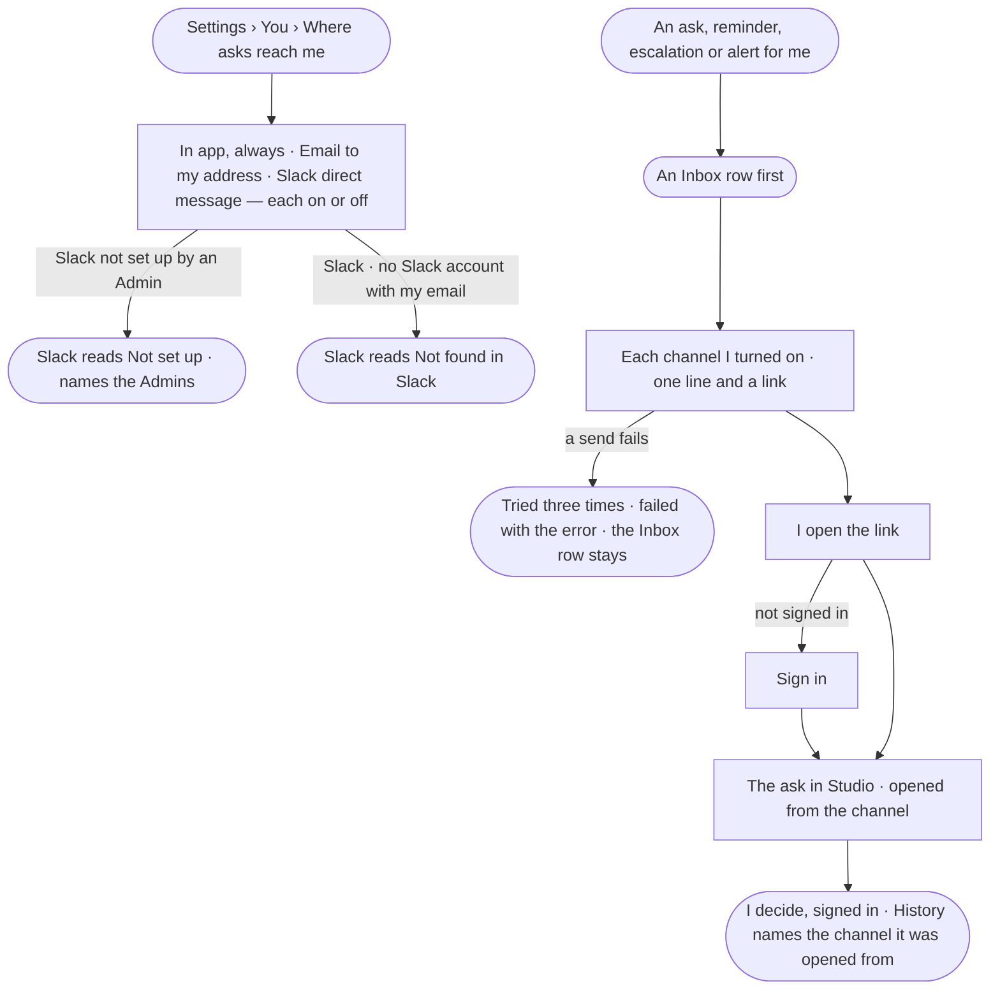

# CP-46 · Choose where my asks and alerts reach me

**As** a named approver or an agent's owner **I want** asks and alerts for me to reach me by email or a Slack message
as well as in the Inbox, and the link in each to take me straight to the decision
**so that** an agent waiting on me is not held because I was not in Studio, and every decision is still mine,
signed in, in History.

Tasks: [task.md](task.md) · Feature: [CP-F08](../../feature.md)

## Who can

| Lens | Can | Otherwise sees |
|---|---|---|
| Admin | Choose where their own asks and alerts reach them | — |
| Operator | Choose where their own asks and alerts reach them | Another person's choices are absent |

## Flow

## Acceptance criteria

| # | Given | When | Then |
|---|---|---|---|
| CP-46.1 | A person | they open *Where asks reach me* | *In app* reads always on; *Email* to their account address and *Slack direct message* read with a switch each, off at first |
| CP-46.2 | No Slack channel set up by an Admin | the page opens | *Slack direct message* reads *Not set up*, naming the Admins, with no switch |
| CP-46.3 | Slack set up, and the person's account email unknown to that Slack workspace | they turn Slack on | it reads *Not found in Slack*, and stays off |
| CP-46.4 | An ask routed to the person, a reminder, an escalation or an alert for them | it is raised | an Inbox row is written first, then one delivery to each channel they turned on (AC-F05) |
| CP-46.5 | A delivery | it reaches the person | it carries one line and a link to the ask or alert — never the ask's content (CP-45.8) |
| CP-46.6 | The link | the person opens it | the ask opens in Studio — after sign-in if needed — and records the channel it was opened from |
| CP-46.7 | An ask opened from a channel | the person decides | the decision is their signed-in act, as from the Inbox; History names the channel it was opened from (AC-F05) |
| CP-46.8 | A reply to a delivery, a reaction in Slack, or a button in a message | it is sent | nothing is decided; a channel never carries a decision |
| CP-46.9 | A channel that is down | a delivery is sent | it is tried three times, then reads *failed* with the error on the person's Inbox row; the Inbox row is there regardless |
| CP-46.10 | Another person's choices | anyone reads them by any path | they are absent (`404`) |

## Screens

| Surface | Lens | First use | Empty after a filter | Loading | Has data | Failed | Agent working or proposing | No access |
|---|---|---|---|---|---|---|---|---|
| Where asks reach me | Admin | settings.me · In app only | — | settings.me · Loading | settings.me · Where asks reach me | settings.me · Not found in Slack | — | — |
| Where asks reach me | Operator | settings.me · In app only | — | settings.me · Loading | settings.me · Where asks reach me | settings.me · Not found in Slack | — | — |
| An ask opened from a channel | Admin | — | — | inbox · Loading | inbox · Opened from a channel | inbox · Delivery failed | inbox · Ask waits | — |
| An ask opened from a channel | Operator | — | — | inbox · Loading | inbox · Opened from a channel | inbox · Delivery failed | inbox · Ask waits | inbox · Waits on someone else |
