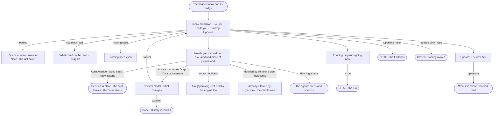

# CP-69 · Decide what needs me from the header

**As** anyone who uses Invana **I want** to see what needs me and decide the small things where I am, without leaving
my work **so that** an ask never waits because answering it meant a trip to another screen.

Tasks: [task.md](task.md) · Feature: [CP-F08](../../feature.md)

## Who can

| Access | Can | Otherwise sees |
|---|---|---|
| Admin | Open the Inbox dropdown; decide in place the asks routed to them; *Acknowledge* an alert sent to them; confirm an *Accept* that writes; open the Inbox | — |
| Operator | the same, on their own asks, alerts, project work and runs | An act they may not take reads *Ask {approver}*, naming who it waits on — and the engine refuses it ([AC-F05](../../../../../access/features/AC-F05-asks-and-approvals/feature.md#refusals)) |

## Flow

## Acceptance criteria

| # | Given | When | Then |
|---|---|---|---|
| CP-69.1 | Any screen | the person clicks the header *Inbox* | a 640 px dropdown opens anchored to it, with no scrim — Needs you · Running · Updates — and the work behind it stays usable |
| CP-69.2 | The dropdown open | the person clicks outside it or presses Esc | it closes and nothing moves |
| CP-69.3 | Asks, alerts and project work waiting on the reader | Needs you is read | each is a card holding enough to decide in place — a proposal's rows, a budget ask's meter of tokens used against its limit, a review's findings, an alert's facts — and its acts, in CP-36.4's order |
| CP-69.4 | A low-risk act — *Acknowledge* an alert, *Send back* a task in review with its note, *Allow tokens* on a budget ask | the person takes it on the card | it is decided in place, the card leaves Needs you, the count drops, and History records who and when |
| CP-69.5 | An *Accept* that writes Graph Data or the model | the person presses it | a confirm modal lists what changes — the records, kinds or properties — with *Confirm* and *Cancel*; nothing is written until *Confirm* |
| CP-69.6 | A budget ask | a person it is not routed to reads its card | *Ask {approver}* stands where *Allow tokens* would; a call that tries anyway is refused *This waits on {approvers}.* |
| CP-69.7 | An open alert sent to the reader | they press *Acknowledge* | everyone it reached reads *{person} is on it*; the alert stays open until the act its kind names closes it (CP-59) |
| CP-69.8 | An ask decided by someone else while the card is open | the person acts on it | it reads *Already allowed by {person} at {time}.* and the card leaves |
| CP-69.9 | A card for an agent's proposal or ask | the person opens *How it got here* | it shows the agent's steps and sources |
| CP-69.10 | The reader's runs going now | Running is read | each run with its agent, its step and its time, opening the run; workers, the queue and other people's runs are not here — they are Operations' (CP-70) |
| CP-69.11 | Updates | they are read | newest first, unread dotted; opening one goes to what it is about and marks it read |
| CP-69.12 | Nothing waits on the reader | the dropdown opens | Needs you reads *Nothing needs you*, as good news |
| CP-69.13 | The lists still loading | the dropdown opens | it opens at once, rows loading in place, the badge the last count read |
| CP-69.14 | The engine cannot read the Inbox | the dropdown opens | it says what it could not read, with *Try again* |
| CP-69.15 | The dropdown | the person picks *Open the Inbox* | the dropdown closes and the full Inbox opens in the large modal (CP-36.20) |
| CP-69.16 | An Operator | they read a card whose act needs another person | the act reads *Ask {approver}*, naming who it waits on |

## Screens

| Surface | Access | First use | Empty after a filter | Loading | Has data | Failed | Agent working or proposing | No access |
|---|---|---|---|---|---|---|---|---|
| The Inbox dropdown | Admin | inbox.dropdown · Nothing needs you | — | inbox.dropdown · Loading | inbox.dropdown | inbox.dropdown · Could not load | inbox.dropdown · A proposal | — |
| The Inbox dropdown | Operator | inbox.dropdown · Nothing needs you | — | inbox.dropdown · Loading | inbox.dropdown | inbox.dropdown · Could not load | inbox.dropdown · A proposal | inbox.dropdown · Ask an approver |
| Confirm what changes | Admin | — | — | — | inbox.dropdown · Confirm | inbox.dropdown · Confirm · Refused | — | — |
| Confirm what changes | Operator | — | — | — | inbox.dropdown · Confirm | inbox.dropdown · Confirm · Refused | — | — |
