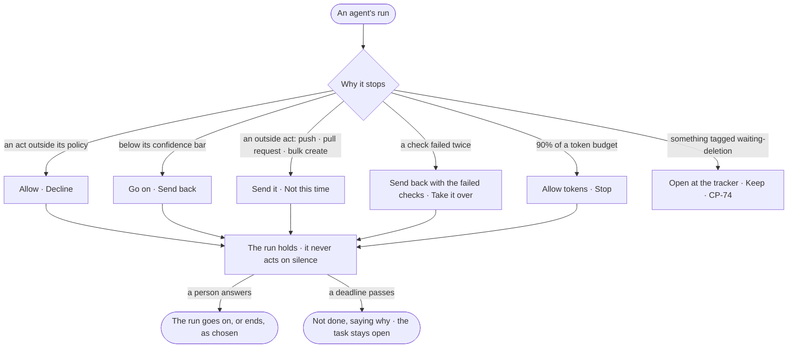

# CP-76 · See why an agent is waiting for me

**As** a person whose agents work in the background **I want** every reason an agent stops and waits to reach Needs you as one card saying what it wants and why **so that** an agent never acts outside its policy or on silence, and I answer in a click.

Tasks: [task.md](task.md) · Feature: [CP-F08](../../feature.md)

## Who can

| Access | Can | Otherwise sees |
|---|---|---|
| Admin | Decide any of these cards of an agent they may decide for (AC-F05); read the reason and the run behind it | — |
| Operator | The same for the agents they are the person behind or the named approver of | A card for someone else's agent is absent; the badge counts only theirs |

## Flow

## Acceptance criteria

| # | Given | When | Then |
|---|---|---|---|
| CP-76.1 | An agent whose act is outside its policy | it reaches that act | its run holds and a card reads *{agent} wants to {act} — outside its policy*, with *Allow* and *Decline* (AC-F05) |
| CP-76.2 | An agent with a confidence bar set on it ([AG-29.26](../../../../../../capabilities/agents/features/AG-F01-build-an-agent/stories/AG-29-tune-an-agents-voice-model-and-effort-and-retire-it/story.md)) | a step ends with a confidence below the bar | its run holds and a card reads what it is unsure of, with *Go on* and *Send back*; an agent with no bar never holds for confidence |
| CP-76.3 | An agent about to push, open a pull request or create more than 5 issues | it reaches that act | its run holds and a card shows exactly what will be sent or made, with *Send it* and *Not this time* |
| CP-76.4 | A task whose check failed twice | the second failure settles | a card names each failed check with *Send back with the failed checks* and *Take it over*; the agent does not try a third time |
| CP-76.5 | A run at 90% of its token budget | it passes 90% | a card shows used and left with *Allow tokens* and *Stop*; the run holds, never spends past its budget |
| CP-76.6 | A task tagged *waiting-deletion* | it is tagged | a card reads *{issue} waits for you to delete it* with *Open at the tracker* and *Keep* (CP-74) |
| CP-76.7 | Any such card | it is open | the run behind it holds and nothing happens on silence: at a deadline the act is not done and the task reads why |
| CP-76.8 | Any such card | a person decides it | it records who, what and when, and leaves Needs you for Done |
| CP-76.9 | A card | its *How it got here* is opened | it shows the run's steps, sources and the rule or number that stopped it |
| CP-76.10 | A person who is neither the person behind the run nor a named approver | they open the Inbox | the card is absent and a call to decide it is refused |
| CP-76.11 | A run that has read outside text (CP-73.17) | it would write at a tracker, ask or propose | its run holds and a card shows the exact text and the target, with *Send it* and *Not this time*, saying the run read outside text |

## Screens

| Surface | Access | First use | Empty after a filter | Loading | Has data | Failed | Agent working or proposing | No access |
|---|---|---|---|---|---|---|---|---|
| An agent waiting | Admin | inbox · Needs you · Nothing waiting | — | inbox · Needs you · Loading | inbox · Needs you · Agent waiting | inbox · Needs you · Could not load | inbox · Needs you · Agent waiting · Run held | — |
| An agent waiting | Operator | inbox · Needs you · Nothing waiting | — | inbox · Needs you · Loading | inbox · Needs you · Agent waiting | inbox · Needs you · Could not load | inbox · Needs you · Agent waiting · Run held | inbox · Needs you · Not mine |
| Decide in place | Admin | — | — | — | inbox.dropdown · Agent waiting | inbox.dropdown · Refused | — | — |
| Decide in place | Operator | — | — | — | inbox.dropdown · Agent waiting | inbox.dropdown · Refused | — | inbox.dropdown · Not mine |
