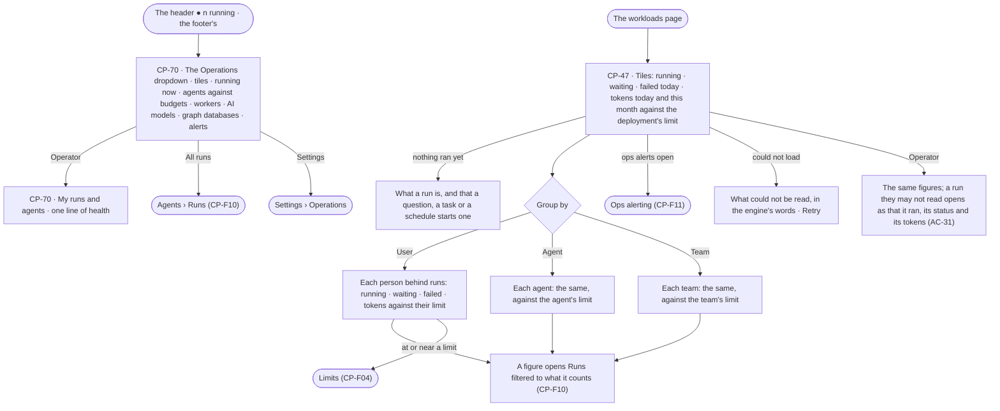

# Overview — Operations and workloads

> What the deployment is doing, at a glance from the header's *● n running*: runs going and queued, tokens against
> budgets, workers, AI models, graph databases and alerts — an Operator's own runs and agents with one line of health.
> Then the workloads page: runs going, waiting and failed, and tokens spent — grouped by the person behind each run,
> the agent and the team — each against its limit. The decision it helps make: *whose work is moving, whose is stuck
> or spending too much, and where do I look first?*

## User journey

Journeys this feature is a step of: [J08 · Watch agent workloads and act on an alert](../../../../journeys/J08-watch-agent-workloads-and-act-on-an-alert.md)

## Stories

| ID | Story | Status |
|---|---|---|
| CP-47 | [See workloads by user, agent and team](stories/CP-47-see-workloads-by-user-agent-and-team/story.md) | idea |
| CP-70 | [See what the deployment is doing from the header](stories/CP-70-see-what-the-deployment-is-doing-from-the-header/story.md) | idea |

## Access

The role × feature table is [AC-F02 › The role table](../../../access/features/AC-F02-access-policies/feature.md#the-role-table); this is what it means here.

| Act | Role | Everyone else sees |
|---|---|---|
| Read the overview — tiles, groups, open ops alerts | Operator · Modeller · Admin | — |
| Read the Operations dropdown on the deployment — every run, the queue, workers, AI models, graph databases, every agent's budget | Admin | Their own runs and the agents they own, and one line of system health |
| Open the runs behind a figure | Operator · Modeller · Admin; a run's content as [AC-31](../../../access/features/AC-F09-what-left-the-platform/stories/AC-31-keep-a-runs-content-to-those-who-may-read-it/story.md) | Content withheld, naming who may read it |
| Act from a figure — stop a run, change a limit | As [CP-F10](../CP-F10-runs-and-how-the-agents-are-doing/feature.md#access) and [CP-F04](../CP-F04-limits/feature.md#access) | As there |

## States

| State | What the person sees |
|---|---|
| First use | Tiles read `0` or `—`; *Nothing ran yet* and what starts a run |
| Empty after a filter | *No {user · agent · team} ran anything in {window}* · *Clear* |
| Loading | The tiles and the group switch drawn at once; rows fill in place |
| Has data | The tiles, then one row per user, agent or team, busiest first, each with its meters |
| Failed | What could not be read, in the engine's words, and *Retry* |
| Agent working or proposing | Running counts move as runs start and end, repainted at most once a second |
| No access | — every role reads the overview |

## Rules

| Rule | Detail |
|---|---|
| One reading of the runs | The overview counts the runs record ([CP-F10](../CP-F10-runs-and-how-the-agents-are-doing/feature.md#engine)); it stores nothing of its own |
| Group by | *User* — the person behind the run · *Agent* — the root run's agent · *Team* — each team the person behind was on when the run opened. A run counts once per team, so team rows may add up to more than the total, and the page says so |
| Windows | Today (the reader's day) · 7 · 30 days; *this month* is the limits' month |
| Each row against its limit | Tokens this month against the row's limit from [CP-F04](../CP-F04-limits/feature.md); a row with no limit reads *No limit*, never an empty meter |
| Every figure opens its runs | A count opens Runs filtered to that user, agent or team, that state and that window |
| Operations is a dropdown | The header's *● n running* and the footer's open it; it reads *Idle* with a grey dot when nothing runs and keeps its place. It links into Agents › Runs and Settings › Operations and is never a summoner |
| Only system state | Operations holds what the deployment is doing; what waits on a person is the Inbox's ([CP-F08](../CP-F08-the-inbox/feature.md)), counted here only as *needs a person* |
| Near a budget is the engine's | The engine marks an agent's meter `near_limit` at 80% or more of its budget; Studio colours it amber and computes nothing |
| Counts, never content | A row counts every run, including those the reader may not read; their content stays withheld ([AC-31](../../../access/features/AC-F09-what-left-the-platform/stories/AC-31-keep-a-runs-content-to-those-who-may-read-it/story.md)) |
| Open ops alerts | The number still open, by kind, opening [CP-F11](../CP-F11-ops-alerting/feature.md) |
| The engine counts | Every tile, count and meter is the engine's; Studio formats and derives nothing |
| Tokens, never currency | Every figure counts tokens ([glossary › Token budget](../../../../glossary.md#what-may-happen)) |
| Leans on | Runs (CP-F10) · Limits (CP-F04) · Ops alerting (CP-F11) · teams (AC-F03) · run privacy (AC-F09) |

## Data touched

| Record | Read or write |
|---|---|
| Runs — status, the person behind, agent, teams at open, tokens, times | Read |
| Limits per team, user and agent, and spend this month | Read |
| Open ops alerts | Read |
| Workers by group and the queue (CP-F03) · AI models and their ledger calls (CP-F01 · AC-F09) · graph database health (CP-F05) · asks waiting (AC-F05) | Read |

## Engine

The low-level design: what this feature stores, serves and refuses. Conventions — naming, errors, lists, events — are
[system-design.md](../../../../system-design.md) §§ 6–8; this section only fills them in.

### Records

| Table | Columns | Notes |
|---|---|---|
| — | — | Stores nothing; reads `control_runs` (with its `team_ids[]` written at open) and the limits |

### Reads

| Record | Owner |
|---|---|
| Runs, their per-run numbers and `team_ids[]` | [CP-F10](../CP-F10-runs-and-how-the-agents-are-doing/feature.md#engine) |
| Limits per team, user and agent, and spend this month | [CP-F04](../CP-F04-limits/feature.md#engine) |
| Open ops alerts | [CP-F11](../CP-F11-ops-alerting/feature.md#engine) |
| Teams and users | [AC-F03](../../../access/features/AC-F03-directory/feature.md#engine) |
| Worker groups, workers and their state, the queue and its oldest step | [CP-F03](../CP-F03-workers-and-the-queue/feature.md#engine) |
| AI model endpoints and pinned versions | [CP-F01](../CP-F01-ai-models/feature.md#engine) |
| Model calls with their outcome and timing — latency and error rate | [AC-F09](../../../access/features/AC-F09-what-left-the-platform/feature.md#engine) |
| Graph databases and their health | [CP-F05](../CP-F05-graph-databases/feature.md#engine) |
| Asks waiting on a person | [AC-F05](../../../access/features/AC-F05-asks-and-approvals/feature.md#engine) |
| Who may stop a run — `may_stop` | [CP-F10](../CP-F10-runs-and-how-the-agents-are-doing/feature.md#engine) |

### Routes

| Route, after `/api/v1/control` | Does | Story |
|---|---|---|
| `GET /overview?window=today·7d·30d&tz=` | `tiles` — `running` · `waiting` · `failed` · `tokens` · `tokens_this_month` · `monthly_tokens` (the deployment's limit, null when none) · `alerts_open` (by kind) | CP-47 |
| `GET /operations?tz=` | The Operations dropdown, scoped by role (below): `tiles` — `agents_running` · `agents_idle` · `tokens_today` · `tokens_this_month` · `monthly_tokens` · `needs_a_person` · `queue_waiting` · `queue_oldest_at` · `workers {busy, idle, draining}` · `ai_models {ok, failing}` · `graph_databases {healthy, unhealthy}`; `running[]` — `run_id` · `agent` · `behind` · `step` · `steps` · `tokens` · `started_at` · `worker_group` · `may_stop`; `queued[]` — `run_id` · `agent` · `behind` · `queued_at`; `agents[]` — `agent` · `running` · `tokens_today` · `tokens_this_month` · `monthly_tokens` (null — no limit) · `near_limit`; `worker_groups[]` — `name` · `busy` · `idle` · `draining`; `ai_models[]` — `endpoint` · `version` · `latency_p95_ms` · `error_rate` (last hour); `graph_databases[]` — `name` · `health`; `alerts[]` — open, then closed in the last 24 hours; `health_line` | CP-70 |
| `GET /overview/groups?by=user·agent·team&window=&tz=` | By the list contract, busiest first: `subject_kind` · `subject_id` · `name` · `running` · `waiting` · `failed` · `runs` · `tokens` · `tokens_this_month` · `monthly_tokens` (null — no limit) · `at_limit`; `team_overlap` true when `by=team` and a run counts under more than one team | CP-47 |

### Events

| Event | When |
|---|---|
| — | Reads only |

### Refusals

| Status | When | Sentence | Criterion |
|---|---|---|---|
| 422 | `window` or `by` outside the offered values | *{field}: one of {values}.* | API only — Studio offers the choices |

### CLI

| Command | Does |
|---|---|
| — | No command of its own |

### Mechanisms

| Mechanism | How |
|---|---|
| Counting | Root runs only, eval runs left out; `running` — queued or running · `waiting` — held on a person · `failed` — ended `failed` in the window, *cannot answer* not counted. Tokens are each run's stored `run_tokens`, helpers included |
| Teams at open | A run's `team_ids[]` is the person's teams when the run opened; a later team change never moves a past run |
| Spend this month | Read from CP-F04's month counters, never summed here |
| Live | Studio refreshes the tiles while open, repainting at most once a second |
| Operations by role | An Admin reads every section on the deployment. An Operator or a Modeller reads `running` and `queued` for runs they are behind, `agents` for agents they own, and `health_line`; the other sections are absent, never empty |
| The health line | One sentence the engine writes from workers, AI models and graph databases — *Workers, AI models and graph databases are healthy*, or the first that is not |
| AI model health | Latency p95 and error rate per endpoint and pinned exact version over the last hour, computed in the engine from the ledger's model calls; a version with no call in the hour is absent |
| Near a budget | `near_limit` is true at 80% or more of the agent's budget; the agent's budget is its *Tokens a month* ([CP-F04](../CP-F04-limits/feature.md)) |
| The header count | *● n running* reads `running` from the one counts source ([CP-F08](../CP-F08-the-inbox/feature.md#engine)), never this route |

## System impact

| HLD section | Change | NFRs |
|---|---|---|
| § 8 APIs and events | Two read routes under `/api/v1/control/overview` and the Operations read `/api/v1/control/operations` | NFR-PERF-7 |
| § 12 Qualities | Performance: grouped counts over the runs record answer within the read budget; cost in tokens only; every figure the engine's | NFR-PERF-3 · NFR-COST-2 · NFR-UX-2 |

## Decisions

| Decision | Detail |
|---|---|
| Operations is the header's glance | The deployment's state is one dropdown from every screen, never a page or a summoner; the workloads page is the depth behind it |
| An Operator sees their own | Their runs and agents in full; the deployment as one line of health |
| A run counts under each of its teams | Teams are flat and a person may be on several; splitting a run across them would invent a share nobody set |
| Everyone reads the counts | Counts and tokens are never content; who may read a run's content is [AC-31](../../../access/features/AC-F09-what-left-the-platform/stories/AC-31-keep-a-runs-content-to-those-who-may-read-it/story.md)'s |

## Open questions

| Question | Who answers |
|---|---|
| Where the workloads page (CP-47) opens from now that Overview is the Operations dropdown — recommend: *Workloads* under Settings › Operations, linked from the dropdown | Ravi |
| An agent's meter: the approved boards name a daily budget, and limits are monthly — recommend: meter against *Tokens a month*, tokens today printed beside it; no new daily limit | Ravi |

## Not building

| Item | Why not |
|---|---|
| Custom dashboards or charts | One page answering *whose work, and how much* beats a builder |
| A cost figure | Tokens only |
| A fifth summoner for Operations | It links into Agents › Runs and Settings › Operations |
| Grouping by graph database | A run may cross several; Runs filters by graph database instead (CP-F10) |
| Acting on many runs at once | Stopping is one run at a time, from the run (CP-58) |
