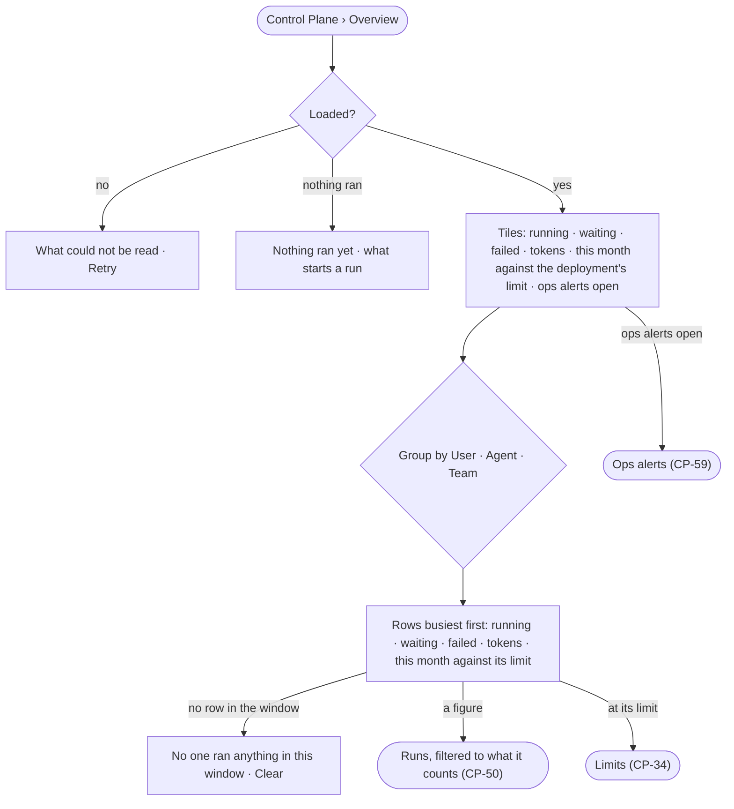

# CP-47 · See workloads by user, agent and team

**As** an Admin **I want** to see what every agent is doing — runs going, waiting and failed, and tokens spent —
grouped by the person behind each run, by agent and by team, each against its limit **so that** I know whose work is
stuck or spending too much before anyone has to tell me.

Tasks: [task.md](task.md) · Feature: [CP-F09](../../feature.md)

## Who can

| Lens | Can | Otherwise sees |
|---|---|---|
| Admin | Read the overview; open the runs behind any figure and read them in full | — |
| Operator | Read the same overview and open the runs behind a figure | A run they are not behind and whose agent they do not own opens as that it ran, its status and its tokens — content *withheld* (AC-31) |

## Flow

## Acceptance criteria

| # | Given | When | Then |
|---|---|---|---|
| CP-47.1 | Runs in the deployment | the overview opens | tiles read running · waiting · failed today · tokens today · tokens this month against the deployment's limit · ops alerts open, each as the engine counted it |
| CP-47.2 | The overview | *Group by* is set to User, Agent or Team | one row per person behind a run, agent or team, busiest first, each with running · waiting · failed · tokens · this month against its limit |
| CP-47.3 | A person on two teams behind a run | grouped by Team | the run counts under both teams, and the page reads *A run counts under each team of the person behind it* |
| CP-47.4 | A row with no limit set | it is read | its meter reads *No limit* |
| CP-47.5 | A row at or past its limit | it is read | its meter is marked at the limit and opens Limits for that team, user or agent |
| CP-47.6 | Any count | it is selected | Runs opens filtered to that user, agent or team, that state and that window |
| CP-47.7 | A run of the counts the reader may not read | they open it from a figure | it reads that it ran, its agent, the person behind it, its status and its tokens; its content is withheld (AC-31.2) |
| CP-47.8 | No run yet | the overview opens | tiles read `0` or `—` and *Nothing ran yet — a question, a task or a schedule starts a run* |
| CP-47.9 | A window in which nobody ran anything | the rows are read | *No one ran anything in {window}* and *Clear* |
| CP-47.10 | The read fails | the overview opens | what could not be read, in the engine's words, and *Retry* |
| CP-47.11 | Runs start and end while it is open | the tiles are read | the counts move in place, at most once a second |
| CP-47.12 | Any figure | it is read | it is in tokens or a count; no cost is shown |

## Screens

| Surface | Lens | First use | Empty after a filter | Loading | Has data | Failed | Agent working or proposing | No access |
|---|---|---|---|---|---|---|---|---|
| Overview | Admin | control.overview · Nothing ran yet | control.overview · No one ran | control.overview · Loading | control.overview | control.overview · Could not load | control.overview · Live | — |
| Overview | Operator | control.overview · Nothing ran yet | control.overview · No one ran | control.overview · Loading | control.overview | control.overview · Could not load | control.overview · Live | — |
