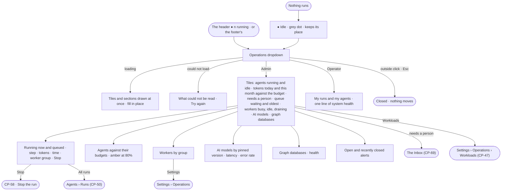

# CP-70 · See what the deployment is doing from the header

**As** an Admin **I want** one glance from any screen at what runs, what waits, what it spends against its budgets and
whether workers, AI models and graph databases are well **so that** I see trouble before anyone tells me, without
leaving my work.

Tasks: [task.md](task.md) · Feature: [CP-F09](../../feature.md)

## Who can

| Lens | Can | Otherwise sees |
|---|---|---|
| Admin | Open the Operations dropdown on the deployment: every tile and section; *Stop* a run as [CP-58](../../../CP-F10-runs-and-how-the-agents-are-doing/stories/CP-58-stop-a-run-that-should-not-go-on/story.md) allows; follow its links | — |
| Operator | Operator · Modeller: open it on their own runs and the agents they own, with one line of system health; *Stop* their own runs | Workers, AI models, graph databases, the queue and other people's runs are not listed — the one health line stands for them |

## Flow

## Acceptance criteria

| # | Given | When | Then |
|---|---|---|---|
| CP-70.1 | Runs going | the header is read | it reads *● n running*, the engine's count, live; the footer reads the same |
| CP-70.2 | Nothing running | the header is read | it reads *Idle* with a grey dot and keeps its place |
| CP-70.3 | Any screen | the person clicks *● n running* in the header or the footer | the Operations dropdown opens anchored to it, no scrim; outside click or Esc closes it |
| CP-70.4 | An Admin | the dropdown opens | tiles read agents running and idle · tokens today and this month against the deployment's budget · needs a person · queue waiting and the oldest · workers busy, idle and draining · AI models · graph databases — each as the engine counted it |
| CP-70.5 | Runs going or queued | *Running now* is read | each run with its agent, the person behind it, its step of its steps, tokens, time and worker group, and *Stop* where the reader may stop it; queued runs below, with how long each has waited |
| CP-70.6 | Agents with a budget | the agents section is read | each agent's tokens today and its meter of tokens against its budget; a meter at 80% or more is amber, as the engine marks it; an agent with no limit reads *No limit* |
| CP-70.7 | Worker groups | the workers section is read | each group with its workers busy, idle and draining |
| CP-70.8 | AI models | the section is read | each pinned exact version with its latency and error rate over the last hour, as the engine computed them |
| CP-70.9 | Graph databases | the section is read | each with its health ([CP-40](../../../CP-F05-graph-databases/stories/CP-40-see-every-graph-database-and-its-health/story.md)) |
| CP-70.10 | Alerts | the section is read | open alerts, then those closed in the last day, each opening its alert (CP-59) |
| CP-70.11 | *Needs a person* above zero | the person picks it | the Inbox dropdown opens (CP-69); the asks themselves stay in the Inbox |
| CP-70.12 | The dropdown | the person follows *All runs*, *Workloads* or *Settings* | Agents › Runs (CP-50), Settings › Operations › Workloads (CP-47) or Settings › Operations opens; Operations is never a summoner of its own |
| CP-70.13 | An Operator | the dropdown opens | it lists their own runs and the agents they own, and one line of system health — *Workers, AI models and graph databases are healthy* or what is not |
| CP-70.14 | Any figure | it is read | it is a count or tokens — never currency |
| CP-70.15 | Runs start and end while it is open | it is read | the figures move in place, at most once a second |
| CP-70.16 | The read fails | the dropdown opens | it says what could not be read, in the engine's words, with *Try again* |
| CP-70.17 | A run the reader may not read | it is listed for an Admin | its agent, the person behind it, its status and tokens read; its content stays withheld (AC-31) |

## Screens

| Surface | Lens | First use | Empty after a filter | Loading | Has data | Failed | Agent working or proposing | No access |
|---|---|---|---|---|---|---|---|---|
| *● n running* | Admin | shell.operations · Idle | — | — | shell.operations | — | shell.operations | — |
| *● n running* | Operator | shell.operations · Idle | — | — | shell.operations · Operator | — | shell.operations · Operator | — |
| The Operations dropdown | Admin | shell.operations · Nothing ran yet | — | shell.operations · Loading | shell.operations | shell.operations · Could not load | shell.operations · Near a budget | — |
| The Operations dropdown | Operator | shell.operations · Operator · Nothing ran yet | — | shell.operations · Loading | shell.operations · Operator | shell.operations · Could not load | shell.operations · Operator | shell.operations · Operator |
