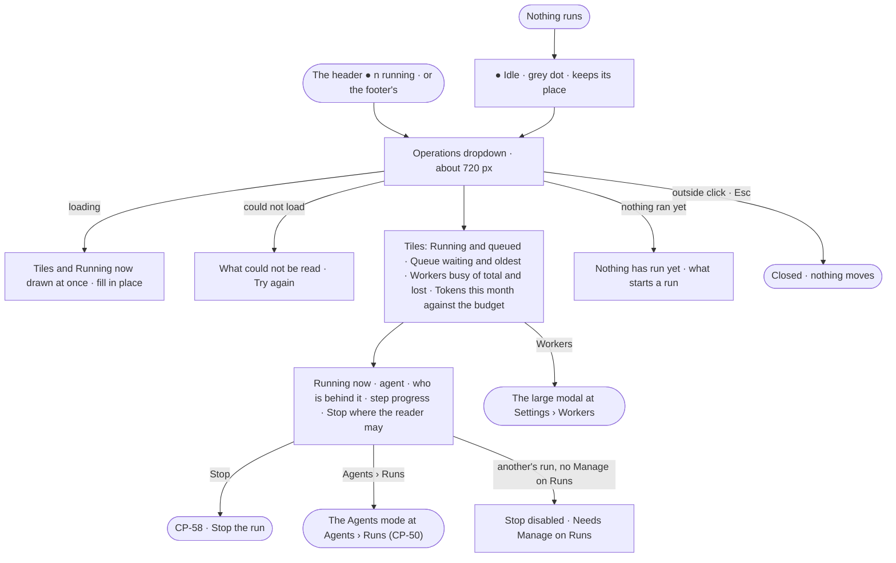

# CP-70 · See what the deployment is doing from the header

**As** an Admin **I want** one glance from any screen at what runs, what waits, whether the workers keep up and where
this month's tokens stand against the budget **so that** I see trouble before anyone tells me, without leaving my work.

Tasks: [task.md](task.md) · Feature: [CP-F09](../../feature.md)

## Who can

| Lens | Can | Otherwise sees |
|---|---|---|
| Admin | Open the Operations dropdown on the deployment: every tile and every run going; *Stop* any run as [CP-58](../../../CP-F10-runs-and-how-the-agents-are-doing/stories/CP-58-stop-a-run-that-should-not-go-on/story.md) allows — Manage on Runs; follow its links | — |
| Operator | Operator · Modeller: the same dropdown — every tile, every run going and both links; *Stop* the runs they are behind | *Stop* on another's run is disabled — *Needs Manage on Runs*; what each link opens responds to their policies there |

## Flow

## Acceptance criteria

| # | Given | When | Then |
|---|---|---|---|
| CP-70.1 | Runs going | the header is read | it reads *● n running*, the engine's count, live; the footer reads the same |
| CP-70.2 | Nothing running | the header is read | it reads *Idle* with a grey dot and keeps its place |
| CP-70.3 | Any screen | the person clicks *● n running* in the header or the footer | the Operations dropdown opens anchored to it, about 720 px wide, no scrim; outside click or Esc closes it |
| CP-70.4 | Anyone signed in | the dropdown opens | four tiles read *Running* with how many are queued · *Queue* — waiting, and how long the oldest has waited · *Workers* — busy of total, and how many are lost · *Tokens this month* against the deployment's budget — each as the engine counted it |
| CP-70.5 | Runs going | *Running now* is read | each run with its agent, the person behind it, its step progress — step *n of m* — and *Stop* where the reader may stop it — the runs they are behind, or every run with Manage on Runs |
| CP-70.6 | A run in *Running now* | the reader presses *Stop* | it stops as CP-58 says; the run leaves the list and the tiles move |
| CP-70.7 | No monthly budget set | the *Tokens this month* tile is read | it reads the month's tokens and *No limit* |
| CP-70.8 | The dropdown | the reader follows *Agents › Runs* or *Workers* | the Agents mode opens at Agents › Runs (CP-50), or the large modal at Settings › Workers; Operations is never a summoner of its own |
| CP-70.9 | The dropdown | an Admin looks for agents against their budgets, workers by group, AI models, graph databases or alerts | none is in the dropdown; each is read where it lives — Agents › Agents, Settings › Workers and Settings › Workers › Alerts in the large modal, Settings › Connections in the large modal — and the dropdown stays a quick overview |
| CP-70.10 | The dropdown | an Admin wants to add workers, change a limit, tune an alert or drain a worker | none is offered in place; *Workers* opens Settings › Workers in the large modal, where the act is taken — *Stop* on a run is the dropdown's one act |
| CP-70.11 | A person without Manage on Runs | the dropdown opens | it reads the same tiles, runs and links as anyone's; *Stop* is offered on the runs they are behind and disabled on another's — *Needs Manage on Runs*; nothing is hidden by policy |
| CP-70.12 | Any figure | it is read | it is a count or tokens — never currency |
| CP-70.13 | Runs start and end while it is open | it is read | the figures move in place, at most once a second |
| CP-70.14 | The read fails | the dropdown opens | it says what could not be read, in the engine's words, with *Try again* |
| CP-70.15 | A run the reader may not read | it is listed for an Admin | its agent, the person behind it and its step progress read; its content stays withheld (AC-31) |
| CP-70.16 | Nothing has ever run | the dropdown opens | the tiles read their counts, and *Running now* says nothing has run yet and that a question, a task or a schedule starts a run |

## Screens

| Surface | Lens | First use | Empty after a filter | Loading | Has data | Failed | Agent working or proposing | No access |
|---|---|---|---|---|---|---|---|---|
| *● n running* | Admin | shell.operations · Idle | — | — | shell.operations | — | shell.operations | — |
| *● n running* | Operator | shell.operations · Idle | — | — | shell.operations · Operator | — | shell.operations · Operator | — |
| The Operations dropdown | Admin | shell.operations · Nothing ran yet | — | shell.operations · Loading | shell.operations | shell.operations · Could not load | shell.operations · Stop | — |
| The Operations dropdown | Operator | shell.operations · Operator · Nothing ran yet | — | shell.operations · Loading | shell.operations · Operator | shell.operations · Could not load | shell.operations · Operator | shell.operations · Operator |
