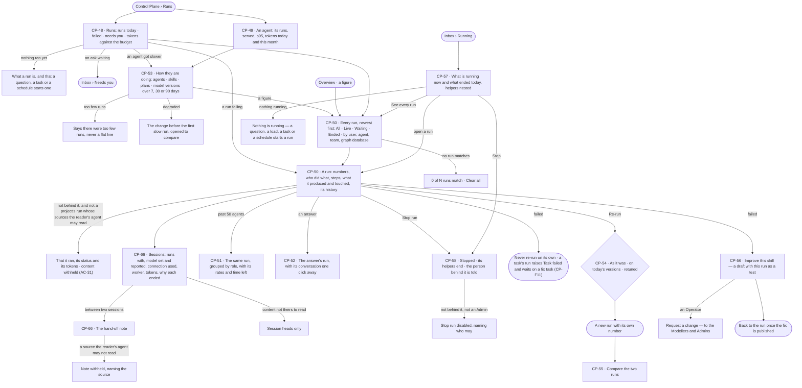
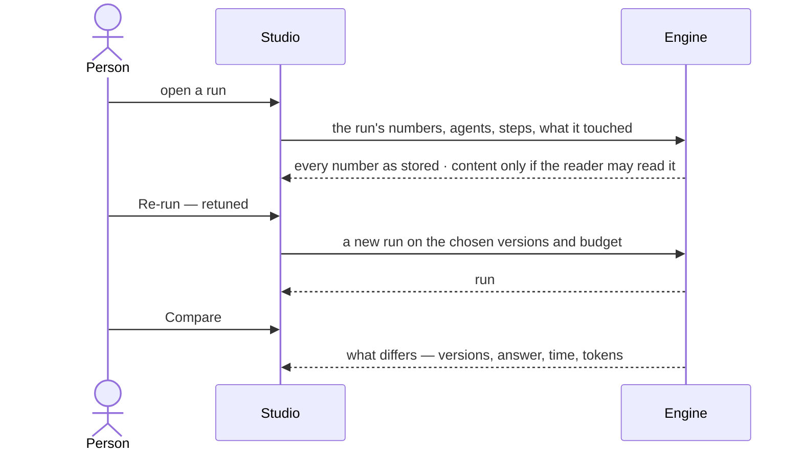
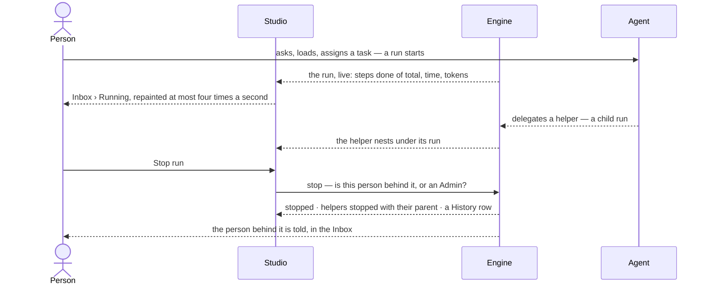
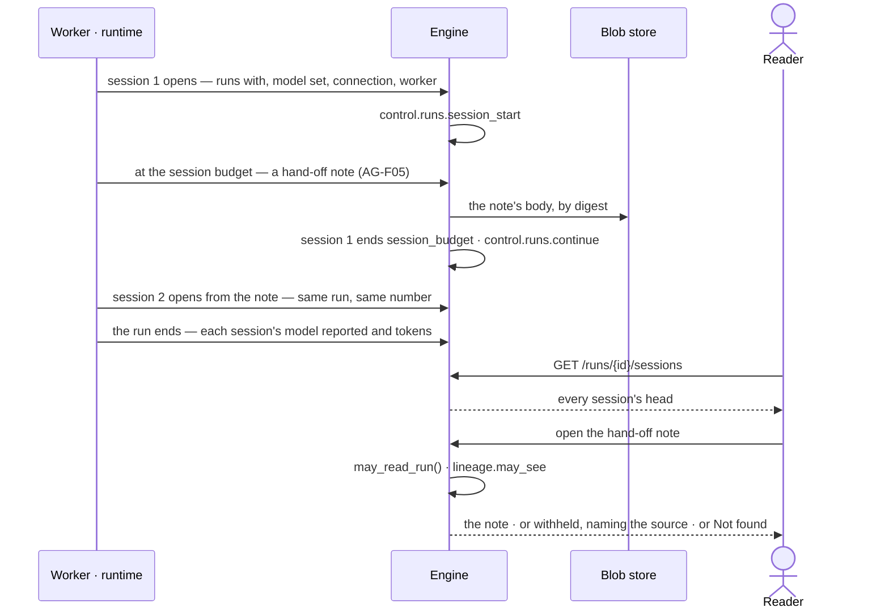

# Runs and how the agents are doing

> Every run in the deployment in one list and read one way, at any size — its numbers, who did what, each step's input
> and output, what it produced and touched, and its sessions: what each ran with, the model set and the model reported,
> the connection it used and the hand-off note between two — filterable by the person behind it, the agent, the team
> and the graph database; every agent, skill, plan and model version against its own baseline, with the change that
> made it worse named; and a run that should not go on, stopped. The decisions it helps make: *does anything need me
> now, is this agent getting worse, did this run go on as it should, should it go on, and is it worth re-running,
> comparing or turning into a better skill?*

## User journey

Journeys this feature is a step of: [J04 · Build an agent and improve it from what runs teach](../../../../journeys/J04-build-an-agent-and-improve-it-from-what-runs-teach.md) ·
[J08 · Watch agent workloads and act on an alert](../../../../journeys/J08-watch-agent-workloads-and-act-on-an-alert.md)

## Stories

| ID | Story | Status |
|---|---|---|
| CP-48 | [See what needs me across every agent](stories/CP-48-see-what-needs-me-across-every-agent/story.md) | idea |
| CP-49 | [Read how one agent is doing](stories/CP-49-read-how-one-agent-is-doing/story.md) | idea |
| CP-53 | [See what got worse and the change that did it](stories/CP-53-see-what-got-worse-and-the-change-that-did-it/story.md) | idea |
| CP-50 | [Find a run and see where it stands](stories/CP-50-find-a-run-and-see-where-it-stands/story.md) | idea |
| CP-66 | [Read a run session by session with its hand-off notes](stories/CP-66-read-a-run-session-by-session-with-its-hand-off-notes/story.md) | idea |
| CP-58 | [Stop a run that should not go on](stories/CP-58-stop-a-run-that-should-not-go-on/story.md) | idea |
| CP-51 | [Read a run of hundreds of agents like any run](stories/CP-51-read-a-run-of-hundreds-of-agents-like-any-run/story.md) | idea |
| CP-52 | [Read an answer's run like any run](stories/CP-52-read-an-answers-run-like-any-run/story.md) | idea |
| CP-54 | [Re-run a run as it was, or retuned](stories/CP-54-re-run-a-run-as-it-was-or-retuned/story.md) | idea |
| CP-55 | [Compare two runs of one question](stories/CP-55-compare-two-runs-of-one-question/story.md) | idea |
| CP-56 | [Turn a failed run into a better skill](stories/CP-56-turn-a-failed-run-into-a-better-skill/story.md) | idea |
| CP-57 | [See what is running and what just ran](stories/CP-57-see-what-is-running-and-what-just-ran/story.md) | idea |

## Access

The role × feature table is [AC-F02 › The role table](../../../access/features/AC-F02-access-policies/feature.md#the-role-table)
(*Runs — read, stop and re-run*: Operator Own · Modeller Own · Admin Acts); this is what it means here. Who reads a
run's content is [AC-31](../../../access/features/AC-F09-what-left-the-platform/stories/AC-31-keep-a-runs-content-to-those-who-may-read-it/story.md)'s, never restated.

| Act | Role | Everyone else sees |
|---|---|---|
| List every run; read how every agent, skill, plan and model version is doing | Operator · Modeller · Admin | — |
| Read a run's sessions — each one's head: runs with, model set and reported, connection used, worker, tokens, why it ended | Operator · Modeller · Admin, on every run they may list | — |
| Read a run's content — steps, queries, records, what it sent, its answer | As [AC-31](../../../access/features/AC-F09-what-left-the-platform/stories/AC-31-keep-a-runs-content-to-those-who-may-read-it/story.md): the person behind it; for a project's run, anyone whose default agent may read its sources. The Admin role adds nothing | That it ran, its agent, the person behind it, its status, its tokens and its session heads; content *withheld*, naming who may read it |
| Read a hand-off note's body | Whoever may read the run's content, when `lineage.may_see` is true for the note ([GP-F02](../../../graph/features/GP-F02-memory/feature.md#engine)) | The note's head — between which sessions, when, its tokens; its body *withheld*, naming the first source the reader's agent may not read |
| Open the conversation behind an answer's run | The person who asked | The run reads; *Open the conversation* is absent |
| Stop a run | The person behind it (Own) · Admin (Acts) | *Stop run* disabled, naming who may stop it |
| Re-run a run — as it was, on today's versions, or retuned | The person behind it (Own) · Admin (Acts) | *Re-run* disabled, naming who may |
| Compare two runs | Whoever may read both runs' content | *Compare* disabled, naming the run they may not read |
| Improve this skill from a run | Modeller · Admin, through an agent granted to them | An Operator: *Request a change* in its place, sent to the Modellers and the Admins |
| Answer an ask a run waits on | Whoever the ask is routed to ([AC-F05](../../../access/features/AC-F05-asks-and-approvals/feature.md)) | The ask reads, with who it waits on |

## States

| State | What the person sees |
|---|---|
| First use | Nothing ran: tiles read `0` or `—`, *Nothing ran in the last 30 days*, and what a run is — a question, a task or a schedule starts one |
| Empty after a filter | *0 of N runs match*, the filters named as chips, *Clear all* |
| Loading | The head and its acts drawn at once; the body loads in place |
| Has data | Tiles against the window before, the runs list, a run's sheet with its sessions and hand-off notes, each agent's and skill's numbers |
| Failed | What could not be read, in the engine's words; a refused act names why; a session that failed names why it ended |
| Agent working or proposing | A run in flight: *running*, time so far, its agents and steps filling in, its current session counting tokens against the session budget, refreshed every few seconds; a run continuing reads *continuing in session {n}* |
| No access | A run whose content the reader may not read shows that it ran, its status, its tokens and its session heads, with its content and hand-off notes withheld; acts they may not take are disabled, naming who may |

## Rules

| Rule | Detail |
|---|---|
| One runs list | Control Plane › Runs lists every run in the deployment; an agent's runs, a person's runs, a team's runs, a graph database's runs and a schedule's runs are that list, filtered |
| A run has a number | `#2291` is how people quote a run; numbered for the deployment, never reused; a helper's run and a step carry none |
| Its status is why it ended | Once ended, a run reads its reason: served · cannot answer · out of tokens · out of time · out of steps · no progress · loop · stopped with its parent · stopped · refused · failed. Running reads *running*; held on a person, *waiting* |
| From | Where a run started, in the reader's words: Ask · Task · Schedule · Project · API |
| The person behind it | A run names the person behind it — who asked, the key's owner, the person who assigned its task, or the person a delegation runs for. A run a schedule or a pick-up started has no person behind it: it runs as its agent and names who set the schedule or the pick-up |
| Teams at open | A run records the teams of the person behind it when it opened; filtering by team reads that, never today's teams |
| Graph databases touched | A run records each graph database it read or wrote; filtering by graph database reads that |
| One run, read one way | The same parts for one agent, nine or seven hundred; past 50 agents the numbers read as rates and agents group by role |
| Content is not listing | Every run is listed for everyone; its content opens only for those [AC-31](../../../access/features/AC-F09-what-left-the-platform/stories/AC-31-keep-a-runs-content-to-those-who-may-read-it/story.md) names |
| Who stops | The person behind a run and the Admins; a run with no person behind it is stopped by an Admin |
| A run is one or more sessions | Each session is one stretch of the run in one fresh context on its runtime, numbered *Session 1, 2 …*; a run read whole sums its sessions |
| Continuation keeps the run | At its session budget ([CP-F04](../CP-F04-limits/feature.md)) a run continues in a fresh session from a hand-off note ([AG-F05](../../../../capabilities/agents/features/AG-F05-delegation-and-outside-agents/feature.md)) — the same run, the same number, its cursor where it was. Reaching the session budget is never an ask and never why a run ended |
| Fork is a new run | A run forked from a hand-off note is a run of its own with its own number; the note names the run it started, and that run names the note ([AG-F05](../../../../capabilities/agents/features/AG-F05-delegation-and-outside-agents/feature.md)) |
| Runs with | Each session names what it ran with — Invana · Claude Code · Codex — and its version |
| Model set and reported | Each session reads the model the agent is pinned to (*set*) and the one the runtime said it ran on (*reported*); a difference is marked; a runtime that reported none reads `—` |
| The connection used | Each session names the connection it signed in with — *work* or *personal*, by name — never a secret; a session that used none reads `—` |
| A hand-off note opens between two sessions | Its body is a copy: it reads only to whoever may read the run's content, and only as far as `lineage.may_see` allows ([GP-F02](../../../graph/features/GP-F02-memory/feature.md#engine)) |
| A failed run is not re-run on its own | Nothing re-runs a failed run or a failed task; a task's failure raises *Task failed* and waits on a fix task ([CP-F11](../CP-F11-ops-alerting/feature.md#the-alert-kinds)). Re-running is a person's act ([CP-54](stories/CP-54-re-run-a-run-as-it-was-or-retuned/story.md)) |
| Cannot-answer is not a failure | Counted on its own, never inside *failed* |
| Run time is what a person waits | From queued to finished; a run still going has none |
| Baselines | A subject's numbers are read against the same window before; degraded is its last 3 runs each slower than 1.5× its 7-day p95, with at least 5 runs in that baseline; failing is 2 or more latest runs failed, and outranks degraded |
| The change named | The newest agent or skill version published inside the baseline before the first slow run; none named when there is none |
| Every figure opens its runs | A tile, a row or a bar opens Runs filtered to what it counts |
| Runs filters | Status · person behind it · agent · team · graph database · task · kind · where it started · since (24 hours · 7 · 30 · 90 days) · why it ended (and *not served*) · never approved into a workflow · interactive runs shown; the tabs All · Live · Waiting · Ended are the state filter — live is queued or running, waiting is held on a person |
| Too few runs is said | A subject with too few runs reads so, never as a flat line |
| Tokens, never currency | Every tile, meter and row counts tokens ([glossary › Token budget](../../../../glossary.md#what-may-happen)) |
| A number not recorded is `—` | Never `0` |
| The engine counts | Every tile, rate, percentile, change and time left is the engine's; Studio formats them and derives nothing |
| An ended run holds no asks | Its pending asks close as expired and leave *Needs you* |
| Stop is the run's one write | *Stop run* is the only act that changes a run; re-running makes a new run |
| Stopping tells | The person behind a stopped run, when someone else stopped it, is told in the Inbox, naming who stopped it |
| One journal | There is one record of runs in the deployment. Control Plane › Runs is the full list; the Overview (CP-F09), Inbox › Running and Done and a load's history are readings of it — never a second record |
| Running is not History | A run is what executed — how it ended, what it spent; a History row is what a person or an agent did — who, on whose behalf. Neither is drawn from the other |
| Everything that runs is a run | A question, a typed query, a load, a link between models, an enrichment, a planner and a checker are each a run; a step is never a run of its own in a list |
| Helpers nest | A helper an agent delegated to, or a part a step fanned out, sits under the run that started it, never as a sibling; past the second level it collapses, showing how many it holds |
| A chain shows its worst | A run still going whose helper already failed shows that beside its own status; neither hides the other |
| Tokens add up the chain | A run's tokens include what its helpers spent |
| Interaction is hidden | Expanding a node on a board and a provider check are runs too, hidden unless *Show interactive runs* is on |
| A row leads with what was asked | The question as typed, the query, or the file and the graph database it loads into — then the agent, how far (*steps 4 of 9*, never a percentage), time so far, tokens; a row whose content the reader may not read leads with its agent and *withheld* |
| Live, but still | A run in flight updates in place and keeps its place in the order; a run that starts while the list is open joins the top; the list repaints at most four times a second |
| Leans on | Build an agent and its runtime (AG-F01) · skills and their tests (AG-F04) · helpers, delegation, hand-off notes and forks (AG-F05) · runtime plugins and connections (CP-F02) · workers, workspaces and the sandbox (CP-F03) · the session budget (CP-F04) · the Inbox (CP-F08) · ops alerts (CP-F11) · run privacy and the ledger (AC-F09) · History (AC-F06) · lineage (GP-F02) · the answer and *How it got here* (EX-F04) |

## Data touched

| Record | Read or write |
|---|---|
| Runs — number, agent, origin, the person behind it, teams at open, graph databases touched, agents used, tokens, time, why it ended | Read |
| A run's steps, helpers, what it produced and what it touched | Read |
| A run's sessions — runs with, model set and reported, connection used, worker, workspace, tokens, why each ended | Write (by the runtime) · read |
| Hand-off notes between sessions (AG-F05), through lineage (GP-F02) | Read |
| Connections and runtime plugins (CP-F02) · workers, workspaces and sandbox refusals (CP-F03) | Read |
| Per-run numbers stored when a run settles — run time, tokens, served | Read |
| Agent, skill and plan versions, with when they were published | Read |
| A re-run — the run it repeats, the versions and budget it used | Write |
| Stop — the run, each helper's reason, who stopped it | Write |
| A skill draft with a run added as a test (AG-F04) | Write |
| History rows of a run (AC-F06) | Read |

## Engine

The low-level design: what this feature stores, serves and refuses. Conventions — naming, errors, lists, events — are
[system-design.md](../../../../system-design.md) §§ 6–8; this section only fills them in.

### Records

| Table | Columns | Notes |
|---|---|---|
| `control_runs` | `number?` · `parent_run_id?` · `todo_id?` · `plan_id` · `task_id?` (the plan step a child row runs) · `task_key?` (its function) · `step_key?` (its plan step's key) · `agent_id?` · `agent_version` · `model_version` · `ontology_version` · `role` (`plan` · `execute` · `evaluate`) · `plan_snapshot` · `plan_revision` · `plan_origin` (`template:<key>@<v>` · `generated`) · `triggered_by` (`user` · `schedule` · `task` · `delegation` · `automation` · `canvas` · `mcp` · `system`) · `author_kind` · `author_id` · `on_behalf_of_user_id?` (the person behind it; none for a schedule's or a pick-up's run) · `team_ids[]` (their teams at open) · `graph_databases[]` (each one read or written) · `session_id?` · `lane` · `iteration` · `attempt` · `status` · `outcome` · `exit_reason` · `stopped_by_id?` · `cursor` · `args` · `input` · `output` · `result` · `error` · `idem_key` · `trace_id` · `queued_at` · `started_at` · `finished_at` · `queue_ms` · `work_ms` · `ask_ms` · `wait_ms` · `duration_ms` · `tokens_in` · `tokens_out` · `run_tokens_in` · `run_tokens_out` · `run_tokens` · `steps_done` · `steps_total` · `replans` · `clarifications` · `escrow_tokens` · `escrow_returned` · `skills_offered[]` · `skills_applied[]` · `rules_offered[]` · `rules_cited[]` · `rerun_of_run_id?` | One table for every run and every step: a root has no `parent_run_id` and a `number` for the deployment, never reused; a step, a lane, an iteration and an attempt are rows under it — (`parent_run_id`, `task_id`, `lane`, `iteration`, `attempt`) unique. Every number is written when its fact settles |
| `control_run_sessions` | `run_id` · `seq` (1, 2, …) · `runtime` (`invana` · `claude_code` · `codex`) · `runtime_version` · `model_set` (the agent's pin) · `model_reported?` (what the runtime said it ran on) · `connection_kind?` (`work` · `personal`) · `connection_id?` · `worker_id?` · `workspace_id?` · `started_at` · `ended_at?` · `ended_because?` (`finished` · `session_budget` · `stopped` · `failed` · `refused`) · `tokens_in` · `tokens_out` · `handoff_in_id?` · `handoff_out_id?` | One row per session of a root run; (`run_id`, `seq`) unique. `handoff_in_id` and `handoff_out_id` are [AG-F05](../../../../capabilities/agents/features/AG-F05-delegation-and-outside-agents/feature.md#engine)'s `agents_handoff_notes`; `connection_id` a [CP-F02](../CP-F02-plugins-and-outside-tools/feature.md#engine) connection; `worker_id` and `workspace_id` [CP-F03](../CP-F03-workers-and-the-queue/feature.md#engine)'s |
| `control_run_stream` | `seq` (the resume cursor) · `run_id` · `ts` · `frame_type` · `payload` | A run's frames in order, for the live sheet and Running |
| `control_run_prompts` | `run_id` · `task_id` · `kind` (`clarification` · `approval` · `verdict`) · `question` · `options` · `deadline_s?` · `answered_by_kind?` · `answered_by_id?` · `answer?` · `answered_at?` | A question a run asks and its answer. A verdict may be answered by an agent or a person; an approval only by a person |
| `control_run_artifacts` | `run_id` · `task_id` · `key` · `media_type` · `size_bytes` · `digest` (sha256) · `uri` | What a run produced, addressed by digest in the blob store; the run row carries the digest, never the payload |

### Reads

| Record | Owner |
|---|---|
| The agent, its version, its runtime (`agents.runtime`), its model pin (`model_version`), budget and effort | [AG-F01](../../../../capabilities/agents/features/AG-F01-build-an-agent/feature.md#engine) |
| Limits a run is admitted against, the `budget` ask at a ceiling, and the session budget (`tokens_per_session`) | [CP-F04](../CP-F04-limits/feature.md#engine) |
| Plans, their steps and the check; `plan_origin`'s key; a function's `bound` and `layer` | [AG-F06](../../../../capabilities/agents/features/AG-F06-plans-and-workflows/feature.md#engine) |
| Skill versions, who made them and their eval runs (`params` · `result.eval`), left out of every number here | [AG-F04](../../../../capabilities/agents/features/AG-F04-skills/feature.md#engine) |
| Helpers, escrow and the caller chain · hand-off notes (`agents_handoff_notes`) and forks | [AG-F05](../../../../capabilities/agents/features/AG-F05-delegation-and-outside-agents/feature.md#engine) |
| Connections, work and personal, by name · runtime plugins and their versions | [CP-F02](../CP-F02-plugins-and-outside-tools/feature.md#engine) |
| Lineage of a hand-off note — `lineage.may_see` | [GP-F02](../../../graph/features/GP-F02-memory/feature.md#engine) |
| The schedule and firing a run opened from | [AG-F07](../../../../capabilities/agents/features/AG-F07-schedules/feature.md#engine) |
| The project task a root run carries out, and who closes it | [PJ-F01](../../../../capabilities/projects/features/PJ-F01-projects-and-tasks/feature.md#engine) |
| Who may read a run's content — `may_read_run()` — and every call it made | [AC-F09](../../../access/features/AC-F09-what-left-the-platform/feature.md#engine) |
| What a run touched, per graph database and kind | [AC-F08](../../../access/features/AC-F08-access-usage/feature.md#engine) |
| Teams of the person behind a run | [AC-F03](../../../access/features/AC-F03-directory/feature.md#engine) |
| Asks a run raises — approval, budget, delegation — and their verdicts | [AC-F05](../../../access/features/AC-F05-asks-and-approvals/feature.md#engine) |
| History rows of a run | [AC-F06](../../../access/features/AC-F06-history/feature.md#engine) |
| The queue, its classes, worker groups and pools a step runs in · workers, workspaces and sandbox refusals (`control.sandbox.refuse`) | [CP-F03](../CP-F03-workers-and-the-queue/feature.md#engine) |
| Graph databases a run names | [CP-F05](../CP-F05-graph-databases/feature.md#engine) |
| The conversation behind an answer's run | [EX-F03](../../../../capabilities/explore/features/EX-F03-ask-a-question/feature.md#engine) |

### Routes

| Route, after `/api/v1/control` | Does | Story |
|---|---|---|
| `GET /runs` | Root runs only, newest first, by the list contract; `total` counts the roots the filters match. Filters: `status` · `behind` (a user) · `agent_id` · `team_id` · `graph_database` · `task_id` · `kind` · `origin` (`Ask` · `Task` · `Schedule` · `Project` · `API`) · `since` (`24h` · `7d` · `30d` · `90d`) · `state` (`live` — queued or running · `waiting` — held on a person · `ended`) · `exit_reason` (and `not_served`) · `candidates` · `interactive` · `plan` · `schedule_id` (through its firings). A row: `id` · `number` · `flow_key` · `status` · `kind` · `body` (null when withheld) · `withheld` · `plan_origin` · `plan_revision` · `replans` · `agent_id` · `behind_user_id` · `role` · `triggered_by` · `task_id` · `task_title` · `steps_done` · `steps_total` · `run_tokens` · `queued_at` · `started_at` · `finished_at` · `children` (count, worst status) · `may_stop` · `may_rerun` | CP-50 · CP-57 |
| `GET /runs/stats?days=&tz=&kind=` | `days` · `since` · `live` · `waiting` · `runs` · `succeeded` · `failed` · `cannot_answer` · `tokens` · `spending_runs` · `median_ms` · `slowest {run_id, title, duration_ms}` · `by_day[{day, runs}]` (oldest first, empty days included) · `served` · `not_served` · `not_served_by_reason` · `served_share` · `waiting_approvals` · `largest_live_run_id` · `largest_live_agents` | CP-48 · CP-57 |
| `GET /runs/{id}` | The run — its head always; `body`, its steps and `trace_id` only when the reader may read its content, else `withheld` with who may · times, tokens, steps done of total · `agent_version` · `model_version` · `rerun_of_run_id` · `stopped_by` · `sessions` (count) · `runtime` · `model_reported` and `connection` (`{kind, name}`) of its latest session · `may_stop` | CP-50 |
| `GET /runs/{id}/sessions` | Every session in `seq` order, for anyone who may list the run: `seq` · `runtime` · `runtime_version` · `model_set` · `model_reported` · `model_differs` · `connection` (`{kind, name}` or null) · `worker` (name) · `started_at` · `ended_at` · `ended_because` · `tokens_in` · `tokens_out` · `handoff_in` · `handoff_out` (each `{id, reason, tokens, created_at, forked_run_number?}` — a head, never a body) · `refusals` (sandbox refusals in it, counted) | CP-66 · CP-50 |
| `GET /runs/{id}/sessions/{seq}` | One session: its head as above, its steps and its sandbox refusals (`act` · `target` · `rule` · `policy`) when the reader may read the run's content, else its head and `withheld` | CP-66 |
| `GET /runs/{id}/handoff-notes/{note_id}` | A hand-off note: `from_session_seq` · `to_session_seq` · `reason` · `forked_run_id` · `written_by` · `tokens` · `size_bytes` · `digest` · `created_at`, and `body` when `may_read_run()` and `lineage.may_see` are both true; with `lineage.may_see` false, `body` is null and `withheld` names the first source. A reader `may_read_run()` refuses gets *Not found* | CP-66 |
| `GET /runs/{id}/overview` | `head` · `tiles` · `large` (past 50 agents) · `agents_over_time` · `steps_per_minute` · `waiting`; a large run adds `finished_per_minute` · `live_over_time` · `by_role` · `time_left_s` | CP-50 · CP-51 |
| `GET /runs/{id}/agents` | `origin_label` · `origin_line` · `nodes[{run_id, parent_run_id, agent_id, agent_name, role, depth, status, exit_reason, state_line, tokens, budget, how}]` · `asks` (delegation asks waiting) · `roles` (per role: `agents` · `by_state` · `line` · `cells`) | CP-50 · CP-51 |
| `GET /runs/{id}/stages` | Per plan step: `step_key` · `function` · `layer` · `status` · `calls` · `lanes` · `duration_ms` · `tokens` · `in_count` · `out_count` · `line` · `summary` · `step_ids`; `pruned`. Content routes answer *Not found* to a reader who may not read it | CP-50 |
| `GET /runs/{id}/assets` | What it produced: `name` · `kind` · `produced_by` · `size_line` · `where`, each linking the step, emission or task that made it | CP-50 |
| `GET /runs/{id}/touched` | `graph_databases[{graph_database, kind, read, written, refused, refused_line}]` · `web[{domain, pages, refused}]` · `llm[{model, local, calls, tokens_in, tokens_out}]` · `secrets[{name, used_by, where}]` · `records_touched` | CP-50 |
| `GET /runs/{id}/trace` | The run — `body` · `ask_kind` · `outcome` · `agent_version` · `plan_origin` · `plan_revision` · `triggered_by` · `trace_id` · `clarifications` · `replans` · times · tokens · `budget` (every ceiling, the run's as frozen) · `result`; each step — `task_key` · `step_key` · `lane` · `attempt` · `max_attempts` · `args` (bound) · `bound` · `input` · `output` · `result` · `error` · times · tokens · share of the run · skills and rules offered and applied · `child_run_id` | CP-50 · CP-52 |
| `GET /runs/{id}/tasks/{task_key}` | One step: its resolved input, its result document, its artifacts and its log slice | CP-50 |
| `GET /runs/{id}/chain` | A run's descendant count, worst outcome and summed tokens | CP-57 |
| `GET /runs/{id}/stream?after=` | Frames from `seq` on — the live sheet resumes from its last cursor; a reader who may not read the content gets status and tokens frames only | CP-50 · CP-57 |
| `GET /runs/compare?a=&b=` | What differs — versions, answer, time, tokens | CP-55 |
| `POST /runs/{id}/stop` | Stop the run; its helpers end *stopped with its parent*; the person behind it is told when someone else stopped it | CP-58 |
| `POST /runs/{id}/rerun` | `{versions: same · current · retune, retune?: {agent_version, model_version, max_tokens_run}}` → `{run_id, rerun_of_run_id, model_version, stream_url}` | CP-54 |
| `POST /runs/{id}/resume` · `POST /runs/{id}/answer` | Resume after an approval · answer a question the run asked | CP-50 |
| `GET /fleet` | `FleetOverview` | CP-48 |
| `GET /fleet/performance?days=7·30·90` | `FleetPerformance` | CP-53 |
| `GET /fleet/pins` | `ModelPins` | CP-53 |
| `GET /fleet/agents/{id}?days=7·30·90` | `{agent_id, days, since, runs, runs_prior, served, served_rate, served_rate_prior, p95_ms, p95_prior_ms, tokens_this_month, max_tokens_month, spawned, daily[{date, runs, tokens}], exits[{exit, runs, last_run_id, last_title}], recent[{id, title, agents, tokens, duration_ms, exit, finished_at}], models[{model_version, first_at, runs, served_rate}]}` | CP-49 |

### Events

| Event | When |
|---|---|
| `control.runs.open` | A root run is written |
| `control.runs.finish` | A root run settles, with its `exit_reason` |
| `control.runs.stop` · `control.runs.stopped_with_parent` | A person stops a run, naming who · a run ends because its parent stopped |
| `control.runs.resume` | A run waiting on an approval resumes |
| `control.runs.rerun` | A re-run opens, naming the run it repeats |
| `control.runs.session_start` | A session opens — `run_id` · `seq` · `runtime` · `runtime_version` · `model_set` · `connection_kind` · `connection_id` · `worker_id` |
| `control.runs.session_end` | A session ends — `run_id` · `seq` · `ended_because` · `model_reported` · `tokens_in` · `tokens_out` |
| `control.runs.continue` | A run goes on in a fresh session — `run_id` · `from_seq` · `to_seq` · `handoff_note_id` |

### Refusals

| Status | When | Sentence | Criterion |
|---|---|---|---|
| 404 | A content route of a run the reader may not read — a step, a session's steps, a hand-off note — or a conversation's run by anyone but its author or whom it is shared with | *Not found.* | CP-50.21 · CP-57.15 · CP-66.12 |
| 403 | Stop by anyone but the person behind it or an Admin | *Only {person} or an Admin can stop this run.* — for a run with no person behind it, *Only an Admin can stop this run.* | CP-58.6 |
| 409 | `run_ended` — stop on a run that already ended | *This run already ended — {reason}.* | CP-58.7 |
| 403 | Compare where the reader may not read one of the two runs | *Only those who may read #{n} can compare it.* — the comparison route answers 404 | CP-55.6 |
| 403 | Re-run by anyone but the person behind it or an Admin | *Only {person} or an Admin can re-run this run.* | CP-54.9 |
| 409 | `run_live` — a re-run of a run still going | *Re-run is offered once the run ends.* | CP-54.6 |
| 409 | `version_not_offered` — *As it was* with a recorded agent or model version the deployment does not offer today, or a retuned version it does not offer | *{version} is not offered.* | CP-54.7 |
| 409 | `version_not_recorded` — *As it was* on a run that recorded no version | *This run recorded no version — choose Today's versions or Retune.* | CP-54.10 |
| 409 | `not_an_ask` — a re-run of a run that is not a question or a typed query | *Only a question or a query re-runs here — {kind} re-runs where it was started.* | CP-54.11 |
| 422 | `days`, `since`, `window` or a filter outside the offered values | *{field}: one of {values}.* | API only — Studio offers the choices |

### CLI

| Command | Does |
|---|---|
| — | No command of its own |

### Mechanisms

| Mechanism | How |
|---|---|
| Run → run is the only execution record | A task opens root runs — one to plan, one to execute, one to evaluate; a plan step opens child rows, a `map_over` of 200 makes 200; a helper's run is a child root. There is no separate step table |
| Who writes each field | The runtime at open — `plan_snapshot` · `ontology_version` · `team_ids[]` · `lane` · `iteration` · `attempt`, never changed after · workers — `status` · `outcome` · `cursor` · tokens · `graph_databases[]` · artifacts · stream · a person — an approval's answer, a stop · an agent or a person — a verdict's answer. An evaluator writes a verdict and stops; only a person closes a task ([PJ-F01](../../../../capabilities/projects/features/PJ-F01-projects-and-tasks/feature.md#mechanisms)) |
| Frozen on the run | `plan_snapshot` — the plan that ran, so a new workflow version never rewrites a past run · `ontology_version` — the published model it ran against, so publishing a model version never rewrites what an answer meant · `team_ids[]` — the teams it counted under |
| The result document | `result` on every row, written by the runtime when the row settles, never by the function: `status` · `task_key` · `step_key` · `attempt` (from the second) · `outputs` (only what the function declares) · `artifacts` · `timing` (`started_at` · `finished_at` · `duration_ms`) · `tokens` (`in` · `out`) · `error`; a run's own adds `outcome` and `tasks` — one line per step, never a copy of the step's document. A key with nothing in it is absent; a function missing from the catalogue contributes no outputs |
| Not stored here | A log line goes to telemetry, correlated by `run_id`; a call to a model, tool or graph database to the ledger ([AC-F09](../../../access/features/AC-F09-what-left-the-platform/feature.md#engine)); an event to the event store ([AC-F06](../../../access/features/AC-F06-history/feature.md#engine)); a metric to telemetry |
| Status and exit reason | Running reads `running`; held on a person `waiting` (`awaiting_approval` · `needs_input`); once ended `exit_reason` names why — `served` · `cannot_answer` · `out_of_tokens` · `budget_declined` · `out_of_time` · `step_limit` · `no_progress` · `loop` · `stopped_with_parent` · `stopped` · `refused` · `failed`. *Cannot answer* is never counted inside *failed* |
| Origin | `triggered_by` and the task, schedule or session map to the reader's words — Ask · Task · Schedule · Project · API |
| Content | Every content route and every row's `body` call `may_read_run()` ([AC-F09](../../../access/features/AC-F09-what-left-the-platform/feature.md#engine)); a reader it refuses gets the head and `withheld`, and content routes answer 404 |
| Who may stop, re-run | Stop: `on_behalf_of_user_id` · an Admin; a run with no `on_behalf_of_user_id`, an Admin only. Re-run: `on_behalf_of_user_id` · an Admin. `may_stop` and `may_rerun` are computed on each row so Studio never decides |
| A session per fresh context | When a root run is first dispatched, the runtime opens `seq` 1 with its `runtime`, `runtime_version`, `model_set` (the agent's `model_version`), the connection it signs in with, the worker and the workspace, and writes `control.runs.session_start`. A session is never opened for a step or a helper's part: a helper is a run of its own, with sessions of its own |
| Continuation | When a session's tokens reach the session budget ([CP-F04](../CP-F04-limits/feature.md#engine)), dispatch pauses between steps, the hand-off note is written (`agents.handoff_notes.write`, [AG-F05](../../../../capabilities/agents/features/AG-F05-delegation-and-outside-agents/feature.md#mechanisms)) and set as `handoff_out_id`, the session ends `session_budget`, `control.runs.continue` is written, and `seq` + 1 opens with `handoff_in_id` on the same run row — same `number`, same `cursor`, its status still *running*. No ask is raised and the run's `exit_reason` is untouched |
| Model reported | The runtime writes `model_reported` when the session ends, from what the model provider answered; `model_differs` is `model_reported` ≠ `model_set`, computed by the engine. A runtime that reports none leaves it null |
| The connection used | `connection_kind` and `connection_id` are the connection the session's runtime signed in with ([CP-F02](../CP-F02-plugins-and-outside-tools/feature.md#engine)); a read names it by its name, never its secret. A personal connection is only ever its own person's run's |
| A session ends | `finished` when the run settles — its reason is the run's `exit_reason` · `session_budget` on continuation · `stopped` on a stop · `failed` when the runtime or its worker failed · `refused` when the sandbox or a policy refused what the session needed to go on ([CP-F03](../CP-F03-workers-and-the-queue/feature.md#mechanisms)). `control.runs.session_end` carries it |
| Tokens by session | Each session's `tokens_in` and `tokens_out` are written as its steps settle; the run's own tokens are their sum, and `run_tokens` adds its helpers' |
| Reading a hand-off note | `GET /runs/{id}/handoff-notes/{note_id}` calls `may_read_run()` ([AC-F09](../../../access/features/AC-F09-what-left-the-platform/feature.md#engine)) — false answers 404 — then `lineage.may_see(person, note)` ([GP-F02](../../../graph/features/GP-F02-memory/feature.md#engine)) — false returns the head with `withheld` naming the first source. Only then is the body read from the blob store by `body_uri` and checked against `digest` |
| A stop between sessions | A stop that lands while a run continues ends the open session `stopped` and opens no next one |
| Stop | Cancels the run between dispatches; in-flight calls finish and are recorded; each helper ends `stopped_with_parent`; its pending asks close as expired; `stopped_by_id` is written; a History row for the stop and one per helper; when the stopper is not the person behind it, an Inbox item reaches that person ([CP-F08](../CP-F08-the-inbox/feature.md)). A stop that finds the run settled answers 409 with how it ended |
| Budget | The only bound that stops a run without ending it. The effective ceiling is the smallest of the run's limits ([CP-F04](../CP-F04-limits/feature.md)), the plan's and the task's, checked by the runtime between dispatches. At it, dispatch stops and in-flight work finishes — the final count may overshoot by the in-flight set — and a `budget` ask names the tokens spent, the ceiling, which bound and the next step's estimate; the run waits `awaiting_approval`, holding no slot. An extension never passes a limit; an optional `hard_ceiling` above the budget cancels the run. Partial writes stay — a run is not a transaction; it resumes from its cursor |
| Approvals | An authored `approval` on a step and a raised budget ask wait the same way; an authored one expires at `deadline_s` and fails the run; a budget ask follows AC-F05's reminders and expiry |
| A clarification | Parks the run on a `control_run_prompts` row of `kind = clarification`; the answer resumes the same run at the next iteration, every earlier answer carried forward — one run, one trace |
| Re-run | A new root run with `rerun_of_run_id`, its own number, the re-runner the person behind it, opened in no conversation so the original reply never changes, its plan drawn afresh. `same` — the recorded `agent_version` and `model_version` · `current` — today's · `retune` — the agent version, model version and run budget named. Only an ended root question or typed query re-runs here |
| Numbers stored at settle | `queue_ms` · `work_ms` (running time of its steps, never waiting) · `ask_ms` · `wait_ms` · `duration_ms` (queued to finished) · tokens for the step and summed for the run including its helpers' · `replans` · `clarifications` · `steps_done` · `steps_total` |
| Time left | Agents still to finish over the last ten minutes' finishing rate; absent when none finished |
| Live | The stream is read from `seq`; Studio repaints at most four times a second; a run in flight keeps its place in the order |
| Interactive runs | A board's expand, a count and a provider check run as runs with `triggered_by` `canvas` or `system`; `interactive=false` hides them by default |
| Fleet overview | `FleetOverview` — `agents` · `skills` · `tiles` (`runs_today` · `runs_week_ago` · `runs_change` · `failed_today` · `failed_latest` · `waiting` · `waiting_latest` · `tokens_this_month` · `max_tokens_month` · `success`) · `attention[]` (`kind` `failing` · `waiting` · `degraded` · `title` · `detail` · `run_id?` · `approval_id?` · `agent_id?` · `at?`) · `daily[]` (30 days, `{date, succeeded, failed}`) · `changes[]` (at most five: `record_kind` agent · skill · `record_id` · `name` · `version` · `previous` · `at` · `actor_name` · `summary` · `runs` · `failed`) |
| Fleet performance | `FleetPerformance` — `window_days` · `tiles {success, runs, tokens_per_run, degraded, failing}` · `agents[]` · `skills[]` · `plans[]` · `models[]` (each `PerformanceRow`: `id` · `name` · `version` · `runs` · `success` · `prior_version` · `tokens_per_run` · `tokens_per_run_prior` · `failing` · `signal` (`degraded` · `failing` · null) · `degradation {since, change}`) · `trend` (`subject_kind` · `subject_id` · `name` · `points[]` · `marks[{date, label}]`) |
| Model pins | `ModelPins` — `items[{address, agents[{id, name}], skills[{id, name, version}], judges[{subject_kind, subject_id, name}]}]` |
| Each subject is identified | An agent by `agent_id` · a skill by each version id in `skills_applied` on the root or its direct steps · a plan by `key@version` — the workflow it ran, else `plan_origin`'s key; a one-off plan is absent · a model by `model_version` on the root or its steps. A run with none of a kind is absent from that table, never *unknown* |
| Degraded and failing | Degraded — the last 3 runs each slower than 1.5× the 7-day p95, with at least 5 runs in that baseline · failing — 2 or more latest runs failed, outranking degraded. The change named is the newest agent or skill version published inside the baseline before the first slow run |
| A change | `{by, unit (ratio · points), direction (up · down · flat), tone (better · worse · neutral)}` — flat within ±2% or ±0.1 pt; run time and tokens up are worse, success up is better, counts neutral |
| Windows and percentiles | `days` UTC calendar days ending today (the reader's zone with `tz`); empty days zero; the prior window the same length before it; root runs only, eval runs left out. Percentiles are computed in the engine over stored times, never in SQL, so development and production stores agree |
| Waiting on a person | Pending approvals plus roots paused on a question, among the roots of the last 90 days |
| The month tile | `tokens_this_month` summed over live agents, drafts and retired left out, against the sum of their monthly limits ([CP-F04](../CP-F04-limits/feature.md)) |
| An agent's overview | `served_rate` — succeeded over settled, null when none settled · `p95` — queued to finished over settled · `recent` — the ten newest whatever the window · `models` grouped by `model_version` with its all-time `first_at` · an exit is the run's `outcome`, else its `status` |

## System impact

| HLD section | Change | NFRs |
|---|---|---|
| § 6 Data and storage | Five tables in Postgres; `control_runs` is the fastest-growing record after telemetry and the ledger; artifacts and hand-off note bodies in the blob store | — |
| § 8 APIs and events | The routes and events above, under `/api/v1/control` | — |
| § 9 Distributed execution | A run is rows the runtime opens and workers settle; a waiting run holds no slot; a run resumes from its cursor; a stop lands between dispatches; a run continues in a fresh session, possibly on another worker, from its hand-off note | — |
| § 10 AI and agents | The loop lives outside the model; the budget is checked between dispatches and pauses, never discards; a session budget continues the run in a fresh context; the model a session ran on is recorded as reported beside the one set | — |
| § 12 Qualities | Privacy: a run's content reads only through `may_read_run()`, a hand-off note's body also through `lineage.may_see`; everyone else reads its head and its session heads | NFR-UX-2 |

## Decisions

| Decision | Detail |
|---|---|
| Runs are the Control Plane's | Every run, whatever started it, is read, filtered and stopped in one place; Agents is where agents and skills are built |
| Runs opens on what needs you | Tiles — runs today against the same day last week · failed today · needs you · p95 over 7 days · tokens this month against the agents' monthly limits · success over 7 days — then *Needs attention*, runs a day over 30 days and what changed recently |
| Needs attention | Failing workflows first, then agents, then degraded agents; an agent whose latest failure is a listed workflow's run is not listed again; each item has one act that opens where it is answered |
| A run is a sheet | A run opens as a sheet over the work: its head (number, agent, the person behind it, status, what started it, what it runs with, the model reported, the connection used, sessions, tokens against its budget, *Re-run*, *Stop run*, *Compare*) and its parts — numbers, who did what, steps, sessions, what it produced, data touched, history |
| Sessions are a part of the sheet | *Sessions* lists each session in order, a hand-off note between two; a run of one session reads that one session, with no note |
| A step opens inside its run | Its input, output, what it touched and its log; a step that fanned out opens on its first part with *All parts* beside it |
| A step's detail reads by layer | Bands in order — Touches · Slice · What it sent · Attempts · Model · Cache; a layer the run touched nothing in draws its band dark, never hidden |
| Queued behind a schedule | A run waiting its turn shows its place in the queue; one held on a person reads *a person is waiting* |
| Who did what is drawn | Who made whom, each agent with its state in words and its tokens against what it was given; an ask still waiting drawn dashed |
| Re-run is one dialog | Wherever a run reads: *As it was* (the versions it recorded, shown — *not recorded* when it pinned none) · *Today's versions* · *Retune* (agent version, model version, run budget). It is offered once the run has ended |
| Stopping is for those it costs | The person behind a run and the Admins stop it; a stop asks *Stop #{n}? Its helpers stop too* and names what already finished |
| A failure waits on a person | A failed run is never re-run on its own; a task's failure alerts and waits on a fix task ([CP-F11](../CP-F11-ops-alerting/feature.md)) |
| Time left is a rate | Agents still to finish over the last ten minutes' finishing rate; absent when none finished |
| An answer is a run | Run by the Assistant on behalf of whoever asked; its head names the conversation |
| A run's conversation stays with its author | Others who may read the run read its steps and history rows; the conversation opens only for its author, or when shared |
| Windows | 7, 30 or 90 days, in the URL with the tab; each tile compares the same length before it |
| A change is the engine's | `↑ 38%`, `▲ 1.2 pt` or *flat* — under 2% or 0.1 pt reads flat; run time and tokens up read worse, success up reads better, counts are neutral |
| A failed run is the way into a better skill | *Improve this skill* opens the skill's draft with the run added as a test and a way back to the run |
| Spend in tokens | No cost is shown anywhere, even when a provider prices tokens |
| Running is the Inbox's, the list is Runs' | Inbox › Running answers *what is moving now*; Control Plane › Runs is where every run is found, filtered and opened. A run opens as one sheet wherever it is listed |
| Done is today | Done lists the runs that ended today, the reader's day; older runs are in Runs |
| Mine first | Running lists the runs the reader is behind first, then everyone else's |

## Open questions

| Question | Who answers |
|---|---|
| The canvas draws *Re-run this step* on a run's step; a step out of its plan has no inputs to trust. Draw a step re-run, or re-run the whole run only? The spec says the whole run meanwhile | Ravi |

## Not building

| Item | Why not |
|---|---|
| A cost per run, agent or model | Tokens only |
| Custom windows or date ranges | 7, 30 and 90 days answer *since it shipped* |
| *Roll back* from how agents are doing | A version rolls back on its own sheet, after its tests (AG-36) |
| A provider's release feed | Invana does not poll vendors; an Admin offers the version they want (CP-F01) |
| Who pins each model version | AI models (CP-F01) |
| An icicle of a big run | Who did what and by role answer *who made whom* and *how each role is doing* |
| Saved copies of a run | A settled run never changes; its sheet reads it any time |
| A section of its own for big runs | A run of hundreds of agents is a run, started like any other |
| An estimate before a big run starts | The engine stores none, and Studio never derives a number (AG-F01) |
| Stopping many runs at once | A stop is read and confirmed one run at a time; switching an agent, a plugin or a graph database off stops new work |
| *Select them* on a big run's agents | Acting on many agents is a re-run, retuned |
| Custom dashboards, paging, exporting metrics | Four questions answered well beat a builder; the record is the source — export it, not a summary. Platform alerts are ops alerting ([CP-F11](../CP-F11-ops-alerting/feature.md)) |
| A word for *job* | A run and its steps already name it |
| Retry or re-run from Running | A run is re-run where it was started, with its own inputs — a blind re-run of a load writes a graph database twice |
| Retrying a failed run or task on its own | A failure alerts and waits on a fix task a person makes ([CP-F11](../CP-F11-ops-alerting/feature.md)); a plan step's bounded repeat stays inside its run and never re-runs a failed task |
| A session as a run of its own | A session is a stretch of its run; it has no number and is never listed apart from it |
| A step as a row of its own | Steps belong to their run and open inside it |
| Auto-approval or auto-acceptance | Nothing set to Ask decides itself; a raised pause waits for a person, and only a person closes a task |
| A run as a transaction | Partial writes stay and a run resumes from its cursor; rolling back a write is a new run |
