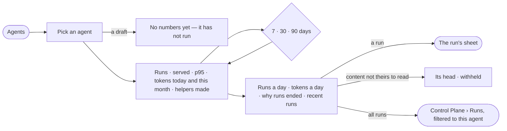

# CP-49 · Read how one agent is doing

**As** an agent builder **I want** a live agent's numbers in one place — its runs, how many it served, how long they
took, the tokens it spent and the helpers it made — with its recent runs beside them **so that** I see whether it is
getting worse before anyone asks why.

Tasks: [task.md](task.md) · Feature: [CP-F10](../../feature.md)

## Who can

| Lens | Can | Otherwise sees |
|---|---|---|
| Admin | Read every agent's numbers, its runs and why each ended | — |
| Operator | An Operator or a Modeller ([the role table](../../../../../access/features/AC-F02-access-policies/feature.md#the-role-table)): read every agent's numbers, its runs and why each ended; their own conversations with it | Others' conversations with the agent are counted, never listed; a recent run whose content they may not read lists with its head and *withheld* ([AC-31](../../../../../access/features/AC-F09-what-left-the-platform/stories/AC-31-keep-a-runs-content-to-those-who-may-read-it/story.md)) |

## Flow

## Acceptance criteria

| # | Given | When | Then |
|---|---|---|---|
| CP-49.1 | A live agent | the person picks it in Agents | it reads its tokens today and this month as meters against its limits, and its recent runs, each with when, what started it and why it ended |
| CP-49.2 | A live agent | its numbers open | tiles read runs · served · p95 a run · tokens this month · helpers made, over 7, 30 or 90 days, each against the window before |
| CP-49.3 | A live agent | its numbers open | runs a day and tokens a day are drawn over the window, one bar a day, a day with none drawn as zero |
| CP-49.4 | A live agent's ended runs | its numbers open | *Why runs ended* counts each reason in the run's own word — *answered* stays *answered* |
| CP-49.5 | A live agent | the person presses *All runs* | Runs opens filtered to this agent, the filter shown as a chip, 50 a page with *Show 50 more* |
| CP-49.6 | A draft that never ran | it is picked | it says it has not run yet, with no tiles |
| CP-49.7 | An agent with no monthly limit | its numbers open | *Tokens this month* reads the tokens alone, with *no monthly limit* |
| CP-49.8 | Conversations with the agent | an Operator opens its numbers | their own conversations are listed, newest first; the count across the deployment names no one else's |
| CP-49.9 | The engine cannot read the agent's numbers | they open | it says what it could not read; the rest of the sheet still reads |
| CP-49.10 | Token counts | any number is shown | it prints as `k`, `M` or `B`; a value that rounds up is printed on the next rung (`1M`, never `1000k`) |
| CP-49.11 | A recent run whose content the reader may not read | the agent's recent runs are read | it lists with when, the person behind it, its status and its tokens; what was asked reads *withheld* |

## Screens

| Surface | Lens | First use | Empty after a filter | Loading | Has data | Failed | Agent working or proposing | No access |
|---|---|---|---|---|---|---|---|---|
| Agents — an agent picked | Admin | agents · Draft | — | agents · Loading | agents | agents · Could not load | agents · Running | — |
| Agents — an agent picked | Operator | agents · Draft | — | agents · Loading | agents | agents · Could not load | agents · Running | agents |
| An agent's numbers on its sheet | Admin | agents.agent · Untested draft | — | agents.agent · Loading | agents.agent | agents.agent · Could not load | — | — |
| An agent's numbers on its sheet | Operator | agents.agent · Untested draft | — | agents.agent · Loading | agents.agent · Read only | agents.agent · Could not load | — | agents.agent · Content withheld |
| Runs filtered to the agent | Admin | — | agents.runs · No runs match | agents.runs · Loading | agents.runs · Filtered | agents.runs · Could not load | agents.runs · Running | — |
| Runs filtered to the agent | Operator | — | agents.runs · No runs match | agents.runs · Loading | agents.runs · Filtered | agents.runs · Could not load | agents.runs · Running | agents.runs · Content withheld |
