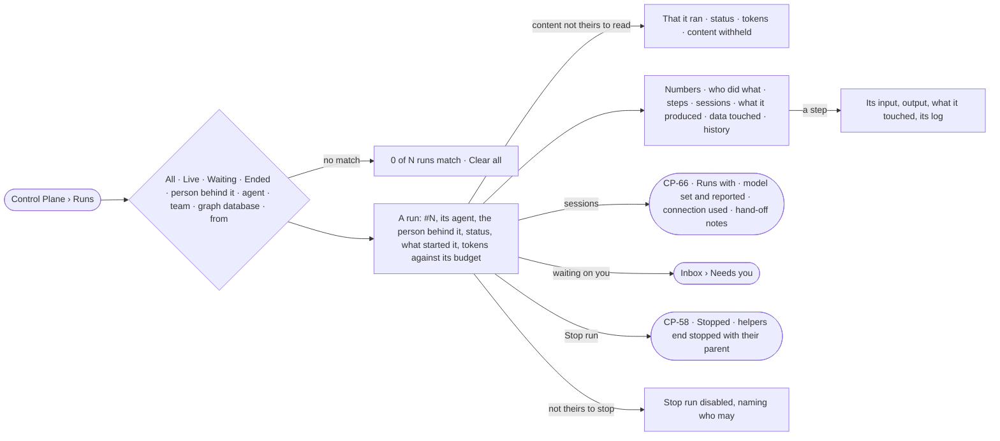

# CP-50 · Find a run and see where it stands

**As** an analyst **I want** every run in the deployment in one list, and each run read the same way — its numbers,
who did what, each step's input and output, what it produced and touched, and what waits on me **so that** I know
where a run stands and can check any of it.

Tasks: [task.md](task.md) · Feature: [CP-F10](../../feature.md)

## Who can

| Lens | Can | Otherwise sees |
|---|---|---|
| Admin | List every run and read its head and sessions; read a run's content as [AC-31](../../../../../access/features/AC-F09-what-left-the-platform/stories/AC-31-keep-a-runs-content-to-those-who-may-read-it/story.md) says — the role adds none; stop any run ([CP-58](../CP-58-stop-a-run-that-should-not-go-on/story.md)) | A run whose content they may not read: its head and sessions, its content *withheld* |
| Operator | An Operator or a Modeller ([the role table](../../../../../access/features/AC-F02-access-policies/feature.md#the-role-table)): list every run and read its head and sessions; read a run's content as [AC-31](../../../../../access/features/AC-F09-what-left-the-platform/stories/AC-31-keep-a-runs-content-to-those-who-may-read-it/story.md) says; stop a run they are behind ([CP-58](../CP-58-stop-a-run-that-should-not-go-on/story.md)) | Any other run lists and opens with that it ran, its agent, the person behind it, its status, its tokens and its sessions — its content *withheld* ([AC-31](../../../../../access/features/AC-F09-what-left-the-platform/stories/AC-31-keep-a-runs-content-to-those-who-may-read-it/story.md)); *Stop run* disabled, naming who may stop it |

## Flow

## Acceptance criteria

| # | Given | When | Then |
|---|---|---|---|
| CP-50.1 | Runs in the deployment | the person opens Runs | tiles read live · waiting on you · served in 24 h · not served in 24 h · tokens in 24 h, over every run, newest first |
| CP-50.2 | The runs list | it is read | each row reads `#number` · agent · what was asked · from (Ask · Task · Schedule · Project · API) · the person behind it · agents used · tokens · time · status, the reason it ended once it has |
| CP-50.3 | The list | the person picks *Live*, *Waiting* or *Ended*, or where it started | only those runs list, each filter shown as a chip with ×, and *Clear all*; the filters ride the link |
| CP-50.4 | Filters that match nothing | the list is read | *0 of N runs match* with *Clear all* |
| CP-50.5 | Nothing ran | Runs opens | it says what a run is, and that a question, a task or a schedule starts one |
| CP-50.6 | A row | the person opens it | the run opens as a sheet titled `Run #N`: its agent, the person behind it, status, what started it (*Task by {person} · "…"*, *asked by {person}*), tokens against its budget as a meter, *Re-run*, *Stop run* and *Compare* |
| CP-50.7 | A run's numbers | they read | time · tokens · agents · steps · what it produced · records touched, with a bar per agent over time, its state in words, and steps a minute |
| CP-50.8 | Who did what | it reads | who made whom: the task or question, the agent, every helper with its state and its tokens against what it was given |
| CP-50.9 | Steps | they read | one card per step of the plan, in order, with calls, how many ran side by side, time and counts in and out on each edge |
| CP-50.10 | A step | the person opens it | its input, output, what it touched and its log open inside the run; a step that fanned out opens on its first part with *All parts* |
| CP-50.11 | What it produced | it reads | every answer, file, branch and task the run made, with the step and agent that made it |
| CP-50.12 | Data touched | it reads | per graph database, the kinds read, written and refused · web domains and pages, refused and why · tokens by model version · secrets used, by name, and where |
| CP-50.13 | History | it reads | the run's history rows (AC-F06), filtered to it |
| CP-50.14 | An ask the run waits on, routed to the reader | the run is read | it is listed under *Waiting on you* and opens it in *Needs you* |
| CP-50.15 | A run still going | its sheet is open | it reads *running* with time so far, its agents and steps filling in, refreshed every few seconds |
| CP-50.16 | A run still going that the reader may stop — they are behind it or are an Admin | its sheet is open | *Stop run* is offered and stops it as [CP-58](../CP-58-stop-a-run-that-should-not-go-on/story.md) says; an ended run offers no *Stop run* |
| CP-50.17 | An ended run with asks pending | it ends | each ask closes as expired and leaves *Needs you* |
| CP-50.18 | A run whose steps were cleared by retention | Steps is read | it says the steps were cleared; the numbers keep their stored values |
| CP-50.19 | A number the engine did not record | it is shown | it reads `—`, never `0` |
| CP-50.20 | A run still going that the reader may not stop — not behind it and not an Admin | they open it | *Stop run* is disabled, naming who may stop it ([CP-58](../CP-58-stop-a-run-that-should-not-go-on/story.md)) |
| CP-50.21 | A run whose content the reader may not read | they open it, or follow a link to one of its steps | its head reads — that it ran, its agent, the person behind it, its status and its tokens; its content reads *withheld — only {person behind}, or someone whose agent may read its sources, reads it*; a link to a step reads *Not found* |
| CP-50.22 | A run | its answer is opened | *How it got here* shows its steps and sources |
| CP-50.23 | A step that ran more than once | it opens | each attempt reads its own start and time, a failed attempt kept and struck through in place, and time waiting apart from time working |
| CP-50.24 | A step in flight, stopped at a bound, cancelled, or that recorded nothing | it opens | it reads in that state and why, never as an empty panel |
| CP-50.25 | A run's numbers | they read | *Bounds reached* lists replans, attempts (naming the step with the most) and questions, each against its limit; a limit not set draws no row |
| CP-50.26 | Data touched | it reads | records created read apart from records updated, per kind; a run that recorded no touches says so, never `0` |
| CP-50.27 | What it produced | a file the run made is read | it is named with its digest; the same bytes made twice are one file |
| CP-50.28 | A link that names a step | it is followed | the run opens with that step open |
| CP-50.29 | A step still running | its time reads | it reads against the p50 the engine stores for that step of the plan; a step waiting on a person reads *no estimate* |
| CP-50.30 | A run a key, a task or a delegation started | someone opens it | the person behind it reads as the key's owner, the person who assigned the task, or the person the delegation runs for; *Stop run* and *Re-run* are offered to them and Admins; for anyone else each is disabled, naming who may |
| CP-50.31 | A run's steps | they read | as a waterfall on the run's clock — one row per task, its colour its status, an earlier attempt struck before the one that stuck, a bounded repetition a bracket over its rounds, a gate a rule across the time it held |
| CP-50.32 | A step whose record was cleared by retention, or of a run the reader may read but not stop or re-run | it opens | it says the step was cleared and keeps its stored numbers, or reads in full with no act offered |
| CP-50.33 | The list | the person filters by a person | only the runs that person is behind list — the ones they asked, the keys they own, the tasks they assigned and the delegations run for them |
| CP-50.34 | The list | the person filters by an agent | only the runs of that agent list |
| CP-50.35 | The list | the person filters by a team | only the runs whose person behind was on that team when the run opened list; joining or leaving the team since changes none of them |
| CP-50.36 | The list | the person filters by a graph database | only the runs that read or wrote that graph database list |
| CP-50.37 | A run whose content the reader may not read | the list is read | it lists like any run — number, agent, from, the person behind it, status, tokens and time; what was asked reads *withheld* |
| CP-50.38 | A run a schedule or a pick-up started | someone opens it | it reads *no person behind it*, naming its agent and who set the schedule or the pick-up; *Stop run* is offered to Admins only — for anyone else it is disabled: *Only an Admin can stop this run* |
| CP-50.39 | A run's head | it reads | it names what the run runs with (Invana · Claude Code · Codex), the model reported — marked when it differs from the model set — the connection used, *work* or *personal* by name and never a secret, and how many sessions it had; the count opens *Sessions* ([CP-66](../CP-66-read-a-run-session-by-session-with-its-hand-off-notes/story.md)) |
| CP-50.40 | A run that continued in a fresh session | the list or its head is read | it keeps its one number; the list shows one row for it, never one per session |

## Screens

| Surface | Lens | First use | Empty after a filter | Loading | Has data | Failed | Agent working or proposing | No access |
|---|---|---|---|---|---|---|---|---|
| Runs — the list | Admin | agents.runs · Nothing ran | agents.runs · No runs match | agents.runs · Loading | agents.runs | agents.runs · Could not load | agents.runs · Running | — |
| Runs — the list | Operator | agents.runs · Nothing ran | agents.runs · No runs match | agents.runs · Loading | agents.runs | agents.runs · Could not load | agents.runs · Running | agents.runs · Content withheld |
| A run — head and numbers | Admin | — | — | agents.run · Loading | agents.run | agents.run · Failed | agents.run · Running | — |
| A run — head and numbers | Operator | — | — | agents.run · Loading | agents.run · Not yours to stop | agents.run · Failed | agents.run · Running | agents.run · Content withheld |
| A run — who did what, steps, a step | Admin | — | — | agents.run · Loading | agents.run · Step | agents.run · Step failed | agents.run · Running | — |
| A run — who did what, steps, a step | Operator | — | — | agents.run · Loading | agents.run · Step | agents.run · Step failed | agents.run · Running | agents.run · Content withheld |
| A run — produced, data touched, history | Admin | — | — | agents.run · Loading | agents.run · Touched | agents.run · Could not load | — | — |
| A run — produced, data touched, history | Operator | — | — | agents.run · Loading | agents.run · Touched | agents.run · Could not load | — | agents.run · Content withheld |
| Waiting on you — the ask in Inbox | Admin | — | — | inbox · Loading | inbox | — | — | — |
| Waiting on you — the ask in Inbox | Operator | — | — | inbox · Loading | inbox | — | — | inbox · Not yours to answer |
