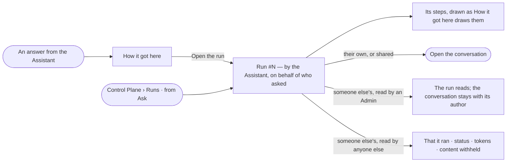

# CP-52 · Read an answer's run like any run

**As** an analyst **I want** an answer from the Assistant read as a run like any other, its steps drawn as the
answer's *How it got here* draws them **so that** everything an agent did is checked in one place, whoever asked.

Tasks: [task.md](task.md) · Feature: [CP-F10](../../feature.md)

## Who can

| Lens | Can | Otherwise sees |
|---|---|---|
| Admin | Read the run of any answer; open its conversation when it is theirs or shared with them | *Open the conversation* is absent on someone else's, unless it is shared |
| Operator | An Operator or a Modeller ([the role table](../../../../../access/features/AC-F02-access-policies/feature.md#the-role-table)): read the run of an answer they asked; open their own conversation, or one shared with them | Someone else's answer's run: that it ran, by the Assistant, the person behind it, its status and its tokens — its content *withheld* ([AC-31](../../../../../access/features/AC-F09-what-left-the-platform/stories/AC-31-keep-a-runs-content-to-those-who-may-read-it/story.md)); *Open the conversation* absent unless it is shared |

## Flow

## Acceptance criteria

| # | Given | When | Then |
|---|---|---|---|
| CP-52.1 | A question asked of the Assistant | it is answered | the answer is a run in Runs, from *Ask*, run by the Assistant on behalf of whoever asked |
| CP-52.2 | An answer's run | its sheet opens | its head reads *asked by {person}* with the conversation's name |
| CP-52.3 | An answer's run | a step opens | it is drawn as the answer's *How it got here* draws it — the same step, the same parts |
| CP-52.4 | An answer's run | it is read | *How it got here* shows its steps and sources |
| CP-52.5 | The person who asked, or someone it is shared with | they press *Open the conversation* | the conversation opens at that answer |
| CP-52.6 | Someone else's conversation, not shared | an Admin opens its run | the run, its steps and history rows read; *Open the conversation* is absent |
| CP-52.7 | History rows of an answer's run | they read | the actor reads *person ▸ Assistant* |
| CP-52.8 | Someone else's answer's run | an Operator or a Modeller opens it | it reads that it ran, by the Assistant, on behalf of whom, its status and its tokens; its question, steps and answer read *withheld* |

## Screens

| Surface | Lens | First use | Empty after a filter | Loading | Has data | Failed | Agent working or proposing | No access |
|---|---|---|---|---|---|---|---|---|
| An answer's run | Admin | — | — | agents.run.answer · Loading | agents.run.answer | agents.run.answer · Failed | agents.run.answer · Running | agents.run.answer · Not their conversation |
| An answer's run | Operator | — | — | agents.run.answer · Loading | agents.run.answer | agents.run.answer · Failed | agents.run.answer · Running | agents.run.answer · Content withheld |
| Runs from Ask | Admin | agents.runs · Nothing ran | agents.runs · No runs match | agents.runs · Loading | agents.runs · Filtered | agents.runs · Could not load | agents.runs · Running | — |
| Runs from Ask | Operator | agents.runs · Nothing ran | agents.runs · No runs match | agents.runs · Loading | agents.runs · Filtered | agents.runs · Could not load | agents.runs · Running | agents.runs · Content withheld |
