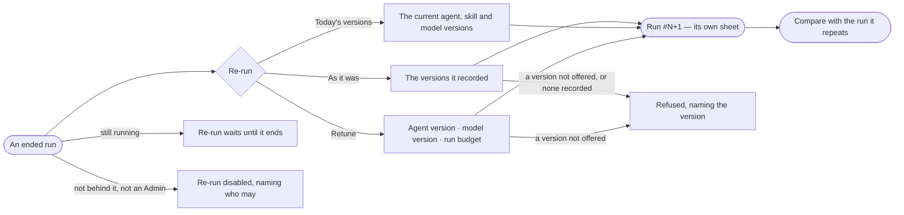

# CP-54 · Re-run a run as it was, or retuned

**As** an agent builder **I want** to re-run a run as it was, on today's versions, or retuned — another agent version,
model version or run budget **so that** I can reproduce a failure and test a fix on the run that failed.

Tasks: [task.md](task.md) · Feature: [CP-F10](../../feature.md)

## Who can

| Lens | Can | Otherwise sees |
|---|---|---|
| Admin | Re-run any ended question or typed query, as it was, on today's versions or retuned | — |
| Operator | An Operator or a Modeller ([the role table](../../../../../access/features/AC-F02-access-policies/feature.md#the-role-table)): re-run an ended question or typed query they are behind | *Re-run* on any other run is disabled: *Only {person} or an Admin can re-run this run.* |

## Flow

## Acceptance criteria

| # | Given | When | Then |
|---|---|---|---|
| CP-54.1 | An ended run | the person presses *Re-run* | one dialog offers *As it was* · *Today's versions* · *Retune* |
| CP-54.2 | *As it was* | the dialog shows it | it names the agent and model versions the run recorded; *not recorded* when it pinned none |
| CP-54.3 | *Retune* | the person changes the agent version, model version or run budget | only versions the deployment offers are offered |
| CP-54.4 | Any choice | the person confirms | a new run starts with its own number, names the run it repeats, has the re-runner as the person behind it, and opens its own sheet; the original run and its conversation are unchanged |
| CP-54.5 | A re-run that has ended | its sheet reads | *Compare* opens the two runs side by side (CP-55) |
| CP-54.6 | A run still going | its sheet is open | *Re-run* is disabled: *Re-run is offered once the run ends.* |
| CP-54.7 | A recorded version since retired or not offered, or a retuned version not offered | the person confirms | it is refused before it runs: *{version} is not offered.* |
| CP-54.8 | A re-run | it runs | it is a run like any other — its tokens, its history rows, *How it got here* showing its steps and sources |
| CP-54.9 | A run the reader is not behind, and the reader not an Admin | they read it | *Re-run* is disabled: *Only {person} or an Admin can re-run this run.* |
| CP-54.10 | A run that recorded no agent or model version | *As it was* is chosen | it is refused before it runs: *This run recorded no version — choose Today's versions or Retune.* |
| CP-54.11 | A run that is not a question or a typed query — a load, a link between models, a task's run | its sheet is open | *Re-run* is disabled: *Only a question or a query re-runs here — {kind} re-runs where it was started.* |

## Screens

| Surface | Lens | First use | Empty after a filter | Loading | Has data | Failed | Agent working or proposing | No access |
|---|---|---|---|---|---|---|---|---|
| Re-run dialog | Admin | — | — | agents.run · Loading | agents.run · Re-run | agents.run · Re-run refused | agents.run · Running | — |
| Re-run dialog | Operator | — | — | agents.run · Loading | agents.run · Re-run | agents.run · Re-run refused | agents.run · Running | agents.run · Not yours to re-run |
