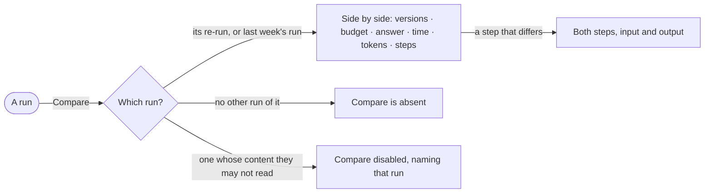

# CP-55 · Compare two runs of one question

**As** an analyst **I want** to compare two runs of one question side by side **so that** I see what a different
agent version, model version or run budget did to the answer.

Tasks: [task.md](task.md) · Feature: [CP-F10](../../feature.md)

## Who can

| Lens | Can | Otherwise sees |
|---|---|---|
| Admin | Compare any two runs of one question | — |
| Operator | An Operator or a Modeller ([the role table](../../../../../access/features/AC-F02-access-policies/feature.md#the-role-table)): compare two runs of one question whose content they may both read ([AC-31](../../../../../access/features/AC-F09-what-left-the-platform/stories/AC-31-keep-a-runs-content-to-those-who-may-read-it/story.md)) | *Compare* disabled, naming the run they may not read |

## Flow

## Acceptance criteria

| # | Given | When | Then |
|---|---|---|---|
| CP-55.1 | A run with another run of the same question — its re-run, or the same schedule's last run | the person presses *Compare* | the two open side by side |
| CP-55.2 | Two runs compared | they read | what differs is marked: agent version, model version, budget, answer, time, tokens and why each ended |
| CP-55.3 | Two runs compared | the person opens a step that differs | both steps' input and output read side by side |
| CP-55.4 | A run with no other run of its question | it is read | *Compare* is absent |
| CP-55.5 | Two runs compared | any change between them is shown | it is the engine's — `↑ 38%` or *flat* — never worked out by Studio |
| CP-55.6 | One of the two runs is one whose content the reader may not read | they reach *Compare* | it is disabled, naming that run; a link to the comparison reads *Not found* |

## Screens

| Surface | Lens | First use | Empty after a filter | Loading | Has data | Failed | Agent working or proposing | No access |
|---|---|---|---|---|---|---|---|---|
| Two runs compared | Admin | — | — | agents.run · Loading | agents.run · Compare | agents.run · Could not load | agents.run · Running | — |
| Two runs compared | Operator | — | — | agents.run · Loading | agents.run · Compare | agents.run · Could not load | agents.run · Running | agents.run · Compare disabled |
