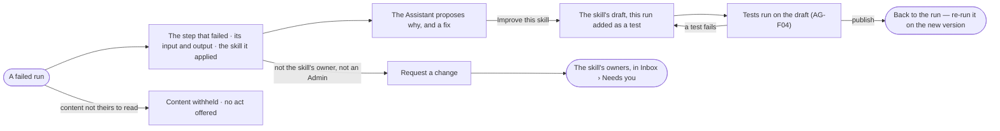

# CP-56 · Turn a failed run into a better skill

**As** an agent builder **I want** to go from a failed run to the skill behind it, fix the skill with that run as a
test, and come back to the run **so that** a bad run becomes a better skill.

Tasks: [task.md](task.md) · Feature: [CP-F10](../../feature.md)

## Who can

| Lens | Can | Otherwise sees |
|---|---|---|
| Admin | *Improve this skill* from any failed run | — |
| Operator | An Operator or a Modeller ([the role table](../../../../../access/features/AC-F02-access-policies/feature.md#the-role-table)): *Improve this skill* from a failed run they may read, when they own the skill | *Request a change* stands where *Improve this skill* would, sent to the skill's owners with the run attached; a failed run whose content they may not read shows neither ([AC-31](../../../../../access/features/AC-F09-what-left-the-platform/stories/AC-31-keep-a-runs-content-to-those-who-may-read-it/story.md)) |

## Flow

## Acceptance criteria

| # | Given | When | Then |
|---|---|---|---|
| CP-56.1 | A failed run | a step that failed opens | it reads its input, output and the skill it applied, with *Improve this skill* |
| CP-56.2 | A failed step | the Assistant reads it | it proposes why it failed and a fix to the skill, citing the step; *How it got here* shows its steps and sources |
| CP-56.3 | An owner of the skill, or an Admin | they press *Improve this skill* | the skill's draft opens with this run added as a test, and a way back to the run |
| CP-56.4 | The draft published | its owner goes back | the run reads that a newer version of its skill exists, with *Re-run* on it (CP-54) |
| CP-56.5 | A run whose skill already has a draft | *Improve this skill* is pressed | the run is added as a test to that draft; a second draft is never made |
| CP-56.6 | Someone who does not own the skill and is not an Admin | they read a failed run | *Request a change* is in its place; it sends the skill's owners a request with the run attached, to *Needs you* |
| CP-56.7 | A failed run that applied no skill | the step opens | *Improve this skill* is absent |
| CP-56.8 | A proposed change to a skill from a failed run | it is shown | it names the change it recommends and why, beside the alternatives it weighed |
| CP-56.9 | A failed run whose content the reader may not read | they open it | its steps read *withheld*; neither *Improve this skill* nor *Request a change* is offered |

## Screens

| Surface | Lens | First use | Empty after a filter | Loading | Has data | Failed | Agent working or proposing | No access |
|---|---|---|---|---|---|---|---|---|
| A failed step on the run | Admin | — | — | agents.run · Loading | agents.run · Step failed | agents.run · Could not load | agents.run · Proposing a fix | — |
| A failed step on the run | Operator | — | — | agents.run · Loading | agents.run · Request a change | agents.run · Could not load | agents.run · Proposing a fix | agents.run · Content withheld |
| The skill's draft, the run as a test | Admin | — | — | agents.skill · Loading | agents.skill · From a run | agents.skill · Test failed | agents.skill · Testing | — |
| The skill's draft, the run as a test | Operator | — | — | agents.skill · Loading | agents.skill · Read only | agents.skill · Test failed | — | agents.skill · Read only |
| The request in Needs you | Admin | — | — | inbox · Loading | inbox · Request a change | — | — | — |
| The request in Needs you | Operator | — | — | inbox · Loading | inbox · Request sent | — | — | inbox · Request sent |
