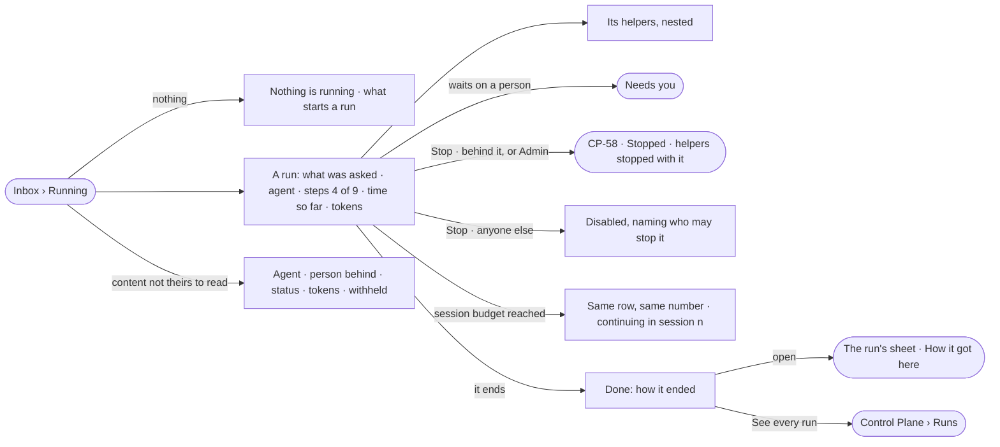

# CP-57 · See what is running and what just ran

**As** an analyst **I want** every run that is going, and the ones that just ended, in one place with their helpers
under them **so that** I know whether the work I am waiting for is moving, and can stop it, without first knowing
which product started it.

Tasks: [task.md](task.md) · Feature: [CP-F10](../../feature.md)

## Who can

| Lens | Can | Otherwise sees |
|---|---|---|
| Admin | Read every run in flight and every run ended today; its content as [AC-31](../../../../../access/features/AC-F09-what-left-the-platform/stories/AC-31-keep-a-runs-content-to-those-who-may-read-it/story.md) says — the role adds none; stop any run ([CP-58](../CP-58-stop-a-run-that-should-not-go-on/story.md)) | A run whose content they may not read lists with what it was about *withheld* |
| Operator | An Operator or a Modeller ([the role table](../../../../../access/features/AC-F02-access-policies/feature.md#the-role-table)): list every run in flight and ended today; read a run's content as [AC-31](../../../../../access/features/AC-F09-what-left-the-platform/stories/AC-31-keep-a-runs-content-to-those-who-may-read-it/story.md) says; stop a run they are behind ([CP-58](../CP-58-stop-a-run-that-should-not-go-on/story.md)) | Any other run lists with its agent, the person behind it, its status and its tokens — what it was about *withheld* ([AC-31](../../../../../access/features/AC-F09-what-left-the-platform/stories/AC-31-keep-a-runs-content-to-those-who-may-read-it/story.md)); *Stop* disabled, naming who may stop it |

## Flow

## Acceptance criteria

| # | Given | When | Then |
|---|---|---|---|
| CP-57.1 | Nothing is running and nothing ended today | the person opens Running | it reads *Nothing is running*, and that a question, a load, a task or a schedule starts a run |
| CP-57.2 | Runs in flight | Running opens | each lists what it was about — the question as typed, the query, or the file and the graph database it loads into — its agent, *steps N of M*, time so far and tokens; the runs the reader is behind first |
| CP-57.3 | A run in flight | its steps arrive | the row updates in place and keeps its place; the list repaints at most four times a second |
| CP-57.4 | A run that delegated to a helper, or a step that fanned out | Running is read | each child sits under its run; past the second level they collapse, showing how many |
| CP-57.5 | A run still going whose helper failed | it is read | it shows the helper's failure beside its own *running*; neither hides the other |
| CP-57.6 | A run with helpers | its tokens are read | they include what its helpers spent, in tokens, never currency |
| CP-57.7 | A run waiting on a person | Running is read | it reads *waiting*, naming who it waits on, and opens the ask in Needs you |
| CP-57.8 | Interactive runs — a board expanding a node, a provider check | Running is read | they are hidden unless *Show interactive runs* is on |
| CP-57.9 | A run the reader is behind, or any run for an Admin | they press *Stop* | it stops as [CP-58](../CP-58-stop-a-run-that-should-not-go-on/story.md) says — it ends *stopped*, each helper *stopped with its parent*, and a History row says who stopped it |
| CP-57.10 | A run the reader is not behind, the reader not an Admin | they reach *Stop* | it is disabled, naming who may stop it ([CP-58](../CP-58-stop-a-run-that-should-not-go-on/story.md)) |
| CP-57.11 | A run that ends | Running is open | it moves to Done with how it ended — served · cannot answer · out of tokens · out of time · stopped · failed — its time and its tokens |
| CP-57.12 | Runs ended today | Done opens | they list newest first; *See every run* opens Control Plane › Runs |
| CP-57.13 | A row | the person opens it | the run opens as its sheet (CP-50), and *How it got here* shows its steps and sources |
| CP-57.14 | Each run | it is read | it names where it came from — Ask, a task, a schedule, a project, the API — and the person behind it |
| CP-57.15 | A run whose content the reader may not read | Running and Done are read | it lists with its agent, the person behind it, its status and its tokens; what it was about reads *withheld*; opened, its sheet reads its head and *withheld*, and a link to a step reads *Not found* |
| CP-57.16 | A number the engine did not record | it is shown | it reads `—`, never `0` |
| CP-57.17 | *Mine* with none of the reader's runs going | Running is read | it reads *Nothing of yours is running*, with *Show everyone's* |
| CP-57.18 | The engine cannot read the runs | Running opens | it says what it could not read, with *Try again* |
| CP-57.19 | A run in flight that reached its session budget | Running is read | it keeps its row and its number, reading *continuing in session {n}*; its tokens keep counting across sessions |

## Screens

| Surface | Lens | First use | Empty after a filter | Loading | Has data | Failed | Agent working or proposing | No access |
|---|---|---|---|---|---|---|---|---|
| Inbox › Running | Admin | inbox · Running · Nothing is running | inbox · Running · Nothing of yours | inbox · Loading | inbox · Running | inbox · Could not load | inbox · Running | — |
| Inbox › Running | Operator | inbox · Running · Nothing is running | inbox · Running · Nothing of yours | inbox · Loading | inbox · Running · Not yours to stop | inbox · Could not load | inbox · Running | inbox · Running · Content withheld |
| Inbox › Done | Admin | inbox · Done · Nothing ended today | — | inbox · Loading | inbox · Done | inbox · Could not load | — | — |
| Inbox › Done | Operator | inbox · Done · Nothing ended today | — | inbox · Loading | inbox · Done | inbox · Could not load | — | inbox · Done · Content withheld |
| A run's sheet | Admin | — | — | agents.run · Loading | agents.run | agents.run · Failed | agents.run · Running | — |
| A run's sheet | Operator | — | — | agents.run · Loading | agents.run · Not yours to stop | agents.run · Failed | agents.run · Running | agents.run · Content withheld |
