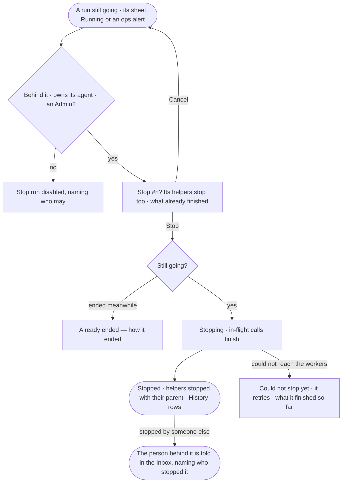

# CP-58 · Stop a run that should not go on

**As** the person behind a run, an owner of its agent or an Admin **I want** to stop a run that is spending too much,
stuck or doing the wrong thing **so that** it costs nothing more, and whoever it was running for knows why it ended.

Tasks: [task.md](task.md) · Feature: [CP-F10](../../feature.md)

## Who can

| Lens | Can | Otherwise sees |
|---|---|---|
| Admin | Stop any run still going | — |
| Operator | Stop a run they are behind, or a run of an agent they own | *Stop run* disabled: *Only {person}, the agent's owners or an Admin can stop this run* |

## Flow

## Acceptance criteria

| # | Given | When | Then |
|---|---|---|---|
| CP-58.1 | A run still going, read by the person behind it, an owner of its agent or an Admin | its sheet or Inbox › Running is read | *Stop run* is offered |
| CP-58.2 | *Stop run* | it is chosen | a confirm reads *Stop #{n}? Its helpers stop too*, with the steps already finished |
| CP-58.3 | The confirm | *Stop* is chosen | dispatch ends; calls already sent finish and are recorded; the run reads *stopped*, naming who stopped it, and each helper *stopped with its parent* |
| CP-58.4 | A stopped run | its asks are read | each pending ask closed as expired and left *Needs you* |
| CP-58.5 | A run stopped by someone other than the person behind it | the stop lands | the person behind it gets an Inbox item naming the run, who stopped it and when |
| CP-58.6 | Anyone else | they read the run | *Stop run* is disabled: *Only {person}, the agent's owners or an Admin can stop this run*; the route answers 403 with the same sentence |
| CP-58.7 | A run that ended before the stop landed | *Stop* is chosen | *This run already ended — {reason}*; nothing changes |
| CP-58.8 | A stop that cannot reach the workers yet | it is chosen | the run reads *stopping*, says what it finished so far, and stops when the workers answer |
| CP-58.9 | A stop | it lands | History holds a row for the stop and one per helper, naming who stopped it and on whose run |
| CP-58.10 | An ops alert about a run (CP-59) | the person may stop it | the alert opens the run with *Stop run* in reach |
| CP-58.11 | A stopped run | its tokens are read | they read as spent up to the stop, helpers included; no cost is shown |

## Screens

| Surface | Lens | First use | Empty after a filter | Loading | Has data | Failed | Agent working or proposing | No access |
|---|---|---|---|---|---|---|---|---|
| A run — Stop | Admin | — | — | agents.run · Stopping | agents.run · Stop confirm | agents.run · Could not stop yet | agents.run · Running | — |
| A run — Stop | Operator | — | — | agents.run · Stopping | agents.run · Stop confirm | agents.run · Could not stop yet | agents.run · Running | agents.run · Stop disabled |
| A run — stopped | Admin | — | — | — | agents.run · Stopped | agents.run · Already ended | — | — |
| A run — stopped | Operator | — | — | — | agents.run · Stopped | agents.run · Already ended | — | agents.run · Content withheld |
| Inbox — your run was stopped | Admin | — | — | inbox · Loading | inbox · Run stopped | inbox · Could not load | — | — |
| Inbox — your run was stopped | Operator | — | — | inbox · Loading | inbox · Run stopped | inbox · Could not load | — | — |
