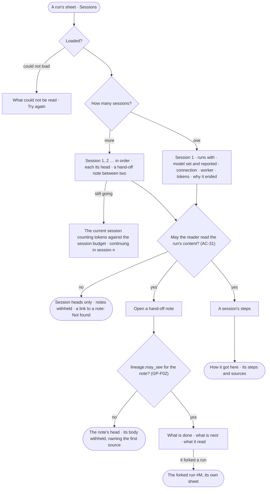

# CP-66 · Read a run session by session with its hand-off notes

**As** a builder whose agent's run went on across fresh sessions **I want** to read each session — what it ran with,
the model set and the model reported, the connection it used, the worker, its tokens and why it ended — and the
hand-off note one session left the next **so that** I know the run continued as it should, on the model and the
account I expected, and can check what it carried forward.

Tasks: [task.md](task.md) · Feature: [CP-F10](../../feature.md)

## Who can

Roles are [the role table](../../../../../access/features/AC-F02-access-policies/feature.md#the-role-table)
(*Runs — read, stop and re-run*). Who reads a run's content is
[AC-31](../../../../../access/features/AC-F09-what-left-the-platform/stories/AC-31-keep-a-runs-content-to-those-who-may-read-it/story.md)'s.

| Lens | Can | Otherwise sees |
|---|---|---|
| Admin | Read every run's session heads; read a session's steps and a hand-off note's body as AC-31 says — the role adds none — and only as far as the note's sources allow | A run whose content they may not read: its session heads; each note's head, its body *withheld* |
| Operator | An Operator or a Modeller: read every run's session heads; read a session's steps and a hand-off note's body of a run they are behind, or of a project's run whose sources their default agent may read, as far as the note's sources allow | Any other run: its session heads; each note's head, its body *withheld — only {person behind}, or someone whose agent may read its sources, reads it*; a direct link to a note reads *Not found* |

## Flow

## Acceptance criteria

| # | Given | When | Then |
|---|---|---|---|
| CP-66.1 | A run of several sessions | *Sessions* is read | they list in order — *Session 1, 2 …* — each with what it ran with and its version, the model set, the model reported, the connection used, the worker, tokens in and out, when it started, how long it ran and why it ended — finished · session budget · stopped · failed · refused |
| CP-66.2 | A session whose model reported differs from the model set | it is read | the difference is marked, naming both versions |
| CP-66.3 | A session whose runtime reported no model | it is read | the model reported reads `—`, never the model set in its place |
| CP-66.4 | A session that used a connection | it is read | it reads *work* or *personal* and the connection's name — never a secret; a session that used none reads `—` |
| CP-66.5 | Two sessions | the reader opens the hand-off note between them | the note reads what was done, what is next and what it read, with who wrote it — the runtime or Invana — its tokens and when |
| CP-66.6 | A hand-off note with a source the reader's default agent may not read | it is opened | its head reads; its body is *withheld*, naming the first source their agent may not read (GP-F02) |
| CP-66.7 | A run of one session | *Sessions* is read | it reads that one session's head, and no hand-off note |
| CP-66.8 | A run whose content the reader may not read (AC-31) | *Sessions* is read | every session's head reads; each note's head reads with its body *withheld*; the session's steps are withheld |
| CP-66.9 | A run still going that reached its session budget | *Sessions* is read | the ended session reads *session budget*, the next one is live, counting tokens against the session budget, and the run keeps its number; no ask is raised |
| CP-66.10 | A hand-off note a fork started from | it is read | it names the run the fork started, `#M`, which opens as its own sheet |
| CP-66.11 | A session the reader may read | its steps are opened | *How it got here* shows its steps and sources |
| CP-66.12 | An Operator or a Modeller not behind a run outside any project | they follow a direct link to one of its hand-off notes | it reads *Not found*; the route answers 404 with *Not found.* |
| CP-66.13 | A session that ended *refused* | it is read | it names what was refused — a file, a program or a host — and the rule, for a reader who may read the run; a session head for anyone else |
| CP-66.14 | A run's sessions | their tokens are read | each session's tokens are the engine's; the run's own tokens are their sum; a number not recorded reads `—`, never `0` |
| CP-66.15 | The engine cannot read the sessions | *Sessions* opens | it says what it could not read, with *Try again* |

## Screens

| Surface | Lens | First use | Empty after a filter | Loading | Has data | Failed | Agent working or proposing | No access |
|---|---|---|---|---|---|---|---|---|
| A run — Sessions | Admin | agents.run · Sessions · One session | — | agents.run · Sessions · Loading | agents.run · Sessions | agents.run · Sessions · Could not load | agents.run · Sessions · Continuing | agents.run · Sessions · Content withheld |
| A run — Sessions | Operator | agents.run · Sessions · One session | — | agents.run · Sessions · Loading | agents.run · Sessions | agents.run · Sessions · Could not load | agents.run · Sessions · Continuing | agents.run · Sessions · Content withheld |
| A hand-off note | Admin | — | — | agents.run · Sessions · Loading | agents.run · Sessions · Hand-off note | agents.run · Sessions · Could not load | — | agents.run · Sessions · Note withheld |
| A hand-off note | Operator | — | — | agents.run · Sessions · Loading | agents.run · Sessions · Hand-off note | agents.run · Sessions · Could not load | — | agents.run · Sessions · Note withheld |
