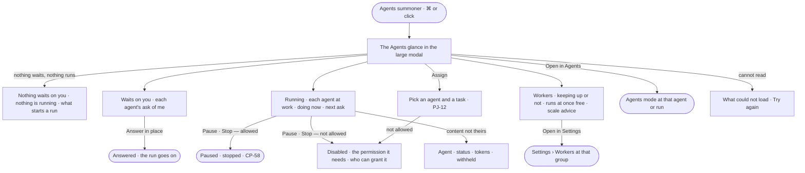

# CP-72 · Glance at the agents without leaving my work

**As** an analyst **I want** one glance at what the agents ask of me, what they are doing now and whether the workers
keep up **so that** I answer and steer them without leaving the board or the project I am working in.

Tasks: [task.md](task.md) · Feature: [CP-F10](../../feature.md)

## Who can

| Lens | Can | Otherwise sees |
|---|---|---|
| Admin | Full access: open the Agents glance; answer each ask routed to them; *Pause* and *Stop* any run ([CP-58](../CP-58-stop-a-run-that-should-not-go-on/story.md)); *Assign* a task to any agent; read the Workers band and its scale advice; *Open in Agents* at an agent or a run; *Open in Settings* at the Workers band | A run whose content they may not read lists *withheld* ([AC-31](../../../../../access/features/AC-F09-what-left-the-platform/stories/AC-31-keep-a-runs-content-to-those-who-may-read-it/story.md)) |
| Operator | Read only: open the Agents glance and read every band; answer an ask routed to them; each other act responds to their Access Policies — *Pause* and *Stop* on runs they are behind, *Assign* where they may work on the project | Every act their policies do not allow is shown disabled, naming the permission it needs and who can grant it; a run whose content they may not read lists *withheld* |

## Flow

## Acceptance criteria

| # | Given | When | Then |
|---|---|---|---|
| CP-72.1 | Any signed-in person | they press the Agents summoner | the large modal opens at the Agents glance, over their work, with three bands — *Waits on you* · *Running* · *Workers* — and Esc returns them where they were |
| CP-72.2 | Nothing waits on the reader and nothing runs | the glance opens | it reads *Nothing waits on you* and *Nothing is running*, and that a question, a task or a schedule starts a run |
| CP-72.3 | An agent's ask routed to the reader | *Waits on you* is read | each ask shows the agent, what it will do and its run, and is answered in place ([AC-F05](../../../../../access/features/AC-F05-asks-and-approvals/feature.md)); answered, it leaves the band |
| CP-72.4 | Runs in flight | *Running* is read | each agent at work shows what it is doing now, *steps N of M*, its tokens and its next ask; the list updates in place, at most four times a second |
| CP-72.5 | A run the reader's Access Policies let them stop | they press *Pause* or *Stop* | it pauses, or stops as [CP-58](../CP-58-stop-a-run-that-should-not-go-on/story.md) says, and the row shows it |
| CP-72.6 | A run the reader's Access Policies do not let them stop | they reach *Pause* or *Stop* | it is disabled, naming the permission it needs and who can grant it; the engine refuses the call too |
| CP-72.7 | A run whose content the reader may not read | *Running* is read | it lists its agent, the person behind it, its status and its tokens; what it is doing reads *withheld* ([AC-31](../../../../../access/features/AC-F09-what-left-the-platform/stories/AC-31-keep-a-runs-content-to-those-who-may-read-it/story.md)) |
| CP-72.8 | The workers | *Workers* is read | it reads keeping up or not, runs at once free and the queue's wait, with the scale advice of [CP-F03](../../../CP-F03-workers-and-the-queue/feature.md); adding or draining workers and changing a limit is *Open in Settings*, at Settings › Workers |
| CP-72.9 | *Assign* | the reader picks an agent and a task they may work on | the task is assigned as [PJ-12](../../../../../../capabilities/projects/features/PJ-F01-projects-and-tasks/stories/PJ-12-write-a-task-hand-it-on-and-accept-the-result/story.md) says; a task they may not assign is disabled, naming why |
| CP-72.10 | Any row | the reader presses *Open in Agents* | the Agents mode opens at that agent or run, and the modal closes; on the Workers band, *Open in Settings* moves the large modal to Settings › Workers at that group |
| CP-72.11 | A number the engine did not record | it is shown | it reads `—`, never `0` |
| CP-72.12 | The engine cannot read the agents | the glance opens | each band that failed says what it could not read, with *Try again*; the others still show |

## Screens

| Surface | Lens | First use | Empty after a filter | Loading | Has data | Failed | Agent working or proposing | No access |
|---|---|---|---|---|---|---|---|---|
| The Agents glance | Admin | shell.agents · Nothing yet | — | shell.agents · Loading | shell.agents | shell.agents · Could not load | shell.agents · Waits on you | — |
| The Agents glance | Operator | shell.agents · Nothing yet | — | shell.agents · Loading | shell.agents · Read only | shell.agents · Could not load | shell.agents · Waits on you | shell.agents · Content withheld |
| A run's page | Admin | — | — | agents.runs · Detail · Loading | agents.runs · Detail | agents.runs · Detail · Failed | agents.runs · Detail · Running | — |
| A run's page | Operator | — | — | agents.runs · Detail · Loading | agents.runs · Detail · Not yours to stop | agents.runs · Detail · Failed | agents.runs · Detail · Running | agents.runs · Detail · Content withheld |
