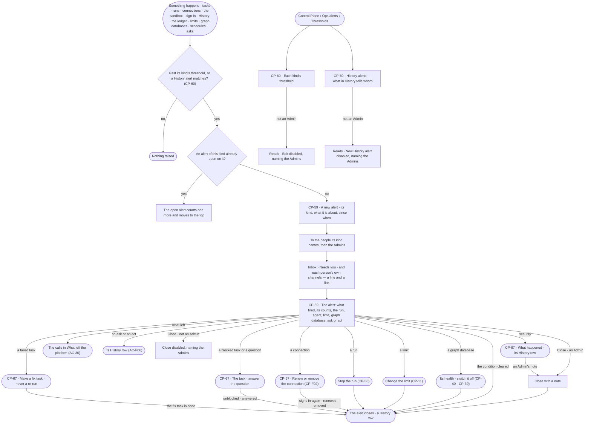
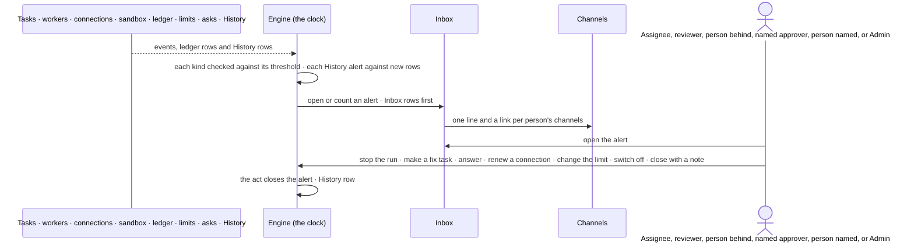

# Ops alerting

> The one place an alert is raised: the platform tells the people who can act when something goes wrong — a task
> that failed, sits blocked or waits on an answer, a run or a task that stopped moving, a connection that cannot sign
> in, a security event, an agent refused again and again, a team, user or agent past its limit, a graph database that
> cannot be reached, a schedule that skipped, data sent from a workflow approved as schema-only, an ask decided by
> someone who recently gave the asker their access, an ask with no approver, or an act in History an Admin asked to
> hear about — and each alert opens what it is about and closes once someone acts. A failed task is never re-run: its
> alert waits on a fix task. The decision it helps make: *what is going wrong, and who acts on it now?*

## User journey

Journeys this feature is a step of: [J08 · Watch agent workloads and act on an alert](../../../../journeys/J08-watch-agent-workloads-and-act-on-an-alert.md) ·
[J09 · Audit what an agent touched and what left the platform](../../../../journeys/J09-audit-what-an-agent-touched-and-what-left-the-platform.md)

## Stories

| ID | Story | Status |
|---|---|---|
| CP-59 | [Be told when an agent or the deployment needs someone to act](stories/CP-59-be-told-when-an-agent-or-the-deployment-needs-someone-to-act/story.md) | idea |
| CP-60 | [Tune when ops alerts fire](stories/CP-60-tune-when-ops-alerts-fire/story.md) | idea |
| CP-67 | [Get told when work stops or a connection fails](stories/CP-67-get-told-when-work-stops-or-a-connection-fails/story.md) | idea |

## Access

The role × feature table is [AC-F02 › The role table](../../../access/features/AC-F02-access-policies/feature.md#the-role-table)
(*Ops alerting*: Operator Reads · Modeller Reads · Admin Acts); this is what it means here.

| Act | Role | Everyone else sees |
|---|---|---|
| Receive an alert | Whom its kind names ([The alert kinds](#the-alert-kinds)), then the Admins | Not sent |
| Read the ops alerts list and an alert | Operator · Modeller · Admin; a run's content inside it as [AC-31](../../../access/features/AC-F09-what-left-the-platform/stories/AC-31-keep-a-runs-content-to-those-who-may-read-it/story.md) | Content withheld, naming who may read it |
| Act on what an alert is about — stop a run, make a fix task, answer a question, renew a connection, change a limit, switch off | As [CP-F10](../CP-F10-runs-and-how-the-agents-are-doing/feature.md#access) · [PJ-F01](../../../../capabilities/projects/features/PJ-F01-projects-and-tasks/feature.md#access) · [CP-F02](../CP-F02-plugins-and-outside-tools/feature.md#access) · [CP-F04](../CP-F04-limits/feature.md#access) · [CP-F05](../CP-F05-graph-databases/feature.md#access) | As there |
| Close an alert with a note | Admin | *Close* disabled — *Needs the Admin role — ask {admins}* |
| Set each kind's threshold | Admin | Thresholds read; *Edit* disabled, naming the Admins |
| Read History alerts | Operator · Modeller · Admin | — |
| Write, change, switch off or remove a History alert | Admin | *New History alert*, its switch and *Edit* disabled — *Needs the Admin role — ask {admins}* |

## States

| State | What the person sees |
|---|---|
| First use | *No ops alerts — the platform tells the people each kind names and the Admins when something needs them*, with the kinds and their thresholds. History alerts: *No History alerts yet*, with *New History alert* for an Admin |
| Empty after a filter | *No {kind} alerts {open · closed}* · *Clear* |
| Loading | The list and its tabs drawn at once; rows fill in place |
| Has data | Open alerts first, newest activity first: kind, what it is about, count, since when, who it went to; Closed below, with who or what closed it |
| Failed | What could not be read, in the engine's words; a threshold or History alert refused names the field |
| Agent working or proposing | An open alert counting up while its run goes on; a run or a task it names reads live |
| No access | Every role reads; *Close*, *Edit thresholds* and every History alert write are disabled for everyone but an Admin, naming the Admins |

## Rules

### The alert kinds

Built in, shipped with Invana, never removed. A kind's threshold is the Admin's to tune ([CP-60](stories/CP-60-tune-when-ops-alerts-fire/story.md)).

| Kind | Fires when | Reaches, then the Admins | Closes on |
|---|---|---|---|
| **Repeated refusals** | An agent is refused `threshold` times within a window | The agent's named approvers | An Admin's note |
| **Over a limit** | A team, user or agent reaches a monthly limit, or a run is held by one ([CP-F04](../CP-F04-limits/feature.md)) | An agent's: its named approvers · a user's: that user · a team's: no one more | The limit changed · a new month |
| **Task failed** | A task closes *Failed* ([PJ-F01](../../../../capabilities/projects/features/PJ-F01-projects-and-tasks/feature.md)) — fixed. Nothing re-runs it: it waits on a fix task | The task's assignee and the project's reviewers | A fix task made from it is done · an Admin's note |
| **Task blocked** | A task reads *Blocked* for `threshold` seconds | The task's assignee and the project's reviewers | It leaves *Blocked* |
| **Task needs input** | A task's run waits on an unanswered question for `threshold` seconds | The person the question is to, and the project's reviewers | The question is answered · the run stopped |
| **Stopped moving** | A running run, or a task *In progress* on its run, has no new step for `threshold` seconds, not waiting on a person | A task's: its assignee and the project's reviewers · a run's: the person behind it and the agent's named approvers | A new step · the run stopped or finished |
| **Graph database unreachable** | A graph database cannot be reached ([CP-F05](../CP-F05-graph-databases/feature.md)) | No one more | It answers again · it is switched off or reconnected |
| **Schedule skipped** | A firing is skipped because a graph database or plugin it needs is off ([AG-F07](../../../../capabilities/agents/features/AG-F07-schedules/feature.md)) | The schedule's creator | What it needs switched back on |
| **Data from a schema-only workflow** | A run of a workflow approved as schema-only makes a data-bearing call ([AC-F09](../../../access/features/AC-F09-what-left-the-platform/feature.md)) — every call, fixed | The agent's named approvers | An Admin's note |
| **Recently added decider** | An ask from a person is decided by someone who put the asker on a team or granted them the agent in the last 30 days, fixed ([AC-F05](../../../access/features/AC-F05-asks-and-approvals/feature.md)) — the ask goes | No one more | An Admin's note |
| **History match** | A History alert an Admin wrote matches a new History row, or its count within its window | The users and the people on the teams it names | An Admin's note |
| **No approver** | An ask finds no named approver who can answer it — none named, every one inactive, or only the person it benefits — and falls to the Admins ([AC-F05](../../../access/features/AC-F05-asks-and-approvals/feature.md)) | No one more | An Admin names approvers for the agent · an Admin's note |
| **Connection failed** | A work or personal connection cannot sign in — expired, revoked, refused ([CP-F02](../CP-F02-plugins-and-outside-tools/feature.md)) — fixed | A work connection's: the named approvers of the agents it is attached to · a personal connection's: its person only, never the Admins | It signs in again · it is renewed · it is removed |
| **Security** | Each of, fixed: the History chain breaks ([AC-F06](../../../access/features/AC-F06-history/feature.md)) · a retired token is presented again ([AC-F01](../../../access/features/AC-F01-sign-in-account-and-sessions/feature.md) · [AC-F11](../../../access/features/AC-F11-connect-an-mcp-client/feature.md)) · an account is locked ([AC-F01](../../../access/features/AC-F01-sign-in-account-and-sessions/feature.md)) · an Access Policy is saved wider ([AC-F02](../../../access/features/AC-F02-access-policies/feature.md)) · the sandbox refuses an agent's act on a worker ([CP-F03](../CP-F03-workers-and-the-queue/feature.md)) | A sandbox refusal: the agent's named approvers · the rest: no one more | An Admin's note |

| Rule | Detail |
|---|---|
| The one home | Every alert in Invana is one of these kinds. A pattern in the records opens a lead instead ([PJ-F06](../../../../capabilities/projects/features/PJ-F06-alerts/feature.md)) |
| The Admins always | Every kind reaches the people it names, then the Admins; with no one named left, the Admins alone. A deactivated person is skipped. A personal connection's alert is the one exception: it reaches its person only |
| A task's people | A task's assignee that is an agent is reached through the person behind its run; a task with no project reaches its author in place of the reviewers |
| A failed task is never re-run | *Task failed* waits on a fix task — a task a person makes to follow the failed one on its failure ([PJ-F01](../../../../capabilities/projects/features/PJ-F01-projects-and-tasks/feature.md)); nothing re-runs the failed task, and the alert closes when the fix task is done |
| A task's run is alerted once | A run that carries out a task stops moving on the task: one *Stopped moving* alert, on the task, never one on each |
| One open alert per thing | A kind on one task, agent, run, connection, team, user, graph database, schedule, ask, Access Policy or History alert has at most one open alert — a security alert one per reason; a repeat counts on it and moves it to the top, never a second alert |
| It closes on the act | The act or the cleared condition its kind names closes it, naming what closed it. An Admin may close any alert with a note |
| History alerts | An Admin writes one: what was done, what it touched, allowed or refused and why, optionally a count in a window, and which users or teams to tell. It sees only rows written after it exists |
| Delivered like an ask | An alert writes an Inbox row in *Needs you* for each person it reaches, then one line and a link to each channel that person turned on ([CP-F08](../CP-F08-the-inbox/feature.md#rules)); a notification rule may also send alerts of a kind to a place ([CP-37](../CP-F08-the-inbox/stories/CP-37-say-which-events-reach-whom-and-where/story.md)) |
| A line and a link | An alert names its kind, the task, the agent, run number, connection, team, user, graph database, ask, Access Policy or History alert, and counts; never a run's content, a record, a query or a secret |
| Evaluated after the fact | Kinds and History alerts are checked on the shared clock from what was written; an alert never slows or fails a run, a call, a decision or a write |
| Every open and close is History | Who it reached, what closed it and who |
| Leans on | Tasks, their states, assignees and reviewers (PJ-F01) · runs, their questions and stopping (CP-F10) · connections (CP-F02) · sandbox refusals (CP-F03) · lockouts and token reuse (AC-F01 · AC-F11) · Access Policy versions (AC-F02) · limits (CP-F04) · graph databases (CP-F05) · plugins (CP-F02) · schedules (AG-F07) · the ledger (AC-F09) · asks and named approvers (AC-F05) · teams and agent grants (AC-F03) · History (AC-F06) · the Inbox and channels (CP-F08) |

## Data touched

| Record | Read or write |
|---|---|
| Alerts — kind, what it is about, count, open or closed, who it reached, what closed it | Write · read |
| Each kind's threshold | Write · read |
| History alerts — what they match, whom they tell, when they last fired | Write · read |
| Tasks — state, assignee, project, reviewers, author and the tasks that follow them on failure (PJ-F01) | Read |
| Runs, their stream, their unanswered questions and refusals (CP-F10 · AC-F06) | Read |
| Connections failing and recovering (CP-F02) · sandbox refusals (CP-F03) | Read |
| Lockouts and token reuse (AC-F01 · AC-F11) · Access Policy versions saved wider (AC-F02) · the History chain's checks (AC-F06) | Read |
| Ledger calls and their class (AC-F09) | Read |
| Spend against limits (CP-F04) | Read |
| Graph database health (CP-F05) · skipped firings (AG-F07) | Read |
| Decided asks and named approvers (AC-F05) · team changes and agent grants (AC-F03) · History rows (AC-F06) | Read |
| Inbox rows and deliveries (CP-F08) | Write |

## Engine

The low-level design: what this feature stores, serves and refuses. Conventions — naming, errors, lists, events — are
[system-design.md](../../../../system-design.md) §§ 6–8; this section only fills them in.

### Records

| Table | Columns | Notes |
|---|---|---|
| `control_ops_alert_kinds` | `kind` (unique: `task_failed` · `task_blocked` · `task_needs_input` · `stopped_moving` · `refusals` · `over_limit` · `unreachable` · `schedule_skipped` · `schema_only_data` · `recent_decider` · `history_match` · `no_approver` · `connection_failed` · `security`) · `threshold` · `window_s?` · `updated_by_id?` · `updated_at` | One row per built-in kind, seeded on install; only `threshold` and `window_s` change, and not for the fixed kinds — `task_failed`, `schema_only_data`, `recent_decider`, `history_match`, `no_approver`, `connection_failed` and `security` |
| `control_ops_alerts` | `kind` · `subject_kind` (`task` · `agent` · `run` · `connection` · `team` · `user` · `graph_database` · `schedule` · `ask` · `access_policy` · `history_alert` · `deployment`) · `subject_id` · `run_id?` · `agent_id?` · `count` · `line` · `facts{}` (the counts and names it carries — never content; a security alert's `reason`: `chain_break` · `token_reuse` · `lockout` · `policy_widened` · `sandbox_refusal`; a connection's `connection_kind`: `work` · `personal`) · `recipient_ids[]` · `status` (`open` · `closed`) · `opened_at` · `last_seen_at` · `closed_at?` · `closed_by_kind?` (`person` · `act` · `cleared`) · `closed_by_id?` · `close_note?` | At most one `open` row per (`kind`, `subject_kind`, `subject_id`, `facts.reason`) — a partial unique index |
| `control_history_alerts` | `name` (unique) · `enabled` · `match{}` (act pattern · touched pattern · verdicts · refusal reasons · optional `count` in `window_s`) · `notify_user_ids[]` · `notify_team_ids[]` · `last_seq` · `last_fired_at?` · `created_by_id` | A History alert, an Admin's |

### Reads

| Record | Owner |
|---|---|
| Tasks, their derived state, assignee, project, reviewers, author, and dependencies `on = failure` | [PJ-F01](../../../../capabilities/projects/features/PJ-F01-projects-and-tasks/feature.md#engine) |
| Runs, their stream, their unanswered questions (`control_run_prompts`), the person behind them, `may_stop` | [CP-F10](../CP-F10-runs-and-how-the-agents-are-doing/feature.md#engine) |
| `control.connections.failed` · `control.connections.recovered`, a connection's renewal and removal, and the agents a work connection is attached to | [CP-F02](../CP-F02-plugins-and-outside-tools/feature.md#engine) |
| `control.sandbox.refuse` | [CP-F03](../CP-F03-workers-and-the-queue/feature.md#engine) |
| `access.auth.locked` · `access.auth.reuse_detected` | [AC-F01](../../../access/features/AC-F01-sign-in-account-and-sessions/feature.md#engine) |
| `access.clients.reuse_detected` | [AC-F11](../../../access/features/AC-F11-connect-an-mcp-client/feature.md#engine) |
| `access.policies.save` of a version wider than the one before | [AC-F02](../../../access/features/AC-F02-access-policies/feature.md#engine) |
| The History chain's check — whether it held, where it broke | [AC-F06](../../../access/features/AC-F06-history/feature.md#engine) |
| Refusals of an agent's acts, and the History rows a History alert matches | [AC-F06](../../../access/features/AC-F06-history/feature.md#engine) |
| Ledger calls, their class and the workflow's declared class | [AC-F09](../../../access/features/AC-F09-what-left-the-platform/feature.md#engine) |
| Spend against each limit | [CP-F04](../CP-F04-limits/feature.md#engine) |
| `control.graph_databases.unreachable` and its recovery | [CP-F05](../CP-F05-graph-databases/feature.md#engine) |
| Skipped firings | [AG-F07](../../../../capabilities/agents/features/AG-F07-schedules/feature.md#engine) |
| An agent's named approvers, and `access.approvals.approve` | [AC-F05](../../../access/features/AC-F05-asks-and-approvals/feature.md#engine) |
| Team members, team changes and agent grants, with who made them and when | [AC-F03](../../../access/features/AC-F03-directory/feature.md#engine) |
| Inbox rows, a person's channel choices, deliveries, the shared clock | [CP-F08](../CP-F08-the-inbox/feature.md#engine) |

### Routes

| Route, after `/api/v1/control` | Does | Story |
|---|---|---|
| `GET /ops-alerts` | By the list contract — `?status=open·closed` · `?kind=` · `?agent_id=` · `?mine=true` (sent to the reader); open first, newest activity first. A row: `id` · `kind` · `line` · `subject_kind` · `subject_id` · `run_id` · `agent_id` · `count` · `opened_at` · `last_seen_at` · `status` · `recipients` · `closed_by_line` · `may_close` | CP-59 |
| `GET /ops-alerts/{id}` | The alert, its `facts`, and the link to what it is about | CP-59 |
| `POST /ops-alerts/{id}/close` | `{note}` — an Admin closes it | CP-59 |
| `GET /ops-alerts/kinds` · `PUT /ops-alerts/kinds/{kind}` | Each kind with its threshold, window and who it reaches · set `{threshold, window_s?}` | CP-60 |
| `GET /ops-alerts/history-alerts` · `POST /ops-alerts/history-alerts` · `PATCH /ops-alerts/history-alerts/{id}` · `DELETE /ops-alerts/history-alerts/{id}` | History alerts — `?q=` the name · `?enabled=`, sorted by name; each read adds `match_line`, `notify_line` and `may_edit` · write · change or switch · remove one | CP-60 |

### Events

| Event | When |
|---|---|
| `control.ops_alerts.open` | A new alert opens — kind, subject, recipients |
| `control.ops_alerts.count` | An open alert counts a repeat |
| `control.ops_alerts.close` | It closes — by an act, the condition clearing, or an Admin with a note |
| `control.ops_alert_kinds.update` | An Admin sets a kind's threshold — old and new |
| `control.history_alerts.create` · `control.history_alerts.update` · `control.history_alerts.delete` | A History alert is written · changed · removed |

### Refusals

| Status | When | Sentence | Criterion |
|---|---|---|---|
| 403 | Closing an alert, setting a threshold, or writing, changing or removing a History alert, by anyone but an Admin | *Needs the Admin role — ask {admins}.* | CP-59.9 · CP-60.4 · CP-60.11 |
| 409 | Closing an alert that is already closed | *Already closed — {by}.* | CP-59.10 |
| 422 | A threshold or window outside its range | *{field}: {min} to {max}.* | CP-60.3 |
| 422 | A History alert with nothing to match or no one to tell | *{field}: {why}.* | CP-60.10 |

### CLI

| Command | Does |
|---|---|
| — | No command of its own |

### Mechanisms

| Mechanism | How |
|---|---|
| The checker | On each shared clock tick ([AG-F07](../../../../capabilities/agents/features/AG-F07-schedules/feature.md#mechanisms)), after a cursor over the event store and the ledger, each kind is checked; opening, counting and closing happen in one transaction with the cursor |
| Kinds and defaults | `task_failed` — a task closed `failed`, or whose latest run settled `failed`; subject the task · `task_blocked` — a task derived `blocked` for `threshold` seconds (3,600) · `task_needs_input` — a task's run with a `clarification` prompt unanswered for `threshold` seconds (900) · `stopped_moving` — `threshold` seconds (900) with no new frame on a running run not held on a person; subject the task when the run carries one out, else the run · `connection_failed` — `control.connections.failed`; subject the connection · `security` — threshold 1, fixed, one `reason` each: `chain_break` (subject the deployment), `token_reuse` and `lockout` (the user), `policy_widened` (the Access Policy), `sandbox_refusal` (the agent, `run_id` the run) · `no_approver` — an ask that falls to the Admins for want of a named approver; subject the ask · `refusals` — `threshold` (5) within `window_s` (600) · `over_limit` — 100% of a monthly limit, or a run held by one · `unreachable` — CP-F05's `unreachable` event · `schedule_skipped` — a skipped firing · `schema_only_data` — threshold 1, fixed · `recent_decider` — an `access.approvals.approve` on an ask from a person whose decider, within 30 days before it, added the asker to a team or granted them the agent; the subject is the ask · `history_match` — below |
| History alerts | Each tick reads History after each enabled History alert's `last_seq`; a match — or its `count` within `window_s` — opens or counts a `history_match` alert on that History alert, sets `last_fired_at` and advances `last_seq`. A new History alert starts at History's head |
| Recipients resolve at open | From [The alert kinds](#the-alert-kinds), as they are now — a task's assignee (an agent's through the person behind its run) and the project's reviewers, or a task with no project its author · the person a question is to · the person behind a run · an agent's named approvers · the named approvers of the agents a work connection is attached to · a personal connection's person · each person on a named team; a deactivated recipient is skipped; the Admins always, but for a personal connection's alert |
| Delivery | One Inbox row per recipient in *Needs you*, kind `ops_alert`, then the person's own channel deliveries ([CP-F08](../CP-F08-the-inbox/feature.md#mechanisms)); the payload is `{kind, title, agent?, subject, link}`. The four task kinds — task failed, task blocked, task needs input, stopped moving — leave Invana on channels through their default notification rules ([CP-F08](../CP-F08-the-inbox/feature.md#rules)), never also directly |
| Closing on the act | `control.runs.stop` · `control.runs.finish` (stopped moving, task needs input) · an answered prompt (task needs input) · `projects.tasks.accepted` of a task that follows the failed one on its failure (task failed) · `control.connections.recovered`, the connection renewed or removed (connection failed) · `control.limits.update` · `control.graph_databases.*` switch, mode or reconnect · plugin switch events close the open alert they settle, `closed_by_kind = act`, naming the event's actor; a cleared condition — reachable again, a new frame, a task out of *Blocked*, a new month — closes with `cleared` |
| Its Inbox rows follow | Closing an alert marks each recipient's Inbox row done, naming what closed it |

## System impact

| HLD section | Change | NFRs |
|---|---|---|
| § 6 Data and storage | Three tables in Postgres; fourteen built-in kinds seeded | — |
| § 7 Components | The alert checker runs on the shared clock beside the notification matcher | — |
| § 8 APIs and events | `/api/v1/control/ops-alerts` routes; `control.ops_alerts.*` · `control.history_alerts.*` events | — |
| § 11 Failure modes and the outside boundary | An unreachable graph database raises one alert, not one per failed call | NFR-REL-3 |
| § 12 Qualities | Operability: what goes wrong reaches someone who can act — a failed, blocked or stalled task, a failed connection; Security: data sent from a schema-only workflow, a broken History chain, a reused token, a lockout, a widened Access Policy and a sandbox refusal are raised the tick they are recorded, and an ask decided by someone who recently gave the asker their access reaches the Admins | NFR-OPS-3 · NFR-SEC-8 |

## Decisions

| Decision | Detail |
|---|---|
| One alerting home | Every alert is a kind here; other features raise the condition and link this feature. Records are Projects': a pattern in the records opens a lead ([PJ-F06](../../../../capabilities/projects/features/PJ-F06-alerts/feature.md)) |
| Built-in, tuned, never written | The kinds cover what an Admin acts on; an Admin tunes thresholds, and an act in History anyone should hear about is a History alert |
| Named approvers, then the Admins | An alert about an agent reaches the people who answer its asks, and the Admins always — never a person because they made the agent |
| Alerts wait in Needs you | An open alert needs someone to act, so it waits beside asks until it closes |
| Closed by acting | Stopping, a done fix task, an answer, a renewed connection, changing a limit or switching off is what closes an alert; *Close* with a note is for an alert no act settles |
| A failure waits on a fix | A failed task is never re-run; its alert stays open until a fix task made from it is done, so a failure is looked at before work goes on |
| A personal account stays its person's | A personal connection's failure reaches its person only; it is their account to renew |
| Work alerts reach the work's people | A task's alerts reach its assignee and the project's reviewers before the Admins — never a person because they made the agent |

## Open questions

| Question | Who answers |
|---|---|
| — | — |

## Not building

| Item | Why not |
|---|---|
| Writing new alert kinds | Tuning the kinds, History alerts and notification rules cover the rest |
| Switching a kind off | An alert nobody acts on is closed with a note, or its threshold raised; silencing a kind hides what went wrong |
| Paging, on-call rotations, escalation chains | A channel reaches a place; paging policy is another product's job |
| Alerting on telemetry signals | The collector's job |
| A cost alert | Tokens only; *over a limit* is the spend alert |
| Retrying a failed task | A failure alerts and waits on a fix task a person makes; a blind retry repeats what failed |
