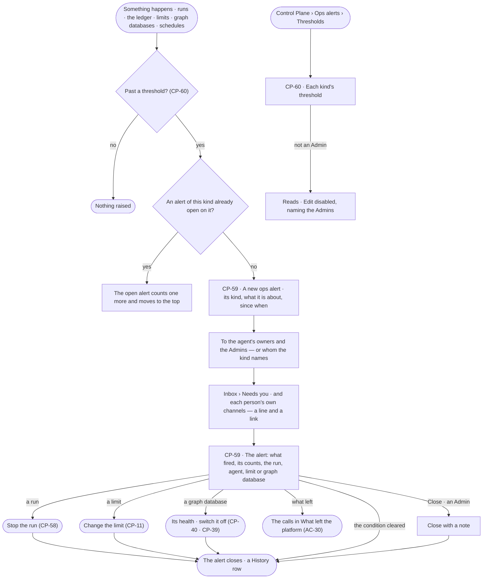
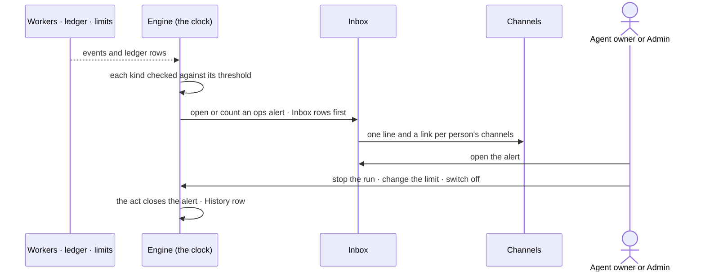

# Ops alerting

> The platform tells the people who can act when something about the agents goes wrong — an agent refused again and
> again, a team, user or agent past its limit, a run that stopped moving, a graph database that cannot be reached, a
> schedule that skipped, or data sent from a workflow approved as schema-only — and each alert opens what it is about
> and closes once someone acts. The decision it helps make: *what is going wrong, and who acts on it now?*

## User journey

Journeys this feature is a step of: [J08 · Watch agent workloads and act on an alert](../../../../journeys/J08-watch-agent-workloads-and-act-on-an-alert.md) ·
[J09 · Audit what an agent touched and what left the platform](../../../../journeys/J09-audit-what-an-agent-touched-and-what-left-the-platform.md)

## Stories

| ID | Story | Status |
|---|---|---|
| CP-59 | [Be told when an agent or the deployment needs someone to act](stories/CP-59-be-told-when-an-agent-or-the-deployment-needs-someone-to-act/story.md) | idea |
| CP-60 | [Tune when ops alerts fire](stories/CP-60-tune-when-ops-alerts-fire/story.md) | idea |

## Access

The role × feature table is [AC-F02 › The role table](../../../access/features/AC-F02-access-policies/feature.md#the-role-table)
(*Ops alerting*: Operator Reads · Modeller Reads · Admin Acts); this is what it means here.

| Act | Role | Everyone else sees |
|---|---|---|
| Receive an ops alert | Whom its kind names — an agent's owners, the person behind a run, a schedule's creator — and the Admins | Not sent |
| Read the ops alerts list and an alert | Operator · Modeller · Admin; a run's content inside it as [AC-31](../../../access/features/AC-F09-what-left-the-platform/stories/AC-31-keep-a-runs-content-to-those-who-may-read-it/story.md) | Content withheld, naming who may read it |
| Act on what an alert is about — stop, limit, switch | As [CP-F10](../CP-F10-runs-and-how-the-agents-are-doing/feature.md#access) · [CP-F04](../CP-F04-limits/feature.md#access) · [CP-F05](../CP-F05-graph-databases/feature.md#access) | As there |
| Close an alert with a note | Admin | *Close* disabled — *Needs the Admin role — ask {admins}* |
| Set each kind's threshold | Admin | Thresholds read; *Edit* disabled, naming the Admins |

## States

| State | What the person sees |
|---|---|
| First use | *No ops alerts — the platform tells the agent's owners and the Admins when something needs them*, with the kinds and their thresholds |
| Empty after a filter | *No {kind} alerts {open · closed}* · *Clear* |
| Loading | The list and its tabs drawn at once; rows fill in place |
| Has data | Open alerts first, newest activity first: kind, what it is about, count, since when, who it went to; Closed below, with who or what closed it |
| Failed | What could not be read, in the engine's words; a threshold refused names the field |
| Agent working or proposing | An open alert counting up while its run goes on; a run it names reads live |
| No access | Every role reads; *Close* and *Edit thresholds* are disabled for everyone but an Admin, naming the Admins |

## Rules

| Rule | Detail |
|---|---|
| Built-in kinds | Six kinds, shipped with Invana, never removed: **repeated refusals** · **over a limit** · **stuck run** · **graph database unreachable** · **schedule skipped** · **data from a schema-only workflow**. A kind's threshold is the Admin's to tune ([CP-60](stories/CP-60-tune-when-ops-alerts-fire/story.md)) |
| Who it reaches | Repeated refusals, stuck run, data from a schema-only workflow — the agent's owners and the Admins · over a limit — an agent's: its owners · a user's: that user · a team's: no one more — and the Admins · graph database unreachable — the Admins · schedule skipped — its creator and the Admins |
| One open alert per thing | A kind on one agent, run, team, user, graph database or schedule has at most one open alert; a repeat counts on it and moves it to the top, never a second alert |
| It closes on the act | Stopping its run, changing its limit, switching its graph database or plugin off or back on, or the condition clearing — the database answers, the run moves again, spend falls under the limit next month — closes it, naming what closed it. An Admin may close one with a note |
| Delivered like an ask | An alert writes an Inbox row in *Needs you* for each person it reaches, then one line and a link to each channel that person turned on ([CP-F08](../CP-F08-the-inbox/feature.md#rules)); a notification rule may also send ops alerts to a place (CP-37) |
| A line and a link | An alert names its kind, the agent, run number, team, user or graph database, and counts; never a run's content, a record or a query |
| The ledger rule | A run of a workflow approved as schema-only that makes a data-bearing call ([AC-F09](../../../access/features/AC-F09-what-left-the-platform/feature.md)) raises *data from a schema-only workflow*, naming the run and the call's target and class |
| Evaluated after the fact | Kinds are checked on the shared clock from what was written; an alert never slows or fails a run, a call or a write |
| Every open and close is History | Who it reached, what closed it and who |
| Leans on | Runs and stopping (CP-F10) · limits (CP-F04) · graph databases (CP-F05) · plugins (CP-F02) · schedules (AG-F07) · the ledger (AC-F09) · the Inbox and channels (CP-F08) · owners (AC-F07) · History (AC-F06) |

## Data touched

| Record | Read or write |
|---|---|
| Ops alerts — kind, what it is about, count, open or closed, who it reached, what closed it | Write · read |
| Each kind's threshold | Write · read |
| Runs, their stream and refusals (CP-F10 · AC-F06) | Read |
| Ledger calls and their class (AC-F09) | Read |
| Spend against limits (CP-F04) | Read |
| Graph database health (CP-F05) · skipped firings (AG-F07) | Read |
| Inbox rows and deliveries (CP-F08) | Write |

## Engine

The low-level design: what this feature stores, serves and refuses. Conventions — naming, errors, lists, events — are
[system-design.md](../../../../system-design.md) §§ 6–8; this section only fills them in.

### Records

| Table | Columns | Notes |
|---|---|---|
| `control_ops_alert_kinds` | `kind` (unique: `refusals` · `over_limit` · `stuck_run` · `unreachable` · `schedule_skipped` · `schema_only_data`) · `threshold` · `window_s?` · `updated_by_id?` · `updated_at` | One row per built-in kind, seeded on install; only `threshold` and `window_s` change |
| `control_ops_alerts` | `kind` · `subject_kind` (`agent` · `run` · `team` · `user` · `graph_database` · `schedule`) · `subject_id` · `run_id?` · `agent_id?` · `count` · `line` · `facts{}` (the counts and names it carries — never content) · `recipient_ids[]` · `status` (`open` · `closed`) · `opened_at` · `last_seen_at` · `closed_at?` · `closed_by_kind?` (`person` · `act` · `cleared`) · `closed_by_id?` · `close_note?` | At most one `open` row per (`kind`, `subject_kind`, `subject_id`) — a partial unique index |

### Reads

| Record | Owner |
|---|---|
| Runs, their stream, the person behind them, `may_stop` | [CP-F10](../CP-F10-runs-and-how-the-agents-are-doing/feature.md#engine) |
| Refusals of an agent's acts | [AC-F06](../../../access/features/AC-F06-history/feature.md#engine) |
| Ledger calls, their class and the workflow's declared class | [AC-F09](../../../access/features/AC-F09-what-left-the-platform/feature.md#engine) |
| Spend against each limit | [CP-F04](../CP-F04-limits/feature.md#engine) |
| `control.graph_databases.unreachable` and its recovery | [CP-F05](../CP-F05-graph-databases/feature.md#engine) |
| Skipped firings | [AG-F07](../../../../capabilities/agents/features/AG-F07-schedules/feature.md#engine) |
| An agent's owners | [AC-F07](../../../access/features/AC-F07-ownership/feature.md#engine) |
| Inbox rows, a person's channel choices, deliveries, the shared clock | [CP-F08](../CP-F08-the-inbox/feature.md#engine) |

### Routes

| Route, after `/api/v1/control` | Does | Story |
|---|---|---|
| `GET /ops-alerts` | By the list contract — `?status=open·closed` · `?kind=` · `?agent_id=` · `?mine=true` (sent to the reader); open first, newest activity first. A row: `id` · `kind` · `line` · `subject_kind` · `subject_id` · `run_id` · `agent_id` · `count` · `opened_at` · `last_seen_at` · `status` · `recipients` · `closed_by_line` · `may_close` | CP-59 |
| `GET /ops-alerts/{id}` | The alert, its `facts`, and the link to what it is about | CP-59 |
| `POST /ops-alerts/{id}/close` | `{note}` — an Admin closes it | CP-59 |
| `GET /ops-alerts/kinds` · `PUT /ops-alerts/kinds/{kind}` | Each kind with its threshold, window and who it reaches · set `{threshold, window_s?}` | CP-60 |

### Events

| Event | When |
|---|---|
| `control.ops_alerts.open` | A new alert opens — kind, subject, recipients |
| `control.ops_alerts.count` | An open alert counts a repeat |
| `control.ops_alerts.close` | It closes — by an act, the condition clearing, or an Admin with a note |
| `control.ops_alert_kinds.update` | An Admin sets a kind's threshold — old and new |

### Refusals

| Status | When | Sentence | Criterion |
|---|---|---|---|
| 403 | Closing an alert, or setting a threshold, by anyone but an Admin | *Needs the Admin role — ask {admins}.* | CP-59.9 · CP-60.4 |
| 409 | Closing an alert that is already closed | *Already closed — {by}.* | CP-59.10 |
| 422 | A threshold or window outside its range | *{field}: {min} to {max}.* | CP-60.3 |

### CLI

| Command | Does |
|---|---|
| — | No command of its own |

### Mechanisms

| Mechanism | How |
|---|---|
| The checker | On each shared clock tick ([AG-F07](../../../../capabilities/agents/features/AG-F07-schedules/feature.md#mechanisms)), after a cursor over the event store and the ledger, each kind is checked; opening, counting and closing happen in one transaction with the cursor |
| Kinds and defaults | `refusals` — an agent refused `threshold` times (5) within `window_s` (600) · `over_limit` — a team, user or agent reaches 100% of a monthly limit, or a run is held by one (CP-F04) · `stuck_run` — a running run with no new frame for `threshold` seconds (900), not waiting on a person · `unreachable` — CP-F05's `unreachable` event · `schedule_skipped` — a firing skipped because what it needs is off · `schema_only_data` — any data-bearing ledger call from a run of a workflow approved as schema-only (threshold 1, fixed) |
| Recipients resolve at open | From the kind's rule above, owners as they are now; a deactivated recipient is skipped; the Admins always |
| Delivery | One Inbox row per recipient in *Needs you*, kind `ops_alert`, then the person's own channel deliveries ([CP-F08](../CP-F08-the-inbox/feature.md#mechanisms)); the payload is `{kind, title, agent?, subject, link}` |
| Closing on the act | `control.runs.stop` · `control.runs.finish` (stuck run) · `control.limits.update` · `control.graph_databases.*` switch, mode or reconnect · plugin switch events close the open alert they settle, `closed_by_kind = act`, naming the event's actor; a cleared condition — reachable again, a new frame, a new month — closes with `cleared` |
| Its Inbox rows follow | Closing an alert marks each recipient's Inbox row done, naming what closed it |

## System impact

| HLD section | Change | NFRs |
|---|---|---|
| § 6 Data and storage | Two tables in Postgres | — |
| § 7 Components | The ops alert checker runs on the shared clock beside the notification matcher | — |
| § 8 APIs and events | `/api/v1/control/ops-alerts` routes; `control.ops_alerts.*` events | — |
| § 11 Failure modes and the outside boundary | An unreachable graph database raises one alert, not one per failed call | NFR-REL-3 |
| § 12 Qualities | Operability: what goes wrong reaches someone who can act; Security: data sent from a schema-only workflow is raised the tick it is recorded | NFR-OPS-3 · NFR-SEC-8 |

## Decisions

| Decision | Detail |
|---|---|
| Ops alerts are the platform's, alerts on records are Projects' | A pattern in the records opens a lead ([PJ-F06](../../../../capabilities/projects/features/PJ-F06-alerts/feature.md)); what goes wrong with agents, limits and graph databases is an ops alert |
| Built-in, tuned, never written | The six kinds cover what an Admin acts on; an Admin tunes thresholds, and anything else is a notification rule over History (CP-37) |
| Alerts wait in Needs you | An open alert needs someone to act, so it waits beside asks until it closes |
| Closed by acting | Stopping, changing a limit or switching off is what closes an alert; *Close* with a note is for an alert nobody needs to act on |

## Open questions

| Question | Who answers |
|---|---|
| — | — |

## Not building

| Item | Why not |
|---|---|
| Writing new alert kinds | Tuning the six and notification rules over History cover the rest |
| Switching a kind off | An alert nobody acts on is closed with a note, or its threshold raised; silencing a kind hides what went wrong |
| Paging, on-call rotations, escalation chains | A channel reaches a place; paging policy is another product's job |
| Alerting on telemetry signals | The collector's job |
| A cost alert | Tokens only; *over a limit* is the spend alert |
