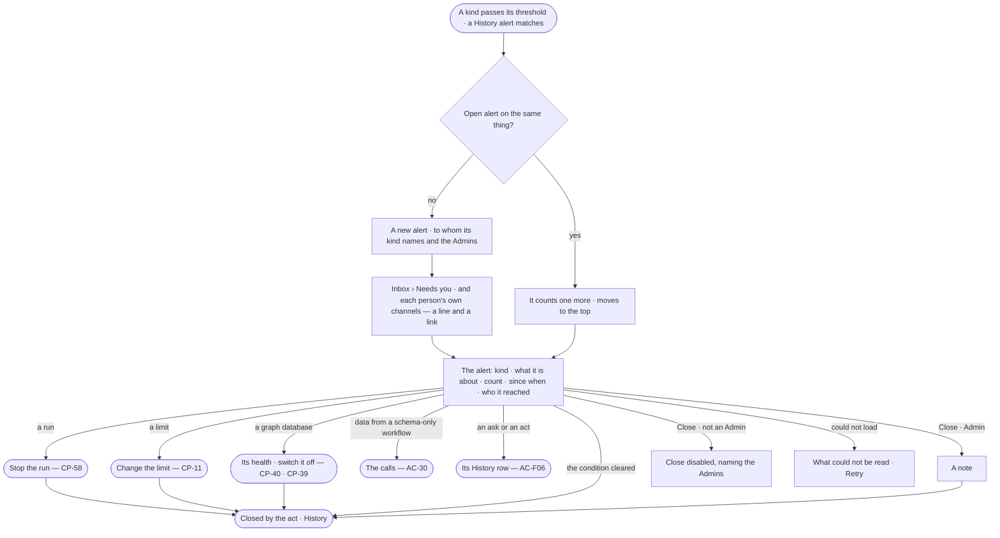

# CP-59 · Be told when an agent or the deployment needs someone to act

**As** an agent's named approver, the person behind a run, a person an alert names, or an Admin **I want** to be told
when an agent keeps being refused, spends past a limit, has a run that stopped moving, loses a graph database, skips a schedule, sends data from a schema-only
workflow, has an ask decided by someone who recently gave the asker their access, or does an act a History alert
watches **so that** I act on it before it costs more, and the alert closes once someone has.

Tasks: [task.md](task.md) · Feature: [CP-F11](../../feature.md)

## Who can

| Lens | Can | Otherwise sees |
|---|---|---|
| Admin | Receive every ops alert; read every alert; act on what it is about; close one with a note | — |
| Operator | Operator · Modeller: receive alerts about agents they are a named approver of, runs they are behind, their own limit, schedules they created and History alerts that name them or their team — alerts about tasks and connections are [CP-67](../CP-67-get-told-when-work-stops-or-a-connection-fails/story.md)'s ([the role table](../../../../../access/features/AC-F02-access-policies/feature.md#the-role-table)); read every alert; act on what it is about as that act allows | *Close* disabled — *Needs the Admin role — ask {admins}*; a run's content withheld as AC-31 says |

## Flow

## Acceptance criteria

| # | Given | When | Then |
|---|---|---|---|
| CP-59.1 | An agent refused 5 times within 10 minutes (the default threshold) | the clock checks | an alert *repeated refusals* opens naming the agent, the count and the last refusal's reason, sent to the agent's named approvers, then the Admins |
| CP-59.2 | An agent, a user or a team reaching its monthly token limit, or a run held by a limit | the clock checks | an alert *over a limit* opens naming the team, user or agent and the limit — sent to the agent's named approvers for an agent, the user for a user, then the Admins |
| CP-59.3 | A running run that carries out no task, with no new step for 15 minutes, not waiting on a person | the clock checks | an alert *stopped moving* opens naming the run number and its agent, sent to the person behind it and the agent's named approvers, then the Admins; a task's run alerts on its task ([CP-67](../CP-67-get-told-when-work-stops-or-a-connection-fails/story.md)) |
| CP-59.4 | A graph database that becomes unreachable | the engine sees it | one alert *graph database unreachable* opens naming it, sent to the Admins — never one per failed call |
| CP-59.5 | A schedule whose firing is skipped because a graph database or plugin it needs is off | it fires | an alert *schedule skipped* opens naming the schedule and who switched it off, sent to its creator and the Admins |
| CP-59.6 | A run of a workflow approved as schema-only that makes a data-bearing call | the call is recorded | an alert *data from a schema-only workflow* opens naming the run, the target and the class, sent to the agent's named approvers, then the Admins |
| CP-59.7 | An alert already open on the same thing | the kind fires again | the open alert counts one more and moves to the top; no second alert opens |
| CP-59.8 | An alert | it reaches a person | it waits in their *Needs you* and goes to each channel they turned on, as one line and a link — never a run's content, a record or a query |
| CP-59.9 | An Operator | they read an alert | *Close* is disabled — *Needs the Admin role — ask {admins}*; the route answers 403 with the same sentence |
| CP-59.10 | An Admin closing an alert already closed | they choose *Close* | *Already closed — {by}*; nothing changes |
| CP-59.11 | An alert about a run | the run is stopped, or moves again | the alert closes naming the stop and who, or *cleared*; each recipient's Inbox row reads closed |
| CP-59.12 | An alert about a limit or a graph database | the limit is changed, or the database is switched off or answers again | the alert closes naming the act and who, or *cleared* |
| CP-59.13 | An Admin | they close an alert with a note | it closes naming them and the note |
| CP-59.14 | An alert opening or closing | it is written | History holds a row naming who it reached, and what closed it and who |
| CP-59.15 | Control Plane › Ops alerts | it is opened | open alerts first, most recently fired first — kind, what it is about, count, since when, who it reached; closed below with what closed them |
| CP-59.16 | No alert ever opened | the list is opened | *No ops alerts — the platform tells the people each kind names and the Admins when something needs them*, with each kind and its threshold |
| CP-59.17 | A filter by kind or open/closed with no match | it is applied | *No {kind} alerts {open · closed}* and *Clear* |
| CP-59.18 | The list fails to load | it is opened | what could not be read, in the engine's words, and *Retry* |
| CP-59.19 | An alert about a run the reader may not read | it is opened | it names the run number, agent and counts; the run opens with its content withheld (AC-31.2) |
| CP-59.20 | An ask from a person decided by someone who put the asker on a team or granted them the agent in the last 30 days | the decision is recorded | the ask goes, and an alert *recently added decider* opens naming the ask, the asker and the decider, sent to the Admins |
| CP-59.21 | An enabled History alert (CP-60.8) | a new History row matches it, or its count within its window is reached | an alert *History match* opens naming the History alert and the act, sent to the users and the people on the teams it names, then the Admins; a further match counts on the open alert |
| CP-59.22 | An agent with no named approver who is still active | one of its kinds fires | the alert is sent to the Admins alone |
| CP-59.23 | An alert *recently added decider*, *History match* or *data from a schema-only workflow* | no act settles it | it stays open until an Admin closes it with a note |

## Screens

| Surface | Lens | First use | Empty after a filter | Loading | Has data | Failed | Agent working or proposing | No access |
|---|---|---|---|---|---|---|---|---|
| Ops alerts | Admin | control.alerts · No alerts | control.alerts · No match | control.alerts · Loading | control.alerts | control.alerts · Could not load | control.alerts · Counting | — |
| Ops alerts | Operator | control.alerts · No alerts | control.alerts · No match | control.alerts · Loading | control.alerts | control.alerts · Could not load | control.alerts · Counting | — |
| An alert | Admin | — | — | control.alerts.alert · Loading | control.alerts.alert | control.alerts.alert · Already closed | control.alerts.alert · Run still going | — |
| An alert | Operator | — | — | control.alerts.alert · Loading | control.alerts.alert | control.alerts.alert · Could not load | control.alerts.alert · Run still going | control.alerts.alert · Close disabled |
| Inbox — an ops alert | Admin | — | — | inbox · Loading | inbox · Ops alert | inbox · Could not load | — | — |
| Inbox — an ops alert | Operator | — | — | inbox · Loading | inbox · Ops alert | inbox · Could not load | — | — |
