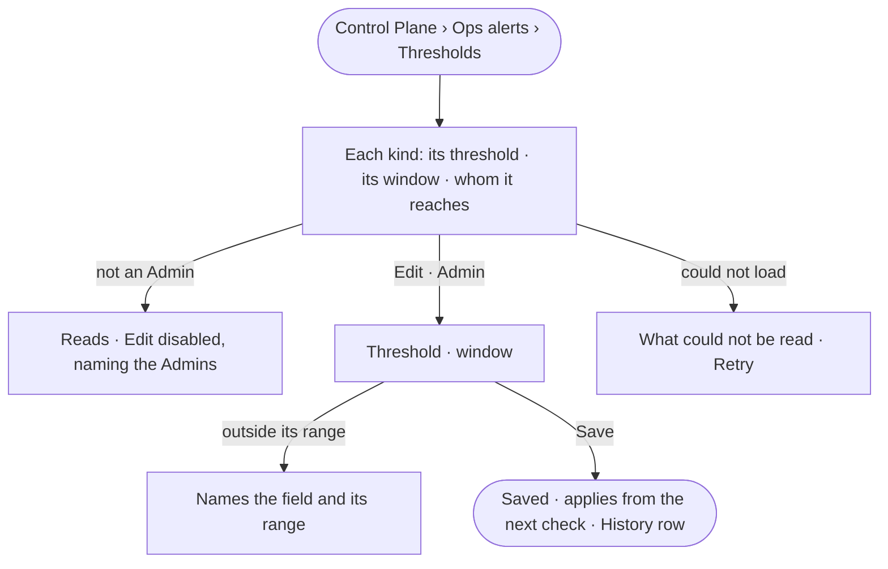

# CP-60 · Tune when ops alerts fire

**As** an Admin **I want** to set how many refusals, how long a stall, and which share of a limit raise an ops alert
**so that** alerts reach people when something needs them, and not so often that they stop reading them.

Tasks: [task.md](task.md) · Feature: [CP-F11](../../feature.md)

## Who can

| Lens | Can | Otherwise sees |
|---|---|---|
| Admin | Read and set each kind's threshold | — |
| Operator | Read each kind, its threshold and whom it reaches | *Edit* disabled — *Needs the Admin role — ask {admins}* |

## Flow

## Acceptance criteria

| # | Given | When | Then |
|---|---|---|---|
| CP-60.1 | Thresholds | they are read | each of the six kinds reads its threshold, its window where it has one, and whom it reaches; *data from a schema-only workflow* reads *every call*, fixed |
| CP-60.2 | An Admin | they set *repeated refusals* to 10 in 30 minutes and save | it applies from the next check; an alert already open stays open |
| CP-60.3 | A threshold or window outside its range | it is saved | *{field}: {min} to {max}*; nothing changes |
| CP-60.4 | An Operator | they read Thresholds | *Edit* is disabled — *Needs the Admin role — ask {admins}*; the route answers 403 with the same sentence |
| CP-60.5 | A threshold change | it is saved | History holds a row naming the kind, the old and new values and who |
| CP-60.6 | A fresh deployment | Thresholds is read | each kind reads its default: refusals 5 in 10 minutes · over a limit at 100% · stuck after 15 minutes · unreachable and skipped at once |
| CP-60.7 | The read fails | Thresholds is opened | what could not be read, in the engine's words, and *Retry* |

## Screens

| Surface | Lens | First use | Empty after a filter | Loading | Has data | Failed | Agent working or proposing | No access |
|---|---|---|---|---|---|---|---|---|
| Thresholds | Admin | control.alerts.settings · Defaults | — | control.alerts.settings · Loading | control.alerts.settings | control.alerts.settings · Out of range | — | — |
| Thresholds | Operator | control.alerts.settings · Defaults | — | control.alerts.settings · Loading | control.alerts.settings | control.alerts.settings · Could not load | — | control.alerts.settings · Edit disabled |
