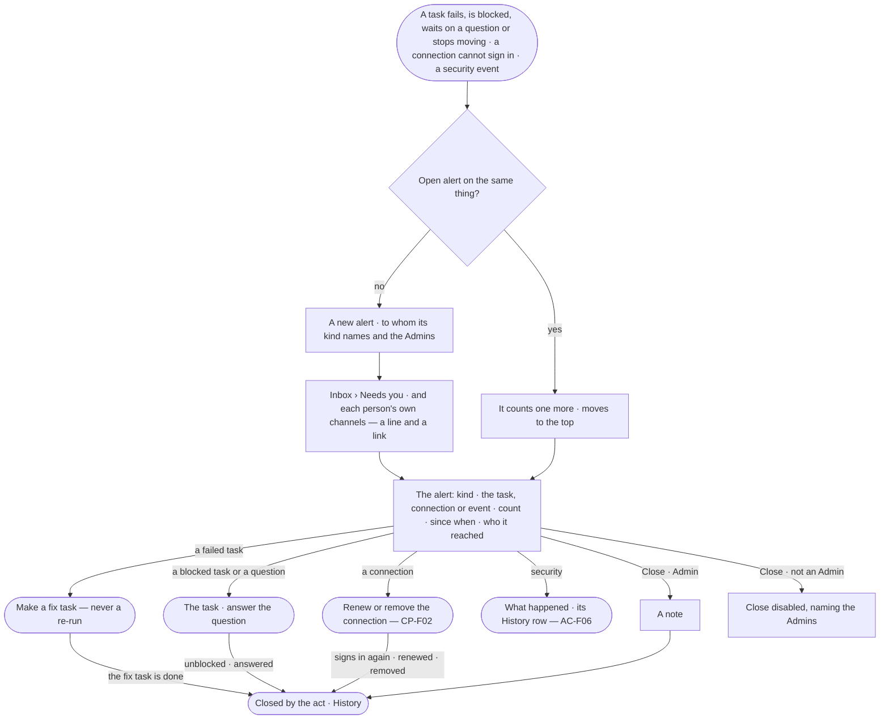

# CP-67 · Get told when work stops or a connection fails

**As** a task's assignee, a project's reviewer, the person a question is to, the person a personal connection belongs to, a named approver or an Admin **I want**
to be told when a task fails, is blocked, needs my input or stops moving, when a connection cannot sign in, and when a
security event happens **so that** I make the fix task, answer, renew the connection or look into it before the work
waits longer, and the alert closes once someone has.

Tasks: [task.md](task.md) · Feature: [CP-F11](../../feature.md)

## Who can

| Lens | Can | Otherwise sees |
|---|---|---|
| Admin | Receive every task, connection and security alert; read every alert; act on what it is about; close one with a note | — |
| Operator | Operator · Modeller: receive the alerts of tasks they are assignee or reviewer of or are asked, of their own personal connections, of work connections whose agents they approve for, and of sandbox refusals of agents they approve for — never another person's personal connection ([the role table](../../../../../access/features/AC-F02-access-policies/feature.md#the-role-table)); read every alert; act on what it is about as that act allows | *Close* disabled — *Needs the Admin role — ask {admins}*; a run's content withheld as AC-31 says |

## Flow

## Acceptance criteria

| # | Given | When | Then |
|---|---|---|---|
| CP-67.1 | A task | it closes *Failed* | an alert *task failed* opens naming the task and its project, sent to the task's assignee and the project's reviewers, then the Admins; nothing re-runs the task |
| CP-67.2 | A *task failed* alert | a fix task made from the failed task is done, or an Admin closes it with a note | the alert closes naming the act and who |
| CP-67.3 | A task that reads *Blocked* for 30 minutes (the default threshold) | the clock checks | an alert *task blocked* opens naming the task, sent to the task's assignee and the project's reviewers, then the Admins; it closes when the task leaves *Blocked* |
| CP-67.4 | A task's run waiting on an unanswered question for 15 minutes (the default threshold) | the clock checks | an alert *task needs input* opens naming the task and the question, sent to the person the question is to and the project's reviewers, then the Admins; it closes when the question is answered or the run is stopped |
| CP-67.5 | A task *In progress* on its run, with no new step for 15 minutes, not waiting on a person | the clock checks | one alert *stopped moving* opens on the task — never one on the task and one on its run — sent to its assignee and the project's reviewers, then the Admins |
| CP-67.6 | A work connection that cannot sign in — expired, revoked or refused | the engine sees it | one alert *connection failed* opens naming the connection and why, sent to the named approvers of the agents it is attached to, then the Admins; it never carries the secret |
| CP-67.7 | A personal connection that cannot sign in | the engine sees it | one alert *connection failed* opens naming the connection, sent to its person only, never the Admins |
| CP-67.8 | A *connection failed* alert | the connection signs in again, is renewed or is removed | the alert closes naming the act and who, or *cleared* |
| CP-67.9 | The History chain breaks, a retired token is presented again, an account is locked, or an Access Policy is saved wider than the one before | the engine sees it | an alert *security* opens naming what happened — one per reason — sent to the Admins; it stays open until an Admin closes it with a note |
| CP-67.10 | The sandbox refuses an agent's act on a worker | the refusal is written | an alert *security* opens naming the run, the act and the target, sent to the agent's named approvers, then the Admins |
| CP-67.11 | An alert already open on the same thing | the kind fires again | the open alert counts one more and moves to the top; no second alert opens |
| CP-67.12 | An Operator | they read an alert | *Close* is disabled — *Needs the Admin role — ask {admins}*; the route answers 403 with the same sentence |
| CP-67.13 | An alert opening or closing | it is written | History holds a row naming who it reached, and what closed it and who |

## Screens

| Surface | Lens | First use | Empty after a filter | Loading | Has data | Failed | Agent working or proposing | No access |
|---|---|---|---|---|---|---|---|---|
| Ops alerts | Admin | control.alerts · No alerts | control.alerts · No match | control.alerts · Loading | control.alerts | control.alerts · Could not load | control.alerts · Counting | — |
| Ops alerts | Operator | control.alerts · No alerts | control.alerts · No match | control.alerts · Loading | control.alerts | control.alerts · Could not load | control.alerts · Counting | — |
| An alert | Admin | — | — | control.alerts.alert · Loading | control.alerts.alert | control.alerts.alert · Already closed | control.alerts.alert · Run still going | — |
| An alert | Operator | — | — | control.alerts.alert · Loading | control.alerts.alert | control.alerts.alert · Could not load | control.alerts.alert · Run still going | control.alerts.alert · Close disabled |
| Inbox — an ops alert | Admin | — | — | inbox · Loading | inbox · Ops alert | inbox · Could not load | — | — |
| Inbox — an ops alert | Operator | — | — | inbox · Loading | inbox · Ops alert | inbox · Could not load | — | — |
