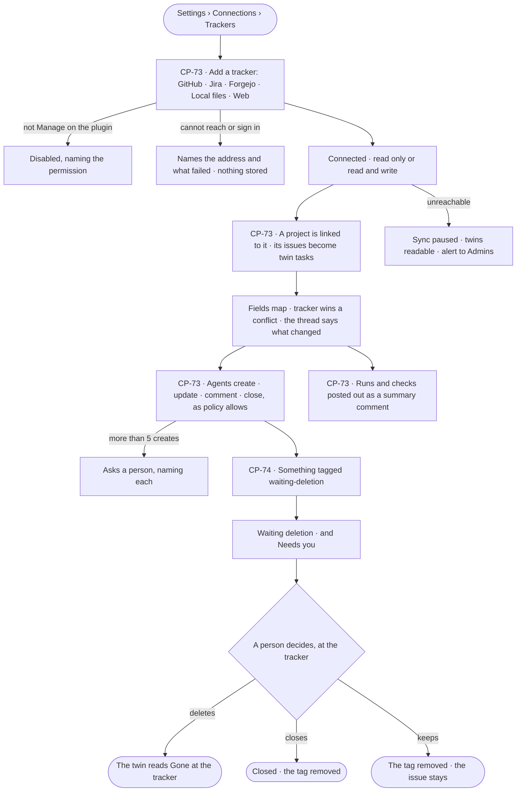

# Issue trackers

> Where a project's work meets the tracker its team already uses — GitHub, Jira, Forgejo, local files or the web.
> When a project is linked, **the tracker is the record of truth** and each issue has an Invana twin that carries its
> runs, checks and context; agents work the tracker through its own MCP server as their policies allow; and nothing
> ever deletes an issue but a person, at the tracker. The decision it helps make: *what in the tracker should
> change, and what should go?*

## User journey

Journeys this feature is a step of: [J11 · Ideate and run a project with its assistant](../../../../journeys/J11-ideate-and-run-a-project-with-its-assistant.md) · [J13 · Plan and run work from the project graph](../../../../journeys/J13-plan-and-run-work-from-the-project-graph.md)

## Stories

| ID | Story | Status |
|---|---|---|
| CP-73 | [Connect an issue tracker and link a project to it](stories/CP-73-connect-an-issue-tracker-and-link-a-project/story.md) | idea |
| CP-74 | [Delete an outside issue only by hand](stories/CP-74-delete-an-outside-issue-only-by-hand/story.md) | idea |

## Access

Permissions are [the permission catalogue](../../../access/features/AC-F02-access-policies/feature.md#the-permission-catalogue)'s; no act here is new to it. A tracker is a tool plugin, so its connection follows [CP-F02](../CP-F02-plugins-and-outside-tools/feature.md#access).

| Act | Permission | Everyone else sees |
|---|---|---|
| Add, test and remove a tracker connection | Manage on `plugin/<name>`, in a session, with the password again; a second Admin's yes when the deployment asks | Disabled — *Needs Manage on the {name} plugin — ask {who can grant}* |
| Read trackers, their state and their linked projects | Read on `plugin/<name>` | — |
| Link or unlink a project to a repository or project key a connection may serve | Every person on the project's team | Disabled — *Join the team to change it* |
| An agent creating, updating, commenting on or closing an issue | The agent's Access Policy: Run on `tool/<tracker>/<tool>`, on Ask by default | Refused, naming the rule |
| Name what a connection may serve, its Web hosts or Local files root, and allow data-bearing text to a public tracker | Manage on `plugin/<name>`, in a session, with the password again | Disabled — *Needs Manage on the {name} plugin — ask {who can grant}* |
| Link a project to a remote the connection does not serve | Nobody until an Admin names it | Refused, naming it |
| Deleting an issue | Nobody in Invana — never granted; a person deletes it in the tracker | No delete tool is offered |
| Tag or untag *waiting-deletion*, keep an item | Every person on the project's team, or a run the project's policies let write | Disabled — *Join the team to change it* |
| Read the *Waiting deletion* queue | A person on the project, or with Read on Projects | Items of a project they may not read show as a count, withheld |

## States

| State | What the person sees |
|---|---|
| First use | *No trackers yet* with *Add a tracker* (Admin) · a project: *Not linked* with *Link to a tracker* |
| Empty after a filter | The filter named — tracker, project, tag — with *Clear it* |
| Loading | Trackers or issues reading, nothing guessed |
| Has data | Each tracker with its adapter, state and linked projects; each twin with its issue's address and state |
| Failed | A tracker unreachable or its connection expired, naming why; sync paused; twins stay readable |
| Agent working or proposing | An agent acting on an issue, or a card holding more than 5 creates |
| No access | The act disabled, naming the permission or *Join the team to change it* |

## Rules

| Rule | Detail |
|---|---|
| One adapter interface | Every tracker is reached through one interface — read issues, labels and milestones; create, update, comment and close — and a tool plugin names its adapter. GitHub, Jira and Forgejo (self-hosted) read and write; Local files (a repository's spec files) and Web (pages, for research) read only |
| The tracker is the truth | A linked project's issues are the record; an Invana task is their twin, carrying runs, checks and context. A change to the same field on both sides keeps the tracker's value, and the task's thread says what changed |
| The field map | Title · body · state (open or closed, with a state label) · tags to labels · milestone · assignee (an agent is a bot user of the tracker). Runs and checks go out as one summary comment, through the outbound check; never a run's content |
| Agents act through the tracker's MCP | Create, update, comment and close are the tracker's own MCP tools, called under the agent's Access Policy, on Ask by default as every outside tool is. More than 5 creates in one run waits for a person naming each |
| Deletes are manual | No agent and no Invana act deletes an outside issue. A tag *waiting-deletion* puts the item in Settings › Connections and in Needs you; a person deletes it at the tracker, or closes or keeps it, which removes the tag. Only the adapter's eight methods are ever offered or granted; every other tool of a tracker's MCP server is Deny, whatever a rule or wildcard says |
| A connection serves only what an Admin names | A connection serves the repositories or project keys an Admin names, none by default; a link outside them is refused. The Admin's token may see more than the connection serves |
| Outside text taints a run | A run that has read an issue, a comment, a page or a parsed source asks before any write at a tracker, an ask or a proposal, whatever its policy says, and the card shows the exact text ([NFR-SEC-15](../../../../system-design.md#3-non-functional-requirements)) |
| A public tracker gets no data | To a public tracker only counts, check names, pass or fail and a link go out; data-bearing comments and created issues are off until an Admin opts the connection in, with a warning shown at that act |
| A fetch goes only where allowed | The Web adapter reaches only the hosts an Admin allows, over https, and Local files only under the Admin's root ([NFR-SEC-16](../../../../system-design.md#3-non-functional-requirements)) |
| A milestone maps to the tracker's own | The tracker's milestone, version or sprint when it has one, else a label `milestone:<name>` |
| A work connection signs in | A tracker signs in with a work connection ([CP-62](../CP-F02-plugins-and-outside-tools/stories/CP-62-make-a-work-connection-and-attach-it-to-agents/story.md)); the agents' acts use the one attached to them |
| Sync is a pull, then a push | A worker reads a linked project's issues every 60 seconds (or on the tracker's webhook, when it has one) and applies the field map; an act in Invana writes through the adapter first and the twin follows what the tracker returns |
| Backend owns every number | Counts of issues synced, conflicts and items waiting are the engine's |

## Data touched

| Record | Access |
|---|---|
| Tracker connections — adapter, address, mode, state; the credential sealed by [CP-F02](../CP-F02-plugins-and-outside-tools/feature.md#engine) | Write · read |
| Tracker links and issue twins | Write · read |
| Tasks and their tags | Write · read ([PJ-F01](../../../../capabilities/projects/features/PJ-F01-projects-and-tasks/feature.md#engine)) |

## Engine

The low-level design: what this feature stores, serves and refuses. Conventions — naming, errors, lists, events — are
[system-design.md](../../../../system-design.md) §§ 6–8; this section only fills them in.

### Records

| Table | Columns | Notes |
|---|---|---|
| `control_trackers` | `name` · `adapter` (`github` · `jira` · `forgejo` · `local_files` · `web`) · `address` · `plugin` · `mode` (`read_only` · `read_write`) · `state` (`connected` · `unreachable` · `expired`) · `serves` (JSON list of repositories, project keys or folders) · `allowed_hosts?` (Web) · `root?` (Local files) · `data_text_public` (bool, default false) · `tool_digest` (hash of the pinned MCP server's version and tool schemas) · `created_by_id` | Unique `name`; the credential is the work connection of the plugin, never a column here |
| `control_tracker_links` | `tracker_id` · `project_id` · `remote` (repository or project key, or folder) · `visibility` (`public` · `private`, read at link time and every sync) · `state` (`active` · `paused`) · `last_synced_at?` · `created_by_id` | Unique (`tracker_id`, `project_id`, `remote`) |
| `control_tracker_issues` | `link_id` · `task_id` · `remote_id` · `remote_url` · `remote_state` · `remote_labels` (JSON) · `remote_hash` · `gone` (bool) · `last_seen_at` | The twin; unique (`link_id`, `remote_id`) |

### Reads

| Record | Owner |
|---|---|
| Tasks, tags (`projects_task_tags`: who tagged, the note), milestones | [PJ-F01 › Engine](../../../../capabilities/projects/features/PJ-F01-projects-and-tasks/feature.md#engine) |
| Plugins, work connections, the tracker's MCP tools | [CP-F02 › Engine](../CP-F02-plugins-and-outside-tools/feature.md#engine) |
| Asks, the outbound check | [AC-F05](../../../access/features/AC-F05-asks-and-approvals/feature.md#engine) · [AC-F09](../../../access/features/AC-F09-what-left-the-platform/feature.md#engine) |

### Routes

| Route, after `/api/v1/control` | Does | Story |
|---|---|---|
| `GET /trackers` · `POST /trackers` · `DELETE /trackers/{id}` · `POST /trackers/{id}/test` | Trackers by the list contract · add · remove (links and twins stay as records, issues untouched) · test the connection | CP-73 |
| `GET /trackers/{id}/links` · `POST /trackers/{id}/links` · `DELETE /trackers/{id}/links/{link_id}` | A tracker's linked projects · link a project · unlink | CP-73 |
| `POST /tasks/{id}/issue` | *Create the issue* for a task made in Invana | CP-73 |
| `GET /waiting-deletion` | The queue by the list contract: each item's twin, tracker, who tagged it, their note | CP-74 |
| `POST /waiting-deletion/{task_id}/keep` | Remove the tag, keeping the issue | CP-74 |

### Events

| Event | When |
|---|---|
| `control.trackers.add` · `control.trackers.remove` · `control.trackers.state` | A tracker added · removed · its state changed |
| `control.trackers.linked` · `control.trackers.unlinked` | A project linked · unlinked |
| `control.trackers.synced` · `control.trackers.conflict` | A sync settled, with counts · a field kept the tracker's value, from and to |
| `control.trackers.issue_created` · `issue_updated` · `issue_commented` · `issue_closed` | An agent's or a person's act through the adapter |
| `control.trackers.issue_gone` | A linked issue found deleted at the tracker |
| `control.trackers.deletion_kept` | An item kept |

### Refusals

| Status | When | Sentence | Criterion |
|---|---|---|---|
| 422 | A tracker that cannot be reached or signs in badly | *{address} could not be reached — {why}.* | CP-73.3 |
| 409 | A write through a read only adapter | *{tracker} is read only.* | CP-73.2 |
| 403 | A policy rule or call that names a tracker tool outside the adapter's eight | *A delete at a tracker is never granted.* | CP-74.1 |
| 403 | A link to a remote the connection does not serve | *{remote} is not served by {tracker} — ask {who can grant}.* | CP-73.16 |
| 422 | A source address outside the connection's hosts or root | *{address} is outside what {tracker} may reach.* | CP-73.19 |
| 422 | A fetch that is not https, resolves to a refused address, leaves the root or reads a secret file | *{address} is refused — {why}.* | CP-73.20 |
| 409 | A created issue, or a data-bearing comment, to a public tracker not opted in | *{tracker} is public — data-bearing text is off for it.* | CP-73.18 |
| 409 | A tracker's MCP server whose version or tool schemas changed | *{plugin} is held — its tools changed — ask {who can grant}.* | CP-73.15 |
| 403 | Adding or removing a tracker without Manage on its plugin | *Needs Manage on the {name} plugin — ask {who can grant}.* | CP-73.12 |
| 403 | Linking a project by a person not on its team | *Join the team to change it.* | CP-73.12 |
| 409 | A sixth create in one run before a person says yes | *{n} issues wait for a person to say Create them.* | CP-73.9 |
| 409 | A write while the tracker is unreachable or its connection expired | *{tracker} is {state} — {why}.* | CP-73.10 |

### CLI

| Command | Does |
|---|---|
| — | |

### Mechanisms

| Mechanism | How |
|---|---|
| The adapter interface | `list_issues(since)` · `get_issue` · `create_issue` · `update_issue` · `comment` · `close_issue` · `labels` · `milestones`. There is no `delete`. Each method maps to one tool of the tracker's MCP server; the tool list Invana offers is exactly those tools, every other tool of the server is Deny whatever a wildcard says, and a call by name outside the list is refused and recorded. On connect Invana reads the credential's scopes where the tracker says them and warns on one that could delete, administer or transfer. The MCP server runs in the worker sandbox with a pinned version and hashed tool schemas (`tool_digest`); a change holds the plugin until an Admin approves again |
| Sync | Every 60 seconds, or on the tracker's webhook, per active link: read issues changed since `last_synced_at`, apply the field map to the twin, and where a field changed on both sides keep `remote_*` and write `control.trackers.conflict`. A `remote_id` absent from the read sets `gone` and the twin reads *Gone at the tracker* |
| A write | Through the adapter first, as the actor's connection allows; the twin takes what the tracker returns, never the other way. A run that has read outside text makes every write an Ask showing the exact text and target; to a public tracker a created issue is refused and a comment is the fixed counts template unless `data_text_public` is on |
| Fetching | Web: https only; the host is in `allowed_hosts`; private, unique-local, shared, mapped and metadata addresses refused; every redirect hop re-checked and the checked address used; no credential or cookie; no script; size, time and content-type caps. Local files: a real path under `root`, no symlink or `..`, no secret, key or `.git` config file |
| Milestones | A milestone is written to the tracker's own milestone, version or sprint when it has one, else the label `milestone:<name>` |
| The summary comment | When a twin's run or check settles, one comment on the issue lists the runs and each check's result; the next edits it. Its text goes through the outbound check and is recorded in *What left the platform* |
| Bulk creates | A run's creates through one link are counted; at the sixth the run holds and a card in Needs you names every issue ([CP-76](../CP-F08-the-inbox/stories/CP-76-see-why-an-agent-is-waiting-for-me/story.md)) |
| Waiting deletion | The queue is the tasks of linked projects tagged `waiting-deletion` and not `gone`; a deletion at the tracker sets `gone` and removes the tag |

## System impact

| HLD section | Change | NFRs |
|---|---|---|
| § 6 Data and storage | Three tables in Invana's own store; the credential stays sealed with the plugin's work connection | NFR-SEC-2 |
| § 7 Architecture and components | A tracker adapter per kind, run by the workers; the sync worker; each tracker's own MCP server as a tool plugin, run in the worker sandbox | NFR-SEC-1 · NFR-SEC-14 |
| § 8 APIs and events | The routes and events above, under `control` | — |
| § 10 AI and agents | An agent's act on a tracker is a tool call under its policy; the sixth create holds the run | NFR-SEC-1 |
| § 11 Failure modes and the outside boundary | A tracker down pauses its sync and refuses writes, naming why; twins stay readable; a connection health alert reaches the Admins | — |
| § 12 Qualities | Security: only the adapter's eight tools offered; a summary comment is outbound text through the outbound check; an issue's text is untrusted data and taints the run that reads it; a fetch goes only where an Admin allows | NFR-SEC-7 · NFR-SEC-8 · NFR-SEC-15 · NFR-SEC-16 |

## Decisions

| Decision | Detail |
|---|---|
| The tracker wins | When a tracker is linked, it is the record; Invana's twin carries what the tracker cannot — runs, checks, context |
| A tracker is a plugin | It follows the plugin's switches, work connections and Access Policies like every outside tool |
| Deletes are a person's, at the tracker | The only deletion of an outside issue is a person's, there; Invana shows the queue and nothing more |
| Read only adapters | Local files and Web feed the subject model and research; they are never written |
| An issue's text is data | A title, a body or a comment from a tracker is never an instruction to an agent; a run that reads one asks before it writes |
| A poll is 60 seconds | A tracker with no webhook is read every 60 seconds; one with a webhook is read when it calls |
| Only the adapter's tools | The offered tools are an allow-list of the adapter's eight methods; a deny-list of names is never the guarantee |
| Public trackers get counts, not data | Data-bearing comments and created issues to a public tracker are off by default; an Admin opts a connection in, with a warning at that act |
| A connection serves what is named | An Admin names the repositories or project keys; the link of a person is bounded by it |
| A milestone maps to the tracker's own | Its milestone, version or sprint when it has one, else the label `milestone:<name>` |

## Open questions

| Question | Who answers |
|---|---|
| Security's medium rows are scheduled with CP-73 and CP-74 and are should-fix before either is `built`: R549 write caps and label pattern · R550 the public tracker's fixed template and the stored comment id · R551 *Closed at the tracker* is not Done, and an assignment never starts a run · R552 webhook signature and no *Gone* on one miss (a 20% brake) · R553 waiting-deletion steering (plain-text note, a grouped card over 5) · R555 the sandbox of the tracker's MCP server · R556 credential hygiene, run id in posted text, a 14-day expiry alert. The coder adds a task for each at the story's `designed` gate | Coder, at build |

## Not building

| Item | Why not |
|---|---|
| Deleting an outside issue from Invana | A deletion is a person's, at the tracker |
| Two-way merge of a conflicting field | The tracker wins; the thread says what changed |
| A tracker of our own | The work is recorded in the engine's tables; a tracker is the team's own |
| Writing to Local files or Web | They are read only sources |
