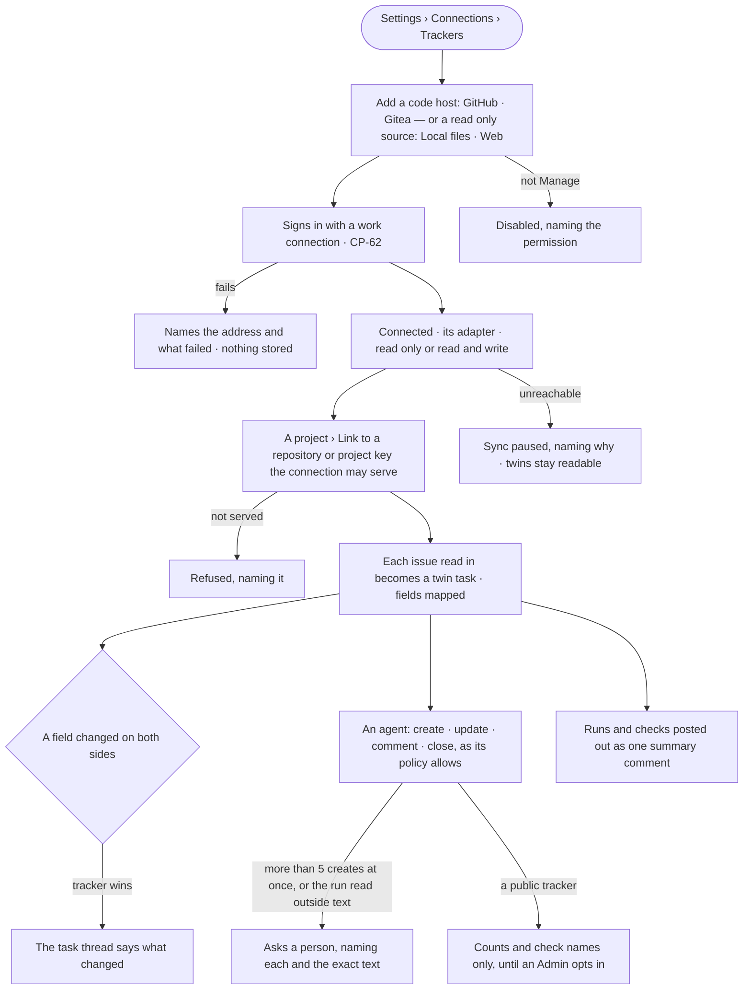

# CP-73 · Connect an issue tracker and link a project to it

**As** an Admin **I want** to connect a code host — GitHub or Gitea — or a read only source — local files or the web — and a person on a project to link the project to it **so that** the tracker stays the record of truth, each issue has an Invana twin that carries its runs, checks and context, and agents work the tracker as their policies allow.

Tasks: [task.md](task.md) · Feature: [CP-F12](../../feature.md)

## Who can

| Access | Can | Otherwise sees |
|---|---|---|
| Admin | With Manage on `plugin/<name>`: add, test and remove a tracker connection, with the password again; name what it may serve, its hosts or root, and whether it may carry data-bearing text to a public tracker; link, unlink and read any project's link | — |
| Operator | Read every tracker connection and the issues linked; on a project they are on the team of, link it to a repository or project key a connection may serve, and work its twins | *Add a tracker*, *Remove*, what it may serve and *Allow data-bearing text* are disabled — *Needs Manage on the {name} plugin — ask {who can grant}*. On a project they are not on the team of, *Link* is disabled — *Join the team to change it* |

## Flow

## Acceptance criteria

| # | Given | When | Then |
|---|---|---|---|
| CP-73.1 | An Admin with Manage on the tracker's plugin | they add a tracker with its address, a work connection (CP-62) and the repositories or project keys it may serve | it is tested, sealed and reads *Connected* with its adapter, whether it is read only or read and write and what it may serve (none until named); History records who, never the credential |
| CP-73.2 | The adapters | they are listed | GitHub and Gitea read and write — issues, branches, pull requests, checks and reviews, through the adapter's seventeen methods; Local files and Web read only — a write to either is refused, naming that it is read only; no other host is offered — another is a connector added later |
| CP-73.3 | A tracker that cannot be reached or signs in badly | it is added | it fails naming the address and what failed; nothing is stored |
| CP-73.4 | A person on a project's team | they link the project to a project or repository a connected tracker may serve (CP-73.16) | every issue read in becomes a twin task, and each twin shows its issue's address; a task made later in Invana creates its issue only when a person chooses *Create the issue* |
| CP-73.5 | A twin and its issue | they are read | the tracker is the record of truth: title, body, state (open or closed, with a state label), tags and labels, milestone and assignee map one to one, an agent being a bot user of the tracker; a tag added in Invana adds the label of the same name, and a label the project has no tag for becomes one |
| CP-73.6 | A field changed on both sides before a sync | the next sync runs | the tracker's value stays and the task's thread says what changed, from what, to what |
| CP-73.7 | A twin | its runs and checks settle | one summary comment is posted on the issue — never a run's content — through the outbound check ([AC-F09](../../../../../access/features/AC-F09-what-left-the-platform/feature.md)); a comment already posted is edited, not repeated |
| CP-73.8 | An agent in a run on a linked project | it creates, updates, comments on or closes an issue | it does so through the tracker's MCP server, only as its Access Policy allows; an act outside its policy is refused, naming the rule |
| CP-73.9 | An agent | it creates more than 5 issues in one run | the sixth waits in Needs you naming every issue it would create; nothing more is created until a person says *Create them* |
| CP-73.10 | A tracker down or an expired connection | a sync or an act runs | it is paused or refused naming why; twins stay readable; a connection health alert reaches the Admins; the sync resumes when it is back |
| CP-73.11 | A person who may not read a project | they open a twin | it is withheld; the issue's address is not shown |
| CP-73.12 | An Operator | they reach *Add a tracker* or *Remove* | it is disabled, naming the permission; a call is refused the same way |
| CP-73.13 | A twin | its *How it got here* is opened | it shows each sync, who or which agent changed what, and the tracker's side |
| CP-73.14 | A credential | an Admin adds it | Invana reads its scopes where the tracker says them and warns, naming the scope, when it could delete, administer or transfer; the dialog names the adapter's least-privilege scopes |
| CP-73.15 | A tracker's MCP server | it is installed or updated | it runs in the worker sandbox (NFR-SEC-14) with only its credential, a pinned version, no network beyond the tracker's address, its tool schemas hashed, and its tool descriptions and results read as untrusted; a changed version or schema holds the plugin until an Admin with Manage approves it again, naming what changed |
| CP-73.16 | A connection and a person linking a project | the remote is not among the repositories or project keys the connection may serve | the link is refused, naming it; adding one to the connection needs Manage on the plugin and is recorded; every link records who made it |
| CP-73.17 | A run that has read outside text — an issue, a comment, a page or a parsed source | it would create, update, comment on, close or tag at a tracker, or ask or propose | the act is Ask whatever its policy says — Allow does not lift it for that run — and the card shows the exact text and the target (CP-76.11); a person says *Send it* or *Not this time* |
| CP-73.18 | A connection | it is linked or synced | Invana records whether the tracker's repository is public or private and checks it again on every sync; to a public one a created issue is refused and a comment carries only counts, check names, pass or fail and a link, until an Admin with Manage turns on *Allow data-bearing text* for that connection, a warning naming the public audience shown at that act and History recording who; every create, update and comment passes the outbound check |
| CP-73.19 | A Web connection or a Local files connection | an Admin adds it | a Web connection holds the hosts an Admin with Manage allows and a Local files connection the workspace root they set; a source address outside it is refused, naming it |
| CP-73.20 | The Web adapter or the Local files adapter | it fetches | Web takes https only, refuses private, unique-local, shared, mapped and metadata addresses, re-checks every redirect hop, uses the address it checked, sends no credential or cookie, runs no script and caps size, time and content types; Local files resolves a folder by real path under the root, refuses symlinks and `..`, and never reads secret, key or `.git` config files (NFR-SEC-16) |

## Screens

| Surface | Access | First use | Empty after a filter | Loading | Has data | Failed | Agent working or proposing | No access |
|---|---|---|---|---|---|---|---|---|
| Trackers | Admin | settings.plugins · Trackers · None yet | settings.plugins · Trackers · Nothing matches | settings.plugins · Trackers · Loading | settings.plugins · Trackers | settings.plugins · Trackers · Unreachable | — | — |
| Trackers | Operator | settings.plugins · Trackers · None yet | settings.plugins · Trackers · Nothing matches | settings.plugins · Trackers · Loading | settings.plugins · Trackers | settings.plugins · Trackers · Unreachable | — | settings.plugins · Trackers · Read only |
| Add a tracker | Admin | — | — | settings.plugins · Trackers · Add · Testing | settings.plugins · Trackers · Add | settings.plugins · Trackers · Add · Failed | — | — |
| Add a tracker | Operator | — | — | settings.plugins · Trackers · Add · Testing | settings.plugins · Trackers · Add | settings.plugins · Trackers · Add · Failed | — | settings.plugins · Trackers · Read only |
| Link a project | Admin | projects.projects · Detail · Tracker · Not linked | — | projects.projects · Detail · Tracker · Reading issues | projects.projects · Detail · Tracker | projects.projects · Detail · Tracker · Paused | projects.projects · Detail · Tracker · Agent acting | — |
| Link a project | Operator | projects.projects · Detail · Tracker · Not linked | — | projects.projects · Detail · Tracker · Reading issues | projects.projects · Detail · Tracker | projects.projects · Detail · Tracker · Paused | projects.projects · Detail · Tracker · Agent acting | projects.projects · Detail · Tracker · Not on the team |
| A twin's conflict | Admin | — | — | — | projects.tasks · Detail · Tracker changed it | projects.tasks · Detail · Tracker · Paused | — | — |
| A twin's conflict | Operator | — | — | — | projects.tasks · Detail · Tracker changed it | projects.tasks · Detail · Tracker · Paused | — | projects.tasks · Detail · Withheld |
| What a tracker may serve | Admin | settings.plugins · Trackers · Reach · None named | — | settings.plugins · Trackers · Reach · Loading | settings.plugins · Trackers · Reach | settings.plugins · Trackers · Reach · Held | — | — |
| What a tracker may serve | Operator | settings.plugins · Trackers · Reach · None named | — | settings.plugins · Trackers · Reach · Loading | settings.plugins · Trackers · Reach | settings.plugins · Trackers · Reach · Held | — | settings.plugins · Trackers · Reach · Read only |
| Allow data-bearing text | Admin | — | — | — | settings.plugins · Trackers · Public · Warning | — | — | — |
| Allow data-bearing text | Operator | — | — | — | — | — | — | settings.plugins · Trackers · Public · Read only |
| A link outside the reach | Admin | — | — | — | — | projects.projects · Detail · Tracker · Not served | — | — |
| A link outside the reach | Operator | — | — | — | — | projects.projects · Detail · Tracker · Not served | — | projects.projects · Detail · Tracker · Not on the team |
