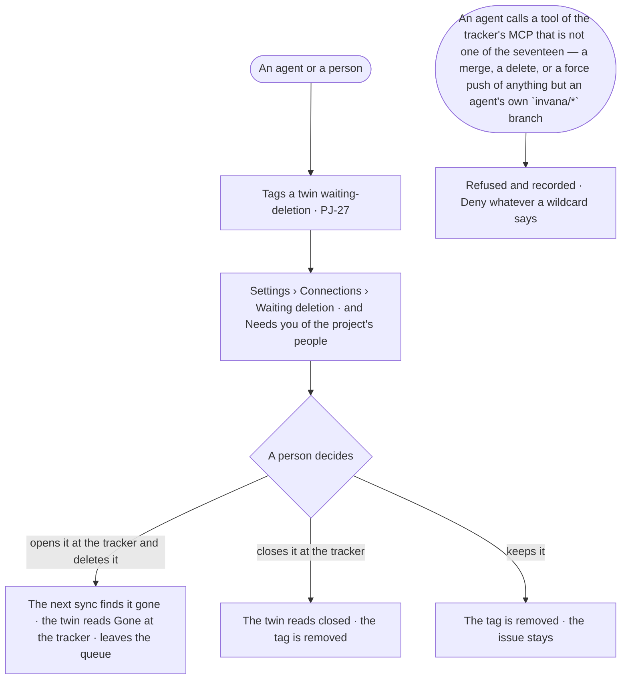

# CP-74 · Delete an outside issue only by hand

**As** a person on a project **I want** anything that should go from the tracker to be tagged *waiting-deletion* and left for a person to delete there **so that** no agent and no Invana act ever deletes an issue, and I decide each deletion myself.

Tasks: [task.md](task.md) · Feature: [CP-F12](../../feature.md)

## Who can

| Access | Can | Otherwise sees |
|---|---|---|
| Admin | Read the *Waiting deletion* queue of every tracker; keep, close or open an item at its tracker; remove the tag | — |
| Operator | The same for the items of projects they are on the team of; others read as a count | Items of a project they may not read are withheld and counted |

## Flow

## Acceptance criteria

| # | Given | When | Then |
|---|---|---|---|
| CP-74.1 | A tracker's MCP server | its tools are offered or called | only the adapter's seventeen methods — list, get, create, update, comment and close an issue, labels, milestones, create a branch, push a branch, force push an agent's own `invana/*` branch (guarded: only after a person approves, CP-78.19), open, update and comment on a pull request, read a pull request, its checks and its reviews — are offered or callable; no merge and no delete of an issue, a branch or a pull request is among them; every other tool of that server is Deny whatever a rule or a wildcard says, a renamed or new tool included; a rule that names one is refused when saved, saying a merge or a delete at a code host is never granted; a call by name outside the seventeen is refused the same way and recorded |
| CP-74.2 | Invana | any of its acts runs | none deletes an issue; unlinking a project or removing a tracker leaves every issue as it is |
| CP-74.3 | A twin | an agent or a person tags it *waiting-deletion* | it is listed in *Waiting deletion* under Settings › Connections, with its tracker, who tagged it and their note, and waits in Needs you of the project's people |
| CP-74.4 | An item in the queue | a person chooses *Open at the tracker* | the issue opens in the tracker; Invana changes nothing |
| CP-74.5 | An issue deleted at the tracker | the next sync runs | its twin reads *Gone at the tracker*, the item leaves the queue and History records it |
| CP-74.6 | An item | a person chooses *Keep* | the tag is removed, the issue stays and the item leaves the queue |
| CP-74.7 | An item | the issue is closed at the tracker | the twin reads closed and the tag is removed |
| CP-74.8 | A tracker that is read only (Local files · Web) | a twin is tagged | it is listed the same; nothing is ever deleted at its source |
| CP-74.9 | A person who may not read the project | they open the queue | its items read as a count, withheld |
| CP-74.10 | A deletion waiting | its *How it got here* is opened | it shows who tagged it, when, their note and every sync since |

## Screens

| Surface | Access | First use | Empty after a filter | Loading | Has data | Failed | Agent working or proposing | No access |
|---|---|---|---|---|---|---|---|---|
| Waiting deletion | Admin | settings.plugins · Waiting deletion · Nothing waiting | settings.plugins · Waiting deletion · Nothing matches | settings.plugins · Waiting deletion · Loading | settings.plugins · Waiting deletion | settings.plugins · Waiting deletion · Tracker unreachable | settings.plugins · Waiting deletion · Agent tagged | — |
| Waiting deletion | Operator | settings.plugins · Waiting deletion · Nothing waiting | settings.plugins · Waiting deletion · Nothing matches | settings.plugins · Waiting deletion · Loading | settings.plugins · Waiting deletion | settings.plugins · Waiting deletion · Tracker unreachable | settings.plugins · Waiting deletion · Agent tagged | settings.plugins · Waiting deletion · Withheld |
| A deletion in Needs you | Admin | — | — | — | inbox · Needs you · Waiting deletion | inbox · Needs you · Waiting deletion · Tracker unreachable | — | — |
| A deletion in Needs you | Operator | — | — | — | inbox · Needs you · Waiting deletion | inbox · Needs you · Waiting deletion · Tracker unreachable | — | inbox · Needs you · Waiting deletion · Withheld |
