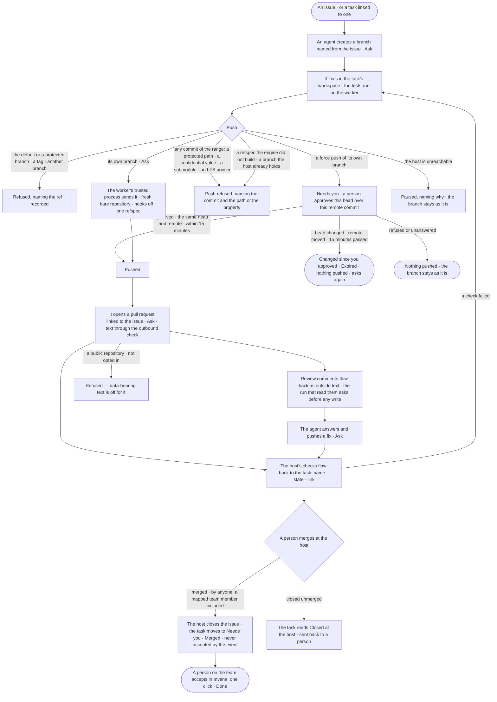

# CP-78 · Fix an issue through a branch and a pull request

**As** a person on a project **I want** an agent to take an issue — or a task linked to one — to a branch, a fix and a pull request at our code host, answer its checks and reviews, and leave the merge to me **so that** the fix reaches the team through the host's own review, nothing lands on the default branch without a person, and the task settles from what happened there. *The agent proposes → the person merges.*

Tasks: [task.md](task.md) · Feature: [CP-F12](../../feature.md)

## Who can

| Access | Can | Otherwise sees |
|---|---|---|
| Admin | Everything an Operator on the team can; name a connection's agent prefix and protected paths (Manage on `plugin/<name>`, with the password again) | — |
| Operator | On a project they are on the team of: read a task's branch, pull request, checks and reviews; say *Send it* to an agent's push or pull request; approve or refuse an agent's force push of its own branch; accept a merged task. An agent acts under its own Access Policy | Acts disabled — *Join the team to change it*. Protected paths and the prefix read only — *Needs Manage on the {name} plugin — ask {who can grant}*. Nobody has *Merge* in Invana |

## Flow

## Acceptance criteria

| # | Given | When | Then |
|---|---|---|---|
| CP-78.1 | A task linked to an issue on GitHub or Gitea, or an issue read in as a twin | an agent in a run on the project begins the fix | it creates a branch named from the issue — the connection's prefix, the issue number and a slug of its title in `[a-z0-9-]`, at most 40 characters, never leading with a dash, such as `invana/42-fix-login-redirect`; a title with nothing left reads `invana/42` — from the default branch's head; the act is Ask unless its policy allows it, and the task shows the branch |
| CP-78.2 | A task made in Invana with no issue | an agent or a person chooses *Create the issue* first (CP-73.4) | the branch is named from the new issue; a pull request is never opened for a task with no issue |
| CP-78.3 | A branch | the agent works | the worker's trusted process clones the repository into the task's workspace — the runtime never holds the host's credential (CP-65.19); the agent edits and runs the tests there and commits as its bot user with the issue's address in each message; nothing leaves the worker until a push |
| CP-78.4 | An agent | it pushes to the default branch, a protected branch, a tag, or any branch other than the one this task created — or force pushes any of them | it is refused before it leaves, naming the ref and that a push goes only to the task's agent branch (a force push is CP-78.19); the attempt is recorded and a security alert may follow |
| CP-78.5 | A push any commit of whose range touches a protected path — the CI and workflow folders by default — or carries a confidential or personal value | it is made | it is refused, naming the commit, the path or the property; an Admin with Manage may name what an agent may change in a protected path, recorded |
| CP-78.6 | An agent's push | it is made | it is Ask by default, showing the branch and the files changed; a run that has read outside text asks whatever its policy says (CP-73.17); to a public repository it is refused until an Admin opts the connection in (CP-73.18) |
| CP-78.7 | A task with no open pull request | the agent opens one | it is linked to the issue so that the host closes the issue when a person merges; its text passes the outbound check; it is Ask by default; a task has one open pull request, and a second is refused, naming it; it counts toward the sixth-create hold (CP-73.9) |
| CP-78.8 | A pull request | the host's checks run | the task shows each check's name, state and link, and the pull request's overall checks state, as the next sync reads them; a check's log text is never stored |
| CP-78.9 | A pull request | a reviewer comments or reviews | each comment appears in the task's thread as outside text — fenced, labelled with its author and link — and the run that reads it is tainted: it asks before any write at the host, showing the exact text (CP-73.17, NFR-SEC-15) |
| CP-78.10 | A review comment | the agent answers or pushes a fix | each is an act under its Access Policy, Ask by default, to the same branch and pull request only |
| CP-78.11 | Any agent, in any run | it tries to merge a pull request, or to delete or close a branch, an issue or a pull request | no such tool is offered; a call by name is refused and recorded (CP-74.1) |
| CP-78.12 | A pull request | a person merges it at the host | the next sync sets it merged, the host closes the issue, the task moves to *Needs you* of the project's people reading *Merged — waiting for your accept*, and History records the host's account that merged it; a merge by a person mapped to a team member does not accept the task, and no outside event ever does — the task is Done only when a person on the team accepts it in Invana with one click, recorded under their name |
| CP-78.13 | A pull request | a person closes it at the host unmerged | the task reads *Closed at the host* and returns to a person; no agent reopens it |
| CP-78.14 | A host unreachable or its connection expired | a push or a pull request is attempted | it is refused naming why; the branch stays as it is; the sync resumes when the host is back (CP-73.10) |
| CP-78.15 | A repository whose default branch is not protected | it is linked | a warning names it and recommends protecting the branch at the host; the link is allowed, since protection is the host's own |
| CP-78.16 | A person who may not read the project | they open the task | the branch, the pull request and its checks are withheld |
| CP-78.17 | An Operator not on the team | they try to say *Send it*, accept or change a connection's paths | it is disabled, naming the permission; the engine refuses the same |
| CP-78.19 | An agent whose own `invana/*` branch needs a forced update — after a rebase, say | it asks to force push it | the guarded `force_push_branch` raises a Needs-you item for the people on the team, showing the branch, the head it sends, the commits it replaces and the files changed; nothing is pushed until a person approves, and an approval covers that one push of that head over that remote commit, once, within 15 minutes; a refusal, or no answer, pushes nothing; the push then passes CP-78.5 and the outbound check like any push; History records `control.trackers.force_push_approved` or `control.trackers.force_push_refused`, naming the person, the branch and the commits replaced |
| CP-78.20 | An agent | it asks to force push the default or a protected branch, a tag, or any branch it did not create for this task | it is refused before it leaves, naming the ref, whatever a person might approve; no Needs-you item is raised |
| CP-78.21 | An approver | they allow the push or the pull request in *Needs you* | the task's *Pull request* reads *Opening*, then *Opened*; a refusal reads *Refused*, naming why; a review comment the agent answers reads *Answered* on the task; a merge reads *Merged* on the task and in *Needs you* |
| CP-78.22 | A workspace holding a pre-push hook, a `core.hooksPath`, `core.sshCommand` or `credential.helper` setting, a changed remote address, a `.gitattributes` filter or a `.gitmodules` entry — or a refspec with an empty source, a `+`, a tag, `--mirror` or `--all` | the agent's branch is sent | the worker's trusted process sends it from a fresh bare repository holding only the range's commits, with hooks off and no workspace config, as the one refspec `<sha>:refs/heads/<ref>` the engine built; nothing the workspace planted runs, and no delete, force, tag or other branch is possible — another refspec is refused, naming it |
| CP-78.23 | A range of several commits — one adds a file under a protected path and a later one removes it; or one renames, symlinks or changes the mode of a file into one; or one holds a submodule entry or an LFS pointer | it is sent | every commit is checked, paths compared ignoring case; it is refused before it leaves, naming the commit and the path, and the task's *Pull request* reads *Push refused* |
| CP-78.24 | A branch name that already exists at the host with history this task did not push | the agent creates or sends it | it is refused, naming the ref — *not this task's branch* |
| CP-78.25 | An approved forced update | the head about to be sent differs from the approved one, the remote moved, it is a second attempt, or 15 minutes passed since the yes | nothing is sent; `control.trackers.force_push_refused` records why — head changed · remote moved · expired; the Needs-you item reads *Changed since you approved* or *Expired*, and a new one is raised for the push as it now stands (NFR-SEC-18) |
| CP-78.18 | A task | its *How it got here* is opened | it shows the branch, each commit pushed, the pull request, each check and review, who merged it and each Ask and its answer |

## Screens

| Surface | Access | First use | Empty after a filter | Loading | Has data | Failed | Agent working or proposing | No access |
|---|---|---|---|---|---|---|---|---|
| A task's branch and pull request | Admin | projects.tasks · Detail · Pull request · None yet | — | projects.tasks · Detail · Pull request · Reading | projects.tasks · Detail · Pull request | projects.tasks · Detail · Pull request · Paused | projects.tasks · Detail · Pull request · Agent working | — |
| A task's branch and pull request | Operator | projects.tasks · Detail · Pull request · None yet | — | projects.tasks · Detail · Pull request · Reading | projects.tasks · Detail · Pull request | projects.tasks · Detail · Pull request · Paused | projects.tasks · Detail · Pull request · Agent working | projects.tasks · Detail · Withheld |
| A push or pull request waiting for a yes | Admin | — | — | — | inbox · Needs you · Push or pull request | inbox · Needs you · Push or pull request · Refused | inbox · Needs you · Push or pull request | — |
| A push or pull request waiting for a yes | Operator | — | — | — | inbox · Needs you · Push or pull request | inbox · Needs you · Push or pull request · Refused | inbox · Needs you · Push or pull request | inbox · Needs you · Push or pull request · Not on the team |
| A review comment | Admin | — | — | — | projects.tasks · Detail · Review comment | — | projects.tasks · Detail · Review comment · Agent answering | — |
| A review comment | Operator | — | — | — | projects.tasks · Detail · Review comment | — | projects.tasks · Detail · Review comment · Agent answering | projects.tasks · Detail · Withheld |
| A force push waiting for a yes | Admin | — | — | — | inbox · Needs you · Force push | inbox · Needs you · Force push · Refused | inbox · Needs you · Force push | — |
| A force push waiting for a yes | Operator | — | — | — | inbox · Needs you · Force push | inbox · Needs you · Force push · Refused | inbox · Needs you · Force push | inbox · Needs you · Force push · Not on the team |
| A force push approved, then changed or lapsed | Admin | — | — | — | — | inbox · Needs you · Force push · Changed since you approved · Expired | — | — |
| A force push approved, then changed or lapsed | Operator | — | — | — | — | inbox · Needs you · Force push · Changed since you approved · Expired | — | inbox · Needs you · Force push · Not on the team |
| A push refused before it left | Admin | — | — | — | — | projects.tasks · Detail · Pull request · Push refused | — | — |
| A push refused before it left | Operator | — | — | — | — | projects.tasks · Detail · Pull request · Push refused | — | projects.tasks · Detail · Withheld |
| A merged task | Admin | — | — | — | inbox · Needs you · Merged | — | — | — |
| A merged task | Operator | — | — | — | inbox · Needs you · Merged | — | — | inbox · Needs you · Merged · Not on the team |
| A connection's agent prefix and protected paths | Admin | — | — | settings.connectors · Trackers · Paths · Loading | settings.connectors · Trackers · Paths | settings.connectors · Trackers · Paths · Refused | — | — |
| A connection's agent prefix and protected paths | Operator | — | — | — | — | — | — | settings.connectors · Trackers · Paths · Read only |
| The pull request opened | Admin | — | — | projects.tasks · Detail · Pull request · Opening | projects.tasks · Detail · Pull request · Opened | projects.tasks · Detail · Pull request · Refused | — | — |
| The pull request opened | Operator | — | — | — | projects.tasks · Detail · Pull request · Opened | — | — | projects.tasks · Detail · Withheld |
| A review comment answered | Admin | — | — | — | projects.tasks · Detail · Review comment · Answered | — | — | — |
| A review comment answered | Operator | — | — | — | projects.tasks · Detail · Review comment · Answered | — | — | projects.tasks · Detail · Withheld |
| Where a merge lands | Admin | — | — | — | projects.tasks · Detail · Merged | — | — | — |
| Where a merge lands | Operator | — | — | — | projects.tasks · Detail · Merged | — | — | projects.tasks · Detail · Withheld |
