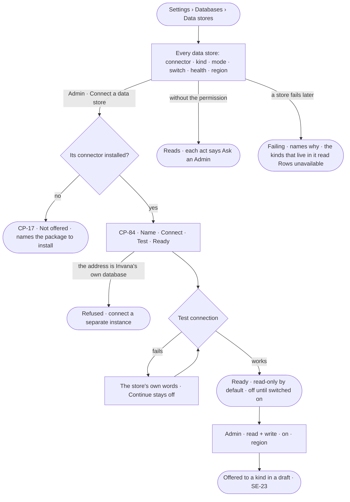

# Data stores

> The Admin's control of the outside stores that hold what a graph database holds badly — bulk rows, time series and
> files — and of the compute engines that work next to them: connecting one through its connector, read-only or read +
> write, switched on or off, healthy or not, and tagged with the region it sits in. A kind of the model says where its
> rows live ([SE-23](../../../../capabilities/semantics/features/SE-F02-change-and-publish-a-model/stories/SE-23-store-a-kinds-rows-in-a-table/story.md)); the graph database holds the
> pointer, never the bulk. The decision it helps make: *which stores may agents read and write, and where may the data
> be worked on?*

## User journey

Journeys this feature is a step of: [J07 · Ready a deployment](../../../../journeys/J07-ready-a-deployment.md)

## Stories

| ID | Story | Status |
|---|---|---|
| CP-84 | [Connect a data store](stories/CP-84-connect-a-data-store/story.md) | idea |

## Access

A data store is the outside system a connector drives, so every act is governed on `plugin/<connector id>` like any connection of a connector ([CP-F02 › Rules](../CP-F02-plugins-and-outside-tools/feature.md#rules)); no act here is new to [the permission catalogue](../../../access/features/AC-F02-access-policies/feature.md#the-permission-catalogue).

| Act | Permission | Everyone else sees |
|---|---|---|
| Read every data store — name, connector, kind, mode, switch, health, region; never its credential | Read on `plugin/<connector>` | — |
| Connect · change · test · remove a data store | Manage on `plugin/<connector>`, and the password again | Each act reads *Needs Manage on the {name} plugin — ask {who can grant}* |
| Set read + write · switch on or off · set the region | Manage on `plugin/<connector>`, signing in again for read + write | The value reads; the act reads disabled with its reason |
| Read or write a data store | An agent, within the mode and the switch set here and the model's own permissions | Refused before it starts, naming the rule, the mode or who switched it off |
| Install or remove a data store connector | None in Studio — done on the engine's machine ([CP-79](../CP-F02-plugins-and-outside-tools/stories/CP-79-install-a-connector/story.md)) | — |

## States

| State | What the person sees |
|---|---|
| First use | No data store: *Connect a data store*; the connectors Invana ships for it are listed with their kind |
| Empty after a filter | *No data store matches* and *Clear* |
| Loading | A test says it is testing; the list draws its rows and fills health in place |
| Has data | Every data store with its connector, kind, mode, switch, health, region and the kinds that live in it |
| Failed | A test failed in the store's own words; a name used; an address that is Invana's own database; a save refused with the reason; a connector not installed, naming its package |
| Agent working or proposing | — (no agent act: a kind's home is proposed in [SE-23](../../../../capabilities/semantics/features/SE-F02-change-and-publish-a-model/stories/SE-23-store-a-kinds-rows-in-a-table/story.md)) |
| No access | Every data store reads; each act reads disabled with its reason; the credential is never shown |

## Rules

| Rule | Detail |
|---|---|
| Two connector kinds | A **data store** is a connection through a connector of kind `data_store`; a **compute** connection is one through a connector of kind `compute` ([CP-F02 › Rules](../CP-F02-plugins-and-outside-tools/feature.md#rules)). Both are connected, tested, switched and tagged the same way, here |
| What ships | TimescaleDB (`invana-timescaledb`) for tables and time series, on an instance of its own — never the application database Invana runs on · S3 (`invana-s3`) for files, RustFS the bundled store, any S3-compatible store or Amazon S3 connectable · MongoDB (`invana-mongodb`) for a MongoDB install the customer already runs — Invana bundles none, installs none and manages none |
| Never Invana's own database | An address that resolves to the application database the engine runs on is refused; Invana's tables are never offered as a home |
| One credential, sealed | A data store has one credential, sealed under the install key, never read back, and asked for with the password again; read-only until an Admin sets read + write, signing in again |
| Tried before it is kept | Connecting makes one read-only, ledgered call; a failure stores nothing |
| Off until switched on | A new data store is off; an off store is offered to no kind and read by no run, and a kind whose rows live in it reads *Rows unavailable* ([SE-23.13](../../../../capabilities/semantics/features/SE-F02-change-and-publish-a-model/stories/SE-23-store-a-kinds-rows-in-a-table/story.md)) |
| A home is what the connector offers | A connector's manifest names its `homes` — TimescaleDB `table` · `series`, MongoDB `collection`, S3 `files`; a store offers a kind only those |
| The graph points, never copies | Rows, points and file bytes stay in the store; the graph database holds a node with the key and a pointer ([SE-F02 › Rules](../../../../capabilities/semantics/features/SE-F02-change-and-publish-a-model/feature.md#rules)). A read through the pointer runs under the person's default agent like any read of a record |
| Every call is ledgered | A call to a data store is one ledger row, with the record IDs a read touched (at most 1,000), as a call to a graph database is ([AC-F09](../../../access/features/AC-F09-what-left-the-platform/feature.md)) |
| A region tag | A data store, a compute connection and a worker each carry an optional region tag — a short name an Admin chooses, such as `eu-west`; untagged means anywhere. The tag is a label Invana keeps and enforces, never a claim about where a provider holds the data |
| The residency rule | A step that reads or writes a tagged data store, or uses a tagged compute connection, runs only on a worker carrying the same tag; with none free it waits, then fails — *No worker in {region} took it.* A result that leaves the region passes the outbound check as a send ([AC-F09](../../../access/features/AC-F09-what-left-the-platform/feature.md#rules)). **Designed now, built after MVP**: the tag is stored and shown from the first build, the rule is enforced only after it |
| Leans on | Connectors and the secret store (CP-F02) · workers (CP-F03) · the graph database's mode and switch (CP-F05) · kinds and homes (SE-F02) · the ledger (AC-F09) |

## Data touched

| Record | Read or write |
|---|---|
| Data store connections — connector, name, configuration, mode, switch, region, health | Read · write |
| The credential — sealed | Write; never read back |
| Connectors found at start, their `homes` | Read |
| Workers and their region | Read |
| Kinds whose rows live in a store | Read |

## Engine

The low-level design: what this feature stores, serves and refuses. Conventions — naming, errors, lists, events — are
[system-design.md](../../../../system-design.md) §§ 6–8; this section only fills them in.

### Records

| Table | Columns | Notes |
|---|---|---|
| `control_data_stores` | `id` · `name` (`^[a-z][a-z0-9_-]{0,63}$`, unique) · `connector` (the entry-point id) · `kind` (`data_store` · `compute`) · `config` (JSON, validated by the connector's schema, no secret) · `secret_sealed?` · `mode` (`read_only` · `read_write`, default `read_only`) · `enabled` (default `false`) · `region?` (`^[a-z0-9-]{1,32}$`) · `state` (`connected` · `failing` · `off`) · `tested_at?` · `test_result?` (`works` · `failed`, with the store's answer) · `made_by_id` · `made_at` · `switched_by_id?` · `switched_at?` | One connection. Never a credential in `config` |

### Reads

| Record | Owner |
|---|---|
| Connectors, their kind, `config` schema, secrets and `homes` | [CP-F02 › Engine](../CP-F02-plugins-and-outside-tools/feature.md#engine) |
| Workers and their `region` | [CP-F03 › Engine](../CP-F03-workers-and-the-queue/feature.md#engine) |
| The kinds whose `store_id` is a store | [SE-F02 › Engine](../../../../capabilities/semantics/features/SE-F02-change-and-publish-a-model/feature.md#engine) |
| The password check and the sealed secret store | [AC-F01](../../../access/features/AC-F01-sign-in-account-and-sessions/feature.md#engine) · [system-design.md](../../../../system-design.md) § 6 |
| History and the ledger | [AC-F06](../../../access/features/AC-F06-history/feature.md#engine) · [AC-F09](../../../access/features/AC-F09-what-left-the-platform/feature.md#engine) |

### Routes

| Route, after `/api/v1/control` | Does | Story |
|---|---|---|
| `GET /data-stores` · `GET /data-stores/{id}` | By the list contract — `?f.kind=` · `?f.connector=` · `?f.state=` · `?q=`: `id` · `name` · `connector` · `kind` · `mode` · `enabled` · `state` · `region` · `homes` · the kinds that live in it; never the secret | CP-84 |
| `POST /data-stores/test` | `{connector, config, secret?}` — one read-only call; returns `works` or the store's own words; writes nothing | CP-84 |
| `POST /data-stores` | `{connector, name, config, secret?, region?, password}` — tries the credential, then stores it; off, read-only | CP-84 |
| `PATCH /data-stores/{id}` | `{name?, config?, secret?, mode?, enabled?, region?, password}` — a change that touches the credential or `read_write` asks the password again | CP-84 |
| `DELETE /data-stores/{id}` | Removes the connection; refused while a published kind lives in it | CP-84 |

### Events

| Event | When |
|---|---|
| `control.data_stores.connect` · `.update` · `.switch` · `.remove` | A data store connected, changed, switched or removed; never the secret |
| `control.data_stores.test` | A test ran: its result |

### Refusals

| Status | When | Sentence | Criterion |
|---|---|---|---|
| 403 | An act without Manage on `plugin/<connector>` | *Needs Manage on the {name} plugin — ask {who can grant}.* | CP-84.11 |
| 403 | An act without the password again, or with a key | *Enter your password again to do this.* | CP-84.10 |
| 409 | A connector that is failed, held or not installed | *{package}: {why}.* | CP-84.12 |
| 422 | A field that breaks the connector's `config` schema | *{field}: {why}.* | CP-84.5 |
| 422 | An address that resolves to the application database Invana runs on | *That is Invana's own database — connect a separate instance.* | CP-84.6 |
| 422 | The store refuses the credential or does not answer | The store's own words | CP-84.4 |
| 409 | A name already used | *{name} is already a data store.* | CP-84.7 |
| 409 | Removing a store a published kind lives in | *{kinds} live in {name} — move them first.* | CP-84.13 |

### CLI

| Command | Does |
|---|---|
| `invana data-stores list` · `test <name>` | Every data store with its mode, switch and health · one test, as Studio's |

### Mechanisms

| Mechanism | How |
|---|---|
| The form is the connector's | Studio draws the connect form from the connector's `config` schema and secret names; the engine validates the same schema |
| Never the application database | The engine compares the resolved host, port and database with its own connection and refuses a match, at connect and at every start |
| Health | The engine tests a switched-on store on the access clock and stores `state` and `tested_at`; a `failing` store raises a connection failed alert ([CP-F11](../CP-F11-ops-alerting/feature.md#the-alert-kinds)) |
| Residency | When a step is admitted, the engine reads the `region` of every store and compute connection the step names and routes the step to a worker whose `region` equals it; no match waits, then fails |
| One interface per home | `DataStoreConnector` offers `read`, `query_series`, `read_object` and, for a read + write store, `project_kind` — the one write path for a table, a hypertable, a collection or a bucket path — and never deletes rows outside a load's undo |

## System impact

| HLD section | Change | NFRs |
|---|---|---|
| § 6 Data and storage | A data store is a store outside the application database, reached through a connector; one Postgres table, `control_data_stores`; the credential sealed under the install key | NFR-SEC-2 |
| § 7 Architecture and components | Two connector kinds — `data_store`, `compute` — behind engine interfaces | — |
| § 8 APIs and events | `/api/v1/control/data-stores`; `control.data_stores.*` events | — |
| § 9 Distributed execution | A step runs on a worker of the region of the stores it names — built after MVP | — |
| § 11 Failure modes and the outside boundary | A data store down fails the step that reads it, and its kinds read *Rows unavailable*; every call ledgered | NFR-SEC-7 · NFR-SEC-9 |

## Decisions

| Decision | Detail |
|---|---|
| Bulk lives outside the graph | Rows, time series and files are held by a store built for them; the graph database holds what relates them and a pointer to each — a graph database stays the one store of records Invana joins and reasons over |
| Its own instance, never Invana's | TimescaleDB is connected as an instance of its own, because the application database is the truth of Invana's own records and a customer's load must never share its tables, its upgrades or its backups |
| S3 for files, RustFS bundled | Files go through the S3 API; RustFS is bundled so a deployment has a file store with nothing installed, and any S3-compatible store connects the same way ([system-design.md](../../../../system-design.md) § 6) |
| MongoDB for an existing install only | Invana bundles no document store: a customer who already runs MongoDB connects it, and one who does not is not asked to run one |
| A connection, not a credential | A data store is a connection of its own with a mode and a switch, as a graph database is, because a person turns it on and off and asks whether it works — not a work connection an agent holds |
| The permission is the plugin's | Every act reuses Manage on `plugin/<connector>`, so no access is new; a resource of its own, `setting/data-stores`, is not added |
| Region is a tag, residency a rule | A region is a label an Admin chooses and Invana enforces on where steps run; it makes no promise about a provider's own placement. Designed now, built after MVP |

## Open questions

| Question | Who answers |
|---|---|
| — | — |

## Not building

| Item | Why not |
|---|---|
| A bundled MongoDB or TimescaleDB | A customer runs the store they trust; only the file store is bundled, since every deployment needs files |
| Joining records across a data store and a graph database in one query | The graph points; a question that needs both reads the pointer, never a join in the store |
| A compute connector that ships | The kind is defined so one can be written; none is asked for yet |
| Moving rows when a kind's home changes | Publishing changes what the model says; a move is a load ([SE-23.12](../../../../capabilities/semantics/features/SE-F02-change-and-publish-a-model/stories/SE-23-store-a-kinds-rows-in-a-table/story.md)) |
| Enforcing residency before MVP | The tag is kept from the first build; the rule is built after it |
