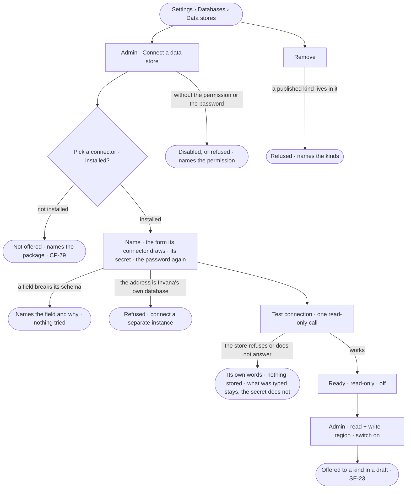

# CP-84 · Connect a data store

**As** an Admin **I want** to connect a store for tables, time series or files, prove it works, and say whether agents may write to it and where it sits **so that** a model's kinds can keep their bulk rows there and the graph database only points to them.

Tasks: [task.md](task.md) · Feature: [CP-F13](../../feature.md)

## Who can

A data store is the outside system a connector drives, so connecting it is Manage on `plugin/<connector>` with the password again ([CP-F13 › Access](../../feature.md#access)). Its connector is installed on the engine's machine first ([CP-79](../../../CP-F02-plugins-and-outside-tools/stories/CP-79-install-a-connector/story.md)).

| Access | Can | Otherwise sees |
|---|---|---|
| Admin | With Manage on the connector's plugin and the password again: connect a data store, test it, set read + write, switch it on or off, tag its region, change it, remove it | — |
| Operator | Read every data store — connector, kind, mode, switch, health, region — never its credential | Each act is disabled — *Needs Manage on the {name} plugin — ask {who can grant}* |

## Flow

## Acceptance criteria

| # | Given | When | Then |
|---|---|---|---|
| CP-84.1 | A data store connector installed — TimescaleDB, S3 or MongoDB | an Admin opens *Connect a data store* | it lists each installed connector of kind `data_store` or `compute`, with its kind and the homes it offers, and a connector not installed is named with its package |
| CP-84.2 | A connector picked | the Admin continues | a form is drawn from the connector's `config` and secret names; TimescaleDB asks for its own instance's address, database and login; S3 for its endpoint, bucket and keys, RustFS preset when it is the bundled store; MongoDB for the existing install's address and login |
| CP-84.3 | A form filled | the Admin tests the connection | Invana makes one read-only call, shown as *Testing*, ledgered, carrying no record of the Graph; a store that answers reads *Works* |
| CP-84.4 | A credential the store refuses, or a store that does not answer | the test ends | it is refused in the store's own words; nothing is stored; the form keeps what was typed except the secret |
| CP-84.5 | A field that breaks the connector's `config` schema | it is submitted | it is refused, naming the field and why; nothing is tried |
| CP-84.6 | An address that is the application database Invana runs on | it is submitted | it is refused — *That is Invana's own database — connect a separate instance.* — and nothing is tried |
| CP-84.7 | A name already used by a data store | it is submitted | it is refused — *{name} is already a data store.* |
| CP-84.8 | A data store just connected | it reads *Works* | it is read-only and off; its credential is sealed and never read back; History records who connected it, never the secret |
| CP-84.9 | A connected data store | an Admin sets read + write, switches it on or off, or sets its region tag | the change is stored with who and when; read + write signs in again; the region is a short tag or none, and reads beside the store as *eu-west* |
| CP-84.10 | Connecting, changing the credential or setting read + write | it is done without the password, with a wrong one, or with a key | it is refused — *Enter your password again to do this* |
| CP-84.11 | An Operator without Manage on the plugin | they connect or change a data store by any path | it is refused — *Needs Manage on the {name} plugin — ask {who can grant}* — and every act reads disabled, naming the permission |
| CP-84.12 | A connector failed, held or not installed | someone opens *Connect a data store* | it is not offered, naming why |
| CP-84.13 | A data store a published kind lives in | an Admin removes it | it is refused — *{kinds} live in {name} — move them first.* |
| CP-84.14 | A switched-on data store | it stops answering | it reads *Failing* with the store's own words, a connection failed alert is raised ([CP-F11](../../../CP-F11-ops-alerting/feature.md#the-alert-kinds)), and the kinds that live in it read *Rows unavailable* (SE-23.13) |
| CP-84.15 | Any data store | the list opens | each row shows connector, kind, mode, switch, health, region and the kinds that live in it; a store that is off is offered to no kind |
| CP-84.16 | A region tag on a data store and on workers | a step that touches the store is admitted — after MVP | it runs only on a worker with the same tag, or fails — *No worker in {region} took it.* — and the tag alone changes nothing before then |
| CP-84.17 | A data store connector not installed | the Admin picks it | its package is named, *Continue* stays off and *Install a connector* opens the install and returns to the same step |
| CP-84.18 | A data store ready | the Admin presses *Set read + write*, *Switch on* or saves a region | read + write goes through *Sign in again*, which names the act and returns to *Ready · Read + write*; *Switch on* reads *On*; a saved region reads *Region saved*; *Done* returns to the list with the store as a row |
| CP-84.19 | A switched-on data store reads *Failing* | the Admin presses *Test again* or *Open connector* | the test runs again, or the connector's details open |
| CP-84.20 | An Admin | they press *Remove* on a data store | a confirm names what it holds, *Sign in again* names the act, and the store leaves the list as *Removed*; a refusal reads *Remove refused* (CP-84.13) |
| CP-84.21 | The list reads *None yet* or *Could not load* | an Admin looks for the next act | *Connect a data store* and *Try again* are offered |

## Screens

| Surface | Access | First use | Empty after a filter | Loading | Has data | Failed | Agent working or proposing | No access |
|---|---|---|---|---|---|---|---|---|
| The data stores | Admin | settings.databases · Data stores · None yet | settings.databases · Data stores · No match | settings.databases · Data stores · Loading | settings.databases · Data stores | settings.databases · Data stores · Could not load | — | — |
| The data stores | Operator | settings.databases · Data stores · None yet · Read only | settings.databases · Data stores · No match | settings.databases · Data stores · Loading | settings.databases · Data stores · Read only | settings.databases · Data stores · Could not load | — | settings.databases · Data stores · Read only |
| A data store · Open, change, test, region | Admin | — | — | — | settings.databases · Data stores · A store | settings.databases · Data stores · Test failed | — | — |
| A data store · Open, change, test, region | Operator | — | — | — | settings.databases · Data stores · A store · Read only | — | — | settings.databases · Data stores · Read only |
| Connect a data store · 1 Connector | Admin | settings.databases · Connect data store · Connector | — | — | settings.databases · Connect data store · Connector · TimescaleDB · S3 · MongoDB picked | — | — | — |
| Connect a data store · 1 Connector | Operator | — | — | — | — | — | — | settings.databases · Data stores · Read only |
| Connect a data store · 2 Connect · TimescaleDB | Admin | — | — | — | settings.databases · Connect data store · Connect · TimescaleDB | settings.databases · Connect data store · Name taken · Field refused · Invana's own database · Unreachable · Password again missing or wrong | — | — |
| Connect a data store · 2 Connect · TimescaleDB | Operator | — | — | — | — | — | — | settings.databases · Data stores · Read only |
| Connect a data store · 2 Connect · S3 | Admin | — | — | — | settings.databases · Connect data store · Connect · S3 | settings.databases · Connect data store · Name taken · Field refused · Unreachable · Password again missing or wrong | — | — |
| Connect a data store · 2 Connect · S3 | Operator | — | — | — | — | — | — | settings.databases · Data stores · Read only |
| Connect a data store · 2 Connect · MongoDB | Admin | — | — | — | settings.databases · Connect data store · Connect · MongoDB | settings.databases · Connect data store · Name taken · Field refused · Invana's own database · Unreachable · Password again missing or wrong | — | — |
| Connect a data store · 2 Connect · MongoDB | Operator | — | — | — | — | — | — | settings.databases · Data stores · Read only |
| Connect a data store · 3 Test | Admin | — | — | settings.databases · Connect data store · Testing | settings.databases · Connect data store · Ready | settings.databases · Connect data store · Refused | — | — |
| Connect a data store · 3 Test | Operator | — | — | — | — | — | — | settings.databases · Data stores · Read only |
| Connect a data store · Ready · Set read + write | Admin | — | — | — | access.signin · Sign in again · Set read + write | access.signin · Sign in again · Set read + write · Wrong password | — | — |
| Connect a data store · Ready · Set read + write | Operator | — | — | — | — | — | — | settings.databases · Data stores · Read only |
| Connect a data store · Ready · Read + write | Admin | — | — | — | settings.databases · Connect data store · Ready · Read + write | — | — | — |
| Connect a data store · Ready · Read + write | Operator | — | — | — | — | — | — | settings.databases · Data stores · Read only |
| Connect a data store · Ready · Switch on | Admin | — | — | — | settings.databases · Connect data store · Ready · On | — | — | — |
| Connect a data store · Ready · Switch on | Operator | — | — | — | — | — | — | settings.databases · Data stores · Read only |
| Connect a data store · Ready · Region | Admin | — | — | — | settings.databases · Connect data store · Ready · Region saved | — | — | — |
| Connect a data store · Ready · Region | Operator | — | — | — | — | — | — | settings.databases · Data stores · Read only |
| Connect a data store · Done | Admin | — | — | — | settings.databases · Data stores | — | — | — |
| Connect a data store · Done | Operator | — | — | — | — | — | — | settings.databases · Data stores · Read only |
| A connector not installed | Admin | settings.connectors · Install · Not installed | — | — | — | settings.connectors · Detail · Not offered | — | — |
| A connector not installed | Operator | settings.connectors · Install · Not installed · Read only | — | — | — | settings.connectors · Detail · Not offered | — | settings.connectors · Detail · Read only |
| A data store failing | Admin | — | — | — | — | settings.databases · Data stores · Failing | — | — |
| A data store failing | Operator | — | — | — | — | settings.databases · Data stores · Failing · Read only | — | — |
| Remove a data store | Admin | — | — | — | settings.databases · Data stores · Remove | settings.databases · Data stores · Remove refused | — | — |
| Remove a data store | Operator | — | — | — | — | — | — | settings.databases · Data stores · Read only |
| Remove a data store · Sign in again | Admin | — | — | — | access.signin · Sign in again · Remove | access.signin · Sign in again · Remove · Wrong password | — | — |
| Remove a data store · Sign in again | Operator | — | — | — | — | — | — | settings.databases · Data stores · Read only |
| Remove a data store · Removed | Admin | — | — | — | settings.databases · Data stores · Removed | — | — | — |
| Remove a data store · Removed | Operator | — | — | — | — | — | — | settings.databases · Data stores · Read only |
