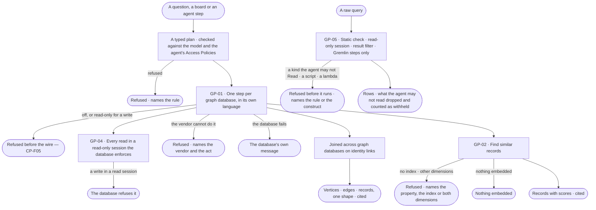
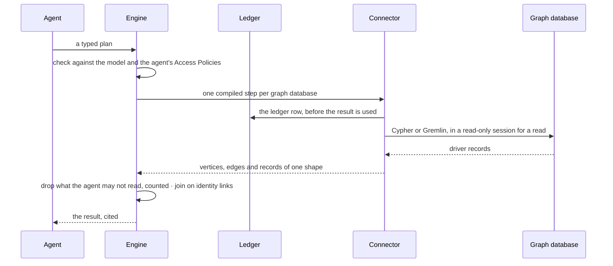

# Data — the customer's Graph, read in place

> Every question, board and agent step reads each graph database in its own language through its connector, answers
> in one shape whatever the vendor, finds similar records with the database's own vector index, and joins the results
> across graph databases on identity links. The decision it helps make: *can I rely on this answer whichever
> databases hold its records?*

## User journey

Journeys this feature is a step of: [J02 · Ask and trust the answer](../../../../journeys/J02-ask-and-trust-the-answer.md).
Connecting a graph database, its mode, switches and health come first, in [CP-F05](../../../control/features/CP-F05-graph-databases/feature.md).

## Stories

| ID | Story | Status |
|---|---|---|
| GP-01 | [Read and write any supported database in its own language](stories/GP-01-read-and-write-any-supported-database-in-its-own-language/story.md) | idea |
| GP-02 | [Find similar records with the database's own vector index](stories/GP-02-find-similar-records-with-the-databases-own-vector-index/story.md) | idea |
| GP-04 | [Trust that a read never writes](stories/GP-04-trust-that-a-read-never-writes/story.md) | idea |
| GP-05 | [Run a raw query within what the agent may read](stories/GP-05-run-a-raw-query-within-what-the-agent-may-read/story.md) | idea |

## Access

Every act here is an agent's, checked against its Access Policies on `data/<graph database>/<kind>` — for a property,
`data/<graph database>/<kind>/<level>`, the level being the property's sensitivity
([AC-F02 › The role table](../../../access/features/AC-F02-access-policies/feature.md#the-role-table)); the person's
role decides only whether they may start the act that asks for it.

| Act | Role | Everyone else sees |
|---|---|---|
| Read or search a graph database | An agent the person may use, as its Access Policies allow, within the graph database's mode and switches ([CP-F05](../../../control/features/CP-F05-graph-databases/feature.md)) | Refused before it starts, naming the rule, the mode or who switched it off |
| Write to a graph database | An agent, as its Access Policies allow Write, on a read + write graph database; a Modeller or an Admin starts it | Refused before the wire, naming the rule or the mode, or *Edit on the board needs the Modeller role* |
| Run a raw query | Operator · Modeller · Admin, through the Query console when it is granted to them; a write needs a Modeller or an Admin | Cypher and Gremlin disabled, naming the Admins; a refusal naming the rule |
| Read which connectors passed the certification test | Admin | — |

## States

| State | What the person sees |
|---|---|
| First use | No graph database on: the asking surface says so and offers set-up ([CP-F05](../../../control/features/CP-F05-graph-databases/feature.md)) |
| Empty after a filter | — the asking surface's own |
| Loading | The step reads as running in its run's trace |
| Has data | Vertices, edges and records of one shape, each cited to its graph database |
| Failed | The database's own message, naming its connector and the graph database; an act the vendor cannot do, named |
| Agent working or proposing | A step running in a run, shown in How it got here |
| No access | Refused before it starts, naming the rule; what a result holds that the agent may not read is dropped and counted as withheld |

## Rules

| Rule | Detail |
|---|---|
| Read in place, never copied | Every look at a record is a query on the customer's graph database; Invana holds no copy |
| One credential per graph database | Each graph database is reached with the one credential an Admin set ([CP-F05](../../../control/features/CP-F05-graph-databases/feature.md)); what an agent may touch is its Access Policies, not a second login |
| A read never writes | Every read opens a read-only session — the driver's read access mode, a read-only transaction, or Gremlin's `ReadOnlyStrategy` — so a write in it fails at the database, not only in Invana, whatever the graph database's mode ([GP-04](stories/GP-04-trust-that-a-read-never-writes/story.md)). A write session opens only for a write step the agent's rules allow on a read + write graph database |
| A connector is certified | A connector is listed as supported only when it passes the certification test: a write attempted in a read session is refused by the database, run against a live database |
| A raw query passes four layers | A static check · a read-only session · a result filter · Gremlin steps only ([GP-05](stories/GP-05-run-a-raw-query-within-what-the-agent-may-read/story.md)); a raw query reaches nothing a typed plan could not |
| Only what the agent may read leaves a read | A kind the agent may not Read is refused before it runs; a property whose level the agent may not Read is dropped from the result and named as withheld, never the whole read refused |
| A person's switch is theirs | A person's own graph-database switch applies only to the runs that person starts; an Admin's switch is a ceiling ([CP-F05](../../../control/features/CP-F05-graph-databases/feature.md)) |
| One package per database | `invana-<db>`, installed beside the engine; the engine depends on no driver |
| Two languages | openCypher and Gremlin, each complete in the engine; a package adds a driver and what the language cannot say |
| One shape | Every vendor answers in vertices, edges and records; nobody downstream sees a driver's types |
| Unsupported is declared | An act a vendor cannot do is refused before the wire, naming the vendor and the act — never a driver error |
| Vector search is the database's | Its own index; no store beside the graph |
| Joined on identity links | A question runs one step per graph database it needs; the engine joins the results on identity links, materialised from the match rules a Modeller declares ([SE-F06](../../../../capabilities/semantics/features/SE-F06-links-and-mappings/feature.md)) |
| Proven against a live database | Every package passes one conformance suite against a running database, never mocked |
| Every call is ledgered | Every call writes its ledger row before its result is used ([AC-F09](../../../access/features/AC-F09-what-left-the-platform/feature.md)) |

## Data touched

| Record | Read or write |
|---|---|
| The customer's records — nodes, relationships, schema, vector indexes | Read · write on a read + write graph database |
| Graph databases — connector, mode, switches, health ([CP-F05](../../../control/features/CP-F05-graph-databases/feature.md)) | Read |
| Identity links — in the system graph | Write (commit and withdraw) · read (the join) |
| Relationships a link between models writes, each marked with its link | Write on commit and on each load · delete on removal |
| The ledger ([AC-F09](../../../access/features/AC-F09-what-left-the-platform/feature.md)) | Write, one row per call |

## Engine

The low-level design: how a connector reads and writes, and how the Graph is joined. Conventions — naming, errors,
lists, events — are [system-design.md](../../../../system-design.md) §§ 6–8; this section only fills them in. The
records of each graph database — its connection, mode, switches and health — are [CP-F05](../../../control/features/CP-F05-graph-databases/feature.md#engine)'s.

### Records

| Table | Columns | Notes |
|---|---|---|
| — | No Postgres table of its own | Identity links are nodes and edges in the system graph; the link rule they come from is `model_links` ([SE-F06](../../../../capabilities/semantics/features/SE-F06-links-and-mappings/feature.md#engine)) |

### Reads

| Record | Owner |
|---|---|
| Graph databases, their connector, mode, switches, health and server version (`control_graph_databases`) · installed connectors | [CP-F05](../../../control/features/CP-F05-graph-databases/feature.md#engine) |
| Who may act and the order of checks | [AC-F02](../../../access/features/AC-F02-access-policies/feature.md#engine) |
| The typed plan a step is compiled from | [EX-F03](../../../../capabilities/explore/features/EX-F03-ask-a-question/feature.md#engine) |
| The query step that calls a connector · packaged plans | [AG-F06](../../../../capabilities/agents/features/AG-F06-plans-and-workflows/feature.md#engine) |
| Link rules (`model_links`) — the match rules identity links come from | [SE-F06](../../../../capabilities/semantics/features/SE-F06-links-and-mappings/feature.md#engine) |
| Loads and their record stamps | [RC-F02](../../../../capabilities/records/features/RC-F02-bring-records-in/feature.md#engine) |
| The ledger row every call writes | [AC-F09](../../../access/features/AC-F09-what-left-the-platform/feature.md#engine) |
| History — every event a commit or withdrawal writes | [AC-F06](../../../access/features/AC-F06-history/feature.md#engine) |

### Routes

| Route | Does | Story |
|---|---|---|
| — | No route of its own: a read, a write, a raw query or a search is a step of a run, started from the surface that asks (a raw query from `POST /sessions/{session}/messages`, [EX-F03](../../../../capabilities/explore/features/EX-F03-ask-a-question/feature.md#engine)); committing and removing a link are [SE-F06](../../../../capabilities/semantics/features/SE-F06-links-and-mappings/feature.md#engine)'s routes | GP-01 · GP-02 · GP-04 · GP-05 |

### Events

| Event | When |
|---|---|
| — | A step's events are its run's ([CP-F10](../../../control/features/CP-F10-runs-and-how-the-agents-are-doing/feature.md#engine)); a link's commit and removal are `model.links.*` ([SE-F06](../../../../capabilities/semantics/features/SE-F06-links-and-mappings/feature.md#engine)) |

### Refusals

| Status | When | Sentence | Criterion |
|---|---|---|---|
| 422 | An act the vendor declares unsupported | *{vendor} cannot {act}.* | GP-01.4 · GP-02.2 |
| 422 | A vector search on a property with no vector index | *{property} has no vector index — it needs {index}.* | GP-02.3 |
| 422 | A query vector of another dimension than the index | *The index holds {n} dimensions; the query has {m}.* | GP-02.4 |
| 502 | The database refuses or fails a query, a write in a read session included | *{connector}: {the database's own message}.* | GP-01.8 · GP-04.2 |
| 422 | A raw query that does not parse | *{the parser's message}, at {line}:{column}.* | GP-05.1 |
| 403 | A raw query with a labelled pattern the agent may not Read | *{agent} may not Read data/{graph database}/{kind} — {rule} on {policy}, set by {person}.* | GP-05.2 |
| 403 | A raw query with an unlabelled pattern and no Read on `data/<graph database>/*` | *An unlabelled pattern reaches every kind — {agent} may not Read data/{graph database}/* — {rule} on {policy}, set by {person}.* | GP-05.3 |
| 422 | A Gremlin query with a script, a lambda or `eval` | *{construct} is not allowed — a Gremlin query is steps only.* | GP-05.9 |
| 409 | A raw write to a read-only graph database | *{name} is read-only — {why}.* | GP-05.6 |
| 403 | A raw write by a person whose role does not hold *Edit on the board* | *Edit on the board needs the Modeller role.* | GP-05.6 |

### CLI

| Command | Does |
|---|---|
| `invana version` | Lists every installed connector and whether it passed the certification test ([CP-F05](../../../control/features/CP-F05-graph-databases/feature.md#engine)) |

### Mechanisms

| Mechanism | How |
|---|---|
| Read session | Part of the connector contract: `read_session()` returns a session the database holds read-only — Bolt `READ` access mode with a read-only transaction, a Gremlin traversal source with `ReadOnlyStrategy`, or the vendor's equivalent. `write_session()` opens only for a write step on a `read_write` graph database, after the step's policy check, for that step only. Every graph database is reached with its one credential (CP-F05); the session, not a second login, is what makes a read safe |
| Certification test | One test every connector must pass before it is listed as supported, run against a live database, never mocked: a write attempted in a read session is refused by the database. A connector that fails it loads `failed`, naming the test; `invana version` shows each connector's result |
| Raw query — static check | The query is parsed in its language. Every labelled node or relationship pattern needs Read on `data/<graph database>/<kind>`; an unlabelled node or relationship pattern needs Read on `data/<graph database>/*`. A refusal comes before the wire and names the rule, its policy and who set it. A kind the agent may Read only in part passes here and is filtered at the result |
| Raw query — result filter | Every returned node and relationship is checked: a kind the agent may not Read is dropped, a property whose level the agent may not Read is dropped, and the reply names the kinds and levels and counts what it withheld. The count is on the ledger row and in the step |
| Raw query — Gremlin steps only | A Gremlin query is steps: no Groovy script, no lambda, no `eval`; the parser refuses the construct before the wire, naming it. Cypher is parsed whole |
| Raw query — the writes | A raw write is a step of the Query console, which asks first ([EX-F03](../../../../capabilities/explore/features/EX-F03-ask-a-question/feature.md)); it runs in a write session only on a read + write graph database |
| Supported databases | openCypher — Neo4j (`neo4j`) · Memgraph (`memgraph`) · ArcadeDB (`arcadedb-cypher`) · Gremlin — JanusGraph (`janusgraph`) · Amazon Neptune (`neptune`) · TinkerGraph (`tinkergraph`) · ArcadeDB (`arcadedb-gremlin`); vector search where the database has an index |
| Three layers | **Base** (core) — lifecycle, transactions, health, the queryset contracts · **language** (core) — a complete openCypher or Gremlin connector with its reference driver, `neo4j` or `gremlinpython` · **integration** (`integrations/invana-<db>/`, its own manifest, dependencies and tests) — a driver the reference one cannot replace, a schema dialect, an algorithm library, a vector index. No code above the connector branches on a database's name |
| Registration | `[project.entry-points."invana.connectors"]` `<name> = "invana_<db>.connector:<Class>"`; read once at start. Names are lowercase and unique; two packages declaring one name both fail to load, named; a connector that cannot be imported is listed `failed` and the engine still starts |
| The contract | A connector subclasses a language connector. `_create_driver` · `_close_driver` · `execute` · `health_check` are implemented already; a package overrides one only where its vendor differs, and any queryset method, or marks it unsupported. Vendor hooks: `message_serializer()` · `query_builder` · `coerce_id()` · `classify_error()` · the serializer's `coerce_element_id()` |
| Querysets | Data reader (vertices and edges, filtered, paged; neighbours, counts, resolve) · data writer (creates, updates, deletes, bulk) · schema (labels, relationship types, property keys, constraints, indexes) · algorithms · vector. Every method is `async` |
| Filters | A `FilterGroup` — a nested AND / OR of conditions — compiled by each language's query builder; nothing is concatenated from strings |
| One shape | A serializer per language turns driver records into the engine's vertices and edges; anything else — a scalar, a map, a list, a count — is a record. Driver types never leave the connector |
| `execute()` is the one door | `execute(query, parameters, *, timeout_s, read_only=True)` runs a compiled step in its language's raw form inside `read_session()` unless `read_only=False` — openCypher over Bolt; Gremlin as a script with bindings, for Invana's own compiled steps, never for a person's or an AI model's text. The querysets compose traversals and send bytecode (`execute_traversal`). Every call writes its ledger row before its result is used ([AC-F09](../../../access/features/AC-F09-what-left-the-platform/feature.md#engine)) |
| Vendor differences | Wire serializer: GraphBinary by default, GraphSON for JanusGraph (its `RelationIdentifier`) · identity function: `elementId()` by default, Memgraph's `id()` via its builder's `ELEMENT_ID` · every id passes `coerce_id` · a construct spelled differently is overridden (Memgraph's `-[*BFS ..n]-`), never refused · a server that does not evaluate scripts is declared (Amazon Neptune) |
| Capabilities | Property types and features — constraints, index kinds, algorithms, vector search — keyed by connector and server version, resolved from the server on connect and on demand, or declared by an Admin ([CP-F05](../../../control/features/CP-F05-graph-databases/feature.md)), and cached with the connection. Enforced at authoring, publish and import: a model version validated against a database that has since changed is refused naming the difference; a model whose types the target cannot hold arrives as an unpublishable draft listing them |
| Vector search | A queryset in each language connector, overridden per vendor; the database's own index. Results are records with scores, cited; an index with nothing embedded returns none, worded *nothing embedded*. Memgraph declares none |
| Conformance | One shared suite every package runs against a live database, never mocked; a method left unimplemented fails it, named |
| The join | One query step per graph database, in its own language; the engine joins the results on the identity links the system graph holds, bounded by NFR-PERF-5 |
| Identity links | Materialised in the system graph from the match rules a Modeller declares per pair of kinds ([SE-F06](../../../../capabilities/semantics/features/SE-F06-links-and-mappings/feature.md)); never guessed; a rule change re-materialises its links |
| Committing a link | `stitch-commit@1`, no agent and no view, the Graph's rules admitting each side; one `MERGE` per link, each relationship carrying `_inv_origin` · `_inv_link_id` · `_inv_rule` · `_inv_at` |
| What each kind writes | *Same thing* writes `SAME_AS` source → target, read undirected; a keyed relationship writes its `edge_type`; a row-sourced relationship writes nothing at commit — committing loads its rows, the files' place read back from the load's run |
| Nothing written says so | A link that wrote nothing — a side the rules refuse — commits, says why, and never reports success; the others still solve |
| Every later load joins | A load's link step runs the same `MERGE`, scoped to that load's stamp; writing again never writes twice |
| A loaded row carries both marks | A relationship a row-sourced link loads carries the link's marks and the load's record stamps (`_inv_model_id` · `_inv_record_id` · `_inv_file` · `_inv_run_id`) |
| `edges` is counted | Re-counted after every solve that writes, never summed — a `MERGE` re-matches |
| Withdrawing a link | An active link runs `stitch-withdraw@1`, deleting exactly the relationships marked with its id; the link's row goes only once they are gone. A rule denying either model refuses the whole removal |

## System impact

| HLD section | Change | NFRs |
|---|---|---|
| § 7 Architecture and components | Connector packages found by entry point; base · language · integration layers | — |
| § 10 AI and agents | One step per graph database in its own language, joined on identity links | NFR-PERF-5 · NFR-PERF-6 |
| § 7 Architecture and components | `read_session()` in the connector contract; the certification test every connector passes; the raw-query static check and result filter | NFR-SEC-9 |
| § 12 Qualities | Every read in a read-only session the database enforces; every raw query checked in four layers; every call ledgered | NFR-SEC-1 · NFR-SEC-5 · NFR-SEC-7 · NFR-SEC-9 |

## Decisions

| Decision | Detail |
|---|---|
| How a connector reads is Data's | The connector contract, read session, raw-query layers, query languages, the one shape, vector search and the join live here; connecting a graph database and its mode, switches and health are [CP-F05](../../../control/features/CP-F05-graph-databases/feature.md)'s |
| Identity links are Data's; match rules are the model's | Link records, commit, withdraw and the join live here; the match rules a Modeller declares, *Link two models* and its count are [SE-F06](../../../../capabilities/semantics/features/SE-F06-links-and-mappings/feature.md)'s |
## Open questions

| Question | Who answers |
|---|---|
| — | — |

## Not building

| Item | Why not |
|---|---|
| A second credential per graph database | One credential each; what an agent may touch is its Access Policies, not a second login |
| A raw query that skips the checks · Groovy scripts, lambdas or `eval` from a person or an AI model | A raw query passes the same four layers a typed plan's reads do; Gremlin is steps only |
| Translating between openCypher and Gremlin | Each step runs in its own graph database's language; the engine joins the results |
| SQL or SPARQL databases | Not families Invana targets |
| A vector store beside the graph · embeddings made by the engine | Two stores are two truths; embeddings arrive with the data |
| A Python fallback for an algorithm a database lacks | The honest answer is that it cannot |
| Guessed identity links | Links come from match rules a person declares |
