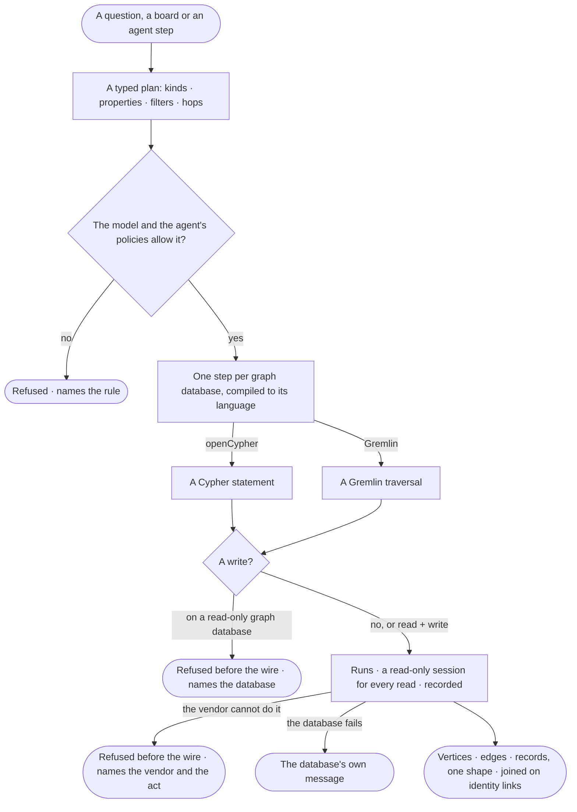

# GP-01 · Read and write any supported database in its own language

**As** an analyst **I want** every question, board and agent step to read each graph database in that database's own
language, with one shape of answer whatever the vendor **so that** what I decide on does not depend on which
databases we happen to run.

Tasks: [task.md](task.md) · Feature: [GP-F01](../../feature.md)

## Who can

| Lens | Can | Otherwise sees |
|---|---|---|
| Admin | Read and write graph databases through the agents they may use, as those agents' Access Policies, each database's mode and its switches allow | — |
| Operator | Read graph databases through the agents they may use, as the same allow | A write is refused before it starts, naming the rule or the mode; *Edit on the board* needs a Modeller |

## Flow

## Acceptance criteria

| # | Given | When | Then |
|---|---|---|---|
| GP-01.1 | A graph database | it is connected | it speaks the one language its connector declares — openCypher or Gremlin; it never switches |
| GP-01.2 | The same question over two graph databases whose vendors differ | each answers | both answer in vertices, edges and records of one shape; no driver type reaches anyone |
| GP-01.3 | A typed plan | it runs | it is checked against the published model and the agent's Access Policies, then compiled to one step per graph database it needs, each in its own language |
| GP-01.4 | An act the vendor cannot do — a Gremlin script on a server that does not run scripts, an algorithm its library lacks | it is asked for | it is refused before reaching the database, naming the vendor and the act |
| GP-01.5 | Any read | it runs | it runs in a read-only session the database enforces ([GP-04](../GP-04-trust-that-a-read-never-writes/story.md)), whatever the graph database's mode |
| GP-01.6 | A write step on a read + write graph database the agent's policies allow | it runs | it writes, and History records the run, the agent and the person behind it |
| GP-01.7 | Every call to a graph database | it runs | it is recorded in *What left the platform* before its result is used (AC-F09) |
| GP-01.8 | The database refuses or fails | a step runs | the person reads the database's own message, naming its connector and the graph database |
| GP-01.9 | An Operator | they ask for something that would write | it is refused, naming the rule or the mode that refuses it |
| GP-01.10 | An agent's step that queried | its run is read | How it got here shows the plan, the query sent to each graph database, the connector and what came back |

## Screens

No board: the asking surface — Explore, a board, a run — is its own story's.

| Surface | Lens | First use | Empty after a filter | Loading | Has data | Failed | Agent working or proposing | No access |
|---|---|---|---|---|---|---|---|---|
| A step through the connector | Admin | — | — | — | — | — | — | — |
| A step through the connector | Operator | — | — | — | — | — | — | — |
