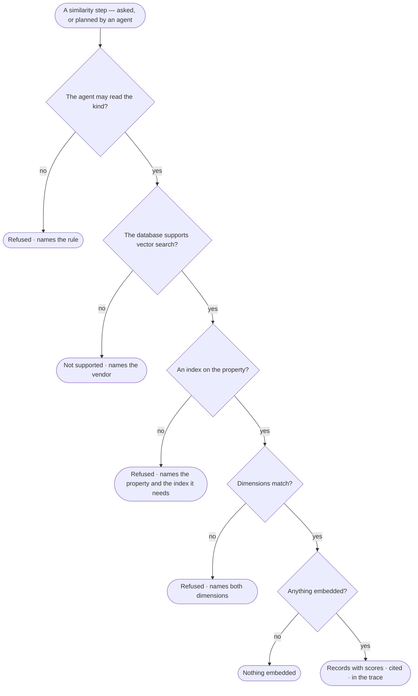

# GP-02 · Find similar records with the database's own vector index

**As** an analyst **I want** to find the records most like one I hold, using the vector index my graph database
already keeps **so that** I follow a lead by likeness, and every result still says where it came from.

Tasks: [task.md](task.md) · Feature: [GP-F01](../../feature.md)

## Who can

| Lens | Can | Otherwise sees |
|---|---|---|
| Admin | Search by similarity through the agents they may use, on any kind those agents may read | — |
| Operator | The same as an Admin | A kind no agent of theirs may read is refused, naming the rule |

## Flow

## Acceptance criteria

| # | Given | When | Then |
|---|---|---|---|
| GP-02.1 | A graph database with a vector index on a property | a similarity search runs | it returns records with their scores, each cited to where it came from, and the step shows in How it got here |
| GP-02.2 | A graph database whose connector declares no vector search | a similarity search is asked for | it is refused before the wire, naming the vendor; the model and planning already read it as not supported |
| GP-02.3 | A property with no vector index | it is searched | it is refused, naming the property and the index it needs |
| GP-02.4 | A query vector of another dimension than the index | it runs | it is refused, naming both dimensions |
| GP-02.5 | An index with no record embedded | it is searched | it returns nothing, worded *nothing embedded*, never *nothing similar* |
| GP-02.6 | An Operator | they search a kind no agent of theirs may read | it is refused, naming the rule |

## Screens

No board: the asking surface is its own story's.

| Surface | Lens | First use | Empty after a filter | Loading | Has data | Failed | Agent working or proposing | No access |
|---|---|---|---|---|---|---|---|---|
| A similarity search | Admin | — | — | — | — | — | — | — |
| A similarity search | Operator | — | — | — | — | — | — | — |
