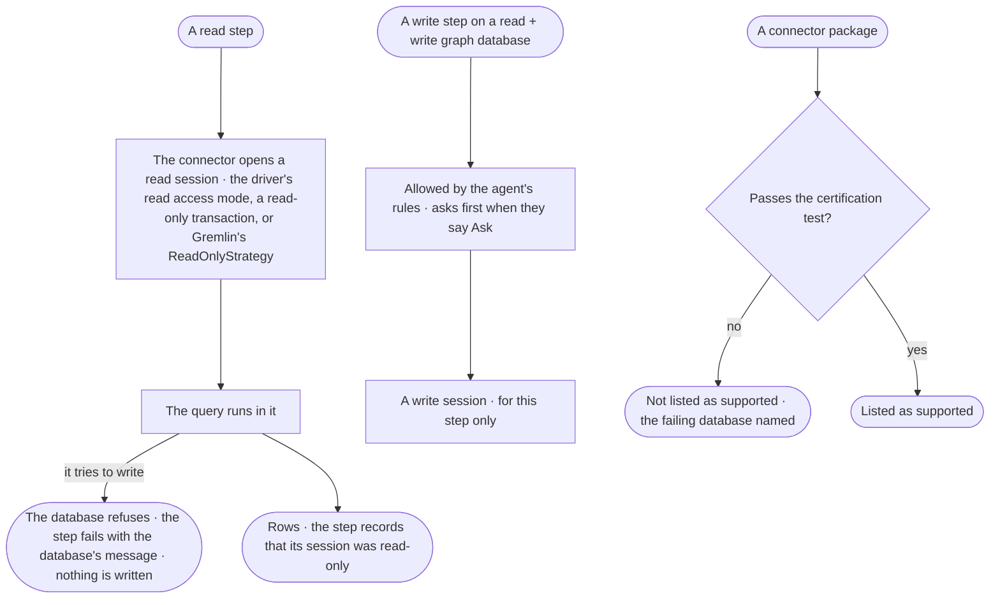

# GP-04 · Trust that a read never writes

**As** an Admin **I want** every read of a graph database to run in a session the database itself holds read-only
**so that** no question, board or agent can change the customer's records by reading, whatever Invana's own checks say.

Tasks: [task.md](task.md) · Feature: [GP-F01](../../feature.md)

## Who can

Nobody chooses this: it is how every read runs. The only person-facing acts are reading the proof in a run and, for an
Admin, which connectors passed the certification test.

| Lens | Can | Otherwise sees |
|---|---|---|
| Admin | Read in any run's *How it got here* that a read step ran in a read-only session; read which connectors passed the certification test | — |
| Operator | Read in *How it got here* that a read step ran in a read-only session; a Modeller reads the same ([the role table](../../../../../access/features/AC-F02-access-policies/feature.md#the-role-table)) | — |

## Flow

## Acceptance criteria

| # | Given | When | Then |
|---|---|---|---|
| GP-04.1 | Any graph database, whatever its mode | a read step runs | it runs in a read-only session its connector opens through `read_session()`, with the one credential the graph database holds |
| GP-04.2 | A read step whose query contains a write | it runs | the graph database refuses it, not only Invana; the step fails with the database's own message naming its connector, and nothing is written |
| GP-04.3 | A read + write graph database | a step that does not write runs | it still runs in a read-only session; a write session opens only for a write step the agent's rules allow, and closes with the step |
| GP-04.4 | A connector package | it is proposed as supported | it passes the certification test — a write attempted in a read session is refused by the database — against a live database, never mocked; one that fails is not listed as supported, and the failing database is named |
| GP-04.5 | A read step in a run | an Admin or an Operator opens *How it got here* | the step shows its session as read-only, with the query sent and the connector |
| GP-04.6 | A graph database set read-only | a read step runs | it runs the same read-only session; the mode decides whether a write step is allowed, never whether a read is safe |
| GP-04.7 | An Operator | they ask for something that would write | it is refused before it starts, naming the rule or the mode (GP-01.9); no write session is opened |
| GP-04.8 | An agent's step that read | its run is read | How it got here shows the session as read-only, the plan, the query and the sources the result carries ([GP-06](../../../GP-F02-memory/stories/GP-06-see-where-any-excerpt-came-from-and-who-may-see-it/story.md)) |

## Screens

No board: the proof is a line of the step in *How it got here*, which is its run's story.

| Surface | Lens | First use | Empty after a filter | Loading | Has data | Failed | Agent working or proposing | No access |
|---|---|---|---|---|---|---|---|---|
| A read step's session | Admin | — | — | — | — | — | — | — |
| A read step's session | Operator | — | — | — | — | — | — | — |
