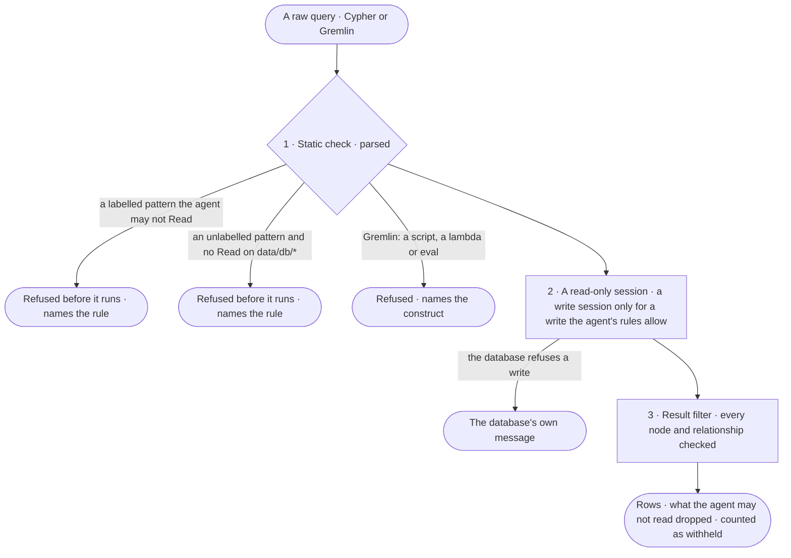

# GP-05 · Run a raw query within what the agent may read

**As** an analyst fluent in Cypher or Gremlin **I want** my own query to run through the same rules as every other read
**so that** typing the query myself never reaches a kind or a property the agent behind it may not read.

Tasks: [task.md](task.md) · Feature: [GP-F01](../../feature.md)

## Who can

A raw query is a step of the built-in **Query console** agent ([EX-08](../../../../../../capabilities/explore/features/EX-F03-ask-a-question/stories/EX-08-write-the-query-myself/story.md)
is the person's side of it); its four layers are this story's. Roles are
[the role table](../../../../../access/features/AC-F02-access-policies/feature.md#the-role-table).

| Lens | Can | Otherwise sees |
|---|---|---|
| Admin | Run a raw query as the Query console, within what its policies allow Read; a write waits on its approvers and runs only on a read + write graph database | A refusal naming the rule, its policy and who set it; the count of what was withheld |
| Operator | The same for a read, when they may use the Query console; a Modeller may also send a write, as Admin | A write: *Edit on the board needs the Modeller role*. Not granted the Query console: disabled, naming the Admins |

## Flow

## Acceptance criteria

| # | Given | When | Then |
|---|---|---|---|
| GP-05.1 | A raw query | it is sent | the engine parses it first; one that does not parse is refused with the parser's message at its position, and nothing runs |
| GP-05.2 | A raw query with a labelled pattern — a node label or a relationship type | the agent may not Read `data/{graph database}/{kind}` | it is refused before it runs, naming the kind, the rule, its policy and who set it |
| GP-05.3 | A raw query with a node or relationship pattern that has no label | the agent may not Read `data/{graph database}/*` | it is refused before it runs, naming the rule — an unlabelled pattern reaches every kind |
| GP-05.4 | A raw query whose every pattern is labelled with kinds the agent may Read | it runs | it passes the static check; a kind the agent may Read only in part is checked again at layer 3 |
| GP-05.5 | A raw read | it runs | it runs in a read-only session (GP-04), whatever the graph database's mode |
| GP-05.6 | A raw query with a write the agent's rules allow, on a read + write graph database | it runs | a write session opens for that step only, after its asks are answered; on a read-only graph database it is refused before the wire (GP-01.9) |
| GP-05.7 | A result with nodes or relationships of kinds the agent may not Read, or properties of a level it may not Read | the query returns | each such node, relationship and property is dropped, never shown; the reply says how many it withheld and names the kinds and levels |
| GP-05.8 | A result with nothing the agent may read left | the query returns | the reply says everything was withheld and how many, never *the Graph does not hold this* |
| GP-05.9 | A Gremlin query | it contains a Groovy script, a lambda or `eval` | it is refused before it runs, naming the construct — *Steps only* — and nothing is sent |
| GP-05.10 | A Gremlin query of steps only | it runs | it passes layer 4 and layers 1 to 3 apply as to Cypher: every label and key in its steps is checked, and a step that reaches every kind needs Read on `data/{graph database}/*` |
| GP-05.11 | A raw query | it runs, is refused or is filtered | the call is recorded in *What left the platform* (AC-F09) with the query, the layer that refused it or the count it withheld, naming the Query console and the person who started it |
| GP-05.12 | An Operator not granted the Query console | they open the ask kind | Cypher and Gremlin are disabled, naming the Admins (EX-08.16); the API refuses the query |
| GP-05.13 | A raw query | its run is read | How it got here shows the query sent, the layers it passed, the withheld count and the sources the result carries |

## Screens

The surface is the Query console of [EX-08](../../../../../../capabilities/explore/features/EX-F03-ask-a-question/stories/EX-08-write-the-query-myself/story.md);
this story adds its refusals and its withheld count.

| Surface | Lens | First use | Empty after a filter | Loading | Has data | Failed | Agent working or proposing | No access |
|---|---|---|---|---|---|---|---|---|
| A raw query refused or filtered | Admin | — | — | explore.board.console · Running | explore.board.console · Withheld count | explore.board.console · Query refused | explore.board.console · Write waiting on approvers | — |
| A raw query refused or filtered | Operator | — | — | explore.board.console · Running | explore.board.console · Withheld count | explore.board.console · Query refused | — | explore.board.console · Query console not granted |
