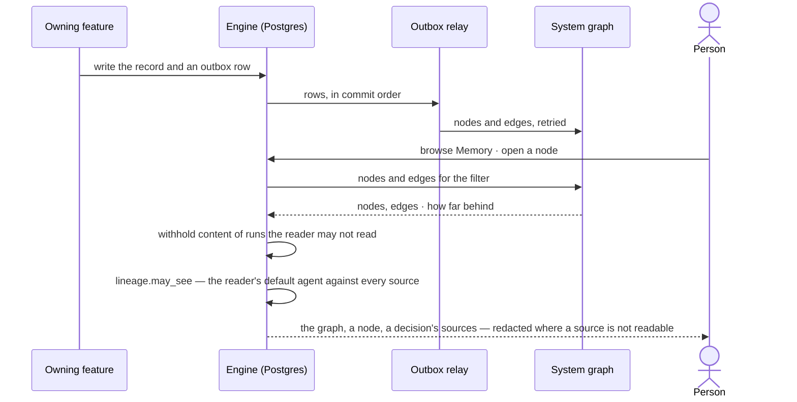

# Memory — Invana's own graph of the work

> Everything the work leaves — projects, groups, tasks, plans, workflows, runs, steps, evidence, findings, decisions and
> org knowledge — kept as nodes in the system graph, linked to what each came from, so any decision can be followed back to the records it cites. Agents
> learn from it ([AG-F09](../../../../capabilities/agents/features/AG-F09-learn-from-memory/feature.md)); people browse
> it. Every copy the work makes — an answer, a finding, a report, a snapshot, a transcript, a note, an export — records
> its sources, and shows to a viewer only as far as the viewer's own agent may read them. The decisions it helps make:
> *can I trust this decision — what is it built on, and who may see it? — where does this project stand, and what
> should every agent know?*

## User journey

Journeys this feature is a step of: [J02 · Ask and trust the answer](../../../../journeys/J02-ask-and-trust-the-answer.md) · [J04 · Build an agent and improve it from what runs teach](../../../../journeys/J04-build-an-agent-and-improve-it-from-what-runs-teach.md) · [J11 · Ideate and run a project with its assistant](../../../../journeys/J11-ideate-and-run-a-project-with-its-assistant.md)

```mermaid
flowchart TD
  w([Work settles — a run, a finding, a decision]) --> pg["Its Postgres record and an outbox row, in one transaction"]
  pg --> rl["The relay writes nodes and edges to the system graph, in commit order"]
  rl -->|behind or down| bh(["Memory says how far behind · nothing in Postgres is lost"])
  rl --> m[("Memory · the thinking graph")]
  m --> br["GP-03 · Browse memory · filter · open a node"]
  br -->|no runs yet| fu(["Fills as runs settle"])
  br -->|a run they may not read| wd(["Head only · content withheld"])
  br -->|a decision| src["GP-03 · Follow it to its sources"]
  src --> rec["Records read fresh through the agent's Access Policies"]
  rec -->|refused| rw(["Counted as withheld"])
  m --> lf(["Agents recall and learn from it — AG-F09"])
  m --> mp["GP-07 · A node reads only as far as its place and its sources allow"]
  mp -->|a source the agent may not read| wd2(["Head only · content withheld"])
  cp([Any copy · an answer · a finding · a report · a snapshot · a transcript · a note · an export]) --> ln["GP-06 · Its sources recorded with it"]
  ln --> sm{"The viewer's default agent may Read every source?"}
  sm -->|no| rd(["Redacted · kind, when, who made it · content withheld"])
  sm -->|yes| full(["Shown · its sources named"])
  pj([A project › Map]) --> pm["GP-08 · Groups, tasks, runs, findings, decisions, related projects · Moving now"]
  pm -->|default agent may not Read memory/project/{key}| pw(["Head only · withheld"])
  lr([An agent's learning]) --> op["GP-09 · Proposed as org knowledge"]
  op -->|a Modeller or an Admin promotes| prm(["Promoted · recalled by agents allowed memory/org"])
  op -->|declines| dcl(["Declined · kept with why"])
  op -->|an Operator| opd(["Promote disabled: Modellers and Admins only"])
  prm -->|retired| ret(["Retired · not recalled"])
```



## Stories

| ID | Story | Status |
|---|---|---|
| GP-03 | [Browse memory and follow a decision to its sources](stories/GP-03-browse-memory-and-follow-a-decision-to-its-sources/story.md) | idea |
| GP-06 | [See where any excerpt came from and who may see it](stories/GP-06-see-where-any-excerpt-came-from-and-who-may-see-it/story.md) | idea |
| GP-07 | [Read memory only as far as its sources allow](stories/GP-07-read-memory-only-as-far-as-its-sources-allow/story.md) | idea |
| GP-08 | [See a project as a map and what is moving on it](stories/GP-08-see-a-project-as-a-map-and-what-is-moving-on-it/story.md) | idea |
| GP-09 | [Promote a learning to org knowledge](stories/GP-09-promote-a-learning-to-org-knowledge/story.md) | idea |

## Access

The role × feature table is [AC-F02 › The role table](../../../access/features/AC-F02-access-policies/feature.md#the-role-table)
(*thinking graph and memory*); who reads a run's content is
[AC-31](../../../access/features/AC-F09-what-left-the-platform/stories/AC-31-keep-a-runs-content-to-those-who-may-read-it/story.md)'s, never restated.

| Act | Role | Everyone else sees |
|---|---|---|
| Browse Memory and follow a decision to its sources | Operator · Modeller · Admin | — (nodes of runs they may not read show their head only) |
| Read a node's content | Whoever may read its run ([AC-31](../../../access/features/AC-F09-what-left-the-platform/stories/AC-31-keep-a-runs-content-to-those-who-may-read-it/story.md)) and whose default agent may Read the node's place and every source it inherits | That it ran, its status, its tokens, the plan or workflow, its labels and record IDs — content *withheld*, naming who may read it or the resource their agent may not read |
| See any copy and its sources | Operator · Modeller · Admin, when their default agent may Read every source | The copy redacted: its kind, when and who made it; content *Withheld — your agent may not read {resource}* |
| Read a cited record | An agent the person may use, as its Access Policies allow | Counted as withheld; never shown |
| Open a project's map | Operator · Modeller · Admin, when their default agent may Read `memory/project/<key>` | The project's head only — *Withheld — your agent may not read `memory/project/{key}`* |
| Read org knowledge and its proposals | Operator · Modeller · Admin, when their default agent may Read `memory/org` and every source | Its head only — when, which agent, its state — content withheld |
| Promote, decline or retire org knowledge | Modeller · Admin | Each act disabled — *Modellers and Admins only* |

## States

| State | What the person sees |
|---|---|
| First use | No runs yet: Memory says it fills as runs settle, with a link to ask a question; a project's map says it fills as work is written; Org knowledge says agents propose it as they learn |
| Empty after a filter | Nothing matches the filter: the filter named, with *Clear filters* |
| Loading | The thinking graph loads with its window named |
| Has data | The thinking graph drawn on the canvas; a node with its kind, labels, marks and links; a decision's path to its sources |
| Failed | The system graph down: Memory unavailable and why; a run's *Thinking* tab still reads |
| Agent working or proposing | The system graph behind: how far, and what it holds drawn; a project's map marks what is moving now; an agent's org-knowledge proposal waits as *Proposed* |
| No access | A node of a run the reader may not read, or of sources their agent may not read: its head only, content withheld, naming who may read it or the resource; a copy redacted the same way |

## Rules

| Rule | Detail |
|---|---|
| Memory is Invana's own graph | It lives in the system graph, governed by the system ontology, and is never part of the Graph |
| Every piece of work is a node | Every plan, workflow, run, step, evidence, finding and decision is a node, linked: a run ran a plan or a workflow · a plan composed workflows · a step found evidence citing records by ID · a finding came from steps · a decision weighed findings · a decision supersedes another · a workflow was approved from a plan |
| Lineage is its edges | What each node came from — the steps, findings and record IDs behind it — is an edge, so a decision is followed back to the records it cites |
| Every copy records its sources | An answer, a finding, a report, a snapshot, a run transcript, a note (a hand-off note, an annotation), a memory node and an export each record the resources it was read from, in [AC-F02's grammar](../../../access/features/AC-F02-access-policies/feature.md#engine) — `data/<graph database>/<kind>/<level>` for each property level it carries, `memory/…`, `project/…` — in the same transaction that makes the copy ([GP-06](stories/GP-06-see-where-any-excerpt-came-from-and-who-may-see-it/story.md)) |
| A copy shows as far as the viewer's agent reads | A copy shows to a viewer only when the viewer's default agent is allowed Read on every source; otherwise it is redacted — kind, when and who made it, content *Withheld — your agent may not read {resource}*. Its level is the highest level among its sources |
| No sources, no copy | A copy with no recorded sources is not shown, and one that cannot record its sources is not written |
| A memory node inherits its sources | Reading a memory node needs Read on its place — `memory/project/<project>` · `memory/agent/<agent>` · `memory/org` — and on every source; a proposal that arrives from another project carries its sources' lineage ([GP-07](stories/GP-07-read-memory-only-as-far-as-its-sources-allow/story.md)) |
| A run's transcript is a copy | A run's content reads to the person behind the run, and to anyone else — an Admin included — only when the run belongs to a project and `lineage.may_see` is true ([AC-F09](../../../access/features/AC-F09-what-left-the-platform/feature.md#engine)) |
| Never customer data | Memory holds record IDs and keyed hashes, never a record's values; a person reading a cited record reads it fresh, through the agent's Access Policies ([system-design § 12 › Privacy](../../../../system-design.md#privacy)) |
| Postgres is the truth | Each node mirrors a Postgres record its owner writes; the system graph follows through the outbox, retried, rebuildable from History ([system-design § 6](../../../../system-design.md#6-data-and-storage) · NFR-REL-6) |
| Kept, then aged out of recall | Every node is kept as long as its Postgres record; recall reads the last 180 days ([AG-F09](../../../../capabilities/agents/features/AG-F09-learn-from-memory/feature.md)) and an older node reads *Not recalled* |
| One memory for the deployment | Project memory sits on its project, agent learnings on their agent, org knowledge on the deployment; no team holds memory of its own |
| Org knowledge is promoted by a person | An agent only proposes org knowledge, from a learning on its agent; a Modeller or an Admin promotes, declines or retires it ([GP-09](stories/GP-09-promote-a-learning-to-org-knowledge/story.md)). Promoted org knowledge is recalled only by agents whose Access Policies allow Read on `memory/org` and its sources; a retired one is kept and never recalled |
| A project is a map | A project, its groups, tasks and relations are nodes, linked to the runs that worked each task, the checks that judged it and the findings and decisions it holds; a project's map draws them with what is moving now ([GP-08](stories/GP-08-see-a-project-as-a-map-and-what-is-moving-on-it/story.md)) |
| Behind is said | When the system graph lags, Memory says how far behind and draws what it holds |
| Leans on | Sensitivity levels (SE-F03) · the default agent and `decide()` (AC-F02) · Runs (CP-F10) · plans and workflows (AG-F06) · projects, groups, tasks, relations and checks (PJ-F01) · findings and decisions (PJ-F03) · the ledger's reads (AC-F09) · run privacy (AC-F09) · History (AC-F06) |

## Data touched

| Record | Read or write |
|---|---|
| Nodes and edges in the system graph | Write (the outbox relay) · read |
| `graph_lineage` — the sources of every copy | Write (in the copy's own transaction) · read |
| `graph_org_knowledge` — proposals and org knowledge | Write · read |
| Projects, members, relations, groups, tasks, checks and claims ([PJ-F01](../../../../capabilities/projects/features/PJ-F01-projects-and-tasks/feature.md)) | Read — mirrored as nodes; claims and open runs as *moving now* |
| A property's sensitivity level ([SE-F03](../../../../capabilities/semantics/features/SE-F03-meaning/feature.md#engine)) | Read — the level a source carries |
| Runs and their steps ([CP-F10](../../../control/features/CP-F10-runs-and-how-the-agents-are-doing/feature.md)) · plans and workflows ([AG-F06](../../../../capabilities/agents/features/AG-F06-plans-and-workflows/feature.md)) · findings and decisions ([PJ-F03](../../../../capabilities/projects/features/PJ-F03-branches-findings-and-decisions/feature.md)) | Read — mirrored as nodes |
| The ledger's reads — record IDs and result hash per step ([AC-F09](../../../access/features/AC-F09-what-left-the-platform/feature.md)) | Read — mirrored as evidence |
| Outcome labels and marks ([AG-F09](../../../../capabilities/agents/features/AG-F09-learn-from-memory/feature.md)) | Read — shown on a node |

## Engine

The low-level design: Memory's store and how a person reads it. Conventions — naming, errors, lists, events — are
[system-design.md](../../../../system-design.md) §§ 6–8; this section only fills them in. What agents learn from
Memory — recall, outcome labels, marks, evidence and suggested changes — is [AG-F09 › Engine](../../../../capabilities/agents/features/AG-F09-learn-from-memory/feature.md#engine).

### Records

| Table | Columns | Notes |
|---|---|---|
| `graph_lineage` | `copy_kind` (`answer` · `finding` · `report` · `snapshot` · `transcript` · `note` · `memory_node` · `export`) · `copy_id` · `resource` (an AC-F02 resource) · `level?` (`public` · `internal` · `confidential` · `personal`, on a `data/…` source) · `recorded_at` | One row per source of a copy, written in the copy's own transaction. Unique (`copy_kind`, `copy_id`, `resource`). Never updated: a copy's sources are what it was made from |
| `graph_org_knowledge` | `statement` · `from_kind` (`outcome_label` · `mark`) · `from_id` · `agent_id` (the proposing agent) · `run_id` · `status` (`proposed` · `promoted` · `declined` · `retired`) · `decided_by_id?` · `decided_at?` · `note?` · `proposed_at` | Its sources are `graph_lineage` rows, `copy_kind = memory_node`, written with it — a proposal that cannot record them is refused. Never deleted; `memory/org` names it in Access Policies |
| — | No other table | Every other node mirrors a record its owning feature writes, through the outbox ([system-design § 6](../../../../system-design.md#6-data-and-storage)) |

### Reads

| Record | Owner |
|---|---|
| Runs and their steps (`control_runs`) | [CP-F10](../../../control/features/CP-F10-runs-and-how-the-agents-are-doing/feature.md#engine) |
| Plans and workflows (`agents_plans` · `agents_workflows`) | [AG-F06](../../../../capabilities/agents/features/AG-F06-plans-and-workflows/feature.md#engine) |
| Findings and decisions (`projects_findings` · `projects_decisions`) | [PJ-F03](../../../../capabilities/projects/features/PJ-F03-branches-findings-and-decisions/feature.md#engine) |
| Projects, members, relations, groups, tasks, check results and claims (`projects` · `projects_relations` · `projects_groups` · `projects_group_dependencies` · `projects_tasks` · `projects_check_results` · `projects_task_claims`) | [PJ-F01](../../../../capabilities/projects/features/PJ-F01-projects-and-tasks/feature.md#engine) |
| The ledger's reads (`access_ledger_calls`) · who may read a run's content — `may_read_run()` | [AC-F09](../../../access/features/AC-F09-what-left-the-platform/feature.md#engine) |
| Outcome labels and marks (`agents_outcome_labels` · `agents_thinking_marks`) | [AG-F09](../../../../capabilities/agents/features/AG-F09-learn-from-memory/feature.md#engine) |
| History, which the system graph is rebuilt from | [AC-F06](../../../access/features/AC-F06-history/feature.md#engine) |
| A person's default agent · `decide()` · the resource grammar | [AC-F02](../../../access/features/AC-F02-access-policies/feature.md#engine) |
| Sensitivity levels, per property | [SE-F03](../../../../capabilities/semantics/features/SE-F03-meaning/feature.md#engine) |

### Routes

| Route, after `/api/v1/graph` | Does | Story |
|---|---|---|
| `GET /memory` | Nodes and edges for `agent` · `workflow` · `label` · `behind` (a user) · `window` (`7d` · `30d` · `90d` · `180d` · `all`) · `around` (a node, and hops); at most 3,000 nodes, with `sample` when cut · `behind_s` · `applied_at` | GP-03 |
| `GET /memory/nodes/{kind}/{id}` | One node: its kind, labels, marks, edges and content — content withheld for a run the reader may not read, or when `lineage.may_see` is false; `recallable` (inside 180 days) | GP-03 · GP-07 |
| `GET /lineage/{copy_kind}/{copy_id}` | A copy's sources — resource, level, `recorded_at` — and its level; for a copy the reader may not see, only its kind, when and who made it, with `withheld` (the first resource the reader's default agent may not read, and `more`). Every surface that shows a copy gets the same answer from `lineage.may_see` | GP-06 |
| `GET /memory/projects/{key}/map` | A project's nodes and edges — groups and their waits, tasks with their state, the runs and checks that worked them, findings, decisions, related projects' heads — and `moving[]` (runs open, claims held, checks running); `window` · at most 3,000 nodes, with `sample` when cut · `behind_s`; the project's head and `withheld` when the reader's default agent may not Read `memory/project/{key}` | GP-08 |
| `GET /memory/org` · `POST /memory/org/{id}/promote` · `POST /memory/org/{id}/decline` · `POST /memory/org/{id}/retire` | Proposals and org knowledge (`?status=`), each through `lineage.may_see` · promote · decline with a note · retire with a note — a Modeller or an Admin | GP-09 |
| `GET /memory/decisions/{id}/sources` | The path from a decision to the findings it weighed, the steps they came from, the evidence and the record IDs it cites; each record read fresh through the agent's Access Policies, `records_withheld` counted | GP-03 |

### Events

| Event | When |
|---|---|
| `graph.memory.org.proposed` · `promoted` · `declined` · `retired` | Each act on org knowledge, with who and the note |
| — | Every other node follows its owner's write |

### Refusals

| Status | When | Sentence | Criterion |
|---|---|---|---|
| — | Memory refuses nothing on a read: a run's content, or a copy or node whose sources the reader's agent may not read, is withheld, never refused | — | GP-03.9 · GP-03.14 · GP-06.4 · GP-07.3 |
| 409 | A copy written with no source recorded | *{copy kind} was not saved — it names no sources.* | GP-06.8 |
| 404 | A copy that does not exist, or that has no recorded sources | *Not found.* | GP-06.7 |
| 403 | Promoting, declining or retiring org knowledge by an Operator, or by an agent | *Modellers and Admins only.* | GP-09.6 · GP-09.9 |
| 409 | Promoting or declining what is not *Proposed*; retiring what is not *Promoted* | *{statement} is {status}.* | API only — Studio offers each act only in its state |
| 409 | A proposal written with no source recorded | *{copy kind} was not saved — it names no sources.* | GP-09.2 |

### CLI

| Command | Does |
|---|---|
| — | No command of its own; rebuilding the system graph from History is the outbox relay's ([system-design § 7](../../../../system-design.md#7-architecture-and-components)) |

### Mechanisms

| Mechanism | How |
|---|---|
| Memory follows Postgres | Each owner writes its record and an outbox row in one transaction; the relay applies nodes and edges to the system graph in commit order, retried, rebuildable from History ([system-design § 6](../../../../system-design.md#6-data-and-storage) · NFR-REL-6). A node carries IDs, versions, labels, times and keyed hashes — never a record's values |
| Node kinds | `Project` · `Group` · `Task` ← `projects` · `projects_groups` · `projects_tasks` (PJ-F01) · `OrgKnowledge` ← `graph_org_knowledge` · `Plan` and `Workflow` (each version) ← `agents_plans` · `agents_workflows` (AG-F06) · `Run` and `Step` ← `control_runs` (CP-F10) · `Session` ← `control_run_sessions` (CP-F10) · `HandoffNote` ← `agents_handoff_notes` (AG-F05) · `Evidence` — a step's reads: record IDs and result hash ← `access_ledger_calls` (AC-F09) · `Finding` · `Decision` ← `projects_findings` · `projects_decisions` (PJ-F03) · `RecordRef` — a graph database, kind and record ID, nothing else. Every kind and edge is in the read-only, versioned system ontology; `invana migrate` takes it to head |
| Edge kinds | `RAN` Run → Plan or Workflow version · `IN_SESSION` Step → Session · `HAS_SESSION` Run → Session · `HANDED_OFF` Session → HandoffNote · `CONTINUED_FROM` Session → HandoffNote · `FORKED_FROM` Run → HandoffNote · `COMPOSED` Plan → Workflow (a pinned `composite` step) · `APPROVED_FROM` Workflow → Plan · `HAS_STEP` Run → Step · `FOUND` Step → Evidence · `CITES` Evidence → RecordRef · `CAME_FROM` Finding → Step · `WEIGHED` Decision → Finding · `SUPERSEDES` Decision → Decision · `RECALLED` Step → the node it recalled, with rank and label · `AVOIDED` Run → Plan or Workflow version · `FED` Run → Finding or Decision · `FROM` copy → source, in the system graph, one per `graph_lineage` row · `IN_PROJECT` Task or Group → Project · `IN_GROUP` Task → Group · `WAITS_ON` Group → Group · `STARTED_FROM` · `RELATED` Project → Project · `WORKED` Run → Task · `CHECKED` Run → Task, with its outcome · `PROPOSED_FROM` OrgKnowledge → the run it came from |
| Reading a node | Content of a `Run` or `Step` node reads only through `may_read_run()` and `lineage.may_see`; otherwise the head — status, tokens, the plan or workflow, labels and record IDs |
| Lineage | Every copy writes its sources as `graph_lineage` rows and, through the outbox, `(copy)-[:FROM]->(source)` edges in the system graph, in the transaction that writes the copy; a copy with no row is not shown and a write that cannot record one is refused — fail closed. A copy made from another copy lists the first copy's sources too. A copy's level is the highest `level` among its rows |
| `lineage.may_see(person, copy)` | The one mechanism every surface that shows a copy calls — a list, a thread, a report, a board, a hand-off note, an export. It resolves the person's **default agent** ([AC-F02 › Rules](../../../access/features/AC-F02-access-policies/feature.md#rules)) at the time of the read, then runs `decide()` for Read on each source; it is true only when every answer is Allow — Ask and Deny both withhold, as does a copy with no row. A false answer redacts: the copy lists its kind, when and who made it, and its content reads *Withheld — your agent may not read {resource}*, naming the first refused source and the count of the rest |
| A memory node's sources | A memory node inherits its sources' resources, so reading it needs Read on `memory/project/<project>` · `memory/agent/<agent>` · `memory/org` and on every source. A proposal that arrives from another project is written with its sources' lineage, whichever project holds it. Recall ([AG-F09](../../../../capabilities/agents/features/AG-F09-learn-from-memory/feature.md)) applies the same check for the agent that recalls |
| Run privacy | A run's transcript is a copy: who reads it is [AC-F09 › Engine](../../../access/features/AC-F09-what-left-the-platform/feature.md#engine); this feature adds only that, for anyone but the person behind the run, the run belongs to a project and `lineage.may_see` is true |
| A personal connection's source | What a personal connection returned records `personal/<username>/<server>` as a source ([CP-F02](../../../control/features/CP-F02-plugins-and-outside-tools/feature.md#engine)); `lineage.may_see` is true for it only when the person is that username, whatever their default agent may read |
| A decision's sources | `WEIGHED` → `CAME_FROM` → `FOUND` → `CITES`; each `RecordRef` read fresh through the agent's Access Policies, a refused one counted in `records_withheld` |
| Behind | Every read returns `behind_s` from the relay's position; the system graph down returns `unavailable` with why |
| A project's map | `GET /memory/projects/{key}/map` calls `decide()` for the reader's default agent on `memory/project/<key>`; on Allow it reads the project's nodes and edges in the window, each node's content through `may_read_run()` and `lineage.may_see`; `moving[]` is read from Postgres — open runs, unexpired claims, checks with no result — so it is never behind. Studio re-reads `moving[]` every 10 seconds while the map is open |
| Proposing org knowledge | The agent function `memory.org.propose` writes a `graph_org_knowledge` row as `proposed` from a learning on the calling agent ([AG-F09](../../../../capabilities/agents/features/AG-F09-learn-from-memory/feature.md#engine)), with its sources as `graph_lineage` rows, in one transaction. No agent function promotes, declines or retires |
| Recalling org knowledge | Recall ([AG-F09](../../../../capabilities/agents/features/AG-F09-learn-from-memory/feature.md#engine)) reads only `promoted` rows, and only for an agent whose `decide()` allows Read on `memory/org` and on every source |

## System impact

| HLD section | Change | NFRs |
|---|---|---|
| § 6 Data and storage | Memory's nodes and edges in the system graph, following Postgres through the outbox — projects, groups and tasks among them; `graph_lineage`, one row per source of every copy, and `FROM` edges; `graph_org_knowledge` | NFR-REL-6 |
| § 10 AI and agents | The agent function `memory.org.propose`; recall reads promoted org knowledge only | — |
| § 8 APIs and events | Memory's routes under `/api/v1/graph`, with `GET /lineage/{copy_kind}/{copy_id}`, a project's map and org knowledge | — |
| § 11 Failure modes | The system graph behind or down: Memory says so; questions still answer | NFR-REL-6 |
| § 12 Qualities | Privacy: record IDs and keyed hashes only; a run's content reads only through `may_read_run()`; a copy reads only as far as `lineage.may_see`; drawn on the canvas, at most 3,000 nodes | NFR-SEC-5 · NFR-SEC-11 · NFR-PERF-4 |

## Decisions

| Decision | Detail |
|---|---|
| Memory is the store; learning is Agents' | Memory holds and serves the nodes; recall, outcome labels, marks, evidence and suggested changes are [AG-F09](../../../../capabilities/agents/features/AG-F09-learn-from-memory/feature.md)'s |
| One store | No separate memory store and no memory kinds in a customer's model; a derived fact written to a customer's graph database is the records' own ([RC-F07](../../../../capabilities/records/features/RC-F07-annotations/feature.md) · [SE-F08](../../../../capabilities/semantics/features/SE-F08-inference/feature.md)), not memory |
| Lineage is Memory's, shown by every surface | Recording a copy's sources and `lineage.may_see` live here; the answer, a finding, a report, a board, a hand-off note and an export each call it, and none keeps a rule of its own |
| Memory opens from Agents | Agents › Thinking draws the thinking graph on the canvas; a run's thinking is a tab of the run |
| A project's map opens from the project | *Map* is a tab of the project, drawn from Memory; moving now is read live from Postgres so it is never behind |
| Org knowledge is a Modeller's or an Admin's to promote | It reaches every agent allowed `memory/org`, as meaning reaches every model — so it takes the role that shapes what agents read |

## Open questions

| Question | Who answers |
|---|---|
| — | — |

## Not building

| Item | Why not |
|---|---|
| Customer data in Memory | Record IDs and keyed hashes only; a cited record is read fresh, through the agent's Access Policies |
| Team or personal memory | Memory is one for the deployment; run privacy decides what each person reads of it |
| Org knowledge written by hand | It is promoted from what an agent learned, with its sources; a person decides, never authors it |
| Editing Memory by hand | It follows Postgres and is rebuilt from History, never repaired |
| Guessing a copy's sources | A copy with no recorded sources is not shown; its sources are recorded when it is made, never inferred later |
| A role that overrides lineage | An Admin reads a copy through their own default agent like anyone; an Admin who needs more changes what their default agent may Read, in History |
