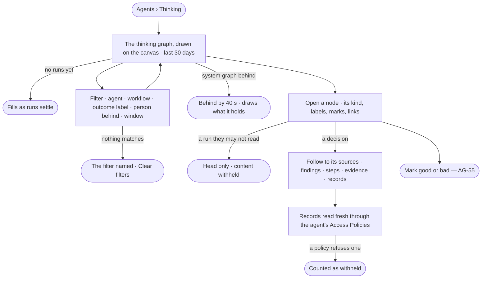

# GP-03 · Browse memory and follow a decision to its sources

**As** an agent builder or a decision maker **I want** to see Memory's thinking graph — plans, workflows, runs, steps,
evidence, findings and decisions and how they link — and follow any decision back to its sources **so that** I can
see what the agents learned, what they avoid, and trust a decision because I can trace it.

Tasks: [task.md](task.md) · Feature: [GP-F02](../../feature.md)

## Who can

| Lens | Can | Otherwise sees |
|---|---|---|
| Admin | Browse the whole thinking graph, filter it, open any node with its content, follow a decision to its sources | — |
| Operator | An Operator or a Modeller ([the role table](../../../../../access/features/AC-F02-access-policies/feature.md#the-role-table)): browse and filter the whole thinking graph; open any node; content of the runs they start or whose agent they own, and of any node whose sources their default agent may Read ([GP-07](../GP-07-read-memory-only-as-far-as-its-sources-allow/story.md)) | A node of anyone else's run: that it ran, its status, its tokens, the plan or workflow, its outcome labels and record IDs — content withheld, naming who may read it ([AC-31](../../../../../access/features/AC-F09-what-left-the-platform/stories/AC-31-keep-a-runs-content-to-those-who-may-read-it/story.md)) |

## Flow

## Acceptance criteria

| # | Given | When | Then |
|---|---|---|---|
| GP-03.1 | Runs that settled | the person opens Agents › Thinking | the thinking graph is drawn on the canvas for the last 30 days — plans, workflows, runs, steps, evidence, findings and decisions, and their links |
| GP-03.2 | More than 3,000 nodes match | it is drawn | it draws 3,000 and says it is a sample, naming how to narrow it |
| GP-03.3 | The thinking graph | the person filters by agent, workflow, outcome label, person behind or window — 7 · 30 · 90 · 180 days · all | only matching nodes and their links are drawn, the filter named |
| GP-03.4 | A filter nothing matches | it is applied | it says nothing matches, names the filter and offers *Clear filters* |
| GP-03.5 | Any node | the person opens it | it shows its kind, its outcome labels and marks, its links and — when they may read it — its content |
| GP-03.6 | A decision | the person follows it to its sources | the findings it weighed, the steps they came from, and the evidence and record IDs they cite are drawn as a path |
| GP-03.7 | A record on that path | the person opens it | it is read fresh through the agent's Access Policies; a record the policies refuse is never shown, and the path says how many were withheld |
| GP-03.8 | A node older than 180 days | it is opened | it reads in full and says *Not recalled — older than 180 days* |
| GP-03.9 | A node of a run the reader may not read | it is opened | it shows that it ran, its status, its tokens, the plan or workflow, its labels and record IDs; the content is withheld, naming who may read it |
| GP-03.10 | The system graph behind | the page opens | it says how far behind it is and when it last caught up, and draws what it holds |
| GP-03.11 | The system graph down | the page opens | it says the thinking graph is unavailable and why; a run's *Thinking* tab still reads |
| GP-03.12 | No runs yet | the page opens | it says the thinking graph fills as runs settle, with a link to ask a question |
| GP-03.13 | Any node | it is shown | it holds record IDs and keyed hashes, never a record's values; values show only when a record is read fresh |
| GP-03.14 | An Operator | they open a node of someone else's run | the node reads its head; its content is withheld, naming who may read it |

## Screens

| Surface | Lens | First use | Empty after a filter | Loading | Has data | Failed | Agent working or proposing | No access |
|---|---|---|---|---|---|---|---|---|
| The thinking graph | Admin | agents.thinking · Fills as runs settle | agents.thinking · Nothing matches | agents.thinking · Loading | agents.thinking | agents.thinking · Unavailable | agents.thinking · Behind | — |
| The thinking graph | Operator | agents.thinking · Fills as runs settle | agents.thinking · Nothing matches | agents.thinking · Loading | agents.thinking | agents.thinking · Unavailable | agents.thinking · Behind | agents.thinking · Withheld node |
| A node and its sources | Admin | — | — | agents.thinking · Node loading | agents.thinking · Decision sources | agents.thinking · Unavailable | — | — |
| A node and its sources | Operator | — | — | agents.thinking · Node loading | agents.thinking · Decision sources | agents.thinking · Unavailable | — | agents.thinking · Withheld node |
