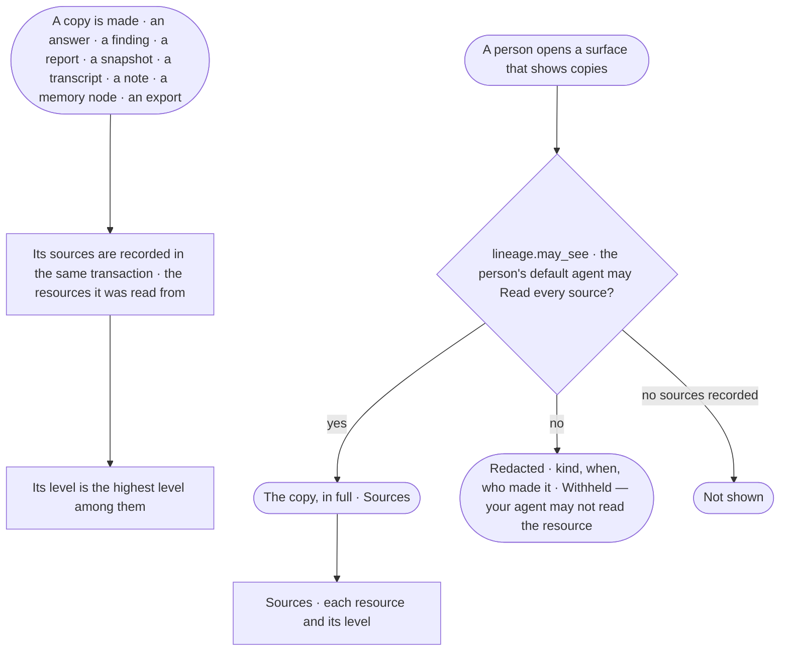

# GP-06 · See where any excerpt came from and who may see it

**As** an analyst or a decision maker **I want** every answer, finding, report, snapshot, transcript, note and export to
say what it was read from, and to show only as far as my own agent may read it **so that** a copy never lets me read
what I could not read myself.

Tasks: [task.md](task.md) · Feature: [GP-F02](../../feature.md)

## Who can

A copy shows to a person only when the person's **default agent** may Read every one of its sources
([AC-F02 › Rules › The default agent](../../../../../access/features/AC-F02-access-policies/feature.md#rules)).
Roles are [the role table](../../../../../access/features/AC-F02-access-policies/feature.md#the-role-table); a run's
transcript has its own privacy rule on top ([AC-F09](../../../../../access/features/AC-F09-what-left-the-platform/feature.md#engine)).

| Lens | Can | Otherwise sees |
|---|---|---|
| Admin | Read a copy and its sources when their default agent may Read every source; read any copy's list row | A redacted copy: its kind, when and who made it; content *Withheld — your agent may not read {resource}* — an Admin's role is no key to a source their default agent may not read |
| Operator | The same; a Modeller reads the same | The same redaction; to read it, ask an Admin to change what their default agent may Read ([AC-38](../../../../../access/features/AC-F03-directory/stories/AC-38-choose-a-persons-default-agent/story.md)) |

## Flow

## Acceptance criteria

| # | Given | When | Then |
|---|---|---|---|
| GP-06.1 | An answer, a finding, a report, a snapshot, a run transcript, a note (a hand-off note, an annotation), a memory node or an export | it is made | its sources are recorded in the same transaction: each resource it was read from — `data/{graph database}/{kind}/{level}` for each property level it carries, `memory/…`, `project/…` |
| GP-06.2 | A copy | it carries properties of several levels | its level is the highest level among its sources |
| GP-06.3 | A copy whose sources the person's default agent may all Read | the person opens it | it shows in full with its sources named, each with its level |
| GP-06.4 | A copy with a source the person's default agent may not Read | it is listed or opened | it is redacted: it lists its kind, when and who made it; its content reads *Withheld — your agent may not read {resource}*, naming the first such resource and how many more |
| GP-06.5 | The same copy | two people whose default agents differ open it | each sees what their own default agent allows; neither sees the other's |
| GP-06.6 | A person's default agent | its rules or its grants change | the next read of every copy uses the new rules; a copy withheld before shows, and a copy shown before may now be withheld |
| GP-06.7 | A copy with no recorded sources | it is read | it is not shown, in any list or count of content; Invana never guesses a copy's sources |
| GP-06.8 | A copy to be written | no source can be recorded | it is not written — the write is refused as a whole |
| GP-06.9 | A copy | it is shown by any surface — a list, a thread, a report, a board, a hand-off note, an export | the surface asks `lineage.may_see` for it; no surface shows a copy by another rule |
| GP-06.10 | A person who made the copy | their default agent may not read one of its sources now | it is redacted for them as for anyone; making a copy is no right to read it later |
| GP-06.11 | A run transcript | a person opens it | it shows only when the run's own privacy rule lets them read it and, for anyone but the person behind the run and the Admins, the run belongs to a project and `lineage.may_see` is true |
| GP-06.12 | A copy shown | an Admin or an Operator opens *Sources* | each source lists its resource and level, the time it was recorded, and — for a source the person may not Read — only that it is withheld |
| GP-06.13 | An agent's outcome that made a copy | its run is read | How it got here shows the copy's sources, its level and who may see it |
| GP-06.14 | A copy that came to be from another copy | it is made | its sources include the first copy's, so redaction follows the chain |

## Screens

| Surface | Lens | First use | Empty after a filter | Loading | Has data | Failed | Agent working or proposing | No access |
|---|---|---|---|---|---|---|---|---|
| A copy's sources | Admin | — | — | graph.memory.lineage · Loading | graph.memory.lineage | graph.memory.lineage · Could not load | — | graph.memory.lineage · Withheld |
| A copy's sources | Operator | — | — | graph.memory.lineage · Loading | graph.memory.lineage | graph.memory.lineage · Could not load | — | graph.memory.lineage · Withheld |
| A redacted copy in a list | Admin | — | — | graph.memory.lineage · Loading | graph.memory.lineage · Redacted row | graph.memory.lineage · Could not load | — | graph.memory.lineage · Withheld |
| A redacted copy in a list | Operator | — | — | graph.memory.lineage · Loading | graph.memory.lineage · Redacted row | graph.memory.lineage · Could not load | — | graph.memory.lineage · Withheld |
