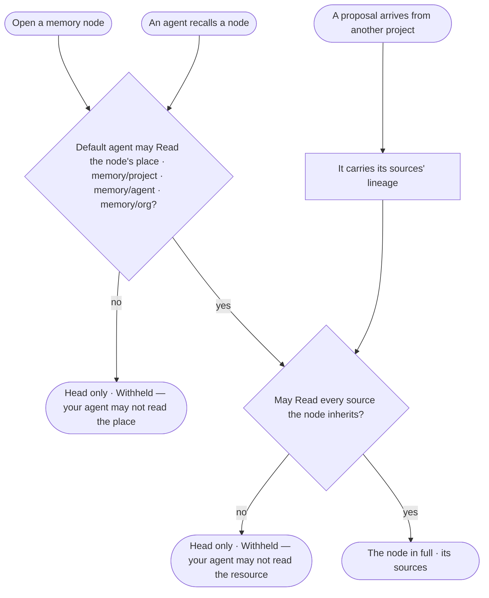

# GP-07 · Read memory only as far as its sources allow

**As** an agent builder or a decision maker **I want** a memory node to read only when my agent may read the memory
place and every source the node was made from **so that** memory is never a way round what an agent may not read.

Tasks: [task.md](task.md) · Feature: [GP-F02](../../feature.md)

## Who can

A memory node inherits its sources' resources ([GP-06](../GP-06-see-where-any-excerpt-came-from-and-who-may-see-it/story.md)).
Roles are [the role table](../../../../../access/features/AC-F02-access-policies/feature.md#the-role-table); the
person's agent is their default agent ([AC-F02 › Rules › The default agent](../../../../../access/features/AC-F02-access-policies/feature.md#rules)).

| Lens | Can | Otherwise sees |
|---|---|---|
| Admin | Browse the thinking graph; open a node whose memory place and every source their default agent may Read | A node withheld: its head only, naming the resource their agent may not read |
| Operator | The same; a Modeller reads the same | The same |

## Flow

## Acceptance criteria

| # | Given | When | Then |
|---|---|---|---|
| GP-07.1 | A memory node | it is made | it records the resources of its sources — the records' levels, the runs, the findings and decisions it came from — and its level is the highest among them |
| GP-07.2 | A memory node | a person opens it | it reads in full only when their default agent may Read the node's place — `memory/project/{project}` · `memory/agent/{agent}` · `memory/org` — **and** every source it inherits |
| GP-07.3 | A node whose place the person's default agent may Read but one source it may not | it is opened | its head shows — kind, labels, marks, time, who made it; its content reads *Withheld — your agent may not read {resource}* |
| GP-07.4 | A thinking graph with such nodes | it is drawn | the node is drawn with its head and links, so the graph's shape does not hide that something is withheld; the count of withheld nodes is named |
| GP-07.5 | A proposal that arrives from another project — a learning, a finding, a decision | it is made | it carries its sources' lineage; a person reads it only when their default agent may Read each source, whichever project holds it |
| GP-07.6 | An agent | it recalls memory to plan or answer | it recalls only the nodes its own policies and its sources' allow, the same check as a person's; a node it may not read is never recalled and never counted as evidence |
| GP-07.7 | A person's default agent | its rules change | the next read of every node follows the new rules |
| GP-07.8 | An org-knowledge node promoted by a person | it is opened | it reads like any node — a promotion widens where it lives, never what its sources allow |
| GP-07.9 | A decision followed to its sources | a source is withheld from the person | the path draws it as withheld, naming the resource, and counts it (GP-03.7) |
| GP-07.10 | A node with no recorded sources | it is read | it is not shown (GP-06.7) |
| GP-07.11 | An agent's outcome that recalled memory | its run is read | How it got here shows each node it recalled, its sources and its level |

## Screens

| Surface | Lens | First use | Empty after a filter | Loading | Has data | Failed | Agent working or proposing | No access |
|---|---|---|---|---|---|---|---|---|
| A memory node | Admin | — | — | agents.thinking · Node loading | agents.thinking · Decision sources | agents.thinking · Unavailable | — | agents.thinking · Withheld node |
| A memory node | Operator | — | — | agents.thinking · Node loading | agents.thinking · Decision sources | agents.thinking · Unavailable | — | agents.thinking · Withheld node |
