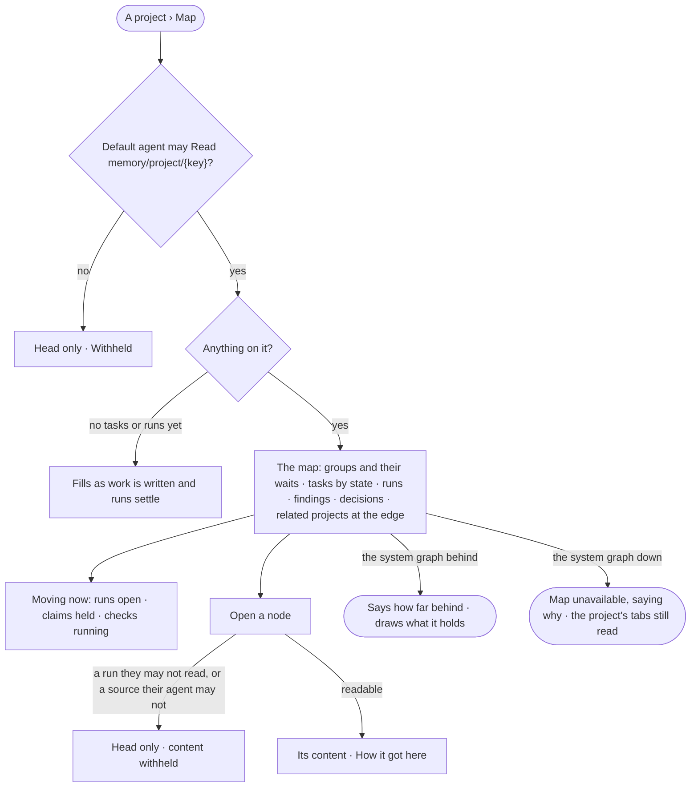

# GP-08 · See a project as a map and what is moving on it

**As** a member of a project **I want** to see the project as a map — its groups, tasks, runs, findings, decisions and
the projects it relates to — with what is moving on it now **so that** I see at a glance where the work stands, what
is running, and what waits on what.

Tasks: [task.md](task.md) · Feature: [GP-F02](../../feature.md)

## Who can

The role × feature table is [AC-F02 › The role table](../../../../../access/features/AC-F02-access-policies/feature.md#the-role-table)
(*projects and tasks*); a node reads as far as the reader's default agent may Read its place and its sources
([GP-F02 › Access](../../feature.md#access)).

| Lens | Can | Otherwise sees |
|---|---|---|
| Admin | Open the map of any project their default agent may Read; open any node on it | A node whose run or sources they may not read: its head only, content withheld |
| Operator | The same; a Modeller the same | A project their default agent may not Read: its head only — *Withheld — your agent may not read `memory/project/{key}`*. A node they may not read: its head only |

## Flow

## Acceptance criteria

| # | Given | When | Then |
|---|---|---|---|
| GP-08.1 | A project with no tasks and no runs | its Map opens | it reads that it fills as work is written and runs settle, with *New task* |
| GP-08.2 | A project with work | its Map opens | it draws the project, its groups and the waits between them, its tasks coloured by state, the runs that worked them, the findings and decisions it holds, and its related projects at the edge, each with its relation |
| GP-08.3 | Work going on | the Map is open | *Moving now* lists the runs open, the claims held and the checks running, each opening its node, and the map marks them; it is re-read while the map is open |
| GP-08.4 | A node | the person opens it | its kind, state, labels and links read, and *How it got here* opens its run for those who may read it |
| GP-08.5 | A run node the reader may not read, or a node whose sources their default agent may not Read | it is drawn | its head reads — kind, state, when — and its content is withheld, naming the resource |
| GP-08.6 | A project the reader's default agent may not Read | they open its Map | it reads the project's head only — *Withheld — your agent may not read `memory/project/{key}`* |
| GP-08.7 | A related project | it is drawn at the edge | it shows its head and the relation; opening it opens that project's Map, read as far as the reader's default agent may |
| GP-08.8 | The system graph behind | the Map loads | it says how far behind and draws what it holds |
| GP-08.9 | The system graph down | the Map loads | it reads unavailable, saying why, and the project's other tabs still read |
| GP-08.10 | A map of more than 3,000 nodes | it loads | it draws the most recent and says it is a sample, with a window to narrow it |
| GP-08.11 | Counts on the map — tasks by state, a group's done of total | they are drawn | each is the engine's; Studio adds nothing up |

## Screens

| Surface | Lens | First use | Empty after a filter | Loading | Has data | Failed | Agent working or proposing | No access |
|---|---|---|---|---|---|---|---|---|
| A project's map | Admin | graph.memory.project_map · Fills as work runs | graph.memory.project_map · Nothing in this window | graph.memory.project_map · Loading | graph.memory.project_map | graph.memory.project_map · Unavailable | graph.memory.project_map · Moving now | — |
| A project's map | Operator | graph.memory.project_map · Fills as work runs | graph.memory.project_map · Nothing in this window | graph.memory.project_map · Loading | graph.memory.project_map | graph.memory.project_map · Unavailable | graph.memory.project_map · Moving now | graph.memory.project_map · Withheld |
| A node on the map | Admin | — | — | graph.memory.project_map · Node loading | graph.memory.project_map · Node | graph.memory.project_map · Node could not load | graph.memory.project_map · Node running | graph.memory.project_map · Node withheld |
| A node on the map | Operator | — | — | graph.memory.project_map · Node loading | graph.memory.project_map · Node | graph.memory.project_map · Node could not load | graph.memory.project_map · Node running | graph.memory.project_map · Node withheld |
| Behind | Admin | — | — | — | graph.memory.project_map · Behind | — | — | — |
| Behind | Operator | — | — | — | graph.memory.project_map · Behind | — | — | — |
