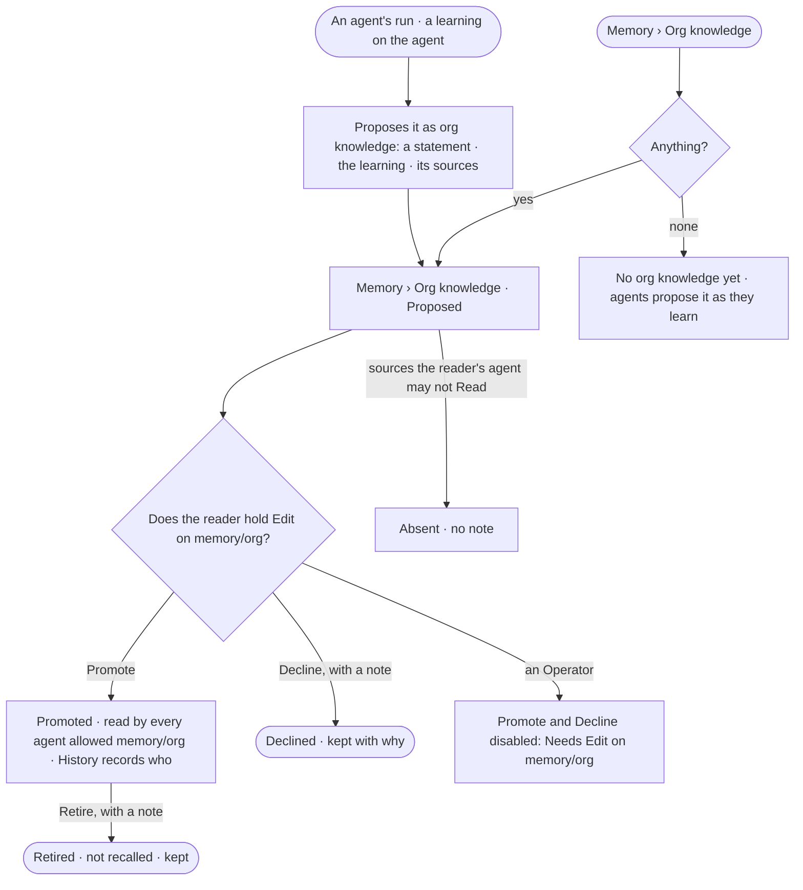
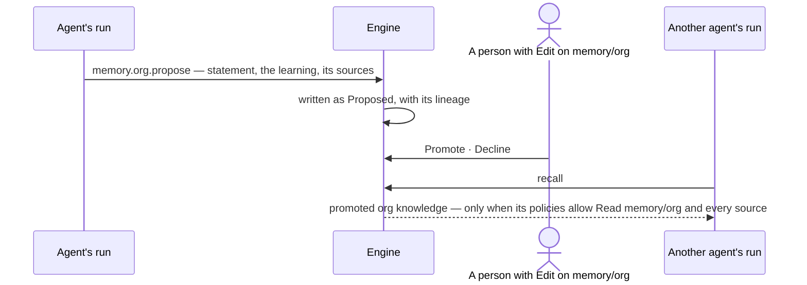

# GP-09 · Promote a learning to org knowledge

**As** an agent builder **I want** to read what agents propose as knowledge for the whole deployment — each with the
learning and sources it came from — and promote, decline or later retire it **so that** what one agent learned helps
every agent allowed to read it, and only a person decides what the organisation knows. *The agent proposes → the
person decides.*

Tasks: [task.md](task.md) · Feature: [GP-F02](../../feature.md)

## Who can

The role × feature table is [AC-F02 › The permission catalogue](../../../../../access/features/AC-F02-access-policies/feature.md#the-permission-catalogue);
promoting, declining and retiring org knowledge needs Edit on `memory/org` ([GP-F02 › Access](../../feature.md#access)).

| Access | Can | Otherwise sees |
|---|---|---|
| Admin | Read every proposal and every piece of org knowledge their default agent may Read; promote, decline and retire | A proposal whose sources their default agent may not Read is absent |
| Operator | Read proposals and org knowledge as far as their default agent may Read `memory/org` and the sources; with Edit on `memory/org` they may promote, decline and retire, as an Admin | *Promote*, *Decline* and *Retire* disabled — *Needs Edit on memory/org — ask {who can grant}* |

## Flow

## Acceptance criteria

| # | Given | When | Then |
|---|---|---|---|
| GP-09.1 | No org knowledge and no proposal | Memory › Org knowledge opens | it reads *No org knowledge yet* and says agents propose it as they learn |
| GP-09.2 | An agent's run with a learning on its agent | it proposes it as org knowledge | it is listed as *Proposed* — the statement, the agent, the run, the learning it came from and who gave that learning — with its sources recorded; nothing is promoted |
| GP-09.3 | A proposal | a person with Edit on `memory/org` presses *Promote* | it reads *Promoted*, by whom and when, History records it, and from the next run every agent whose Access Policies allow Read on `memory/org` and on its sources may recall it ([AG-F09](../../../../../../capabilities/agents/features/AG-F09-learn-from-memory/feature.md)) |
| GP-09.4 | A proposal | a person with Edit on `memory/org` declines it with a note | it reads *Declined*, by whom and why, and is never recalled |
| GP-09.5 | Promoted org knowledge | a person with Edit on `memory/org` retires it with a note | it reads *Retired*, is not recalled by any run that starts after, and stays listed with who retired it and why |
| GP-09.6 | An Operator | they open a proposal | it reads; *Promote*, *Decline* and *Retire* are disabled — *Needs Edit on memory/org — ask {who can grant}*; a call is refused the same way |
| GP-09.7 | A proposal or org knowledge whose sources the reader's default agent may not Read | it is listed | it is absent from the list, with no count and no note |
| GP-09.8 | A proposal | a person who may read its run opens *How it got here* | it shows the run's steps and the learning behind it; anyone else reads that it ran, its status and its tokens |
| GP-09.9 | An agent | it tries to promote, decline or retire | it cannot: only a person decides org knowledge; no function offers an agent the act |
| GP-09.10 | A team | anything is proposed | there is no team memory: org knowledge is the deployment's, and agent learnings stay on their agent |

## Screens

| Surface | Access | First use | Empty after a filter | Loading | Has data | Failed | Agent working or proposing | No access |
|---|---|---|---|---|---|---|---|---|
| Org knowledge | Admin | graph.memory · Org knowledge · None yet | graph.memory · Org knowledge · Nothing matches | graph.memory · Org knowledge · Loading | graph.memory · Org knowledge | graph.memory · Org knowledge · Could not load | graph.memory · Org knowledge · Proposed | — |
| Org knowledge | Operator | graph.memory · Org knowledge · None yet | graph.memory · Org knowledge · Nothing matches | graph.memory · Org knowledge · Loading | graph.memory · Org knowledge | graph.memory · Org knowledge · Could not load | graph.memory · Org knowledge · Proposed | graph.memory · Org knowledge · Needs permission |
| A proposal | Admin | — | — | graph.memory · Org knowledge · Proposal loading | graph.memory · Org knowledge · Proposal | graph.memory · Org knowledge · Could not promote | graph.memory · Org knowledge · Proposal | — |
| A proposal | Operator | — | — | graph.memory · Org knowledge · Proposal loading | graph.memory · Org knowledge · Proposal | graph.memory · Org knowledge · Could not promote | graph.memory · Org knowledge · Proposal | graph.memory · Org knowledge · Needs permission |
| Retired | Admin | — | — | — | graph.memory · Org knowledge · Retired | — | — | — |
| Retired | Operator | — | — | — | graph.memory · Org knowledge · Retired | — | — | — |
