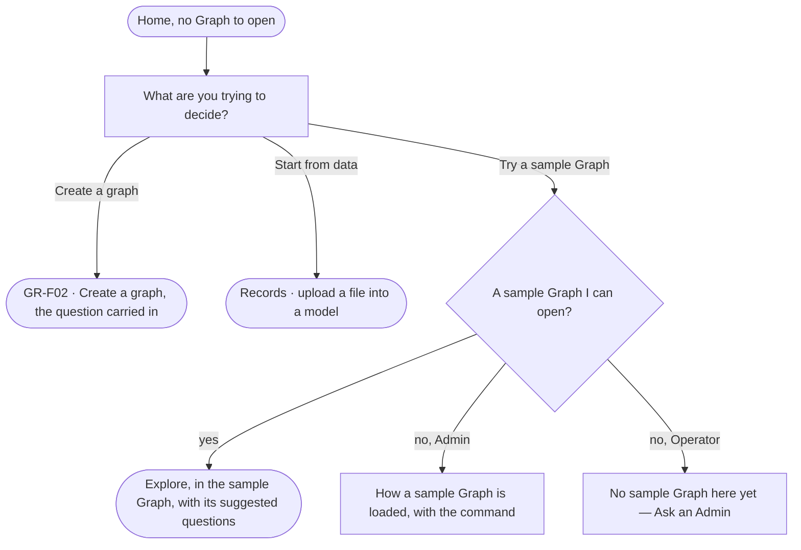

# GR-02 · Start an empty install from a question

**As** the first person on a new install **I want** to be asked what I am trying to decide and offered three ways in
**so that** an empty install is a start, not a wall.

Tasks: [task.md](task.md) · Feature: [GR-F01](../../feature.md)

## Who can

| Lens | Can | Otherwise sees |
|---|---|---|
| Admin | Create a graph · Start from data · Try a sample Graph, or read how a sample Graph is loaded when there is none | — |
| Operator | Create a graph (they become its Owner) · Start from data as RC-F02 allows · Try a sample Graph they are a member of | No sample Graph to open: *No sample Graph here yet — Ask an Admin* |

## Flow

## Acceptance criteria

| # | Given | When | Then |
|---|---|---|---|
| GR-02.1 | A person with no Graph to open, and none archived | Home opens | it asks *What are you trying to decide?* and offers *Create a graph* · *Start from data* · *Try a sample Graph*, in that order |
| GR-02.2 | The question answered | the person picks *Create a graph* | Create a graph opens with the answer as the Graph's question (GR-05) |
| GR-02.3 | First run | the person picks *Start from data* | Records opens on upload (RC-08) |
| GR-02.4 | A sample Graph the person can open | they pick *Try a sample Graph* | it opens in Explore with its suggested questions |
| GR-02.5 | No sample Graph on the install | an Admin picks *Try a sample Graph* | it says how a sample Graph is loaded, with the command to copy |
| GR-02.6 | No sample Graph on the install | an Operator picks *Try a sample Graph* | it reads *No sample Graph here yet — Ask an Admin* |
| GR-02.7 | First run | the person reads it | nothing it offers is experimental, and it promises nothing the install does not have |

## Screens

| Surface | Lens | First use | Empty after a filter | Loading | Has data | Failed | Agent working or proposing | No access |
|---|---|---|---|---|---|---|---|---|
| Home | Admin | graphs.home · First run | — | graphs.home · Loading | — | graphs.home · Could not load | — | — |
| Home | Operator | graphs.home · First run | — | graphs.home · Loading | — | graphs.home · Could not load | — | graphs.home · First run · No sample Graph |
