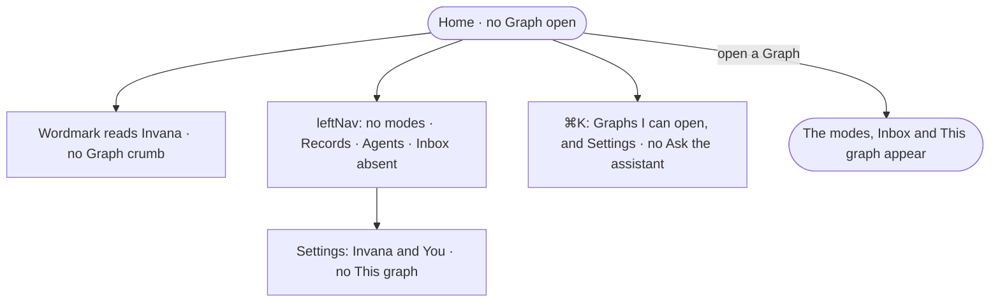

# GR-03 · See only what works with no Graph open

**As** an analyst **I want** the frame to show only what works with no Graph open **so that** I never reach for
something I cannot use yet.

Tasks: [task.md](task.md) · Feature: [GR-F01](../../feature.md)

## Who can

| Lens | Can | Otherwise sees |
|---|---|---|
| Admin | Off a Graph: Records · Agents · Settings › Invana · You · ⌘K over Graphs | — |
| Operator | Off a Graph: Settings › You · ⌘K over the Graphs they can open | Settings › Invana is absent; Agents reads as AG-F02 says |

## Flow

## Acceptance criteria

| # | Given | When | Then |
|---|---|---|---|
| GR-03.1 | No Graph open | the header draws | the wordmark reads *Invana* and there is no Graph crumb |
| GR-03.2 | No Graph open | the leftNav draws | Explore, Model and Projects are absent, as is Inbox; Records, Agents and Settings stay |
| GR-03.3 | No Graph open | Settings opens | it holds *Invana* and *You*; *This graph* is absent |
| GR-03.4 | An Operator, no Graph open | Settings opens | it holds *You* only |
| GR-03.5 | No Graph open | ⌘K opens | it lists the Graphs the person can open and Settings; *Ask the assistant* is absent |
| GR-03.6 | A Graph opened | the frame draws again | the modes, Inbox and *This graph* appear |

## Screens

| Surface | Lens | First use | Empty after a filter | Loading | Has data | Failed | Agent working or proposing | No access |
|---|---|---|---|---|---|---|---|---|
| The frame off a Graph | Admin | graphs.home · First run | — | graphs.home · Loading | graphs.home | graphs.home · Could not load | — | — |
| The frame off a Graph | Operator | graphs.home · First run | — | graphs.home · Loading | graphs.home | graphs.home · Could not load | — | graphs.home |
