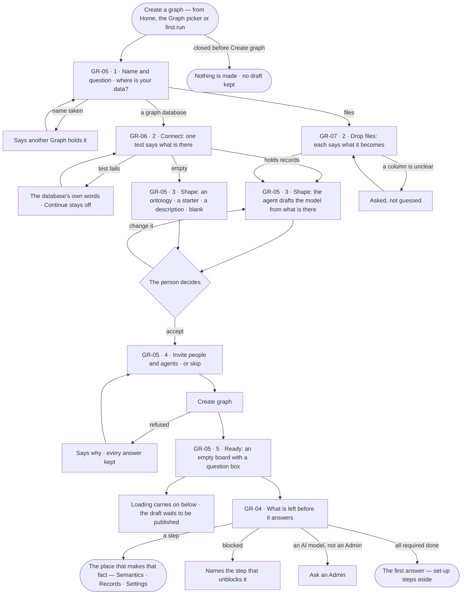
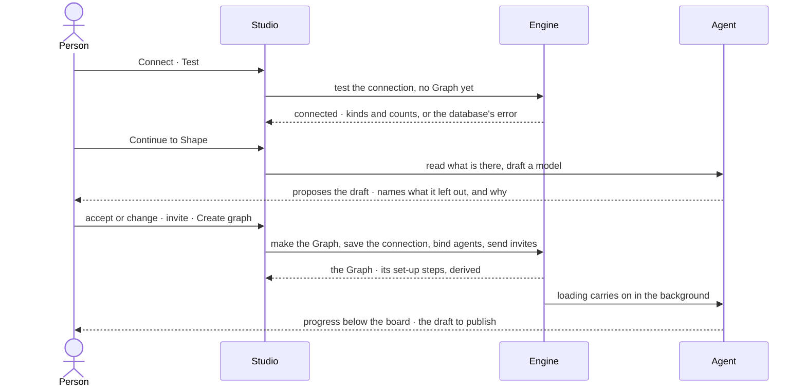

# Create a graph

> A new Graph made in one modal of steps — a name and the question it helps decide, its data (a graph database, or
> files), the model the agent reads from that data, the people and agents who work in it — then the steps still
> standing between it and a first answer. The decision it helps make: *is this the model my data describes, and who
> works on it?*

## User journey

Journeys this feature is a step of: [J01 · From an empty install to a first answer](../../../../journeys/J01-from-an-empty-install-to-a-first-answer.md) · [J05 · Join a Graph someone set up](../../../../journeys/J05-join-a-graph-someone-set-up.md)

## Stories

| ID | Story | Status |
|---|---|---|
| GR-05 | [Create a graph in one modal of steps](stories/GR-05-create-a-graph-in-one-modal-of-steps/story.md) | idea |
| GR-06 | [Start from a graph database that already holds data](stories/GR-06-start-from-a-graph-database-that-already-holds-data/story.md) | idea |
| GR-07 | [Start from files with an empty database](stories/GR-07-start-from-files-with-an-empty-database/story.md) | later |
| GR-04 | [See what is left before the Graph answers](stories/GR-04-see-what-is-left-before-the-graph-answers/story.md) | idea |

## Access

| Act | Role (`.claude/team/TEAM.md` §7) | Everyone else sees |
|---|---|---|
| Create a graph — every step | Anyone signed in; they become the new Graph's Owner | — |
| Test a connection before the Graph exists | Anyone signed in, inside Create a graph | — |
| Invite people into the new Graph | The creator, as its Owner | — |
| Invite agents into the new Graph | The creator, as AG-35 allows | As AG-35 |
| Read the set-up steps | Operator — every member | — |
| Do a set-up step | The role that owns the fact: the connection *Owner* (GR-15) · the model *Can shape the model* (SE-F01) · data *Can shape the model* (RC-F02) · AI models Admin (RT-F01) | The step reads; its act is shown as *Ask Priya (owner)*, naming who holds that role, or *Ask an Admin* |
| Skip or bring back an optional step | `owner` · shown as *Owner* | The step reads; *Skip* shown as *Ask Priya (owner)* |

## States

| State | What the person sees |
|---|---|
| First use | Step 1 with the question carried in from first run, if any |
| Empty after a filter | — no step filters |
| Loading | A test says it is testing; Shape says the agent is reading the database; Ready shows the board at once with loading carrying on below |
| Has data | Each step filled in, the step strip marking what is done; the set-up steps with each done one checked |
| Failed | A test failed in the database's own words; a name another Graph holds; *Create graph* refused with the reason — every answer kept |
| Agent working or proposing | The agent reading the data and drafting the model; the draft shown for a decision before anything is loaded |
| No access | Inside Create a graph, none — the creator is the Owner. A set-up step whose fact needs another role reads with *Ask Priya (owner)* or *Ask an Admin* |

## Rules

| Rule | Detail |
|---|---|
| One modal, five steps | Name and question · Data · Shape · Invite · Ready, on a step strip; never a page, never a modal on a modal |
| Nothing is made until *Create graph* | Closing before it keeps no Graph and no draft; a failed test or a refused create keeps every answer |
| The question is the Graph's | *What will this Graph help you decide?* is saved as its instructions, which every agent reads before it plans |
| A test gates the database step | *Continue* opens only once the test passes; it reports what the database holds — kinds and counts, or empty |
| Create a graph branches on the data | A database with records defaults to *Draft from what is there*; an empty one offers drafting disabled, saying why, and the other starting points |
| The agent proposes the model | The shape step shows the draft before anything is loaded; nothing is published until the person publishes it in Model |
| A draft names what it left out | Every kind not drafted is listed with why — nothing is dropped silently (SE-04) |
| Files say what they become | Each file names the kind it becomes; a column the agent cannot place is asked, never guessed |
| Agents arrive with the Graph | The core assistants and the query skills for the connector's languages are included; install agents are offered unticked (AG-35) |
| Set-up is derived, never ticked | A step is done because its fact exists — whoever made it, from Studio, the command line or the API |
| Set-up names four required steps | The database connects · a model is published · the Graph holds records · an AI model answers. Progress counts these four and nothing else |
| Records already there count | A database that holds records satisfies the data step on arrival |
| Set-up owns no forms | Each step opens the place that already makes its fact: Settings › This graph, Semantics, Records, Settings › Invana |
| Four gates, each a lock | *Connected* — the last test passed: opens the canvas, the console's queries and reading the database · *Modelled* — a published model: opens loading data and links between models · *Grounded* — the database holds records: data on the canvas and answers that cite a record · *Answering* — the default AI model's last check passed: opens asking, the assistant and every agent run. A surface waits on the one gate it needs, never on the whole sequence |
| Knowing and deciding are independent | An AI model may answer before a database is connected; the order between them is a preference |
| Two ways in, the same load | Records arrive from the browser or from the command line; both are a load (RC-F02), checked the same way, and every dialog shows its command-line twin |
| The command line runs where the person works | Installed on a laptop and signed in with a key from Settings › You; it never needs a shell on the engine's host |
| A blocked step names its blocker | Bringing data in waits on a published model, and says so |
| Every shut surface names the step that opens it | *Ask opens when an AI model answers* — never a blank or a dead act |
| A step can be done from the terminal | The step shows the exact command, filled in for this Graph and model |
| Set-up ends at the first answer | What comes after it — rules, views, schedules, agents — is offered where it is useful (*Schedule this* on an answer), never owed |
| A step's lesson | Every step carries its name · why · what it opens · two or three moves · the command · how to tell it worked; a required step adds the one idea it rests on |
| Set-up is a timeline, not a form | Each step is a row with its marker; the only acts on a row are *Skip* on an optional step, *Undo* on a skipped one, and the arrow that opens the place the step is about |
| One sequence, two renderings | The onboarding wizard is where a step is done and explained — the stepper, the lesson, the command, *What next*; the timeline is where it is remembered. Neither owns a form: both open the place that makes the fact, at the field it asks for |
| A done step is a check | Every other state is a dot; one marker across the wizard's stepper, the timeline and the board |
| Set-up belongs to the Graph | A member joining a ready Graph never sees it; there is no per-person checklist |
| Leans on | Drafting a model (SE-F01) · uploading and loading data (RC-F02) · inviting agents (AG-35) · the connection and the setup timeline in General (GR-15) · AI models (RT-F01) · adding people (AC-09) |

## Data touched

| Record | Read or write |
|---|---|
| The Graph — name, address, question as instructions, owner | Write |
| The Graph's connection — connector, address, database, encrypted credentials, read-only | Write |
| The drafted model (SE-F01) | Write — a draft, never published here |
| Members — invited people and their grants; bound agents and skills | Write |
| Set-up steps — derived from the facts; only a skip is stored | Read · write a skip |
| Loads started from files (RC-F02) | Write |

## Engine

The low-level design: what this feature stores, serves and refuses. Conventions — naming, errors, lists, events — are
[system-design.md](../../../../system-design.md) §§ 6–8; this section only fills them in.

### Records

| Table | Columns | Notes |
|---|---|---|
| — | — | No table of its own: it writes the Graph, its connection and its members ([GR-F04](../GR-F04-this-graph/feature.md#engine)); set-up stores only skips, in `graphs.setup_state` |

### Reads

| Record | Owner |
|---|---|
| The Graph, its connection and members | [GR-F04](../GR-F04-this-graph/feature.md#engine) |
| The connector a test builds, and its server version | [RT-F05](../../../runtime/features/RT-F05-graph-database-connectors/feature.md#engine) |
| The drafted model, and whether a model is published | [SE-F01](../../../../capabilities/semantics/features/SE-F01-start-a-model/feature.md#engine) · [SE-F02](../../../../capabilities/semantics/features/SE-F02-change-and-publish-a-model/feature.md#engine) |
| Loads — the first that succeeded, and loads started from files | [RC-F02](../../../../capabilities/records/features/RC-F02-bring-records-in/feature.md#engine) |
| Agents bound at creation | [AG-F02](../../../../capabilities/agents/features/AG-F02-the-agents-catalogue/feature.md#engine) |
| The AI model a Graph's runs resolve to, and its last check | [RT-F01](../../../runtime/features/RT-F01-ai-models/feature.md#engine) |
| Skills on the Graph | [AG-F04](../../../../capabilities/agents/features/AG-F04-skills/feature.md#engine) |

### Routes

| Route, install-wide | Does | Story |
|---|---|---|
| `POST /api/v1/graphs/connect/test` | Test a connection before a Graph exists — `{connector, uri, auth, database?, read_only?, server_version?}` → `{ok, latency_ms?, server_version?, compatibility_status?, error?, discovered?: {node_labels, edge_labels, indexes, constraints}}`; records nothing | GR-06 |
| `POST /api/v1/graphs` | *Create graph* in one call — `{name, slug, instructions, connection, model, members?, agents?}`: tests the connection, makes the Graph with its creator as Owner, saves the connection, writes the drafted model as a draft, binds the agents and adds the members. `201` `{graph, model_id, discovered}` | GR-05 · GR-06 |

| Route, after `/api/v1/u/{u}/{g}/graphs` | Does | Story |
|---|---|---|
| `POST /setup/{step}` | `{act: skip · reset}` on an optional step | GR-04 |

### Events

| Event | When |
|---|---|
| `graphs.create` | A Graph is made — its connection, members and agents write their own events |
| `graphs.setup.skip` · `graphs.setup.reset` | An optional step is skipped · brought back |

### Refusals

| Status | When | Sentence | Criterion |
|---|---|---|---|
| 409 | An address another Graph of the creator holds | *You already have a graph at {slug}.* | GR-05.3 |
| 422 | The create's connection test fails — `connection_failed`, nothing written | *{the connector's own words}* | GR-05.12 · GR-06.3 |
| 422 | A create with an empty name or question, or a member no account has | *{field}: {why}.* | GR-05.12 |
| 409 | A route whose gate is shut — `graph_setup_incomplete`, with `gate`, `missing_sections` and `graph_id` | *{surface} opens when {step}.* | GR-04.6 |
| 422 | Skipping a required step | *{step} is required — it cannot be skipped.* | API only — Studio offers *Skip* only on an optional step |

### CLI

| Command | Does |
|---|---|
| — | No command of its own — each step shows the command of the place that makes its fact |

### Mechanisms

| Mechanism | How |
|---|---|
| Nothing before *Create graph* | Testing and drafting write nothing; the one create call writes the Graph, connection, draft model, agents and members in one transaction, or nothing |
| The question | `instructions` is the answer to *What will this Graph help you decide?* |
| Set-up is derived | `GET /api/v1/u/{u}/{g}` composes the steps from the facts on every read — create, list, detail, update; a stored `done` is never read back |
| `graph_info` — required | Done when the connection's last test passed · gate `connected` |
| `model` — required | Done when a model other than the database's mirror has a published version · gate `modelled` |
| `records` — required | Done when a load succeeded, or the database's mirror has node types · gate `grounded` · `blocked_by` `model` |
| `providers` — required | Done when the AI model the Graph's runs resolve to passed its last check · gate `answering` |
| `instructions` · `skills` — optional | Done when `instructions` is not blank · when the Graph has a skill; never counted in progress |
| A step's payload | `{done, completed_at?, skipped_at?, required, gate?, blocked_by?, broken?}` — `completed_at` when the fact came into being (the connection row, the first published version, the first succeeded load); `broken` a done step whose fact stopped being true, carrying what was stored about the failure |
| What is stored | `setup_state` holds `skipped_at` per optional step and the instructions' written stamp — the one completion time no other record keeps |
| Gates are dependencies | `require_graph_connected` — Explore, the console, the schema route · `require_graph_modelled` — loads, links between models · `require_graph_grounded` — the canvas's data, answers that cite a record · `require_graph_answering` — asking, the assistant, every agent run. A shut gate answers `graph_setup_incomplete` |
| A step is done by its act | The event of the act that made its fact — a connection tested, a model published, a load succeeded, an AI model checked; set-up writes only skip and reset |

## System impact

| HLD section | Change | NFRs |
|---|---|---|
| § 8 APIs and events | Two install-wide routes — test before a Graph exists, and the one create — and the set-up step route | — |
| § 11 Failure modes | A shut gate names the step that opens it; a done step whose fact broke reads `broken`, never an invented reason | — |

## Decisions

| Decision | Detail |
|---|---|
| Create a graph is a modal of steps | It shows a person's own data back to them and asks for a decision at each step; a page would have nothing behind it to return to |
| The model is shaped in step 3 | The agent reads the data and proposes the model before anything is loaded |
| The creator is the Owner | The Graph's address is `/u/<creator>/<graph>` |
| Set-up lives in General | After Ready, the set-up steps lead *Settings › This graph › General* while required steps are unfinished (GR-15), and Home shows the Graph's progress with *Continue set-up* |
| One idea per required step | Each required step says the one idea it rests on, where it is about to be used: a Graph is a question, not a database · the model is the shared vocabulary · answers are grounded, or refused · your key, your provider |
| Four groups, one sentence | Steps are grouped by what a Graph is: it runs on a graph database · it knows a curated context · it decides by reasoning · it acts within what it may do |
| Reasoning is shared and inert; action is owned and runs | The AI model, the instructions, the skills and the plans are the Graph's — one copy, authored once, usable by any agent, and none acts on its own. The agent, its envelope and budget, and what sets it off are each agent's own |
| The connection is substrate, not knowledge | *Connect a graph database* asks which engine runs underneath; the curated context is the same whichever is chosen, so the database is a group of its own, not the first step of the model |
| An action step is done when it has run | A schedule is done when it has fired, not when it is saved |

## Open questions

| Question | Who answers |
|---|---|
| Does creating a Graph also give the creator *Can manage people* there, so the invite step adds people as AC-09 does? Recommend: yes — the creator is the only person who can staff a new Graph | Ravi |
| *An AI model answers* is a required step, but AI models are an Admin's (RT-F01). Recommend: keep it required; a creator who is not an Admin reads *Ask an Admin*, and an install with a working default model satisfies it for every Graph | Ravi |
| The set-up steps after Ready have no board of their own; the spec names them on `graphs.new_graph.ready`, `graphs.home` and `settings.people`. Recommend: the designer draws `graphs.setup` as a peek from Ready and Home | Ravi |

## Not building

| Item | Why not |
|---|---|
| A page for creating a Graph | Steps stay in one modal |
| A Graph with a name and no data | A Graph with nothing to read answers nothing |
| A tour, coach marks or a primer | Each step says the one idea it rests on, where it is used |
| A "set-up complete" screen | The first answer is the celebration |
| Progress that counts optional steps | An optional step that drags the number down turns an offer into a debt |
| A dismiss-forever flag | Set-up steps aside once the required steps are done |
| Writing sample data into a person's database | Sample data lives in a sample Graph |
| A separate onboarding product or address | Set-up is the Graph's, shown where its facts are made |
| A *watch it* or *monitor it* step | There is no such feature; set-up never invents a destination, and a schedule is the one act offered after the first answer |
| Set-up as a page or a modal of its own | Set-up is what the Graph shows while required steps are unfinished — leading General and Home's *Continue set-up* — and the wizard reopens over the work; a second place to close and reopen would have nowhere to come back from |
| A set-up command of its own | Each step already has its command; a wrapper would be a second sequence to keep true |
