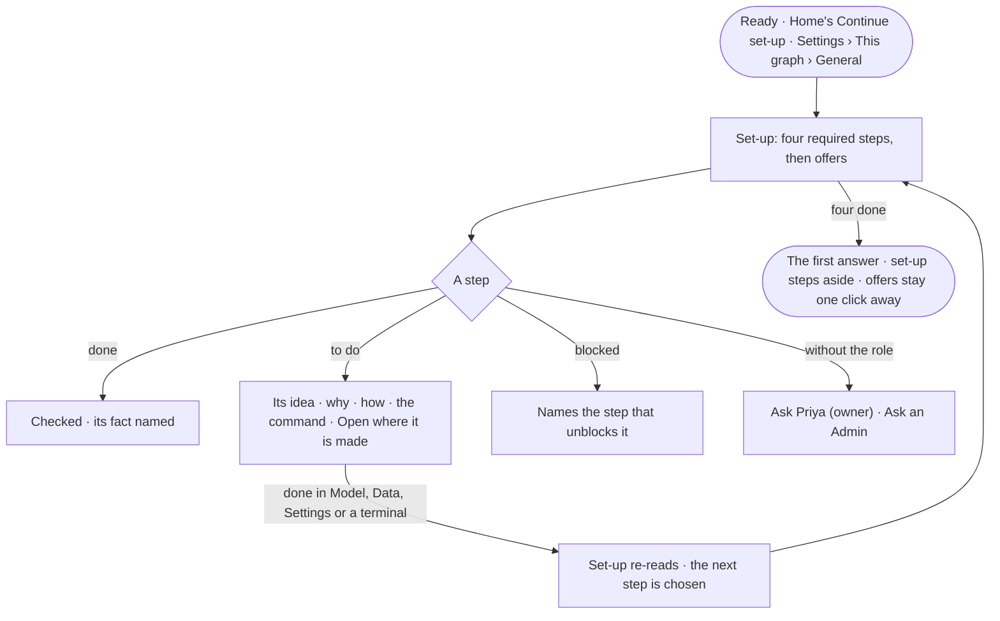

# GR-04 · See what is left before the Graph answers

**As** a Graph owner with a new Graph **I want** to see what still stands between it and a first answer, and why each
step matters **so that** I can do it, or hand it to a teammate or a terminal, without guessing.

Tasks: [task.md](task.md) · Feature: [GR-F02](../../feature.md)

## Who can

| Lens | Can | Otherwise sees |
|---|---|---|
| Admin | Read every step; open each one where its fact is made; skip or bring back an optional step | — |
| Operator | Read every step, its idea and its command | Each step's act shown as *Ask Priya (owner)*, naming who holds the role it needs; the AI model step *Ask an Admin*. With the grant a step needs: that step as Admin |

## Flow

## Acceptance criteria

| # | Given | When | Then |
|---|---|---|---|
| GR-04.1 | A Graph with required steps outstanding | set-up opens | it lists the four required steps — the database connects · a model is published · the Graph holds records · an AI model answers — with progress as *2 of 4* |
| GR-04.2 | A step whose fact exists | set-up reads | it is checked, whoever made the fact and from wherever — Studio, the command line or another member |
| GR-04.3 | A step to do | the person selects it | it shows its idea, why it matters, what it opens, two or three moves, the command filled in for this Graph, and how to tell it worked |
| GR-04.4 | A step to do | the person opens it | the place that makes its fact opens — Settings › This graph, Model, Data or Settings › Invana; set-up has no form of its own |
| GR-04.5 | Bringing data in with no published model | set-up reads | the data step is blocked and names *Publish a model* |
| GR-04.6 | A surface a step shuts | the person opens it | it says which step opens it — *Ask opens when an AI model answers* — with the act that does it |
| GR-04.7 | Optional offers | set-up reads | they are listed after the required steps with no status, and never counted in progress |
| GR-04.8 | An Owner | they skip an optional step, or bring one back | it is skipped or shown again for every member |
| GR-04.9 | The four required steps done | set-up reads | it steps aside; it stays one click away from Settings › This graph › General |
| GR-04.10 | A Graph mid set-up | Home draws its card | it shows its progress and *Continue set-up* |
| GR-04.11 | A member joining a ready Graph | they open it | they never see set-up |
| GR-04.12 | An Operator without the role a step needs | they reach its act | it reads *Ask Priya (owner)*, naming who holds that role, or *Ask an Admin* for the AI model |
| GR-04.13 | The AI model failing its check | set-up reads | the step reads not done, and Explore and the console keep working — the page says so |

## Screens

| Surface | Lens | First use | Empty after a filter | Loading | Has data | Failed | Agent working or proposing | No access |
|---|---|---|---|---|---|---|---|---|
| Set-up on Ready | Admin | start.new_graph.ready | — | start.new_graph.ready · Loading below | start.new_graph.ready · Set-up | — | start.new_graph.ready · Drafting below | — |
| Set-up on Ready | Operator | — | — | — | — | — | — | — |
| Set-up in General | Admin | settings.people · General · Setup unfinished | — | settings.people · Loading | settings.people · General · Setup unfinished | settings.people · Could not load | — | — |
| Set-up in General | Operator | settings.people · General · Setup unfinished | — | settings.people · Loading | settings.people · General · Setup unfinished | settings.people · Could not load | — | settings.people · General · Read only |
| A Graph mid set-up on Home | Admin | — | — | start.home · Loading | start.home · Continue set-up | start.home · Could not load | — | — |
| A Graph mid set-up on Home | Operator | — | — | start.home · Loading | start.home · Continue set-up | start.home · Could not load | — | start.home · Continue set-up |
