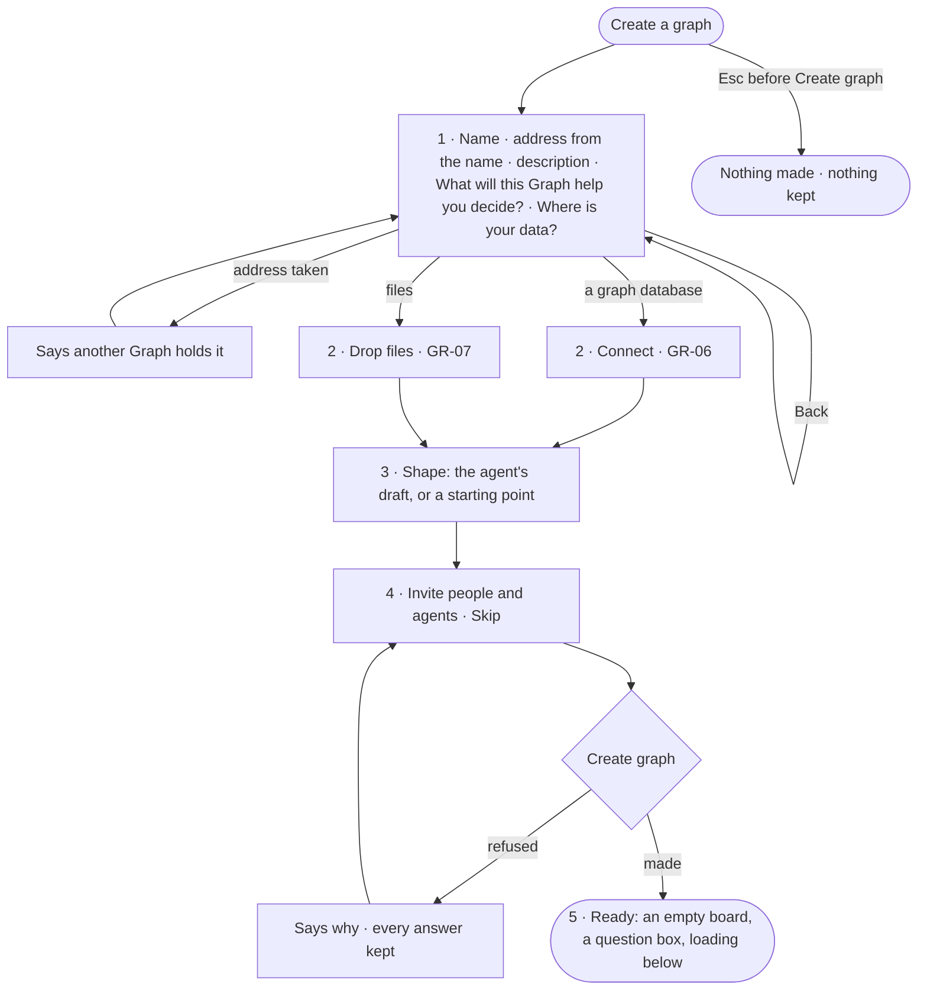

# GR-05 · Create a graph in one modal of steps

**As** a Graph owner **I want** to create a Graph by saying what it is for, where its data is, what its model is and
who works in it — one step at a time, with the agent drafting what it can **so that** a new Graph has a name and a
purpose, not a hostname, and is ready to ask.

Tasks: [task.md](task.md) · Feature: [GR-F02](../../feature.md)

## Who can

| Lens | Can | Otherwise sees |
|---|---|---|
| Admin | Every step; *Create graph* makes them the Graph's Owner | — |
| Operator | Every step, as an Admin — anyone signed in creates a Graph and becomes its Owner | — |

## Flow

## Acceptance criteria

| # | Given | When | Then |
|---|---|---|---|
| GR-05.1 | Create a graph opens | it draws | one modal with a step strip — Name · Data · Shape · Invite · Ready — on step 1 |
| GR-05.2 | Step 1 | the person types a name | the address fills from it and stays editable |
| GR-05.3 | An address another Graph of theirs holds | they continue | it says another Graph holds it and stays on step 1 |
| GR-05.4 | Step 1 | the person answers *What will this Graph help you decide?* | the answer becomes the Graph's question, read by every agent before it plans |
| GR-05.5 | First run's question answered | Create a graph opens from it | step 1 carries that answer |
| GR-05.6 | Step 1 | the person picks where the data is | step 2 is *Connect* for a graph database or *Drop files* for files |
| GR-05.7 | Step 3 | the person decides | they accept the agent's draft, change it, or pick an ontology, a starter, a description or blank |
| GR-05.8 | Step 4 | the person invites people | each is invited by email with a grant read as a sentence (*Can shape the model*) |
| GR-05.9 | Step 4 | the agents list draws | the core assistants and the query skills for the connector's languages read *Included*; install agents are offered unticked, each with its skills (AG-35) |
| GR-05.10 | Step 4 | the person skips it | Create graph is offered with no one invited |
| GR-05.11 | Any step before *Create graph* | the person closes the modal | no Graph, connection, draft or invitation is made |
| GR-05.12 | *Create graph* | the engine refuses | it says why and keeps every answer |
| GR-05.13 | *Create graph* | it succeeds | the Graph is made with its connection saved, its draft model, its agents bound and its invitations sent; the creator is its Owner |
| GR-05.14 | Ready | it opens | an empty board with a question box; loading and drafting carry on below it, and the work stays usable |
| GR-05.15 | Ready | the person opens *How it got here* on the draft | it shows the agent's run that drafted it, what it read and what it left out |

## Screens

| Surface | Lens | First use | Empty after a filter | Loading | Has data | Failed | Agent working or proposing | No access |
|---|---|---|---|---|---|---|---|---|
| 1 · Name and question | Admin | start.new_graph | — | — | start.new_graph · Filled | start.new_graph · Address taken | — | — |
| 1 · Name and question | Operator | start.new_graph | — | — | start.new_graph · Filled | start.new_graph · Address taken | — | — |
| 3 · Shape | Admin | start.new_graph.shape · A starting point | — | start.new_graph.shape · Reading | start.new_graph.shape | start.new_graph.shape · Unreachable | start.new_graph.shape · Drafting | — |
| 3 · Shape | Operator | start.new_graph.shape · A starting point | — | start.new_graph.shape · Reading | start.new_graph.shape | start.new_graph.shape · Unreachable | start.new_graph.shape · Drafting | — |
| 4 · Invite | Admin | start.new_graph.invite · No one yet | — | — | start.new_graph.invite | start.new_graph.invite · Could not create | — | — |
| 4 · Invite | Operator | start.new_graph.invite · No one yet | — | — | start.new_graph.invite | start.new_graph.invite · Could not create | — | — |
| 5 · Ready | Admin | start.new_graph.ready | — | start.new_graph.ready · Loading below | start.new_graph.ready | — | start.new_graph.ready · Drafting below | — |
| 5 · Ready | Operator | start.new_graph.ready | — | start.new_graph.ready · Loading below | start.new_graph.ready | — | start.new_graph.ready · Drafting below | — |
