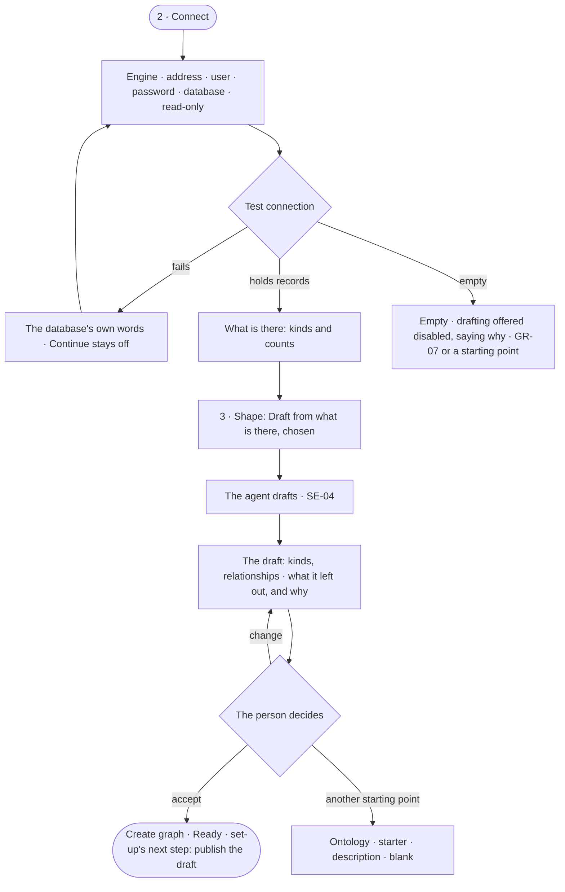

# GR-06 · Start from a graph database that already holds data

**As** a Graph owner who already runs a graph database **I want** to connect it and get a drafted model to review,
then publish and ask **so that** my existing graph answers questions in minutes.

Tasks: [task.md](task.md) · Feature: [GR-F02](../../feature.md)

## Who can

| Lens | Can | Otherwise sees |
|---|---|---|
| Admin | Connect, test, accept or change the agent's draft, create the Graph | — |
| Operator | The same — the creator is the new Graph's Owner | — |

## Flow

## Acceptance criteria

| # | Given | When | Then |
|---|---|---|---|
| GR-06.1 | Step 2 · Connect | it draws | the engines with their query languages, then address, user, password, database name and a read-only switch |
| GR-06.2 | Connection details | the person tests them | it says it is testing; a pass reports what the database holds — kinds and counts — before any Graph exists |
| GR-06.3 | A failed test | it returns | the database's own error shows under the fields and *Continue* stays off |
| GR-06.4 | Details changed after a pass | the person looks for *Continue* | it is off until the test passes again |
| GR-06.5 | A database that holds records | step 3 opens | *Draft from what is there* is chosen, and the agent drafts the model (SE-04) |
| GR-06.6 | An empty database | step 3 opens | *Draft from what is there* is shown disabled — *The database holds nothing yet* — and the other starting points are offered |
| GR-06.7 | The agent's draft | it is shown | it lists the kinds and relationships it drafted and every kind it left out, each with why |
| GR-06.8 | The draft | the person accepts it and creates the Graph | the draft is kept unpublished, and set-up's next step is to review and publish it in Model |
| GR-06.9 | A database that holds records | the Graph is made | set-up counts the data step done on arrival |
| GR-06.10 | The password | it is saved | it is stored encrypted and never read back |

## Screens

| Surface | Lens | First use | Empty after a filter | Loading | Has data | Failed | Agent working or proposing | No access |
|---|---|---|---|---|---|---|---|---|
| 2 · Connect | Admin | graphs.new_graph.connect | — | graphs.new_graph.connect · Testing | graphs.new_graph.connect · Connected | graphs.new_graph.connect · Test failed | — | — |
| 2 · Connect | Operator | graphs.new_graph.connect | — | graphs.new_graph.connect · Testing | graphs.new_graph.connect · Connected | graphs.new_graph.connect · Test failed | — | — |
| 3 · Shape | Admin | graphs.new_graph.shape · Nothing there yet | — | graphs.new_graph.shape · Reading | graphs.new_graph.shape | graphs.new_graph.shape · Unreachable | graphs.new_graph.shape · Drafting | — |
| 3 · Shape | Operator | graphs.new_graph.shape · Nothing there yet | — | graphs.new_graph.shape · Reading | graphs.new_graph.shape | graphs.new_graph.shape · Unreachable | graphs.new_graph.shape · Drafting | — |
| 5 · Ready | Admin | — | — | graphs.new_graph.ready · Loading below | graphs.new_graph.ready · Draft to publish | — | graphs.new_graph.ready · Drafting below | — |
| 5 · Ready | Operator | — | — | graphs.new_graph.ready · Loading below | graphs.new_graph.ready · Draft to publish | — | graphs.new_graph.ready · Drafting below | — |
