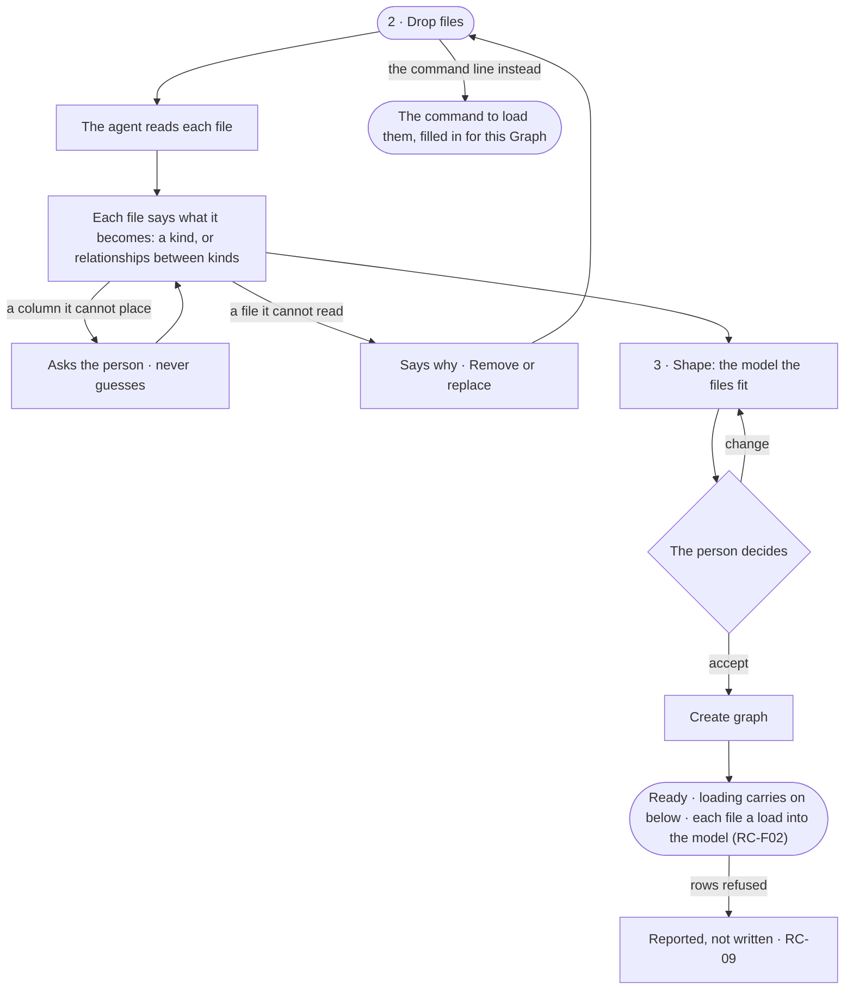

# GR-07 · Start from files with an empty database

**As** a Graph owner with CSV files and an empty database **I want** to drop my files, see what each becomes and get a
model they fit **so that** I get from files to a first answer without an engineer.

Tasks: [task.md](task.md) · Feature: [GR-F02](../../feature.md)

## Who can

| Lens | Can | Otherwise sees |
|---|---|---|
| Admin | Drop files, answer the agent's questions, accept or change the model, create the Graph | — |
| Operator | The same — the creator is the new Graph's Owner | — |

## Flow

## Acceptance criteria

| # | Given | When | Then |
|---|---|---|---|
| GR-07.1 | Step 2 · Drop files | the person drops CSV files | each file shows its name, rows and what it becomes — a kind, or relationships between kinds |
| GR-07.2 | A column the agent cannot place | the file is read | the agent asks what it is, with a recommendation, and does not go on for that file until it is answered |
| GR-07.3 | A file that cannot be read | it is dropped | it says why, with *Remove* and *Replace* |
| GR-07.4 | Step 3 | it opens | the model the files fit is shown before anything is loaded |
| GR-07.5 | The model accepted | the Graph is created | each file is a load into the model — the Records upload (RC-08) — checked against its rules, while Ready shows the board |
| GR-07.6 | Records that do not fit | a load runs | they are rejected record by record, each named, and set-up's data step reads what landed (RC-09) |
| GR-07.7 | Step 2 | the person prefers the command line | it shows the command to load the files, filled in for this Graph and model |
| GR-07.8 | A load | the person opens *How it got here* | it shows each file, the kind it became, and the rows written and refused |

## Screens

| Surface | Lens | First use | Empty after a filter | Loading | Has data | Failed | Agent working or proposing | No access |
|---|---|---|---|---|---|---|---|---|
| 2 · Drop files | Admin | graphs.new_graph.files · No files yet | — | graphs.new_graph.files · Reading | graphs.new_graph.files | graphs.new_graph.files · Cannot read | graphs.new_graph.files · A column asked | — |
| 2 · Drop files | Operator | graphs.new_graph.files · No files yet | — | graphs.new_graph.files · Reading | graphs.new_graph.files | graphs.new_graph.files · Cannot read | graphs.new_graph.files · A column asked | — |
| 3 · Shape | Admin | — | — | graphs.new_graph.shape · Reading | graphs.new_graph.shape · From files | — | graphs.new_graph.shape · Drafting | — |
| 3 · Shape | Operator | — | — | graphs.new_graph.shape · Reading | graphs.new_graph.shape · From files | — | graphs.new_graph.shape · Drafting | — |
| 5 · Ready | Admin | — | — | graphs.new_graph.ready · Loading below | graphs.new_graph.ready | graphs.new_graph.ready · Rows refused | graphs.new_graph.ready · Loading below | — |
| 5 · Ready | Operator | — | — | graphs.new_graph.ready · Loading below | graphs.new_graph.ready | graphs.new_graph.ready · Rows refused | graphs.new_graph.ready · Loading below | — |
