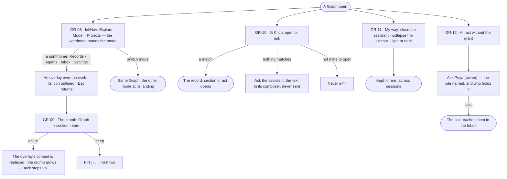

# Find your way — modes, crumbs, ⌘K, no access

> The frame every surface sits in: three modes and what is summoned over them, a crumb that says where you are,
> ⌘K to do, open or ask anything, a frame that works your way, and no dead end when you lack the grant. The decision it
> helps make: *where is the thing I need, and who can act on it if I cannot?*

## User journey

Journeys this feature is a step of: [J05 · Join a Graph someone set up](../../../../journeys/J05-join-a-graph-someone-set-up.md)

## Stories

| ID | Story | Status |
|---|---|---|
| GR-08 | [Switch mode and keep the open Graph](stories/GR-08-switch-mode-and-keep-the-open-graph/story.md) | idea |
| GR-09 | [Know where I am and step back up](stories/GR-09-know-where-i-am-and-step-back-up/story.md) | idea |
| GR-10 | [Do, open or ask anything from ⌘K](stories/GR-10-do-open-or-ask-anything-from-k/story.md) | idea |
| GR-11 | [Make the frame work my way](stories/GR-11-make-the-frame-work-my-way/story.md) | idea |
| GR-12 | [Read without the grant and see who can act](stories/GR-12-read-without-the-grant-and-see-who-can-act/story.md) | idea |

## Access

| Act | Role (`.claude/team/TEAM.md` §7) | Everyone else sees |
|---|---|---|
| Switch mode · open a summoner · follow a crumb | Operator — every member | — |
| Find with ⌘K | Operator — every member; hits are only what they may open | A record they may not open is never a hit |
| Run an act from ⌘K | The role the act needs | The act listed disabled, naming the role |
| Ask the assistant from ⌘K | Operator — every member, on a Graph | Absent off a Graph |
| Close the assistant · collapse the sidebar · pick light or dark | Every signed-in person, for themselves | — |
| Any act a surface offers | The role its feature's Access table names | Disabled, *Ask Priya (owner)* — the role named and who holds it; a surface they may not read at all is absent |

## States

| State | What the person sees |
|---|---|
| First use | ⌘K with nothing typed lists the open mode's sections and acts, and recent records |
| Empty after a filter | ⌘K matches nothing: *Nothing found* and *Ask the assistant* |
| Loading | ⌘K opens at once and fills each group as its list arrives; a mode switch draws the frame at once |
| Has data | ⌘K's hits grouped by where they live; the crumb to the item; the mode lit |
| Failed | A group ⌘K could not read says so in its place; the others still match |
| Agent working or proposing | — the frame shows no agent work of its own; the Inbox's count says what needs the person |
| No access | Every surface reads; each act the person lacks shows *Ask Priya (owner)* with the role named |

## Rules

| Rule | Detail |
|---|---|
| Three modes, summoned overlays | Explore, Model and Projects change main; Records, Agents, Inbox and Settings open over the work and close with Esc |
| The wordmark names the mode | It changes with the mode (`specs/design-language.md` §2); the crumb never repeats it |
| The summoner lights | While an overlay is open, its leftNav icon is outlined |
| Every overlay has an address | It survives a reload and can be shared; an old page address opens its overlay over the last workspace |
| One level of overlay | Never a modal on a modal; a drill-in replaces the overlay's content and its crumb grows |
| Crumb levels | Graph › section › item › drill-in. Tabs are not a level |
| Every crumb but the last links | The last is plain; long names truncate with the full name on hover |
| Deep crumbs fold | More than four segments read first · … · last two; … opens the hidden levels |
| No back links in a page | The crumb is the way up; inside an overlay, Back steps up one level |
| ⌘K reads only what may be opened | Every list it reads is scoped by the engine to the person: their Graphs, and the private projects they are on |
| ⌘K ranks names | Exact, then prefix, then contains; meaning-based matches wait for a vector index and then show as *Related* |
| ⌘K never sends | *Ask the assistant* puts the text in the composer and focuses it; the person still picks the agent and the view before any tokens are spent |
| The Graph's own records are found by asking | An airport or a gene is reached through Explore and the assistant, not ⌘K |
| Preferences are the person's | Theme and the closed assistant follow the person across sessions; the collapsed sidebar is this browser's |
| Light and dark are equals | Every surface, the canvas included, is checked in both; print and export use light |
| Colour carries meaning once | A status reads the same colour everywhere |
| Experimental is shown, not hidden | A mode, summoner or act not yet launched carries an *Experimental* badge; nothing launched depends on one |
| People are named | Rules, schedules and asks name people, never ids; the signed-in person reads *you* |
| Without the grant, the surface stays | The act reads *Ask Priya (owner)* ([design-language.md › States](../../../../design-language.md#5-states)); a surface the person may not read at all is absent from the leftNav, and a direct link to it opens a locked empty state saying what it is and who can open it — never a blank |
| Leans on | Access rules and who holds them (AC-F03) · the person's own settings (AC-F01) · the Inbox for an ask (AC-F05) |

## Data touched

| Record | Read or write |
|---|---|
| The lists each mode and summoner serves — boards, conversations, models and kinds, views, agents, skills, projects and tasks, recent runs, Graphs | Read |
| The person's access on the open Graph and who holds each role | Read |
| The person's theme and assistant preference | Read · write |

## Engine

The low-level design: what this feature stores, serves and refuses. Conventions — naming, errors, lists, events — are
[system-design.md](../../../../system-design.md) §§ 6–8; this section only fills them in.

### Records

| Table | Columns | Notes |
|---|---|---|
| — | — | No table of its own: theme and the closed assistant are the account's `preferences` ([AC-F01](../../../access/features/AC-F01-sign-in-account-and-sessions/feature.md#engine)); the collapsed sidebar is this browser's |

### Reads

| Record | Owner |
|---|---|
| The lists each mode serves — ⌘K matches them in the browser | Each mode's own feature |
| The reader's roles, each area's role and who holds it | [GR-F04 › `GET /members/me`](../GR-F04-this-graph/feature.md#routes) |
| Graphs the reader is on | [GR-F04](../GR-F04-this-graph/feature.md#engine) |
| Private projects the reader is not on | [PJ-F01](../../../../capabilities/projects/features/PJ-F01-projects-and-tasks/feature.md#engine) |
| Models · views of the graph · agents · skills · projects — the names search reads | [SE-F02](../../../../capabilities/semantics/features/SE-F02-change-and-publish-a-model/feature.md#engine) · [SE-F09](../../../../capabilities/semantics/features/SE-F09-views-of-the-graph/feature.md#engine) · [AG-F01](../../../../capabilities/agents/features/AG-F01-build-an-agent/feature.md#engine) · [AG-F04](../../../../capabilities/agents/features/AG-F04-skills/feature.md#engine) · [PJ-F01](../../../../capabilities/projects/features/PJ-F01-projects-and-tasks/feature.md#engine) |
| The account's preferences | [AC-F01](../../../access/features/AC-F01-sign-in-account-and-sessions/feature.md#engine) |

### Routes

| Route, install-wide | Does | Story |
|---|---|---|
| `GET /api/v1/graphs/search?q=&graph=&limit=` | Name search across the reader's Graphs, or one (`graph=<user>/<slug>`): `{query, hits[{kind, id, name, graph?, product?, match}]}` — `kind` `graph` · `model` · `agent` · `skill` · `project` · `world` · `guardrail`; `product` `explore` · `model` · `agents` · `projects`, absent for a Graph; `match` `exact` · `prefix` · `contains`. `limit` 20, at most 50 | GR-10 |

### Events

| Event | When |
|---|---|
| — | No event of its own; finding writes nothing |

### Refusals

| Status | When | Sentence | Criterion |
|---|---|---|---|
| 404 | `graph=` names a Graph the reader is not on | *Not found.* | GR-10.14 |
| 422 | `q` empty after trimming, or over 200 characters | *Search needs 1 to 200 characters.* | API only — the command line trims and checks before it calls; ⌘K never calls it |
| — | An act the reader's roles do not cover is the area gate's `403` ([GR-F04](../GR-F04-this-graph/feature.md#refusals)) | — | GR-10.8 · GR-12.2 |

### CLI

| Command | Does |
|---|---|
| `invana search "<text>" [--graph <user>/<slug>]` | One line per hit — kind, name, Graph, id — closest first |

### Mechanisms

| Mechanism | How |
|---|---|
| Access before match | Each name query is handed the ids of the Graphs the reader is on; a private project is a hit only for its people; a view nobody named is never a hit |
| Ranking | Exact, then prefix, then contains on the name, case-insensitive; ties by name |
| Seams | A Graph the reader left stops matching on the next search; an archived Graph is still searched |
| Not searched | Runs, schedules, findings and branches — a run is found through its Graph's runs, not by name |
| ⌘K | Matches in the browser over the lists each mode already serves, read once per opening; it never calls the search route |
| Who to ask | A disabled act names its role and holders from `GET …/graphs/members/me`; a role nobody holds reads *Ask an Admin* |

## System impact

| HLD section | Change | NFRs |
|---|---|---|
| § 8 APIs and events | One install-wide search route, for the command line | — |
| § 12 Qualities | Privacy: access is applied before a name is matched — a Graph or a private project the reader is not on is never a hit | — |

## Decisions

| Decision | Detail |
|---|---|
| No launcher | The person never picks a product; the leftNav holds the modes and the summoners |
| ⌘K is the one door | *Do, open or ask anything* — acts, records and sections in one palette, with no products to switch between |
| ⌘K matches in the browser | It reads the lists each mode already serves, once per opening, and matches as the person types; a record with no address of its own opens its section |
| The command line searches in the engine | One engine search applies the access first — the person's Graphs, a private project only for its people — then ranks by name, exact then prefix then contains, as ⌘K does |
| Ask is the last ⌘K entry | Whenever something is typed on a Graph; off a Graph there is no assistant |
| The assistant closes, never disappears | Closed, it is reopened from the header; it is always one click away |
| Tools on right-click | A canvas's tools are on its right-click menu, not a toolbar that is always shown |
| Without the grant reads, never hides | An act is disabled with the role it needs and who holds it; a detail surface opens saying *You can read this. Changing it needs …* |

## Open questions

| Question | Who answers |
|---|---|
| Does *Ask Priya (owner)* send an ask to the Inbox, or only name the person? Recommend: it opens an ask in the Inbox naming what the person wanted to do — AC-F03 holds the same question | Ravi |

## Not building

| Item | Why not |
|---|---|
| A product launcher | Three modes and what is summoned replace it |
| ⌘K over the Graph's own records | That is the graph database's, through Explore and the assistant |
| Search history or saved searches | Not asked for |
| A theme editor or per-Graph branding | One product, one look; themes ship with it |
| Switching the assistant off for good | It is always one click away; closing it is enough |
| Per-element saved colours | Colour by kind keeps meaning the same |
