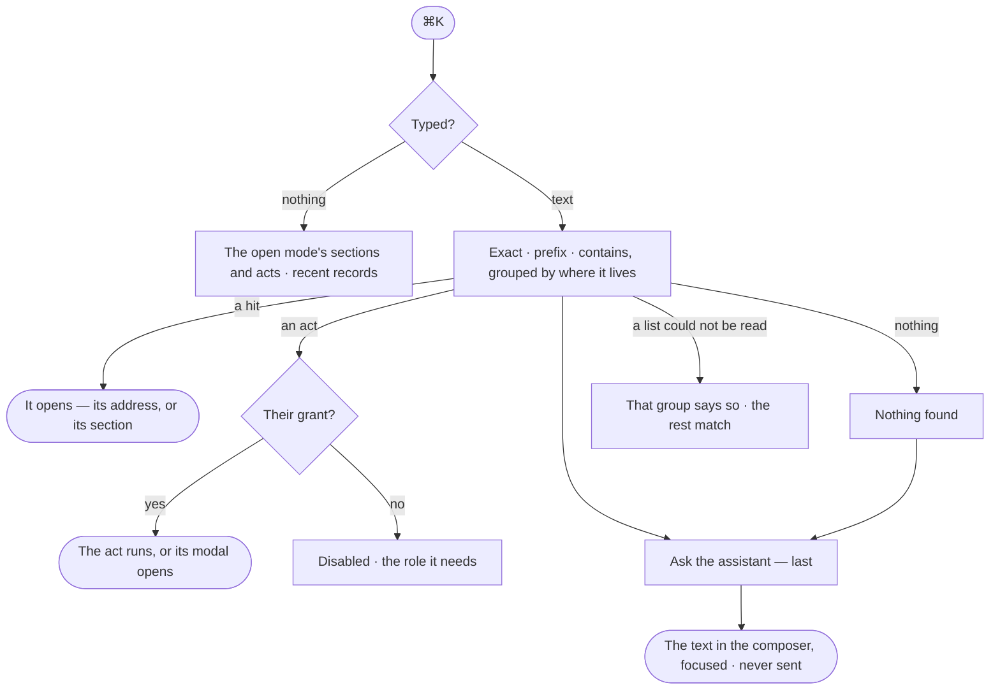

# GR-10 · Do, open or ask anything from ⌘K

**As** an analyst **I want** ⌘K to jump to any board, model, agent, skill, project, task or run, run an act, or ask the
assistant **so that** I reach anything without the nav — and never see what I may not open.

Tasks: [task.md](task.md) · Feature: [GR-F03](../../feature.md)

## Who can

| Lens | Can | Otherwise sees |
|---|---|---|
| Admin | Find every record they may open, run any act, ask the assistant | — |
| Operator | Find every record they may open, run the acts their grants allow, ask the assistant | A record they may not open is never a hit; an act they lack is listed disabled, naming the role |

## Flow

## Acceptance criteria

| # | Given | When | Then |
|---|---|---|---|
| GR-10.1 | A Graph open, nothing typed | ⌘K opens | it lists the open mode's sections and acts, and recent records |
| GR-10.2 | Text typed on a Graph | ⌘K matches | boards and conversations, models and kinds, views, agents, skills, projects and tasks, the last runs and the Graphs the person can open — grouped by where each lives, exact then prefix then contains |
| GR-10.3 | A private project the person is not on | they search its name | it is never a hit |
| GR-10.4 | A Graph the person is not a member of | they search its name | it is never a hit |
| GR-10.5 | A hit with no address of its own | the person picks it | its section opens with it selected |
| GR-10.6 | Conversations and runs with one title | they are listed | each carries its age beside its kind |
| GR-10.7 | An act the person's grants allow | they pick it | it runs, or its modal opens |
| GR-10.8 | An act the person lacks | it is listed | it is disabled, naming the role it needs |
| GR-10.9 | Text typed on a Graph | the list draws | *Ask the assistant* is the last entry; picking it puts the text in the composer and focuses it, never sending |
| GR-10.10 | Nothing matches | the list draws | it says *Nothing found*, with *Ask the assistant* |
| GR-10.11 | A list ⌘K could not read | it matches | that group says it could not be read; the others still match |
| GR-10.12 | Off a Graph | ⌘K opens | it lists the Graphs the person can open and Settings; *Ask the assistant* is absent |
| GR-10.13 | A person at the command line | they run `invana search "<text>"`, across their Graphs or in one `--graph` | each hit reads its kind, name, Graph and id, closest first — Graphs and the records ⌘K finds; a Graph or a private project they are not on is never a hit |
| GR-10.14 | A person at the command line | they search in one `--graph` they are not on | it reads *not found*, as if the Graph did not exist |

## Screens

| Surface | Lens | First use | Empty after a filter | Loading | Has data | Failed | Agent working or proposing | No access |
|---|---|---|---|---|---|---|---|---|
| ⌘K | Admin | graphs.command · Nothing typed | graphs.command · Nothing found | graphs.command · Loading | graphs.command | graphs.command · A group failed | — | — |
| ⌘K | Operator | graphs.command · Nothing typed | graphs.command · Nothing found | graphs.command · Loading | graphs.command | graphs.command · A group failed | — | graphs.command · Act disabled |
