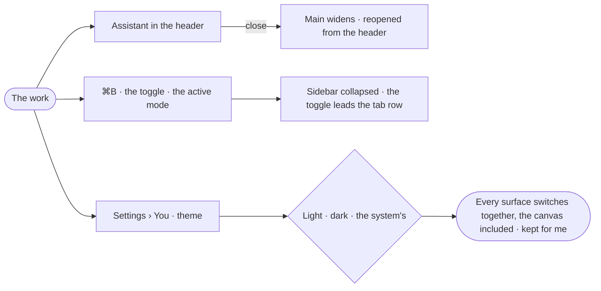

# GR-11 · Make the frame work my way

**As** an analyst who works in Invana all day **I want** to close the assistant, collapse the sidebar and pick light or
dark, and find them as I left them **so that** the product is comfortable, not merely functional.

Tasks: [task.md](task.md) · Feature: [GR-F03](../../feature.md)

## Who can

| Lens | Can | Otherwise sees |
|---|---|---|
| Admin | Close and reopen the assistant, collapse the sidebar, pick light, dark or the system's | — |
| Operator | The same, for themselves | — |

## Flow

## Acceptance criteria

| # | Given | When | Then |
|---|---|---|---|
| GR-11.1 | The assistant open | the person closes it | main widens; the header's Assistant reopens it |
| GR-11.2 | The assistant closed | the person signs in again | it stays closed |
| GR-11.3 | A mode's sidebar | the person presses ⌘B, the toggle, or the active mode | it collapses, and the toggle leads main's tab row |
| GR-11.4 | No choice made | Invana opens | it follows the system's light or dark, applied before the first paint |
| GR-11.5 | A theme picked in Settings › You | the person switches | every surface switches together, the canvas included, with no flash |
| GR-11.6 | A theme picked | the person signs in elsewhere | it follows them |
| GR-11.7 | Dark | a board is printed or exported | it uses light |

## Screens

| Surface | Lens | First use | Empty after a filter | Loading | Has data | Failed | Agent working or proposing | No access |
|---|---|---|---|---|---|---|---|---|
| The frame | Admin | explore.board | — | — | explore.board.left_closed | — | — | — |
| The frame | Operator | explore.board | — | — | explore.board.left_closed | — | — | — |
| Theme in Settings › You | Admin | settings.me | — | settings.me · Loading | settings.me · Theme | settings.me · Could not save | — | — |
| Theme in Settings › You | Operator | settings.me | — | settings.me · Loading | settings.me · Theme | settings.me · Could not save | — | — |
